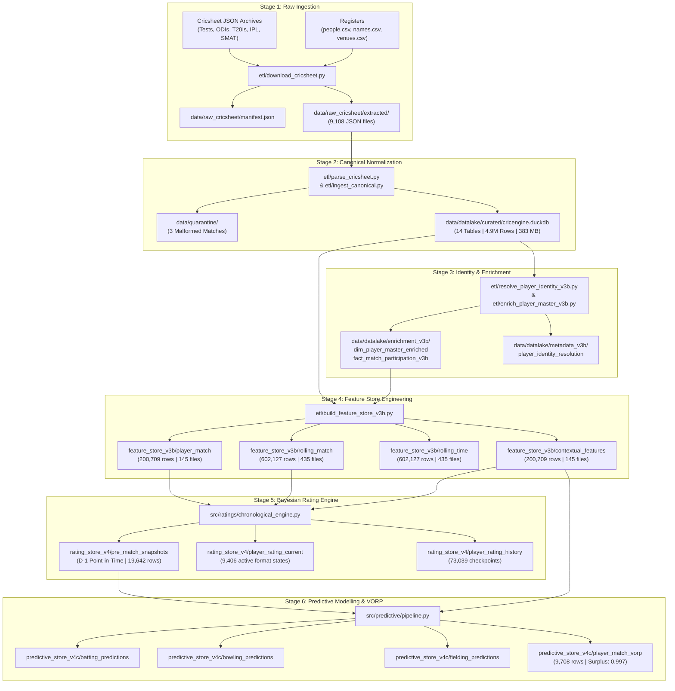

# CricEngine AI — End-to-End Data Lineage

This document traces the complete transformation lifecycle of cricket data through CricEngine AI: from raw Cricsheet JSON archives to normalized relational tables, engineered feature partitions, Bayesian state-space ratings, and probabilistic performance forecasts.

---

## 1. Architectural Data Flow

---

## 2. Transformation Stage Breakdown

### Stage 1: Acquisition & Verification
- **Scripts:** `etl/download_cricsheet.py`, `etl/build_inventory.py`
- **Inputs:** Cricsheet HTTPS endpoints (`/downloads/tests_male_json.zip`, etc.).
- **Operations:**
  - Streaming archive retrieval with SHA-256 integrity validation.
  - Extraction to format subdirectories (`tests_male/`, `odis_male/`, `t20s_male/`, `ipl_male/`, `sma_male/`).
  - Generation of `data/raw_cricsheet/manifest.json`.

### Stage 2: Canonical Database Ingestion
- **Scripts:** `etl/parse_cricsheet.py`, `etl/ingest_canonical.py`
- **Inputs:** 9,108 raw JSON files in `data/raw_cricsheet/extracted/`.
- **Operations:**
  - Schema conformity checks against Cricsheet JSON spec v1.0.0.
  - Three malformed match files (lacking standard delivery structures) quarantined into `data/quarantine/`.
  - Normalization of deeply nested arrays into a Third Normal Form (3NF) relational model.
  - Vectorized bulk-loading into `data/datalake/curated/cricengine.duckdb`.
- **Relational Integrity Guarantees:**
  - Foreign key constraints between `dim_match`, `fact_innings`, `fact_ball_by_ball`, `fact_match_participation`, `fact_delivery_dismissal`, and `fact_dismissal_fielder`.

### Stage 3: Entity Resolution & Roster Enrichment
- **Scripts:** `etl/resolve_player_identity_v3b.py`, `etl/enrich_player_master_v3b.py`, `etl/classify_historical_rosters_v3b.py`
- **Inputs:** `cricengine.duckdb` (`dim_player_master`, `player_source_identity`) and Cricsheet register files (`people.csv`, `names.csv`).
- **Operations:**
  - Resolution of 7,029 source player tokens into 7,014 canonical entities with 99.98% verified accuracy.
  - Enrichment of playing roles (Opener, Middle-Order, Pace Bowler, Spin Bowler, Wicketkeeper, All-Rounder), batting hand, and bowling style.
  - Materialization of `dim_player_master_enriched.parquet` and `fact_match_participation_v3b.parquet`.

### Stage 4: Feature Store Generation
- **Script:** `etl/build_feature_store_v3b.py`
- **Inputs:** `cricengine.duckdb` and `enrichment_v3b`.
- **Operations:**
  - Single-match player statistics aggregation (`player_match`: 49 numeric/categorical features).
  - Multi-scale rolling moving windows ($w \in \{5, 10, 20\}$ matches) with exponential half-life decay ($\lambda = 0.05$) and Empirical Bayes shrinkage towards role priors.
  - Multi-scale rolling calendar-time windows ($w \in \{30, 90, 365\}$ days).
  - Contextual feature calculations: Venue historical park factors ($824$ venues) and opposition bowling/batting strength indices.
  - Storage in Hive-partitioned Snappy Parquet files under `data/datalake/feature_store_v3b/`.

### Stage 5: Context-Aware Bayesian Rating Engine (CA-HBSS)
- **Scripts:** `src/ratings/chronological_engine.py`, `src/ratings/run_rating_pipeline.py`
- **Inputs:** `feature_store_v3b` (`player_match`, `rolling_match`, `contextual_features`).
- **Operations:**
  - Sequential, strictly chronological execution across matches from 2002 to 2026.
  - Point-in-time latent ability estimation ($\theta$, variance $\sigma^2$, rating $r = 1500 + 173.717 \cdot \theta$, deviation $rd = 173.717 \cdot \sigma$).
  - **D-1 Leakage Prevention:** Prior to each match's processing, the player's existing rating state is snapshot into `pre_match_snapshots`.
  - Bayesian update performed only after match deliveries are evaluated.

### Stage 6: Probabilistic Predictive Modelling & VORP
- **Scripts:** `src/predictive/pipeline.py`, `src/predictive/vorp.py`
- **Inputs:** `rating_store_v4/pre_match_snapshots` and `feature_store_v3b/contextual_features`.
- **Operations:**
  - Two-Stage Hurdle / Zero-Inflated Poisson regression models forecasting expected runs, wickets, and fielding run values.
  - Marginal Value Over Replacement Player (VORP) computed against empirical 10th percentile replacement baselines for each format and player archetype.
  - Realized match VORP recorded in `predictive_store_v4c/player_match_vorp`.

---

## 3. End-to-End Concrete Record Lineage

The table below illustrates how a single real-world event—**Ravi Bishnoi bowling to Glenn Maxwell in Match 1389392**—propagates through every architectural layer:

| Stage | Data Artifact | Record Representation / Value |
| :--- | :--- | :--- |
| **1. Raw JSON** | `data/raw_cricsheet/extracted/t20s_male/1389392.json` | Nested JSON delivery object: `over: 5, delivery: 3, batter: 'GJ Maxwell', bowler: 'Ravi Bishnoi', runs: 0, wicket: 'caught'` |
| **2. DuckDB Delivery** | `fact_ball_by_ball` (`ball_id: 1389392_2_5_3`) | `batter_id: b681e71e`, `bowler_id: df064e1a`, `runs_batter: 0`, `is_wicket: TRUE`, `match_phase: 'powerplay'` |
| **3. DuckDB Dismissal**| `fact_delivery_dismissal` & `fact_dismissal_fielder` | `dismissal_kind: 'caught'`, `bowler_credited: TRUE`, `fielder_id: 6c19c6e5` (YBK Jaiswal) |
| **4. Feature Store** | `feature_store_v3b/player_match` | Ravi Bishnoi: `overs_bowled: 4.0`, `runs_conceded: 32`, `wickets_credited: 3`, `economy_rate: 8.0` |
| **5. Rating Store** | `rating_store_v4/pre_match_snapshots` | Ravi Bishnoi D-1 Rating: `pre_r_bowl: 1647.9`, `pre_rd_bowl: 77.6`, `inferred_role: 'R8_PACE_SPECIALIST'` |
| **6. Predictive Store**| `predictive_store_v4c/player_match_vorp` | Ravi Bishnoi Match Impact: `vorp_bowl: +11.31 runs`, `vorp_total: +11.45 runs` (Match MVP) |
