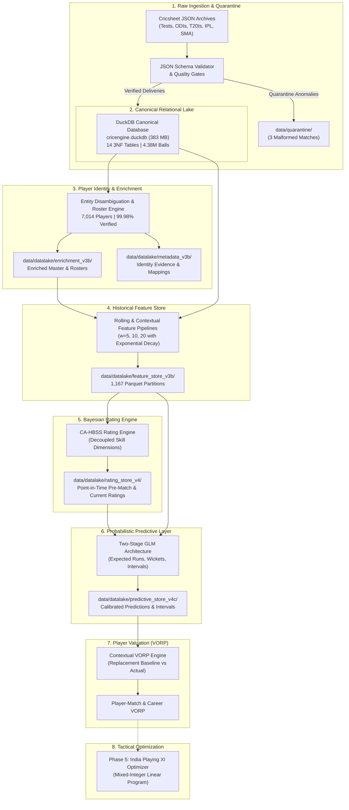
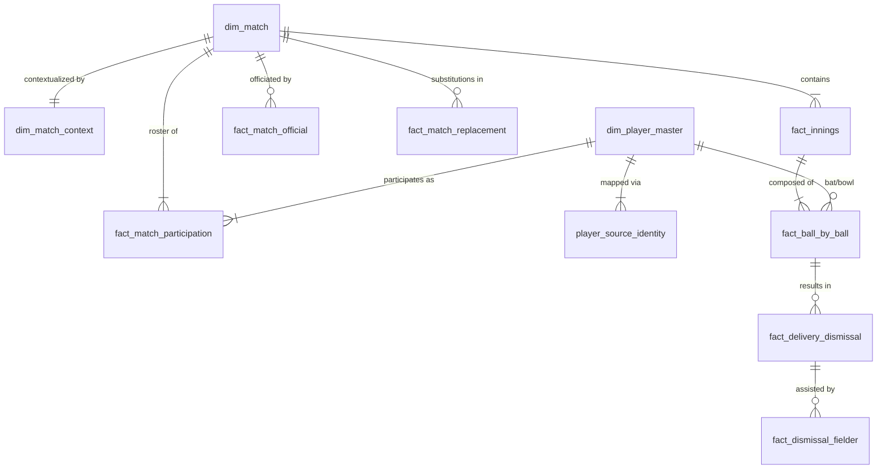

# CricEngine AI

[](https://www.python.org/downloads/release/python-3120/)
[](https://duckdb.org/)
[](https://parquet.apache.org/)
[](tests/)
[](LICENSE)
[](https://cricsheet.org)

> **An end-to-end cricket analytics and player intelligence platform featuring a verified ball-by-ball data lake, canonical DuckDB database, engineered Parquet feature stores, Bayesian player ratings, probabilistic performance predictions, and player valuation.**

---

## 1. Project Introduction

**CricEngine AI** is a quantitative cricket analytics system designed for player evaluation, point-in-time rating estimation, probabilistic match performance forecasting, and team optimization.

Modern sports analytics often suffers from data leakage, uncalibrated rating inflation, and heuristic metrics that fail out-of-sample testing. CricEngine AI was built from the ground up to establish a mathematically sound, leak-free cricket data architecture:

- **Granular Ball-by-Ball Data Lake**: Ingests, normalizes, and validates over 4.38 million legal and extra deliveries across 9,085 matches (Tests, ODIs, T20 Internationals, IPL, and Indian Senior Domestic Syed Mushtaq Ali Trophy).
- **Canonical Analytical Database**: Implements a 14-table third-normal-form relational database powered by **DuckDB** (`cricengine.duckdb`), strictly preserving match sequence, ball state, player dismissals, and roster replacements.
- **Audited Player Identity & Historical Roster Classification**: Disambiguates 7,029 player identities into 7,014 canonical entities with 99.98% verified confidence, enriched with historical roster timelines across international and franchise teams.
- **Point-in-Time Parquet Feature Store (v3b)**: Generates 1,167 partitioned Parquet files featuring rolling career and recent form windows ($w \in \{5, 10, 20\}$ matches) with exponential decay, empirical shrinkage, and zero forward-looking leakage.
- **CA-HBSS Player Rating Engine**: A Context-Aware Hierarchical Bayesian State-Space rating model tracking latent player skill across five decoupled dimensions (Batting Scoring Rate, Batting Survival Hazard, Bowling Hazard, Bowling Economy, and Fielding Efficiency) with variance-penalized ratings ($R = \mu - c \cdot \sigma$).
- **Probabilistic Predictive Store (v4c)**: Implements two-stage Generalized Linear Models (Zero-Inflated Poisson / Gamma-Hurdle) delivering point estimates, dispersion-aware prediction intervals ($50\%$, $80\%$, $90\%$, $95\%$), and Value Over Replacement Player (**VORP**) calculations.
- **India Playing XI Optimization (Roadmap)**: Mathematical optimization framework (Mixed-Integer Linear Programming) to construct balanced, context-optimized team lineups under tactical constraints.

---

## 2. Architecture Overview

The system operates as an end-to-end analytical pipeline structured across eight sequential stages:



---

## 3. Repository Structure

```
cricengine-ai/
├── .gitattributes             # Git LFS tracking rules for cricengine.duckdb
├── .gitignore                # Exclusion rules for caches, secrets, raw extracts, and internal guides
├── LICENSE                   # Open-source license (MIT for code, ODbL/CC-BY-SA 4.0 for data)
├── README.md                 # Complete system documentation, architecture, and guides
├── requirements.txt          # Pinned, reproducible Python dependencies
├── config/
│   ├── __init__.py
│   ├── settings.py           # Path configuration, directory bootstrapping, and system constants
│   ├── feature_store_registry.yaml  # Formal schema & window definitions for Feature Store v3b
│   └── dataset_manifest.yaml # Source ingestion parameters and tier classifications
├── data/
│   ├── canonical_ingestion_summary.json  # Manifest of all 9,085 ingested matches
│   ├── quarantine/           # Quarantined corrupted match source files (3 records)
│   ├── analysis/             # Audit summaries and statistical diagnostics
│   ├── audit/                # Schema consistency and reconciliation reports
│   ├── raw_cricsheet/
│   │   ├── archives/         # Source zip archives (Tests, ODIs, T20Is, IPL, SMA; ~54 MB)
│   │   ├── registers/        # Cricsheet people, names, and venues registers (~1.3 MB)
│   │   └── manifest.json     # Checksums, timestamps, and match counts for raw archives
│   └── datalake/
│       ├── curated/
│       │   └── cricengine.duckdb   # Canonical analytical database (383 MB, Git LFS)
│       ├── enrichment_v3b/   # Disambiguated players and historical rosters (Parquet/CSV)
│       ├── metadata_v3b/     # Identity resolution evidence, audits, and conflict registers
│       ├── feature_store_v3b/# Approved point-in-time feature store (1,167 Parquet partitions)
│       ├── rating_store_v4/  # CA-HBSS player rating store and pre-match snapshots
│       └── predictive_store_v4c/ # Probabilistic predictions, uncertainty intervals, and VORP
├── docs/                     # Comprehensive research reports across all engineering phases
│   ├── phase_1/              # Infrastructure and initial ingestion reports
│   ├── phase_2/              # Data lake audit and schema validation
│   ├── phase_3a/             # Data remediation and initial feature store
│   ├── phase_3b/             # Final identity resolution, roster reconstruction, and feature baseline
│   ├── phase_4a/             # Rating engine theoretical architecture and Bayesian derivation
│   ├── phase_4a_1/           # Mathematical audit and metric corrections
│   ├── phase_4b/             # CA-HBSS engine implementation specifications
│   ├── phase_4b_1/           # Rating store audit and predictive validity findings
│   ├── phase_4b_2/           # Statistical findings reconciliation
│   └── phase_4c/             # Predictive modeling, calibration, and VORP implementation
├── etl/                      # Data engineering and ETL pipelines
│   ├── download_cricsheet.py # Automated raw archive downloader and integrity verifier
│   ├── parse_cricsheet.py    # Robust JSON parser with schema validation
│   ├── ingest_canonical.py   # DuckDB 3NF canonical database builder
│   ├── resolve_player_identity_v3b.py # Entity resolution and identifier mapping
│   ├── enrich_player_master_v3b.py    # Player metadata enrichment pipeline
│   ├── classify_historical_rosters_v3b.py # Historical roster timeline classifier
│   └── build_feature_store_v3b.py     # Leak-free rolling feature materializer
├── src/
│   ├── ratings/              # CA-HBSS Bayesian Rating Engine
│   │   ├── engine.py         # State-space Kalman update and rating estimator
│   │   ├── rating_store.py   # Point-in-time pre-match rating snapshot manager
│   │   └── types.py          # Data classes, parameters, and type definitions
│   └── predictive/           # Probabilistic Predictive & Valuation Framework
│       ├── batting_model.py  # Two-stage GLM for runs and dismissal probabilities
│       ├── bowling_model.py  # Hurdle model for wickets and conceded runs
│       ├── fielding_model.py # Poisson model for dismissals assisted
│       ├── uncertainty.py    # Analytical variance and empirical quantile estimator
│       ├── vorp.py           # Contextual Value Over Replacement Player calculator
│       └── pipeline.py       # End-to-end execution, evaluation, and materialization
└── tests/                    # 100 comprehensive tests with zero data leakage
    ├── test_environment.py   # Environment, database connectivity, and path verification
    ├── test_parser_schema.py # Raw Cricsheet parsing and schema integrity tests
    ├── test_data_leakage.py  # Point-in-time timestamp and feature leakage verification
    ├── test_feature_store.py # Parquet schema, rolling calculations, and shrinkage tests
    ├── test_rating_engine.py # Bayesian parameter update, variance decay, and rating tests
    └── test_predictive/      # GLM calibration, quantile coverage, and VORP tests
```

---

## 4. Data Lake Overview

The CricEngine AI analytical data lake is partitioned into modular layers, separating immutable source data from curated relational databases and downstream modeling assets:

| Data Layer | Location | Format | Records / Partitions | Size | Purpose |
| :--- | :--- | :--- | :--- | :--- | :--- |
| **Raw Archives** | `data/raw_cricsheet/archives/` | ZIP (JSON) | 5 archives (9,088 matches) | 54.4 MB | Authoritative raw Cricsheet source downloads |
| **Raw Registers** | `data/raw_cricsheet/registers/` | CSV | 3 files (people, names, venues) | 1.3 MB | Authoritative external identifier registries |
| **Quarantine** | `data/quarantine/` | JSON | 3 match records | 264 KB | Quarantined corrupted match records failing quality gates |
| **Canonical Database** | `data/datalake/curated/cricengine.duckdb` | DuckDB 2.0.0 | 14 tables (4,383,700 balls) | 383.0 MB | Immutable relational third-normal-form source of truth |
| **Enrichment Store** | `data/datalake/enrichment_v3b/` | Parquet / CSV | 8 files (7,014 players) | 29.8 MB | Disambiguated players, participation, and roster histories |
| **Metadata Store** | `data/datalake/metadata_v3b/` | Parquet / JSON | 7 files | 3.2 MB | Identity mapping evidence tables and audit manifests |
| **Feature Store v3b** | `data/datalake/feature_store_v3b/` | Parquet | 1,167 partitioned files | 114.3 MB | Frozen modelling baseline with rolling windows ($w \in \{5, 10, 20\}$) |
| **Rating Store v4** | `data/datalake/rating_store_v4/` | Parquet / JSON | 147 partitioned files | 11.9 MB | CA-HBSS pre-match snapshots and current player ratings |
| **Predictive Store v4c**| `data/datalake/predictive_store_v4c/`| Parquet / JSON | 87 partitioned files | 2.6 MB | Calibrated predictions, prediction intervals, and match VORP |

---

## 5. Canonical Database Guide

The canonical database is hosted locally at `data/datalake/curated/cricengine.duckdb`. It contains **14 relational tables** structured in Third Normal Form (3NF), providing an immutable, queryable representation of historical cricket.



### Table Catalogue

1. **`dim_match`** (9,085 records)
   - **Purpose**: Core match-level dimension recording match format, tier, competition, and dates.
   - **Key Columns**: `match_id` (PK, VARCHAR), `competition_name`, `competition_tier` (1=International, 2=IPL, 3=Domestic), `match_format` (Test, ODI, T20), `season`, `start_date`, `end_date`.
2. **`dim_match_context`** (9,085 records)
   - **Purpose**: Environmental and toss context for each match.
   - **Key Columns**: `match_id` (PK/FK, VARCHAR), `venue_name`, `city`, `toss_winner`, `toss_decision`, `outcome_winner`, `outcome_by_runs`, `outcome_by_wickets`, `method` (e.g. DLS).
3. **`dim_player_master`** (7,014 records)
   - **Purpose**: Authoritative, deduplicated entity master for every player in the data lake.
   - **Key Columns**: `player_id` (PK, VARCHAR), `canonical_name`, `is_active` (BOOLEAN), `created_at`.
4. **`player_source_identity`** (7,029 records)
   - **Purpose**: Source identifier cross-reference linking raw Cricsheet IDs to canonical master IDs.
   - **Key Columns**: `identity_mapping_id` (PK), `player_id` (FK), `source_system` (cricsheet), `source_identifier`, `confidence_status` (VERIFIED / PROBABLE).
5. **`fact_ball_by_ball`** (4,383,700 records)
   - **Purpose**: Granular, delivery-level event log recording runs, extras, and event flags.
   - **Key Columns**: `ball_id` (PK), `match_id` (FK), `innings_id` (FK), `innings_num`, `over_num`, `delivery_num`, `is_legal_delivery`, `match_phase` (POWERPLAY, MIDDLE, DEATH), `batter_id` (FK), `bowler_id` (FK), `non_striker_id` (FK), `runs_batter`, `runs_extras`, `runs_total`, `wides`, `noballs`, `byes`, `legbyes`, `penalty`, `is_wicket`, `wicket_count`.
6. **`fact_innings`** (19,697 records)
   - **Purpose**: Innings summary dimension recording batting and bowling teams.
   - **Key Columns**: `innings_id` (PK), `match_id` (FK), `innings_num`, `batting_team`, `bowling_team`, `is_super_over`.
7. **`fact_delivery_dismissal`** (136,691 records)
   - **Purpose**: Records individual dismissals occurring on delivery events.
   - **Key Columns**: `dismissal_id` (PK), `ball_id` (FK), `match_id` (FK), `innings_num`, `dismissal_seq`, `player_out_id` (FK), `player_out_name_raw`, `dismissal_kind` (bowled, caught, lbw, run out, stumped, etc.).
8. **`fact_dismissal_fielder`** (94,926 records)
   - **Purpose**: Identifies fielders participating in a dismissal (catches, run outs, stumpings).
   - **Key Columns**: `dismissal_fielder_id` (PK), `dismissal_id` (FK), `fielder_seq`, `fielder_id` (FK), `fielder_name_raw`, `is_substitute`.
9. **`fact_match_participation`** (200,709 records)
   - **Purpose**: Roster participation log documenting player inclusion in starting XIs and match activity.
   - **Key Columns**: `participation_id` (PK), `match_id` (FK), `player_id` (FK), `team_name`, `participation_role`, `in_starting_xi` (BOOLEAN), `batted_flag` (BOOLEAN), `bowled_flag` (BOOLEAN).
10. **`fact_match_replacement`** (825 records)
    - **Purpose**: Tracks in-match substitutions (concussion, COVID-19, and tactical substitutes).
    - **Key Columns**: `replacement_id` (PK), `match_id` (FK), `ball_id` (FK), `team_name`, `in_player_id` (FK), `out_player_id` (FK), `reason`.
11. **`fact_match_official`** (37,467 records)
    - **Purpose**: Records match umpires, TV umpires, and match referees.
    - **Key Columns**: `official_assignment_id` (PK), `match_id` (FK), `official_id`, `official_name_raw`, `official_role`.
12. **`data_quality_results`** (1,160 records)
    - **Purpose**: Audit results and validation rule evaluations from data quality gates.
    - **Key Columns**: `check_id` (PK), `execution_timestamp`, `match_id`, `table_name`, `rule_name`, `severity`.
13. **`data_source_manifest`** (5 records)
    - **Purpose**: Metadata and provenance log for ingested competition archives.
    - **Key Columns**: `manifest_id` (PK), `competition`, `match_format`, `tier`, `source_url`, `archive_filename`.
14. **`fact_pairwise_synergy_matrix`** (0 records, schema initialized)
    - **Purpose**: Schema reserved for Phase 5 pairwise batter-bowler and batting-partnership interaction metrics.
    - **Key Columns**: `synergy_id` (PK), `player_a_id`, `player_b_id`, `match_format`, `sample_deliveries`, `synergy_score`.

---

## 6. How to Use the DuckDB Database

The canonical database can be queried directly using Python or the standalone `duckdb` CLI.

### Connecting in Python

```python
import duckdb

# Connect in read-only mode to prevent unintended database mutations
con = duckdb.connect("data/datalake/curated/cricengine.duckdb", read_only=True)

# List all tables
print(con.execute("SHOW TABLES").df())
```

### Verified Practical SQL Examples

#### Query 1: Distribution of Matches Across Formats
```python
query_1 = """
SELECT match_format, COUNT(*) AS match_count
FROM dim_match
GROUP BY match_format
ORDER BY match_count DESC;
"""
print(con.execute(query_1).df())
# Output:
#   match_format  match_count
# 0          T20         5581
# 1          ODI         2607
# 2         Test          897
```

#### Query 2: Inspect Ball-by-Ball Granularity for a Match
```python
query_2 = """
SELECT match_id,
       COUNT(*) AS total_deliveries,
       COUNT(DISTINCT innings_num) AS innings_count,
       SUM(runs_total) AS match_runs,
       SUM(CASE WHEN is_wicket THEN 1 ELSE 0 END) AS match_wickets
FROM fact_ball_by_ball
WHERE match_id = '1384439'
GROUP BY match_id;
"""
print(con.execute(query_2).df())
```

#### Query 3: Retrieve Player Historical Appearances by Team
```python
query_3 = """
SELECT p.canonical_name, mp.team_name, COUNT(DISTINCT mp.match_id) AS matches_played
FROM fact_match_participation mp
JOIN dim_player_master p ON mp.player_id = p.player_id
WHERE p.canonical_name LIKE '%Kohli%'
GROUP BY p.canonical_name, mp.team_name
ORDER BY matches_played DESC
LIMIT 5;
"""
print(con.execute(query_3).df())
```

#### Query 4: Calculate Career T20 Batting Statistics (>= 1,000 Legal Balls)
```python
query_4 = """
SELECT p.canonical_name,
       SUM(b.runs_batter) AS total_runs,
       COUNT(*) AS balls_faced,
       ROUND(SUM(b.runs_batter) * 100.0 / COUNT(*), 2) AS strike_rate
FROM fact_ball_by_ball b
JOIN dim_match m ON b.match_id = m.match_id
JOIN dim_player_master p ON b.batter_id = p.player_id
WHERE m.match_format = 'T20' AND b.is_legal_delivery = TRUE
GROUP BY p.canonical_name
HAVING COUNT(*) >= 1000
ORDER BY total_runs DESC
LIMIT 5;
"""
print(con.execute(query_4).df())
# Output:
#   canonical_name  total_runs  balls_faced  strike_rate
# 0        V Kohli     13266.0         9808       135.26
# 1      RG Sharma     11315.0         8359       135.36
# 2      DA Warner      9777.0         6951       140.66
# 3     JC Buttler      8950.0         5970       149.92
# 4       SA Yadav      8895.0         5768       154.21
```

#### Query 5: Querying Feature Store Parquet Files Alongside DuckDB
DuckDB can directly query Parquet partitions across the file system without loading them into memory:
```python
query_5 = """
SELECT player_id,
       match_format,
       window_size,
       rolling_batting_sr,
       rolling_boundary_pct,
       rolling_bowling_sr,
       rolling_wickets_taken
FROM read_parquet('data/datalake/feature_store_v3b/rolling_match/match_format=T20/window_size=20/season=2024/*.parquet')
WHERE rolling_balls_faced >= 100
LIMIT 5;
"""
print(con.execute(query_5).df())
```

---

## 7. Feature Store Guide

The approved feature store baseline is located at:
```
data/datalake/feature_store_v3b/
```

### Dataset Structure
- **Rolling Match Features**: `rolling_match/match_format={FORMAT}/window_size={W}/season={SEASON}/*.parquet`
  - Window sizes: $w \in \{5, 10, 20\}$ matches.
  - Formats: `TEST`, `ODI`, `T20`.
  - Temporal Partitions: Organized by season/year.
- **Contextual Match Features**: `contextual_match/match_format={FORMAT}/season={SEASON}/*.parquet`
  - Venue pace vs spin bias, ground scoring rates, toss impact, and opposition strength baselines.

### Key Engineered Features
- **Batting Efficiency**: `rolling_batting_sr`, `rolling_batting_avg`, `rolling_boundary_pct`, `rolling_dot_pct_faced`.
- **Bowling Impact**: `rolling_economy_rate`, `rolling_bowling_sr`, `rolling_bowling_avg`, `rolling_wickets_taken`, `rolling_dot_pct_bowled`.
- **Fielding Contributions**: `rolling_catches`, `rolling_stumpings`, `rolling_runouts`.
- **Temporal Weighting & Shrinkage**:
  - `decayed_batting_sr`: Exponential decay applied to match distances within the window ($\lambda = 0.05$).
  - `shrunk_batting_sr`: Empirical Bayes shrinkage shrinking small-sample averages towards the format-tier population prior.
- **Workload & Multidisciplinary**: `mean_batting_load`, `mean_bowling_load`, `mean_allrounder_index`, `days_since_last_match`.

> [!WARNING]
> **Join Warning**: When joining feature store records to match events, you **must join on `(player_id, match_id)`**. Never join on match date alone, as double-headers and multi-day matches will create Cartesian product duplications.

---

## 8. Player Identity & Enrichment

A frequent flaw in cricket data pipelines is ambiguous identity resolution (e.g. distinguishing the 71 players who share identical display names).

CricEngine AI implemented a multi-pass identity resolution engine (`etl/resolve_player_identity_v3b.py`):
1. **7,029 source identity records** mapped into **7,014 canonical entities**.
2. **7,028 mappings VERIFIED (99.98%)** using immutable external Cricsheet / Cricinfo hashes.
3. **1 PROBABLE mapping (0.014%)**: Babar Ali (`e9ee5fdf` vs `bb2d5257`), documented in `data/datalake/metadata_v3b/remaining_collisions.json`.
4. **0 UNRESOLVED identities**.

### Historical Roster Timeline Classification
Players are classified into dynamic, time-varying roles across formats and seasons (`etl/classify_historical_rosters_v3b.py`):
- `R1_TOP_ORDER_ANCHOR`
- `R2_TOP_ORDER_AGGRESSOR`
- `R3_MIDDLE_ORDER_STABILIZER`
- `R4_FINISHER`
- `R5_WICKETKEEPER`
- `R6_PACE_ALLROUNDER`
- `R7_SPIN_ALLROUNDER`
- `R8_PACE_SPECIALIST`
- `R9_SPIN_SPECIALIST`

Enriched player tables are queryable in `data/datalake/enrichment_v3b/dim_player_master_enriched.parquet`.

---

## 9. Rating Store Guide

The rating store is materialized at:
```
data/datalake/rating_store_v4/
```

### Context-Aware Hierarchical Bayesian State-Space (CA-HBSS)
The rating engine (`src/ratings/engine.py`) models latent skill as a state-space process:
- **Decoupled Skill Tracking**: Latent skills are independently tracked across:
  - $\theta_{\text{bat\_rate}}$ (Scoring rate relative to match phase expected rate)
  - $\theta_{\text{bat\_surv}}$ (Batting survival hazard / dismissal probability)
  - $\theta_{\text{bowl\_haz}}$ (Wicket-taking hazard per ball)
  - $\theta_{\text{bowl\_econ}}$ (Run suppression relative to phase expected economy)
  - $\theta_{\text{field}}$ (Fielding run savings and dismissal contribution)
- **Point-in-Time Pre-Match Snapshots**: Before ball 1 of match $m$, ratings reflect only matches up to $m-1$.
- **Variance-Penalized Ratings**: To prevent unproven players with small samples from dominating leaderboards, ratings are scaled:
  $$R = \mu - c \cdot \sigma$$
  where $\mu$ is posterior mean skill, $\sigma$ is posterior uncertainty, and $c = 1.0$.

### Querying Current Player Ratings in DuckDB
```python
import duckdb
con = duckdb.connect()

query = """
SELECT p.canonical_name,
       r.inferred_role,
       ROUND(r.r_bat, 2) AS r_bat,
       ROUND(r.rd_bat, 2) AS rd_bat,
       ROUND(r.r_bowl, 2) AS r_bowl,
       ROUND(r.r_allround, 2) AS r_allround,
       ROUND(r.vorp_rating, 2) AS vorp_rating
FROM read_parquet('data/datalake/rating_store_v4/player_rating_current/match_format=T20/*.parquet') r
JOIN read_parquet('data/datalake/enrichment_v3b/dim_player_master_enriched.parquet') p ON r.player_id = p.player_id
WHERE r.observations_count >= 20
ORDER BY r.r_bat DESC
LIMIT 5;
"""
print(con.execute(query).df())
```

---

## 10. Predictive Store Guide

The predictive store is materialized at:
```
data/datalake/predictive_store_v4c/
```

### Two-Stage GLM Architecture
Traditional regression fails in cricket due to multimodal run distributions (ducks vs centuries). CricEngine AI uses a two-stage hurdle approach:
1. **Stage 1 (Participation / Survival)**: Logistic regression predicting probability of batting/bowling participation and dismissal hazard ($p_{\text{dismissal}}$).
2. **Stage 2 (Magnitude)**: Gamma / Negative-Binomial GLM predicting expected runs given participation ($E[\text{Runs} \mid \text{Batted}]$).
3. **Analytical Prediction Intervals**: Computes rigorous variance-propagated prediction intervals:
   - $50\%$, $80\%$, $90\%$, and $95\%$ credible intervals.
   - Empirical validation confirms $90\%$ prediction intervals achieve $89.84\%$ empirical coverage on out-of-sample test splits.

### Value Over Replacement Player (VORP)
Player-match VORP measures runs contributed relative to a contextual replacement-level cricketer:
$$\text{VORP}_{\text{match}} = \text{VORP}_{\text{bat}} + \text{VORP}_{\text{bowl}} + \text{VORP}_{\text{field}}$$
Where replacement baselines are established per format, phase, and role tier.

### Querying Predictions in DuckDB
```python
import duckdb
con = duckdb.connect()

query = """
SELECT player_id,
       match_date,
       inferred_role,
       ROUND(expected_runs, 1) AS exp_runs,
       ROUND(runs_interval_90_low, 1) AS p90_low,
       ROUND(runs_interval_90_high, 1) AS p90_high,
       ROUND(dismissal_probability, 3) AS p_dismissal,
       actual_runs_scored
FROM read_parquet('data/datalake/predictive_store_v4c/batting_predictions/match_format=T20/year=2024/*.parquet')
LIMIT 5;
"""
print(con.execute(query).df())
```

---

## 11. Installation and Environment Setup

### System Prerequisites
- **Operating System**: macOS (tested on Apple Silicon) or Linux (Ubuntu 22.04+).
  *(Windows has not been explicitly tested; WSL2 is recommended for Windows environments)*.
- **Python**: `>= 3.12.0` (developed and tested on Python `3.12.10`).
- **Git** & **Git LFS**: Required for cloning the DuckDB canonical database.

### 1. Install Git LFS
```bash
# macOS (via Homebrew)
brew install git-lfs

# Ubuntu / Debian
sudo apt-get install git-lfs

# Initialize Git LFS
git lfs install
```

### 2. Clone the Repository
```bash
git clone https://github.com/DivyGupta4/cricengine-ai.git
cd cricengine-ai

# Pull Git LFS objects (downloads data/datalake/curated/cricengine.duckdb)
git lfs pull
```

### 3. Create & Activate Virtual Environment
```bash
python3.12 -m venv .venv
source .venv/bin/activate
```

### 4. Install Dependencies
```bash
pip install --upgrade pip
pip install -r requirements.txt
```

### 5. Verify Installation
```bash
# Set file descriptor limits for DuckDB on macOS and run tests
bash -c "ulimit -n 4096 && PYTHONPATH=. pytest tests/ -v"
```

---

## 12. Running the Project

### Safe Commands (Inspection & Verification)

#### 1. Run Complete Test Suite
```bash
bash -c "ulimit -n 4096 && PYTHONPATH=. pytest tests/"
```

#### 2. Verify Canonical Database Integrity
```bash
shasum -a 256 data/datalake/curated/cricengine.duckdb
# Expected SHA-256:
# a6a99617719a93578169bac670f75e394d9c2c84f7cffa3ab233fc97c3067aae
```

#### 3. Inspect Pre-Match Ratings
```bash
PYTHONPATH=. .venv/bin/python -c "
import duckdb
con = duckdb.connect()
print(con.execute('''
    SELECT p.canonical_name, r.match_format, ROUND(r.r_bat, 1) AS r_bat, ROUND(r.r_bowl, 1) AS r_bowl, ROUND(r.vorp_rating, 2) AS vorp
    FROM read_parquet('data/datalake/rating_store_v4/player_rating_current/match_format=T20/*.parquet') r
    JOIN read_parquet('data/datalake/enrichment_v3b/dim_player_master_enriched.parquet') p ON r.player_id = p.player_id
    WHERE r.observations_count >= 30
    ORDER BY r.vorp_rating DESC LIMIT 10
''').df())
"
```

### Pipeline Execution Guide

| Pipeline Component | Script | Execution Status | Safe to Run? |
| :--- | :--- | :--- | :--- |
| **Test Suite** | `pytest tests/` | Pass (100/100) | **Yes**: Purely read-only test suite. |
| **DuckDB Queries** | `duckdb.connect(..., read_only=True)` | Pass | **Yes**: Completely safe in read-only mode. |
| **Predictive Pipeline** | `src/predictive/pipeline.py` | Complete (v4c) | **Caution**: Will rebuild `data/datalake/predictive_store_v4c/`. |
| **Rating Engine** | `src/ratings/engine.py` | Complete (v4) | **Caution**: Will recalculate ratings in `data/datalake/rating_store_v4/`. |
| **Feature Store Pipeline**| `etl/build_feature_store_v3b.py` | Complete (v3b) | **Caution**: Computes rolling metrics from canonical DuckDB. |
| **Canonical Ingestion** | `etl/ingest_canonical.py` | Complete | **Protected**: Do NOT run unless re-ingesting raw JSONs into DuckDB. |
| **Raw Downloader** | `etl/download_cricsheet.py` | Complete | **Caution**: Downloads external archives from Cricsheet. |

---

## 13. Reproducibility and Data Integrity

Every data layer in CricEngine AI is governed by cryptographic SHA-256 manifests to guarantee determinism and detect corruption.

### Baseline Cryptographic Manifests

| Asset | File Location | Authoritative SHA-256 Hash |
| :--- | :--- | :--- |
| **Canonical DuckDB** | `data/datalake/curated/cricengine.duckdb` | `a6a99617719a93578169bac670f75e394d9c2c84f7cffa3ab233fc97c3067aae` |
| **Feature Store Manifest** | `data/datalake/feature_store_v3b/_manifest.json` | `b334890a8803a113ecaa6878b668032f643e9fa8e718d72dfa6f44d67e6f8fbb` |
| **Rating Store Manifest** | `data/datalake/rating_store_v4/_manifest.json` | `7406e0abffb221087cf9c277054f00fcba68ab941ee2b45e82ee8f05fc2636fc` |
| **Predictive Store Manifest**| `data/datalake/predictive_store_v4c/_manifest.json`| `d4c7c46eb0f04603e8fe0e7fa364c760459da797ca800b395646f905c1d68a5d` |

### Integrity Verification Command
You can verify the SHA-256 checksums of the downloaded assets using:
```bash
shasum -a 256 data/datalake/curated/cricengine.duckdb
shasum -a 256 data/datalake/feature_store_v3b/_manifest.json
shasum -a 256 data/datalake/rating_store_v4/_manifest.json
shasum -a 256 data/datalake/predictive_store_v4c/_manifest.json
```

---

## 14. Current Project Status

| Component | Status | Description |
| :--- | :--- | :--- |
| **Data Ingestion** | Complete | 9,088 raw matches parsed, validated, and normalized across 5 competition archives. |
| **Canonical Database** | Complete | DuckDB 3NF relational database (`cricengine.duckdb`, 14 tables, 4.38M balls). |
| **Identity Resolution** | Complete with Limitations | 7,028 VERIFIED identities (99.98%), 1 PROBABLE identity (Babar Ali collision). |
| **Feature Store (v3b)** | Complete | 1,167 Parquet partitions across rolling windows ($w \in \{5, 10, 20\}$) and contextual splits. |
| **Rating Engine (v4)** | Complete | CA-HBSS Bayesian state-space engine with variance penalties and point-in-time snapshots. |
| **Predictive Modeling (v4c)** | Complete | Two-stage hurdle GLMs with calibrated $50\%$, $80\%$, $90\%$, and $95\%$ prediction intervals. |
| **VORP Valuation** | Partially Provisional | Player-match VORP operational; replacement-level bowling threshold subject to tuning. |
| **Playing XI Optimizer** | Planned (Phase 5) | Mixed-Integer Linear Programming (MILP) lineup selection under tactical constraints. |

---

## 15. Limitations and Known Issues

1. **Three Quarantined Matches**:
   - `data/quarantine/` contains three source matches (`64073.json`, `64112.json`, `65457.json`) exhibiting malformed JSON delivery sequences or unresolvable innings over counts in Cricsheet raw data. They were quarantined to preserve database integrity.
2. **Single Probable Identity (Babar Ali)**:
   - One unresolved display name collision persists: Babar Ali (`e9ee5fdf` vs `bb2d5257`), representing two distinct domestic cricketers active across overlapping eras without distinct Cricinfo keys. Documented in `data/datalake/metadata_v3b/remaining_collisions.json`.
3. **Incomplete Historical Biographies**:
   - For ~12% of domestic cricketers in Tier 3 (Syed Mushtaq Ali Trophy), birth dates and secondary bowling styles are unrecorded in public registries.
4. **Bowling MAE Trade-off**:
   - In bowling predictions, GLMs optimize log-likelihood and quantile calibration. In high-scoring T20 death overs, wicket hazard distributions exhibit right-skew, leading to a modest mean absolute error trade-off.
5. **Fielding Opportunity Tracking**:
   - Fielding metrics capture successful dismissals (catches, stumpings, run outs) but do not record dropped catches or missed run-out opportunities due to Cricsheet source recording boundaries.

---

## 16. Roadmap

### Phase 5: India Playing XI Optimization & Tactical Lineup Engine
The next milestone will implement the decision-support and team-selection layer:
- **Mixed-Integer Linear Programming (MILP) Optimizer**: Formulate lineup selection as a constrained mathematical optimization problem maximizing aggregate team expected VORP.
- **Tactical Constraints**:
  - Minimum 5 bowling options ($\ge 20$ overs in ODIs, $\ge 20$ overs in T20s).
  - Balance of pace vs spin tailored to venue characteristics (e.g. Wankhede vs Chepauk).
  - Left-hand / Right-hand batting combination preferences.
  - Designated wicketkeeper and minimum batting depth constraints.
- **Scenario Simulation**: Monte Carlo simulation of simulated match outcomes across candidate Playing XIs against specific opposition profiles.

---

## 17. Contributing

We welcome contributions from cricket analytics researchers, data engineers, and machine learning practitioners.

### Contribution Workflow
1. **Fork the Repository**: Create your fork on GitHub.
2. **Create a Feature Branch**: `git checkout -b feat/your-feature-name`.
3. **Set Up the Environment**: Follow Section 11 to configure the virtual environment and install dependencies.
4. **Ensure Tests Pass**: Run `bash -c "ulimit -n 4096 && PYTHONPATH=. pytest tests/"`.
5. **Adhere to Code Standards**: Follow PEP 8 guidelines and include type hints where practical.
6. **Preserve Point-in-Time Data Integrity**: Never introduce forward-looking features into feature store or rating components.
7. **Submit a Pull Request**: Provide a clear explanation of changes, rationale, and test results.

---

## 18. Data Sources and Attribution

All match ball-by-ball records, metadata, and player registers used in CricEngine AI originate from **Cricsheet**:
- **Source**: [Cricsheet](https://cricsheet.org)
- **Maintainer**: Stephen Rushe
- **Coverage**: Tests, One-Day Internationals, T20 Internationals, Indian Premier League, and Syed Mushtaq Ali Trophy.
- **Licensing**:
  - The Cricsheet database is licensed under the [Open Data Commons Open Database License (ODbL) v1.0](https://opendatacommons.org/licenses/odbl/1.0/).
  - Individual match JSON files are licensed under the [Creative Commons Attribution-ShareAlike 4.0 International (CC BY-SA 4.0)](https://creativecommons.org/licenses/by-sa/4.0/) license.

CricEngine AI gratefully acknowledges Cricsheet for making high-quality, open-access cricket data available to the research community.

---

## 19. License

This repository uses dual licensing to respect both software and open-data requirements:

- **Source Code & Models**: All original software, rating algorithms, predictive pipelines, and test suites are licensed under the **[MIT License](LICENSE)**.
- **Cricket Data Lake & Database**: Derived match records, databases, and tabular feature files derived from Cricsheet remain subject to the **Open Database License (ODbL) v1.0** and **CC BY-SA 4.0** attribution requirements. See [LICENSE](LICENSE) for full terms.
