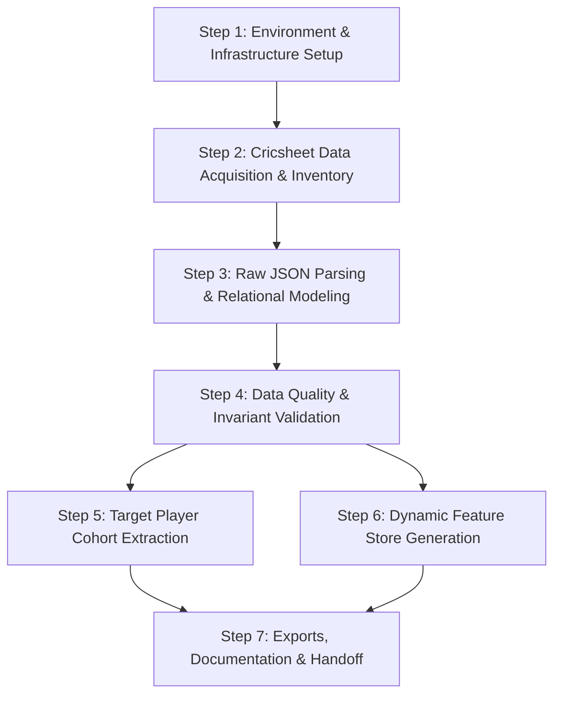

# CricEngine AI — Phase 1 Detailed Execution Plan

## Phase 1 Objective
Transform raw cricket match archives into a clean, reproducible, normalized, and queryable relational dataset (DuckDB + Parquet) alongside a target candidate cohort and dynamic rolling feature store for downstream predictive modeling and lineup optimization.

---

## Plan Overview & Step Dependency Graph



---

## Detailed Step Specifications

### Step 1 — Repository Inspection and Data Infrastructure
- **Objective**: Establish the Python runtime environment, virtual environment, dependency specifications, lightweight directory layout, and local data lake paths.
- **Expected Inputs**: Local development environment (macOS, Python 3.12).
- **Expected Outputs**:
  - Python virtual environment (`.venv`).
  - `requirements.txt` containing pinned versions for `duckdb`, `pyarrow`, `pandas`, `polars`, `requests`, `pytest`, `pydantic`.
  - Directory hierarchy:
    ```
    cricengine_ai/
    ├── data/
    │   ├── raw_cricsheet/        # Raw downloaded archives and extracted JSONs (git-ignored)
    │   └── datalake/             # Local Parquet analytical files (git-ignored)
    │       ├── raw/
    │       ├── curated/
    │       └── feature_store/
    ├── etl/                      # Ingestion, parsing, and transformation modules
    ├── tests/                    # Unit, regression, and data quality tests
    ├── docs/                     # Architecture, schema, and data dictionary
    ├── config/                   # Pipeline configuration and paths
    ├── requirements.txt
    ├── .gitignore
    └── README.md
    ```
  - Initialized Git repository with proper `.gitignore` excluding raw data, Parquet files, virtual environments, and caches.
- **Dependencies**: Host Python 3.12.
- **Validation Criteria**:
  - Virtual environment activates cleanly.
  - All dependencies install without wheel build errors.
  - Smoke test verifies DuckDB can create an in-memory database and write/read a test Parquet file.
- **Blockers & Assumptions**: None. Local disk space is 132 GiB (sufficient).
- **Completion Criteria**: Clean test run verifying environment, dependency imports, and Git hygiene.

---

### Step 2 — Cricsheet Data Acquisition and Source Inventory
- **Objective**: Programmatically download, unpack, and inventory Cricsheet match archives and register files for the target competitions.
- **Expected Inputs**: Official Cricsheet endpoints (`https://cricsheet.org/downloads/`, `https://cricsheet.org/register/`).
- **Expected Outputs**:
  - `data/raw_cricsheet/` containing:
    - `tests_male_json.zip` (International Tests)
    - `odis_male_json.zip` (International ODIs)
    - `t20s_male_json.zip` (International T20Is)
    - `ipl_male_json.zip` (Indian Premier League)
    - `sma_male_json.zip` (Syed Mushtaq Ali Trophy)
    - `people.csv`, `names.csv`, `venues.csv` (Cricsheet Register)
  - `docs/DATA_INVENTORY.md` recording:
    - Competition name, format, season range, archive size, match count, source URL, download timestamp, and known coverage limitations.
  - Download module `etl/download_cricsheet.py` with checksum validation, caching, and retry logic.
- **Dependencies**: Step 1.
- **Validation Criteria**:
  - ZIP archives downloaded with HTTP 200 and uncorrupted extraction.
  - Match counts match Cricsheet's published numbers.
  - Zero synthetic data introduced.
- **Blockers & Assumptions**:
  - *Known Limitation*: Cricsheet does not provide Ranji Trophy or Vijay Hazare Trophy ball-by-ball JSON archives. Domestic coverage is currently bounded to Syed Mushtaq Ali Trophy (SMAT).
- **Completion Criteria**: Complete source inventory written; target archives downloaded and verified.

---

### Step 3 — Raw JSON Parsing and Relational Data Modeling
- **Objective**: Parse Cricsheet JSON structures (v1.x) and transform them into five normalized relational tables in DuckDB and Parquet.
- **Expected Inputs**: Extracted match JSON files and Register CSVs.
- **Expected Outputs**:
  - **`dim_player_master`**: `player_id`, `full_name`, `dob`, `gender`, `nationality`, `is_active`, `primary_role`, `taxonomic_subrole`, `batting_hand`, `bowling_style`.
  - **`fact_match_participation`**: `participation_id`, `player_id`, `match_id`, `match_date`, `competition_tier`, `format`, `team_name`, `is_playing_xi`, `days_since_last_match`.
  - **`fact_ball_by_ball`**: `ball_id`, `match_id`, `innings`, `over_num`, `delivery_num`, `match_phase`, `batter_id`, `bowler_id`, `non_striker_id`, `runs_batter`, `runs_extras`, `runs_total`, `is_wicket`, `dismissal_type`, `dismissed_player_id`, plus explicit NULLs for uncalculated metrics (`shot_control_flag`, `xRA`, `xW`, `wpa_delta`, `dismissed_player_rating`).
  - **`dim_match_context`**: `match_id`, `match_date`, `season`, `match_type`, `venue_name`, `city`, `toss_winner`, `toss_decision`, `match_winner`, `win_outcome_type`, `win_margin`, plus explicit NULLs for `pitch_surface_type`, `expected_turn_deg`, `boundary_length_sq`, `boundary_length_str`.
  - **`fact_pairwise_synergy_matrix`**: Pre-allocated schema (`synergy_id`, `player_a_id`, `player_b_id`, `lr_batting_synergy`, `bowling_pair_synergy`, `running_synergy`) documented for downstream edge construction.
  - Parsing script `etl/parse_cricsheet.py`.
- **Dependencies**: Step 2.
- **Validation Criteria**:
  - Stable composite keys (e.g. `ball_id` = `{match_id}_{innings}_{over}_{delivery}`).
  - Foreign key integrity across deliveries -> matches and deliveries -> players.
  - Idempotent table inserts (rerunning does not duplicate rows).
- **Blockers & Assumptions**:
  - Player metadata attributes not present in Cricsheet raw files (DOB, batting hand, bowling style) are explicitly assigned `NULL` / `Unknown` rather than synthetic guesses.
- **Completion Criteria**: Parsing pipeline processes all downloaded matches into DuckDB tables with 100% referential consistency.

---

### Step 4 — Data Quality and Validation Engine
- **Objective**: Implement comprehensive automated checks ensuring data integrity, delivery sequence preservation, and absence of anomalies.
- **Expected Inputs**: Populated DuckDB database and Parquet datasets.
- **Expected Outputs**:
  - Validation test suite (`tests/test_data_quality.py`).
  - Automated report generator producing `docs/DATA_QUALITY_REPORT.md`.
  - Check categories:
    1. **Uniqueness**: Match IDs, Ball IDs, Participation IDs.
    2. **Referential Integrity**: All batters, bowlers, and fielders resolve to `dim_player_master`.
    3. **Sequence Invariants**: Ball and over indices are strictly monotonically increasing within an innings.
    4. **Score Invariants**: Delivery runs sum matches total innings runs; boundary values are valid (0, 1, 2, 3, 4, 5, 6).
    5. **Dismissal Consistency**: Wicket events correctly identify dismissed player and dismissal type.
    6. **Idempotency**: Reprocessing an identical archive yields identical row counts and checksums.
- **Dependencies**: Step 3.
- **Validation Criteria**: Zero test failures on critical invariants; documented warning logs for known source anomalies.
- **Blockers & Assumptions**: Handled edge cases (e.g., penalty runs, super overs, rain-interrupted revised targets).
- **Completion Criteria**: Automated test suite passes; detailed quality summary generated.

---

### Step 5 — Target Player Cohort Extraction
- **Objective**: Query relational tables to extract the qualifying active Indian male cricketer cohort.
- **Expected Inputs**: `dim_player_master`, `fact_match_participation`, `dim_match_context`.
- **Expected Outputs**:
  - Table and Parquet export: `data/datalake/curated/target_player_cohort.parquet`.
  - Schema: `player_id`, `full_name`, `taxonomic_subrole`, `batting_hand`, `bowling_style`, `total_matches_post_2020`, `tier1_matches_post_2020`, `tier2_matches_post_2020`, `tier3_matches_post_2020`, `last_match_date`, `eligibility_flag`.
  - Cohort extraction script `etl/extract_cohort.py`.
  - Audit report `docs/COHORT_AUDIT.md` detailing:
    - Total players considered.
    - Exclusion breakdown by criteria (gender, nationality/domestic team representation, match count < 5, last match before 2020).
    - Ambiguous or unverified records flagged for manual review.
- **Dependencies**: Step 4.
- **Validation Criteria**:
  - Every player in the cohort has $\ge 5$ qualifying senior appearances on or after 2020-01-01.
  - Zero non-qualifying (under-19, women's, or club) matches counted.
- **Blockers & Assumptions**:
  - Nationality resolution logic: A player is confirmed Indian if they represented India in an international match or represented an Indian domestic state association / IPL team without overseas registration.
- **Completion Criteria**: Filtered candidate cohort exported with reproducible SQL/Python pipeline and verified audit numbers.

---

### Step 6 — Dynamic Feature Store Generation
- **Objective**: Generate rolling contextual form features for cohort players across 5, 10, and 20 match windows without lookahead bias.
- **Expected Inputs**: `fact_ball_by_ball`, `fact_match_participation`, `dim_match_context`, `target_player_cohort`.
- **Expected Outputs**:
  - Table and Parquet export: `data/datalake/feature_store/dim_player_feature_store.parquet`.
  - Feature engineering module `etl/build_features.py`.
  - Feature categories:
    - **Batting (L5, L10, L20 matches)**: Total runs, balls faced, strike rate, batting average (runs / dismissals), boundary percentage (runs in 4s and 6s / total runs), dot-ball percentage faced.
    - **Bowling (L5, L10, L20 matches)**: Overs bowled, runs conceded, wickets taken, economy rate, strike rate (balls / wickets), dot-ball percentage bowled.
    - **Phase-Specific Splits**: Powerplay, Middle, and Death overs performance.
    - **Format Splits**: Separate rolling windows for Tests, ODIs, and T20s.
    - **Recency & Workload**: Days since previous match, cumulative balls in past 30/60 days.
  - Feature Dictionary: `docs/FEATURE_DICTIONARY.md` documenting every metric's mathematical definition, aggregation rules, and handling of not-outs / missing data.
- **Dependencies**: Step 5.
- **Validation Criteria**:
  - **Zero Lookahead Leakage**: Features for match $M_t$ strictly use match history from $M_{<t}$.
  - Monotonicity checks on rolling windows (e.g. balls in L20 $\ge$ balls in L10 $\ge$ balls in L5).
  - Proper handling of divide-by-zero (e.g. infinite average when dismissals = 0).
- **Blockers & Assumptions**:
  - Advanced modeled features (xRA, xW, shot control, WPA) remain null until corresponding ML models are implemented in Phase 2.
- **Completion Criteria**: Complete feature matrix generated and validated across all cohort players.

---

### Step 7 — Outputs, Documentation, and Handoff
- **Objective**: Package Phase 1 deliverables, verify end-to-end pipeline execution from scratch, and deliver full documentation for Phase 2 handoff.
- **Expected Inputs**: All outputs from Steps 1–6.
- **Expected Outputs**:
  - Local DuckDB database file (`cricengine.duckdb`).
  - Parquet analytical exports.
  - Schema documentation (`docs/SCHEMA.md`).
  - Comprehensive runbook (`README.md`).
  - End-to-end integration test validating end-to-end reproducibility.
- **Dependencies**: Steps 1–6.
- **Validation Criteria**:
  - Fresh clone / clean slate pipeline run reproduces all tables and Parquet files deterministically.
- **Completion Criteria**: Full test suite passing; handoff artifacts documented and ready for Stage 2 (Rating Engine) and Stage 3 (Playing XI Optimizer).
