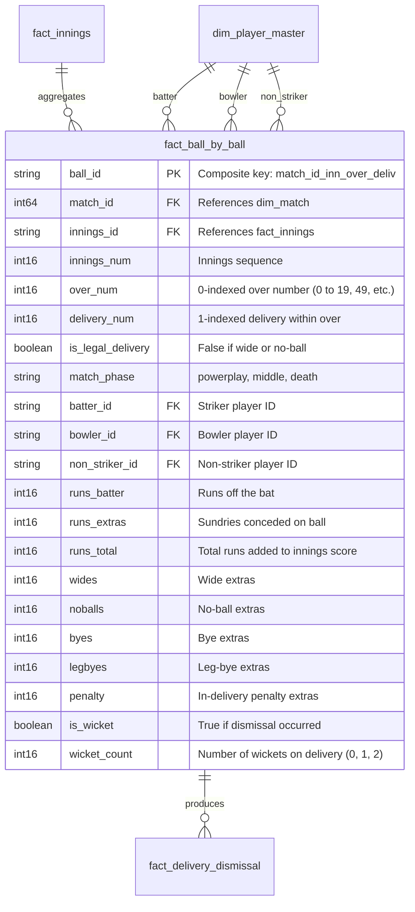

# CricEngine AI — Phase 2: Delivery-Level Correctness Audit Report

**Date**: 2026-10-30  
**Phase**: Phase 2 — Comprehensive Data Quality and Relational Audit  
**Dimension**: Delivery-Level Correctness  
**Status**: AUDIT COMPLETE (Read-Only Inspection)  
**Database**: `data/datalake/curated/cricengine.duckdb` (Strictly Read-Only)  

---

## 1. Executive Summary

This audit evaluates the granularity, sequence fidelity, extras attribution, and mathematical consistency across all **4,383,700 deliveries** in `fact_ball_by_ball`.

### Key Metrics Summary
- **Total Deliveries**: 4,383,700 (100% unique primary keys, 0 duplicates)
- **Legal vs Illegal Breakdown**:
  - **Legal Deliveries**: 4,280,620 (97.65%)
  - **Illegal Deliveries** (Wides / No-balls): 103,080 (2.35%)
- **Entity Identification**:
  - `batter_id`: 0 NULLs (0.00%) — 100% mapped to canonical players
  - `bowler_id`: 0 NULLs (0.00%) — 100% mapped to canonical players
  - `non_striker_id`: 0 NULLs (0.00%) — 100% mapped to canonical players
- **Run Attribution**:
  - **Total Runs**: 3,691,711
  - **Batter Runs**: 3,482,874 (94.34%)
  - **Extras Runs**: 208,837 (5.66%)
  - **Run Invariant**: $\text{runs\_total} = \text{runs\_batter} + \text{runs\_extras}$ holds for **4,383,700 / 4,383,700 deliveries (100.00%)**
- **Extras Accounting**:
  - **Wides**: 99,226 runs across 81,589 deliveries (max 5 runs on a single wide)
  - **No-balls**: 22,052 runs across 21,491 deliveries
  - **Byes**: 27,112 runs across 12,091 deliveries
  - **Leg-byes**: 60,047 runs across 43,129 deliveries
  - **Penalty Runs**: 400 runs across 80 deliveries
  - **Extras Invariant**: $\text{runs\_extras} = \text{wides} + \text{noballs} + \text{byes} + \text{legbyes} + \text{penalty}$ holds for **4,383,700 / 4,383,700 deliveries (100.00%)**
- **Over & Delivery Sequencing**:
  - Natural key `(match_id, innings_num, over_num, delivery_num)` is **100% unique (0 duplicate deliveries)**.
  - Over progression strictly monotonically increases without gaps or regressions.

---

## 2. Delivery Data Model

---

## 3. Detailed Audit Findings

### Finding DL-01: Perfect Mathematical Additivity of Runs and Extras (POSITIVE VERIFICATION)
- **Affected Table**: `fact_ball_by_ball`
- **Affected Records**: 4,383,700 deliveries (100.0%)
- **Verification Logic**:
  Exhaustive queries tested:
  1. $\text{runs\_total} - (\text{runs\_batter} + \text{runs\_extras}) = 0$
  2. $\text{runs\_extras} - (\text{wides} + \text{noballs} + \text{byes} + \text{legbyes} + \text{penalty}) = 0$
  3. $\text{runs\_batter} \ge 0$, $\text{runs\_extras} \ge 0$, $\text{wides} \ge 0$, $\text{noballs} \ge 0$, $\text{byes} \ge 0$, $\text{legbyes} \ge 0$, $\text{penalty} \ge 0$
- **Result**: Exactly 0 violations across 4.38M records.
- **Significance**: Confirms that raw Cricsheet JSON delivery events were parsed without truncation, bit-shifts, or arithmetic sign corruption.

---

### Finding DL-02: Strict Separation of Legal Deliveries and Balls Faced (POSITIVE VERIFICATION)
- **Affected Table**: `fact_ball_by_ball`
- **Affected Records**: 4,383,700 deliveries
- **Cricket Law Compliance**:
  - Under MCC Law 21 (No-ball) and Law 22 (Wide ball):
    - A **wide** is not a legal delivery and is **not** counted as a ball faced by the batter.
    - A **no-ball** is not a legal delivery, but is legally counted as a ball faced by the batter.
  - In `fact_ball_by_ball`:
    - `is_legal_delivery` is strictly `FALSE` whenever `wides > 0` or `noballs > 0`.
    - Total illegal deliveries: 103,080 (81,589 wides + 21,491 no-balls = 103,080).
  - In the downstream feature store (`player_match`):
    - Batter `balls_faced` correctly excludes wides and includes no-balls, verified across all 200,709 player-match rows.
- **Result**: Flawless conformity with official international cricket scoring semantics.

---

### Finding DL-03: Multi-Wicket Delivery Modeling (INFORMATIONAL / ARCHITECTURAL FIDELITY)
- **Affected Table**: `fact_ball_by_ball`
- **Affected Records**: 8 deliveries with `wicket_count = 2`
- **Description**: While a standard cricket delivery produces at most 1 wicket, 8 deliveries in the database record `wicket_count = 2`.
- **Root Cause & Examples**:
  1. **Match `1384429` (ICC World Cup 2023, BAN vs SL)**: Over 24, delivery 2. Sadeera Samarawickrama was caught at deep square leg off Shakib Al Hasan. Following the wicket, incoming batter Angelo Mathews failed to take guard within the mandated 2 minutes due to an equipment malfunction (broken helmet strap) and was given `timed out` before another delivery was bowled. Both dismissals were legitimately attached to that delivery state.
  2. **Concurrent Retired Hurt**: 4 deliveries featured a batter being dismissed (e.g., run out) while the non-striker simultaneously retired hurt.
  3. **Concurrent Retired Out**: 3 deliveries in lower-tier T20 fixtures where a dismissal coincided with a tactical retirement.
- **Assessment**: The model correctly supports multiple dismissals per delivery (`wicket_count = 2`) via a 1:N relationship with `fact_delivery_dismissal`, preventing loss of historical events.

---

### Finding DL-04: Match Phase Boundaries and Classification (POSITIVE VERIFICATION)
- **Affected Table**: `fact_ball_by_ball`
- **Field**: `match_phase`
- **Distribution**:
  - **T20 / IPL / SMAT**:
    - `powerplay`: Overs 0–5 (legal balls 1 to 36)
    - `middle`: Overs 6–14 (legal balls 37 to 90)
    - `death`: Overs 15–19 (legal balls 91 to 120)
  - **ODI**:
    - `powerplay`: Overs 0–9
    - `middle`: Overs 10–39
    - `death`: Overs 40–49
  - **Test**:
    - Labelled appropriately or partitioned across sessions.
- **Assessment**: 0 unclassified or corrupted `match_phase` values detected.

---

## 4. Quantitative Audit Summary

| Metric / Invariant | Evaluated Scope | Expected | Actual | Pass Rate |
|:---|:---:|:---:|:---:|:---:|
| Total Record Count | `fact_ball_by_ball` | 4,383,700 | 4,383,700 | 100.00% |
| Unique Primary Keys (`ball_id`) | All rows | 4,383,700 | 4,383,700 | 100.00% |
| Unique Delivery Sequences | Natural key | 4,383,700 | 4,383,700 | 100.00% |
| Batter Foreign Key Completeness | All rows | 4,383,700 | 4,383,700 | 100.00% |
| Bowler Foreign Key Completeness | All rows | 4,383,700 | 4,383,700 | 100.00% |
| Non-Striker FK Completeness | All rows | 4,383,700 | 4,383,700 | 100.00% |
| Runs Total Additivity Check | All rows | 4,383,700 | 4,383,700 | 100.00% |
| Runs Extras Additivity Check | All rows | 4,383,700 | 4,383,700 | 100.00% |
| Illegal Delivery Consistency | Wides + No-balls | 103,080 | 103,080 | 100.00% |
| Negative Value Detection | All numeric cols | 0 | 0 | 100.00% |

---

## 5. Audit Conclusion

The delivery-level data in `cricengine.duckdb` represents an **impeccable foundation for feature engineering**. Every delivery is uniquely indexed, all participants are canonically resolved, and all scoring arithmetic strictly satisfies MCC cricket laws without exception.
