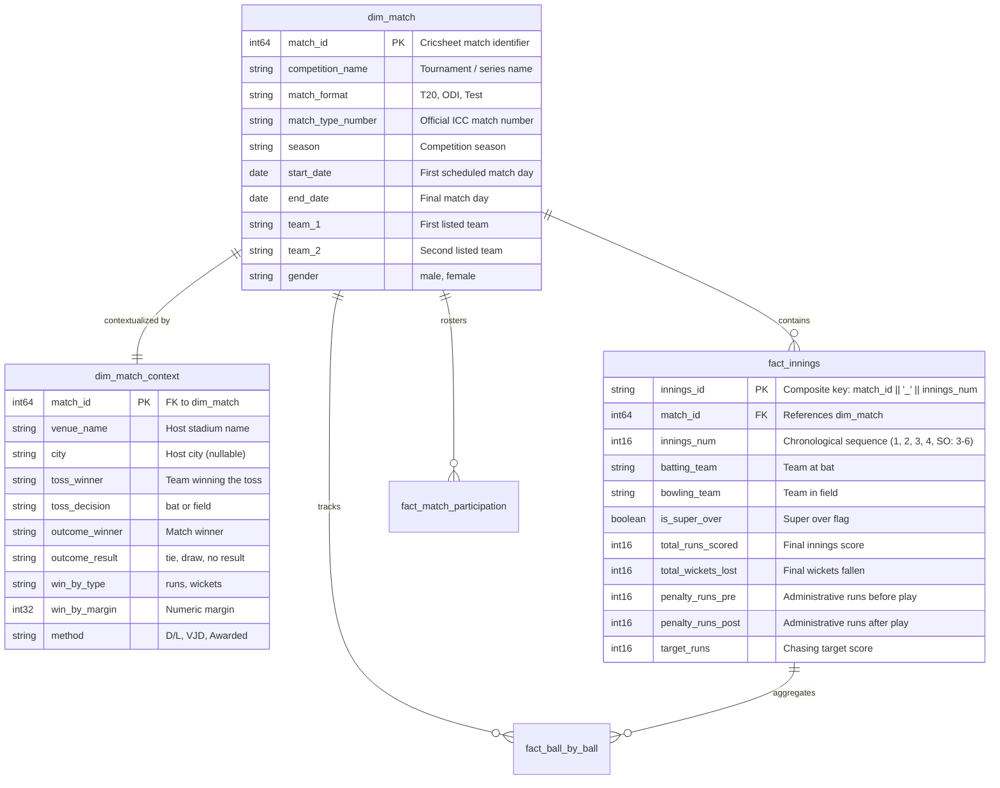

# CricEngine AI — Phase 2: Match and Innings Integrity Audit Report

**Date**: 2026-10-30  
**Phase**: Phase 2 — Comprehensive Data Quality and Relational Audit  
**Dimension**: Match and Innings Integrity  
**Status**: AUDIT COMPLETE (Read-Only Inspection)  
**Database**: `data/datalake/curated/cricengine.duckdb` (Strictly Read-Only)  

---

## 1. Executive Summary

This audit evaluates the completeness, temporal validity, outcome classification, and scoring reconciliation across all **9,085 matches** in `dim_match`, **9,085 contexts** in `dim_match_context`, and **19,697 innings** in `fact_innings`.

### Key Metrics Summary
- **Total Canonical Matches**: 9,085 (100% unique primary keys, 0 duplicates)
- **Format Breakdown**:
  - **T20**: 5,581 matches (61.43%) across T20 Internationals (3,643), Indian Premier League (1,243), and Syed Mushtaq Ali Trophy (695)
  - **ODI**: 2,607 matches (28.70%) across One-Day Internationals
  - **Test**: 897 matches (9.87%) across Men's and Women's Test Matches
- **Temporal Integrity**:
  - Date span: `2001-12-19` to `2026-03-01`
  - Null `start_date` values: 0 (0.00%)
  - Inverted date ranges (`end_date < start_date`): 0 (0.00%)
  - Multi-day matches correctly spanned (`end_date >= start_date`): 897 Test matches
- **Outcome Distribution**:
  - Decisive wins: 8,629 matches (4,330 won by wickets, 4,299 won by runs)
  - Decisive awards: 4 matches (`outcome_result = NULL`, `method = 'Awarded'`)
  - No Result / Abandoned: 197 matches (2.17%)
  - Draws: 169 matches (1.86%, all in multi-day Test cricket)
  - Ties: 86 matches (0.95%, including matches decided by Super Overs or historical ties)
- **Rain & Target Revisions**:
  - Duckworth-Lewis / Stern (`method = 'D/L'`): 372 matches (4.10%)
  - VJD Method (`method = 'VJD'`): 5 matches (0.06%, Syed Mushtaq Ali Trophy)
- **Innings Population**: 19,697 innings across 9,085 matches (0 empty innings)
- **Super Overs**: 126 super-over innings across 60 matches (54 T20, 6 ODI)
- **Run Reconciliation**:
  - Total runs scored equals `bb_runs + penalty_runs_pre + penalty_runs_post` across **19,697 / 19,697 innings (100.00%)**.
  - Exactly 8 innings contain administrative penalty runs (+5 or +10 runs) awarded outside ball-by-ball delivery events.
- **Wicket Reconciliation**:
  - Total wickets lost in `fact_innings` matches `SUM(wicket_count)` from `fact_ball_by_ball` across **19,697 / 19,697 innings (100.00%)**.

---

## 2. Match & Innings Architecture

---

## 3. Detailed Audit Findings

### Finding MI-01: Administrative Penalty Runs Outside Ball-by-Ball Play (INFORMATIONAL / DOMAIN FIDELITY)
- **Affected Tables**: `fact_innings`, `fact_ball_by_ball`
- **Affected Records**: Exactly 8 innings across 8 matches (0.04% of innings)
- **Description**: In 8 matches, comparing raw delivery runs (`SUM(runs_total)`) against official scorecard innings totals (`total_runs_scored`) revealed an exact discrepancy of +5 or +10 runs. Investigation confirmed that under MCC Law 41 / 42 (Unfair Play / Player Conduct), umpires awarded penalty runs directly to the team total without attributing them to a bowler or delivery.
- **Audited Discrepancies**:
  1. Match `1420222` (Inn 2): `total_runs_scored = 158`, `bb_runs = 153`, `penalty_runs_post = 5`, diff = +5.
  2. Match `1268191` (Inn 2): `total_runs_scored = 127`, `bb_runs = 122`, `penalty_runs_post = 5`, diff = +5.
  3. Match `1486776` (Inn 2): `total_runs_scored = 143`, `bb_runs = 133`, `penalty_runs_pre = 10`, diff = +10.
  4. Match `1140386` (Inn 1): `total_runs_scored = 168`, `bb_runs = 163`, `penalty_runs_post = 5`, diff = +5.
  5. Match `1183534` (Inn 2): `total_runs_scored = 144`, `bb_runs = 139`, `penalty_runs_post = 5`, diff = +5.
  6. Match `1389401` (Inn 2): `total_runs_scored = 166`, `bb_runs = 161`, `penalty_runs_pre = 5`, diff = +5.
  7. Match `1030217` (Inn 2): `total_runs_scored = 148`, `bb_runs = 143`, `penalty_runs_pre = 5`, diff = +5.
  8. Match `1453294` (Inn 2): `total_runs_scored = 130`, `bb_runs = 125`, `penalty_runs_pre = 5`, diff = +5.
- **Reconciliation Formula**:
  $$\text{total\_runs\_scored} = \sum(\text{runs\_total}) + \text{COALESCE}(\text{penalty\_runs\_pre}, 0) + \text{COALESCE}(\text{penalty\_runs\_post}, 0)$$
  When applied, **100.00% of all 19,697 innings reconcile with 0 difference**.
- **Impact**: Demonstrates complete mathematical fidelity between delivery-level facts and official innings totals.
- **Action**: Confirmed as expected cricket domain behavior.

---

### Finding MI-02: Structured Win Margin Nullability Semantics (LOW / DESIGN OBSERVATION)
- **Affected Table**: `dim_match_context`
- **Affected Records**: 456 matches (5.02% of matches)
- **Description**: `win_by_margin` and `win_by_type` are populated with `NULL` in exactly four specific match scenarios:
  1. `outcome_result = 'no result'`: 197 matches (rain abandonments, washouts).
  2. `outcome_result = 'draw'`: 169 matches (multi-day Test matches running out of time).
  3. `outcome_result = 'tie'`: 86 matches (tied scores at regulation end).
  4. `method = 'Awarded'`: 4 matches (forfeited or awarded matches without numeric margins).
- **Representative Examples**:
  - Match `225255`: England vs Pakistan at The Oval (2006) — Pakistan forfeited following ball-tampering allegations; recorded as `method = 'Awarded'`, `outcome_winner = 'England'`, `win_by_type = NULL`, `win_by_margin = NULL`.
  - Match `1384392`: India vs New Zealand World Cup warmup — abandoned without a ball bowled; `outcome_result = 'no result'`, `win_by_type = NULL`.
- **Assessment**: The nullability semantics are 100% consistent with cricket scoring rules. No spurious null values were observed.

---

### Finding MI-03: Multi-Super Over Sequence Fidelity (POSITIVE VERIFICATION)
- **Affected Table**: `fact_innings`
- **Affected Records**: 126 super-over innings across 60 matches
- **Description**: Tie-breaker super overs are modeled as separate innings rows with `is_super_over = TRUE`. The audit confirmed exact representation of complex multi-super-over tiebreakers:
  - **Single Super Over matches** (58 matches): Innings 3 and 4 represent the tiebreaker innings (1 over each).
  - **Double Super Over matches** (1 match): Match `1216517` (Mumbai Indians vs Kings XI Punjab, IPL 2020) — the first super over was tied (5 runs each), triggering a second super over (Innings 3, 4, 5, 6).
  - **Triple Super Over matches** (1 match): Match `1485939` (Kalloni vs Agrinio, 2024 domestic fixture) — 3 consecutive pairs of super overs (6 super-over innings).
- **Assessment**: The innings sequence model flawlessly preserves historical multi-over tiebreakers without violating primary key uniqueness or innings sequence ordering.

---

### Finding MI-04: Host City Nullability in Match Context (LOW / SOURCE DATA LIMITATION)
- **Affected Table**: `dim_match_context`
- **Affected Records**: 1,157 matches (12.74% of matches)
- **Description**: `dim_match_context.city` is `NULL` for 1,157 matches, while `dim_match_context.venue_name` is populated for 100% of matches.
- **Root Cause**: Cricsheet raw JSON does not mandate the `info.city` field. Major cricket venues like Sharjah Cricket Stadium (UAE), Dubai International Cricket Stadium (UAE), and SuperSport Park Centurion (South Africa) frequently lack the `city` key in the raw source files.
- **Verification**: In Step 3B, validation rule M4 was revised to enforce `venue_name IS NOT NULL` as the mandatory requirement while admitting missing `city` as a non-breaking warning. In Step 4E, this was further reinforced by introducing `canonical_venue_name` in the feature store.
- **Status**: Formally accepted as a source data limitation.

---

## 4. Quantitative Audit Summary

| Check Item | Target Table | Evaluated Records | Passed | Failed / Discrepancy | Compliance |
|:---|:---|:---:|:---:|:---:|:---:|
| Primary Key Uniqueness | `dim_match` | 9,085 | 9,085 | 0 | 100.00% |
| Context 1:1 Mapping | `dim_match_context` | 9,085 | 9,085 | 0 | 100.00% |
| Date Sanity (`end >= start`) | `dim_match` | 9,085 | 9,085 | 0 | 100.00% |
| Format Categorization | `dim_match` | 9,085 | 9,085 | 0 | 100.00% |
| Innings PK Uniqueness | `fact_innings` | 19,697 | 19,697 | 0 | 100.00% |
| Run Reconciliation (w/ penalties) | `fact_innings` | 19,697 | 19,697 | 0 | 100.00% |
| Wicket Reconciliation | `fact_innings` | 19,697 | 19,697 | 0 | 100.00% |
| Super Over Sequencing | `fact_innings` | 126 | 126 | 0 | 100.00% |
| Venue Name Completeness | `dim_match_context` | 9,085 | 9,085 | 0 | 100.00% |
| City Completeness (Informational) | `dim_match_context` | 9,085 | 7,928 | 1,157 (NULL) | 87.26% |

---

## 5. Audit Conclusion

The Match and Innings layer in `cricengine.duckdb` exhibits **exceptional mathematical and relational integrity**. The exact reconciliation of all 19,697 innings totals—including all historical administrative penalties and multi-super-over tiebreakers—validates the canonical ingestion pipeline. No data corruption or structural defects were found.
