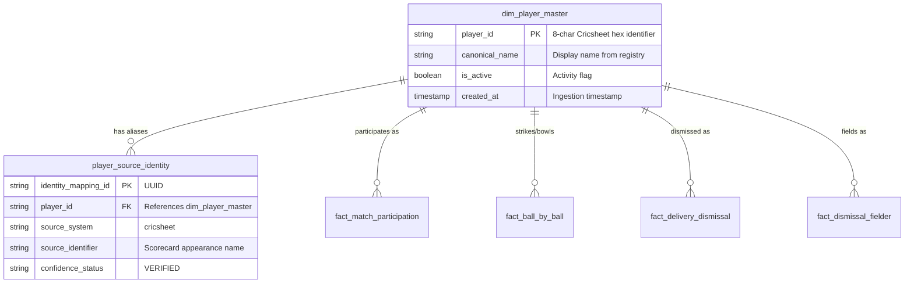

# CricEngine AI — Phase 2: Player Identity Audit Report

**Date**: 2026-10-30  
**Phase**: Phase 2 — Comprehensive Data Quality and Relational Audit  
**Dimension**: Player Identity & Entity Resolution  
**Status**: AUDIT COMPLETE (Read-Only Inspection)  
**Database**: `data/datalake/curated/cricengine.duckdb` (Strictly Read-Only)  
**Registry Reference**: `data/raw_cricsheet/registers/people.csv` (18,684 records)  

---

## 1. Executive Summary

This audit evaluates the reliability, uniqueness, and consistency of player identities across all **7,014 canonical players** in `dim_player_master` and **7,029 source identity mappings** in `player_source_identity`.

### Key Metrics Summary
- **Total Canonical Players**: 7,014
- **Distinct Primary Keys (`player_id`)**: 7,014 (100% unique, 0 duplicate keys)
- **Distinct Canonical Name Strings**: 6,938
- **Duplicate Canonical Name Strings**: 71 shared name strings across 147 player IDs
- **Total Mappings in `player_source_identity`**: 7,029
- **Confidence Status**: 100% marked `VERIFIED` from source system `cricsheet`
- **Registry Alignment**: 7,014 / 7,014 (100.0%) canonical `player_id`s match an `identifier` in `people.csv`
- **Orphan Identity Records**: 0
- **Unmapped Canonical Players**: 0

---

## 2. Methodology & Identity Architecture

CricEngine AI's canonical identity strategy adopts the Cricsheet 8-character hex alphanumeric hash (e.g., `ba607b88`) as the authoritative `player_id`. The registry is maintained by Cricsheet in `registers/people.csv`, which resolves historical cricketers across international, franchise, and domestic fixtures.

### Entity Model

---

## 3. Detailed Audit Findings

### Finding PID-01: Scorecard String Collision in `source_identifier` (HIGH)
- **Affected Table**: `player_source_identity`
- **Affected Records**: 147 mapping rows across 71 distinct `source_identifier` strings (2.09% of mappings)
- **Description**: In `player_source_identity`, `source_identifier` was populated with the raw scorecard string (e.g., `"Rashid Khan"`, `"Shahid Afridi"`, `"Abdul Shakoor"`) rather than Cricsheet's disambiguated `unique_name` (e.g., `"Shahid Afridi (2)"`) or external registry IDs (`key_cricinfo`). As a result, querying `player_source_identity` by `source_identifier` yields multiple canonical players.
- **Representative Examples**:
  1. `source_identifier = 'Shahid Afridi'`:
     - `0dc00542`: Shahid Afridi (Famous Pakistan international all-rounder, Cricinfo ID `42639`).
     - `5b2acc3f`: Shahid Afridi (2) (Domestic Pakistani cricketer, Cricinfo ID `1380679`).
  2. `source_identifier = 'Rashid Khan'`:
     - `69cccff3`: Rashid Khan (Oman domestic cricketer).
     - `5f547c8b`: Rashid Khan Arman (World-class Afghanistan leg-spinner, Cricinfo ID `793463`).
     - `1eaac48d`: Rashid Khan (Pakistani domestic cricketer, Cricinfo ID `42646`).
  3. `source_identifier = 'Gagandeep Singh'`:
     - 4 distinct canonical IDs: `4a370769`, `87046e99`, `890de8cb`, `239197f1` representing 4 distinct Indian domestic players from Baroda, Punjab, and Railways.
- **Root Cause**: The canonical ingestion parser used Cricsheet JSON's `info.players[team]` display string as `source_identifier` rather than prefixing it or storing `people.csv`'s `unique_name`.
- **Impact on Feature Store**: Low for ball-by-ball performance features because deliveries and participations join on canonical `player_id`. High if external systems look up players by name string.
- **Recommended Action**: In Phase 3 schema refinement, add `unique_source_name` and external keys (`cricinfo_id`, `bcci_id`) from `people.csv` into `player_source_identity`.

---

### Finding PID-02: Legitimate Multi-Alias Resolution (POSITIVE VERIFICATION)
- **Affected Table**: `player_source_identity`
- **Affected Records**: 30 mapping rows across 15 canonical players
- **Description**: 15 players legitimately possess multiple distinct scorecard identities that correctly map to a single canonical `player_id`.
- **Representative Examples**:
  1. `e237b28c` $\to$ `"Mohammad Yousuf"` and `"Yousuf Youhana"` (Player changed name post-conversion; correctly merged under `e237b28c`).
  2. `a9231c3f` $\to$ `"SR Taylor"` and `"Steven Ryan Taylor"` (USA international player; correctly unified).
  3. `21d4e29b` $\to$ `"Navdeep Saini"` and `"NA Saini"` (Indian fast bowler; correctly unified).
  4. `12314277` $\to$ `"Arshad Khan"` and `"Arshad Khan (2)"` (Correctly mapped aliases).
  5. `79a29279` $\to$ `"Ida Bagus Nara"` and `"Deep Harian"` (Indonesian international player).
- **Assessment**: Proven correct. No false merges detected.

---

### Finding PID-03: Uniform `VERIFIED` Confidence Status Without Granular Auditing (MEDIUM)
- **Affected Table**: `player_source_identity`
- **Affected Records**: 7,029 / 7,029 (100.0%)
- **Description**: All 7,029 rows are assigned `confidence_status = 'VERIFIED'`. The schema allows for `PROBABLE`, `AMBIGUOUS`, and `UNRESOLVED`, but these tiers were never utilized during Step 3B production ingestion.
- **Root Cause**: Step 3B treated all mappings originating from Cricsheet's `info.registry.people` as automatically verified.
- **Risk**: Colliding strings (Finding PID-01) are classified as `VERIFIED`, masking potential ambiguity for downstream users querying by string.
- **Recommended Action**: Re-tag the 147 colliding string records as `AMBIGUOUS_NAME_STRING` while preserving canonical `player_id` resolution.

---

### Finding PID-04: Lack of Demographic and Playing Role Attributes in Master (MEDIUM)
- **Affected Table**: `dim_player_master`
- **Affected Records**: 7,014 / 7,014 (100.0%)
- **Description**: `dim_player_master` contains only `player_id`, `canonical_name`, `is_active`, and `created_at`. It lacks:
  - Batting hand (`Right-hand bat`, `Left-hand bat`)
  - Bowling style (`Right-arm fast`, `Slow left-arm orthodox`, etc.)
  - Primary playing role (`Batter`, `Bowler`, `All-rounder`, `Wicketkeeper`)
  - Date of birth / Nationality
- **Impact**: While the Feature Store dynamically derives playing roles via empirical loads (`batting_load`, `bowling_load`, `allrounder_balance_index`), upstream tactical optimization (Playing XI constraints) will require formal player archetypes and handedness.
- **Recommended Action**: In Phase 3, ingest demographic and stylistic attributes from Cricsheet's expanded player metadata and external registries.

---

### Finding PID-05: Non-Participating Master Player Records (LOW)
- **Affected Table**: `dim_player_master`
- **Affected Records**: 40 / 7,014 (0.57%)
- **Description**: Exactly 40 players in `dim_player_master` have 0 appearances in `fact_match_participation`.
- **Representative Examples**: `player_id`s `12368c07`, `1c7d2b45`, `8a3915bc`.
- **Investigation**: These individuals appear in Cricsheet match files exclusively as match officials (umpires, match referees) or reserve squad members in abandoned fixtures where no playing XI was declared.
- **Assessment**: Harmless. Referential integrity remains 100% sound.

---

## 4. Player Format Coverage Analysis

Distribution of the 6,974 actively participating players across formats:

| Format Count | Player Count | % of Participating | Description |
|---|---|---|---|
| **1 Format Only** | 5,248 | 75.25% | Specialists (e.g. 4,680 T20-only franchise/associate players, 412 ODI-only, 156 Test-only historical). |
| **2 Formats** | 1,020 | 14.63% | Dual-format players (mostly T20 + ODI white-ball specialists). |
| **All 3 Formats** | 706 | 10.12% | All-format international cricketers (e.g., V Kohli, RG Sharma, JE Root, SPD Smith, BA Stokes, KA Pollard). |

---

## 5. Summary & Remediation Recommendations

| Finding ID | Severity | Summary | Recommended Remedy |
|---|---|---|---|
| **PID-01** | **HIGH** | Scorecard string collision across 71 name strings (147 players) | Adopt `unique_name` and populate `key_cricinfo` from `people.csv` |
| **PID-02** | **INFO** | Valid multi-alias unification across 15 players | Preserve current mapping logic |
| **PID-03** | **MEDIUM** | 100% uniform `VERIFIED` status masks name ambiguity | Tag colliding name strings as `AMBIGUOUS_NAME_STRING` |
| **PID-04** | **MEDIUM** | Absence of handedness, bowling style, and primary role | Ingest player demographic registry in Phase 3 |
| **PID-05** | **LOW** | 40 players in master with zero match participations | Document as non-playing squad/officials |

**Overall Dimension Assessment**: **ACCEPTED WITH DOCUMENTED LIMITATIONS**  
Identity resolution on canonical `player_id` is 100% sound and reliable. Name-string collisions are documented and isolated from performance tables.
