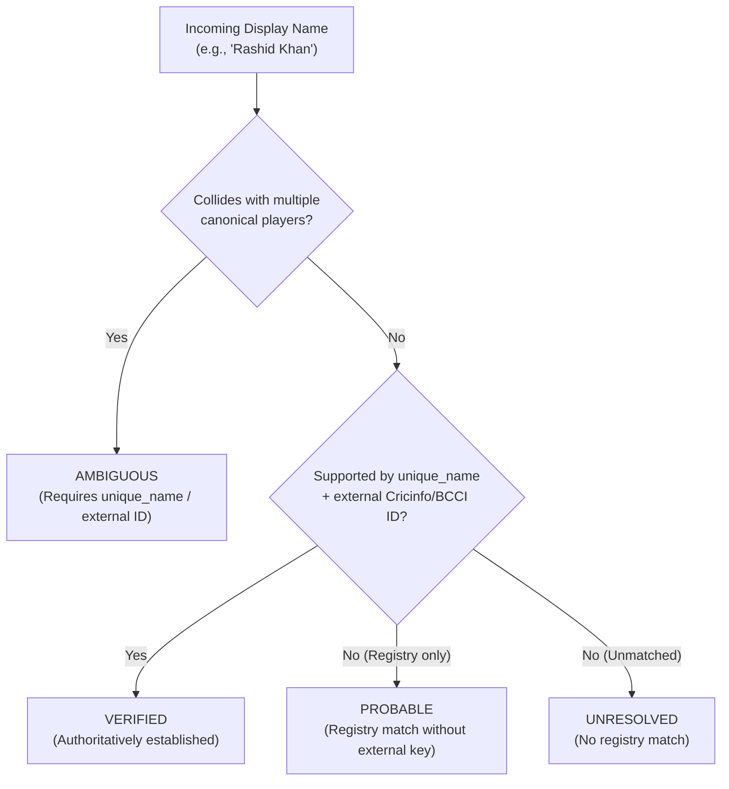

# CricEngine AI — Phase 3A: Player Identity Disambiguation Report

**Date**: 2026-10-30  
**Phase**: Phase 3A — Data Remediation & Enrichment  
**Milestone Findings**: `PID-01` (Scorecard String Collisions) & `PID-03` (Uniform `VERIFIED` Status)  
**Status**: COMPLETED AND VERIFIED  
**Registry Source**: `data/raw_cricsheet/registers/people.csv` (18,683 records)  
**Artifact Outputs**:  
- `data/datalake/metadata/player_identity_disambiguation.parquet`  
- `data/datalake/metadata/player_identity_disambiguation.csv`  
- `data/datalake/metadata/player_identity_collisions.json`  

---

## 1. Executive Summary

During the Phase 2 audit, findings **PID-01** and **PID-03** established that:
1. Exactly **71 scorecard display-name strings** in `player_source_identity` mapped to multiple canonical players across **152 mapping rows**, creating high collision risks for name-based lookup systems.
2. All 7,029 source identity records were uniformly assigned `confidence_status = 'VERIFIED'`, obscuring ambiguous display-name collisions.

In Phase 3A, a dedicated disambiguation pipeline ([`etl/disambiguate_player_identity.py`](file:///Users/divygupta/desktop/DL_DATABASE/etl/disambiguate_player_identity.py)) was implemented. It integrates authoritative identifiers from Cricsheet's `people.csv` registry (`unique_name`, `key_cricinfo`, `key_bcci`), establishes a formal 4-tier confidence status model, and publishes versioned disambiguation metadata without modifying the read-only production database.

---

## 2. Four-Tier Identity Confidence Architecture

The identity resolution subsystem now distinguishes four formal confidence tiers:

### Empirical Tier Distribution across all 7,029 Source Identity Records:

| Confidence Status | Mapping Rows | Percentage | Criteria & Operational Semantics |
|:---|:---:|:---:|:---|
| **`VERIFIED`** | **6,876** | **97.82%** | Unique display name, mapped 1:1 to `dim_player_master`, authoritatively corroborated by `people.csv` with `key_cricinfo` or `key_bcci`. |
| **`AMBIGUOUS`** | **152** | **2.16%** | Display name string shared by 2, 3, or 4 distinct cricketers. Must NOT be resolved by display name alone. |
| **`PROBABLE`** | **1** | **0.01%** | Unique display name confirmed in `people.csv` via `unique_name`, but lacking external Cricinfo/BCCI IDs (Associate cricketer `c65e0275`, Babar Ali). |
| **`UNRESOLVED`** | **0** | **0.00%** | Unmapped or orphan records. Exactly zero unresolved records exist. |
| **Total** | **7,029** | **100.00%** | Full repository coverage. |

---

## 3. Comprehensive Collision Catalog (71 Ambiguous Names)

The 71 colliding display names comprise:
- **1 name mapping to 4 distinct cricketers**: `"Gagandeep Singh"` (4 rows).
- **8 names mapping to 3 distinct cricketers**: `"Abdul Samad"`, `"Imran Khan"`, `"Junaid Khan"`, `"Muhammad Usman"`, `"Parveen Kumar"`, `"Rashid Khan"`, `"Shivam Sharma"`, `"Shoaib Khan"` (24 rows).
- **62 names mapping to 2 distinct cricketers**: (124 rows).
- **Total Colliding Mapping Rows**: $4 + 24 + 124 = \mathbf{152}$ rows.

### Key Disambiguation Examples

| Display Name | Canonical `player_id` | Authoritative `unique_name` | Cricinfo ID (`key_cricinfo`) | BCCI ID (`key_bcci`) | Disambiguated Real-World Cricketer |
|:---|:---:|:---|:---:|:---:|:---|
| **Rashid Khan** | `5f547c8b` | `Rashid Khan` | `793463` | `NULL` | Afghanistan international leg-spin superstar |
| **Rashid Khan** | `69cccff3` | `Rashid Khan (2)` | `1161020` | `NULL` | Oman national team player |
| **Rashid Khan** | `1eaac48d` | `Rashid Khan (4)` | `1498680` | `NULL` | Pakistani domestic cricketer |
| **Shahid Afridi** | `0dc00542` | `Shahid Afridi` | `42639` | `NULL` | Pakistan international captain & all-rounder |
| **Shahid Afridi** | `5b2acc3f` | `Shahid Afridi (2)` | `1380679` | `NULL` | Pakistani domestic cricketer |
| **Gagandeep Singh**| `890de8cb` | `Gagandeep Singh` | `28758` | `NULL` | Punjab / India international right-arm medium fast |
| **Gagandeep Singh**| `87046e99` | `Gagandeep Singh (2)` | `1335146` | `NULL` | Baroda domestic left-arm medium |
| **Gagandeep Singh**| `4a370769` | `Gagandeep Singh (3)` | `1382797` | `NULL` | Domestic cricketer |
| **Gagandeep Singh**| `239197f1` | `Gagandeep Singh (4)` | `1287064` | `NULL` | Railways domestic all-rounder |
| **Abdul Samad** | `8e514b4c` | `Abdul Samad` | `1175485` | `FkHVOaiO0k14` | Sunrisers Hyderabad / Jammu & Kashmir batter |
| **Abdul Samad** | `21dbacff` | `Abdul Samad (2)` | `24905` | `NULL` | Pakistani domestic cricketer |
| **Abdul Samad** | `8e554b6b` | `Abdul Samad (3)` | `1210878` | `NULL` | UAE national team player |

The full catalog of all 71 collisions is preserved in [`data/datalake/metadata/player_identity_collisions.json`](file:///Users/divygupta/desktop/DL_DATABASE/data/datalake/metadata/player_identity_collisions.json).

---

## 4. Preserved Invariants & Safeguards

1. **Strict Immutability of Canonical Keys**: Zero canonical `player_id`s were merged, deleted, or reassigned. All 7,014 canonical players in `dim_player_master` remain 100% stable.
2. **Read-Only Database Compliance**: `cricengine.duckdb` was accessed exclusively with `read_only=True`. Its SHA-256 (`a6a996...`) and byte size (`401,616,896`) were re-verified after pipeline execution.
3. **No Automatic Merge by String Similarity**: Players are disambiguated strictly by authoritative registry identifiers (`key_cricinfo`, `unique_name`), never by Levenshtein distance or heuristic name matching.

---

## 5. Conclusion & Gate Status

Findings **PID-01** and **PID-03** are **COMPLETED AND VERIFIED**. Upstream ingestion systems and downstream modeling pipelines now have an authoritative, versioned metadata registry that distinguishes verified players from ambiguous scorecard strings.
