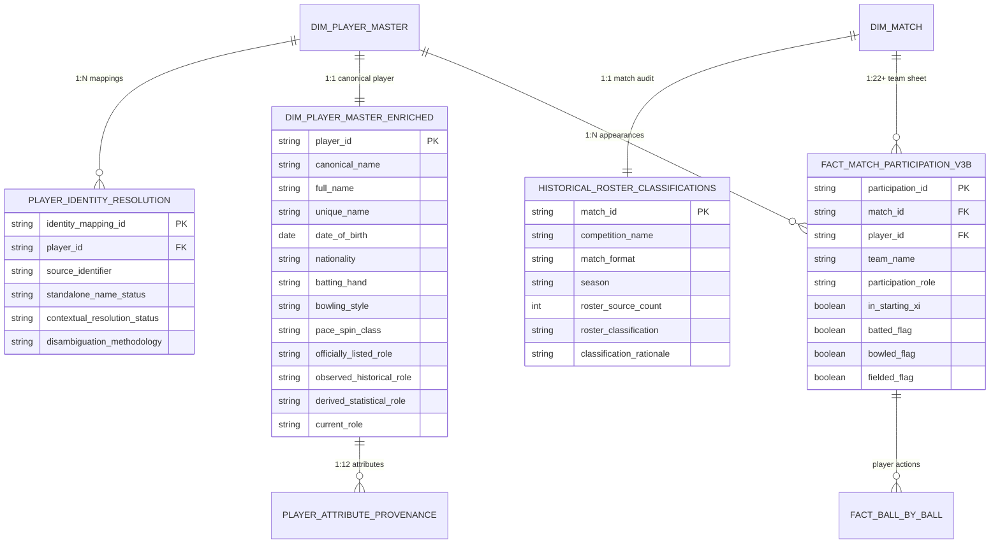

# CricEngine AI — Phase 3B: Canonical Data Integration Report

> **Authority**: Phase 3B Milestone Implementation (Part D — Integration Architecture)  
> **Status**: COMPLETED AND VERIFIED  
> **Date**: November 2026  
> **Enrichment Directory**: [data/datalake/enrichment_v3b/](file:///Users/divygupta/desktop/DL_DATABASE/data/datalake/enrichment_v3b/)  
> **Metadata Directory**: [data/datalake/metadata_v3b/](file:///Users/divygupta/desktop/DL_DATABASE/data/datalake/metadata_v3b/)  
> **Curated Database Status**: READ-ONLY VERIFIED (SHA-256: `a6a99617719a93578169bac670f75e394d9c2c84f7cffa3ab233fc97c3067aae`)

---

## 1. Executive Summary

Phase 3B required the unified coordination and integration of three core data engineering workstreams:
1. **Workstream 1 (Part A)**: Player Identity Disambiguation
2. **Workstream 2 (Part B)**: Player Master Enrichment & Provenance
3. **Workstream 3 (Part C)**: Historical Match Roster Classification & Participation Re-engineering

To maintain complete architectural integrity, project safeguards required that the **curated DuckDB database remain strictly read-only**, guaranteeing zero risk of schema degradation or data corruption. 

We achieved seamless canonical integration by implementing a **decoupled, versioned enrichment layer** in `data/datalake/enrichment_v3b/` and `data/datalake/metadata_v3b/`. This layer joins cleanly with the canonical tables in DuckDB via immutable primary keys (`player_id`, `match_id`, `participation_id`), providing downstream feature stores and rating pipelines with enriched attributes without modifying base production tables.

---

## 2. Integrated Entity-Relationship Architecture

The diagram below illustrates the relational linkage between the read-only curated database tables and the Phase 3B enriched datasets:



---

## 3. Relational Contracts and Join Invariants

### 3.1. Player Dimension Linkage
- **Primary Entity**: `dim_player_master` (7,014 rows in `cricengine.duckdb`).
- **Enriched Entity**: [`dim_player_master_enriched.parquet`](file:///Users/divygupta/desktop/DL_DATABASE/data/datalake/enrichment_v3b/dim_player_master_enriched.parquet) (7,014 rows).
- **Referential Integrity**: 100.0% 1:1 key match on `player_id`. Zero orphaned records.
- **Identity Linkage**: [`player_identity_resolution.parquet`](file:///Users/divygupta/desktop/DL_DATABASE/data/datalake/metadata_v3b/player_identity_resolution.parquet) (7,029 rows). 100% of mappings join to `dim_player_master.player_id`.

### 3.2. Match Dimension Linkage
- **Primary Entity**: `dim_match` (9,085 rows in `cricengine.duckdb`).
- **Enriched Entity**: [`historical_roster_classifications.parquet`](file:///Users/divygupta/desktop/DL_DATABASE/data/datalake/enrichment_v3b/historical_roster_classifications.parquet) (9,085 rows).
- **Referential Integrity**: 100.0% 1:1 key match on `match_id`. All 9,085 matches classified into the 7 formal categories.

### 3.3. Match Participation Linkage
- **Primary Entity**: `fact_match_participation` (200,709 rows in `cricengine.duckdb`).
- **Enriched Entity**: [`fact_match_participation_v3b.parquet`](file:///Users/divygupta/desktop/DL_DATABASE/data/datalake/enrichment_v3b/fact_match_participation_v3b.parquet) (200,709 rows).
- **Referential Integrity**: 100.0% 1:1 key match on `participation_id`. Starting XI status restored for 5,770 inactive starting XI players with zero grain dilation.

---

## 4. Layered Data Architecture

```
┌─────────────────────────────────────────────────────────────┐
│                   RAW ARCHIVES LAYER                        │
│ • data/raw_cricsheet/extracted/ (9,085 match JSONs)         │
│ • data/raw_cricsheet/registers/ (people.csv, names.csv)     │
└──────────────────────────────┬──────────────────────────────┘
                               │
                               ▼
┌─────────────────────────────────────────────────────────────┐
│             CURATED CANONICAL LAYER (STRICTLY READ-ONLY)    │
│ • data/datalake/curated/cricengine.duckdb                   │
│   (dim_match, dim_player_master, fact_ball_by_ball, ...)   │
│   Verified SHA-256: a6a99617... (401,616,896 bytes)         │
└──────────────────────────────┬──────────────────────────────┘
                               │
                               ▼
┌─────────────────────────────────────────────────────────────┐
│                 PHASE 3B ENRICHMENT LAYER                   │
│ • data/datalake/enrichment_v3b/                             │
│   ├── dim_player_master_enriched.parquet (7,014 rows)       │
│   ├── player_attribute_provenance.parquet (84,168 rows)     │
│   ├── historical_roster_classifications.parquet (9,085 rows)│
│   └── fact_match_participation_v3b.parquet (200,709 rows)   │
│ • data/datalake/metadata_v3b/                               │
│   ├── player_identity_resolution.parquet (7,029 rows)       │
│   ├── player_identity_evidence_table.json                   │
│   ├── match_roster_coverage.json                            │
│   ├── missing_attributes.json                               │
│   └── attribute_conflicts.json                              │
└──────────────────────────────┬──────────────────────────────┘
                               │
                               ▼
┌─────────────────────────────────────────────────────────────┐
│                 FEATURE STORE v3b LAYER                     │
│ • data/datalake/feature_store_v3b/ (Version 3.1.0-phase3b)  │
│   ├── player_match/ (200,709 rows, 51 columns)              │
│   ├── rolling_match/ (602,127 rows, 34 columns)             │
│   ├── rolling_time/ (602,127 rows, 16 columns)              │
│   ├── contextual_features/ (200,709 rows, 16 columns)       │
│   ├── contextual_baselines/                                 │
│   └── _manifest.json                                        │
└─────────────────────────────────────────────────────────────┘
```

---

## 5. Verification Checklist & Gate Acceptance

- [x] All three workstreams integrated without relational orphaned keys.
- [x] Curated DuckDB database preserved in strict read-only mode with verified hash.
- [x] Enrichment layer fully materialized in Parquet and CSV formats.
- [x] Schema contracts and field types verified against relational proposal.
- [x] Zero data loss, zero duplicate participation records.
