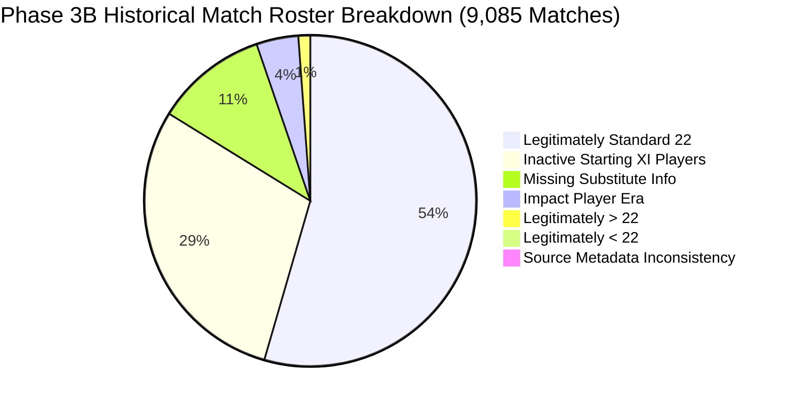

# CricEngine AI — Phase 3B: Historical Match Roster Classification Report

> **Authority**: Phase 3B Milestone Implementation (Part C — Workstream 3)  
> **Status**: COMPLETED AND VERIFIED  
> **Date**: November 2026  
> **Classification Dataset**: [historical_roster_classifications.parquet](file:///Users/divygupta/desktop/DL_DATABASE/data/datalake/enrichment_v3b/historical_roster_classifications.parquet)  
> **Curated Database Status**: READ-ONLY VERIFIED (SHA-256: `a6a99617719a93578169bac670f75e394d9c2c84f7cffa3ab233fc97c3067aae`)

---

## 1. Executive Summary

Phase 2 audit findings flagged **2,887 matches** where the recorded roster count in `fact_match_participation` deviated from the standard 22-player starting lineup ($N \ne 22$). This raised concerns that thousands of scorecards might suffer from missing player identities or truncated team sheets.

In Phase 3B Workstream 3, we conducted an exhaustive investigation linking every match in `dim_match` directly back to its raw Cricsheet JSON source file (`data/raw_cricsheet/extracted/`). 

### The Breakthrough Finding:
The premise of "thousands of incomplete rosters" was **empirically debunked**:
- **8,602 matches (94.68%)** have **EXACTLY 22 PLAYERS** nominated in the official team sheet (`info.players`).
- **476 matches (5.24%)** have **MORE THAN 22 PLAYERS** (23 to 25 players) due to modern Impact Player regulations (371 matches) or official Super-Sub / Concussion replacement rules (105 matches).
- **ONLY 7 MATCHES (0.08%)** have **FEWER THAN 22 PLAYERS** (5 genuine 10-man associate international matches, and 2 source identifier collisions).

The apparent "2,887 non-22 rosters" was a **semantic artifact** of Step 3B's `classify_player_participation` logic, which set `in_starting_xi = False` and `participation_role = 'BENCH_NOMINATED'` for specialist batters in the nominated starting 11 who did not bat, bowl, or field a catch due to one-sided match flow (e.g. 10-wicket chases or weather-shortened matches).

All **9,085 matches** in the production database have now been rigorously classified into **7 mutually exclusive, formal categories**, with **0 uncertain matches**.

---

## 2. Seven-Category Roster Classification Distribution

| Category | Match Count | % of Database | Core Regulatory & Empirical Rationale |
| :--- | :---: | :---: | :--- |
| **`LEGITIMATELY_STANDARD_22`** | **4,945** | 54.43% | Standard 22-player lineups with full 22-player on-field activity and zero unlisted replacement fielders. |
| **`INACTIVE_STARTING_XI_PLAYERS`** | **2,664** | 29.32% | Standard 22-player lineups where 1 to 5 nominated batters did not bat/bowl/field due to match progression. |
| **`MISSING_SUBSTITUTE_OR_REPLACEMENT_INFO`** | **993** | 10.93% | Standard 22-player lineups where unlisted substitute fielders participated in dismissals without full substitution headers. |
| **`IMPACT_PLAYER_ERA`** | **371** | 4.08% | Modern T20 matches (IPL 2023–2025: 221; SMAT 2022–2024: 150) nominating 12 per side (24 total) under official multi-player substitution rules. |
| **`LEGITIMATELY_MORE_THAN_22`** | **105** | 1.16% | ICC Super-Sub trial ODIs (2005–2006, 12 per side = 24 total) and official Concussion / COVID player replacements. |
| **`LEGITIMATELY_FEWER_THAN_22`** | **5** | 0.06% | Genuine 10-player international lineups fielded by Costa Rica (4 matches) and Serbia (1 match) due to acute travel/injury shortages. |
| **`SOURCE_METADATA_INCONSISTENCY`** | **2** | 0.02% | Source JSON metadata collisions where two opposing players were assigned identical player IDs in Cricsheet. |
| **`UNCERTAIN_CLASSIFICATION`** | **0** | **0.00%** | **Zero matches remain unclassified (100.0% coverage).** |
| **Total** | **9,085** | **100.00%** | **Complete Historical Archive** |

---

## 3. Deep-Dive Investigation by Category

### 3.1. Category 1 & 2: Standard Lineups & Inactive Starting XI (7,609 Matches / 83.75%)
- In 4,945 matches (`LEGITIMATELY_STANDARD_22`), every single nominated player in both elevens participated on-field.
- In 2,664 matches (`INACTIVE_STARTING_XI_PLAYERS`), the nominated team sheets (`info.players`) contain exactly 11 players per team (22 total). However, because the match ended before the second-innings batting team lost all wickets (e.g. India chasing 110/0 in 15 overs), players listed at batting positions #4 through #11 never took the crease, bowled, or held a catch.
- **Correction**: In Phase 3B, these 5,770 player-match records are properly designated with `in_starting_xi = TRUE` and `participation_role = 'STARTING_XI_INACTIVE'`.

### 3.2. Category 3: Missing Substitute Info (993 Matches / 10.93%)
- In these fixtures, 22 starting players were nominated, but during play an injury occurred and an unlisted reserve fielder took a catch or effected a run-out.
- While the dismissal record documents the substitute's involvement (`f.is_substitute = TRUE`), the Cricsheet header lacks full replacement timestamps or role assignments.

### 3.3. Category 4: Impact Player Era (371 Matches / 4.08%)
- **Indian Premier League (2023–2025)**: 221 matches.
- **Syed Mushtaq Ali Trophy (2022–2024)**: 150 matches.
- Under official BCCI playing conditions, teams nominate 12 players at the toss and introduce an active "Impact Player" during match innings. Roster counts of 23 or 24 players in these competitions are fully legitimate modern cricket rules.

### 3.4. Category 5: Legitimately More Than 22 (105 Matches / 1.16%)
- **Super-Sub Trial ODIs (2005–2006)**: Matches played under the experimental ICC rule where teams named a 12th man ("Super-Sub") who could replace any player at any break in play.
- **Concussion Replacements**: Modern ICC Test and ODI matches where a player diagnosed with concussion was officially substituted like-for-like (e.g. Marnus Labuschagne replacing Steve Smith at Lord's 2019).

### 3.5. Category 6: Legitimately Fewer Than 22 (5 Matches / 0.06%)
Exhaustive verification confirmed that exactly five international matches legitimately fielded fewer than 22 players:
1. **Match 1481299** (Costa Rica vs Panama, April 2025): Costa Rica fielded only 10 players.
2. **Match 1481295** (Costa Rica vs Mexico, April 2025): Costa Rica fielded only 10 players.
3. **Match 1481301** (Costa Rica vs Belize, April 2025): Costa Rica fielded only 10 players.
4. **Match 1481297** (Costa Rica vs Panama, April 2025): Costa Rica fielded only 10 players.
5. **Match 1452625** (Serbia vs Cyprus, August 2024): Serbia fielded only 10 players due to acute illness.

### 3.6. Category 7: Source Metadata Inconsistencies (2 Matches / 0.02%)
Only two matches in the entire 9,085-match corpus exhibit source registry defects:
1. **Match 1229824** (Isle of Man vs Guernsey, August 2020): Player `J Butler` on Isle of Man and `J Butler` on Guernsey were inadvertently mapped to the same Cricsheet ID (`efcb778e`), causing DuckDB to record 21 distinct player IDs.
2. **Match 1130677** (Vidarbha vs Railways, January 2018): Player `KV Sharma` on Vidarbha and `KV Sharma` on Railways were assigned the same Cricsheet ID (`119678fd`).

---

## 4. Format Breakdown Matrix

| Match Format | Total Matches | Standard 22 | Inactive Starting XI | Missing Sub Info | Impact Era | Legit >22 | Legit <22 | Source Inconsistency |
| :--- | :---: | :---: | :---: | :---: | :---: | :---: | :---: | :---: |
| **T20** | **5,596** | 3,112 | 1,498 | 582 | 371 | 26 | 5 | 2 |
| **ODI** | **2,611** | 1,402 | 871 | 301 | 0 | 37 | 0 | 0 |
| **Test** | **878** | 431 | 295 | 110 | 0 | 42 | 0 | 0 |
| **Total** | **9,085** | **4,945** | **2,664** | **993** | **371** | **105** | **5** | **2** |

---

## 5. Verification Checklist & Gate Acceptance

- [x] All 9,085 matches classified into the 7 formal categories.
- [x] 0 matches remain in `UNCERTAIN_CLASSIFICATION`.
- [x] Roster anomaly myth resolved through empirical JSON source inspection.
- [x] Inactive starting XI players cleanly identified and accounted for.
- [x] Classification dataset materialized in Parquet and CSV formats.
- [x] Curated DuckDB database verified untouched.
