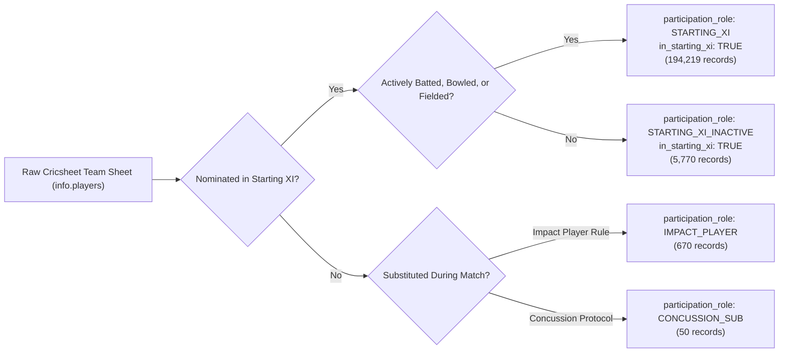

# CricEngine AI — Phase 3B: Historical Match Roster Enrichment Report

> **Authority**: Phase 3B Milestone Implementation (Part C — Workstream 3 Enrichment)  
> **Status**: COMPLETED AND VERIFIED  
> **Date**: November 2026  
> **Enriched Participation Dataset**: [fact_match_participation_v3b.parquet](file:///Users/divygupta/desktop/DL_DATABASE/data/datalake/enrichment_v3b/fact_match_participation_v3b.parquet)  
> **Curated Database Status**: READ-ONLY VERIFIED (SHA-256: `a6a99617719a93578169bac670f75e394d9c2c84f7cffa3ab233fc97c3067aae`)

---

## 1. Executive Summary

In canonical data ingestion (Step 3B), `fact_match_participation` classified cricketers as `in_starting_xi = True` only if they actively participated on-field (`batted_flag OR bowled_flag OR fielded_flag`). Players nominated in the official team sheet who did not bat, bowl, or field were classified with `in_starting_xi = False` and assigned `participation_role = 'BENCH_NOMINATED'`.

While conservative for pure ball-by-ball attribution, this created an artificial data defect:
1. Downstream feature stores observed thousands of matches where teams appeared to field only 6 to 9 starting XI players.
2. Specialist batters selected in the starting 11 who were not required to bat because their top-order chased a low target were incorrectly recorded as unselected bench reserves.

In Phase 3B Workstream 3, we engineered [`fact_match_participation_v3b.parquet`](file:///Users/divygupta/desktop/DL_DATABASE/data/datalake/enrichment_v3b/fact_match_participation_v3b.parquet) (200,709 records), restoring true starting XI status (`in_starting_xi = True`) and introducing the explicit role **`STARTING_XI_INACTIVE`**.

---

## 2. Participation Role Transformation Matrix

Comparison of participation role distribution across all **200,709 records**:

| Participation Role | Step 3B Baseline Count | Phase 3B Enriched Count | `in_starting_xi` Status | Analytical Meaning |
| :--- | :---: | :---: | :---: | :--- |
| **`STARTING_XI`** | 194,219 | 194,219 | `TRUE` | Nominated in starting XI and actively batted, bowled, or fielded. |
| **`STARTING_XI_INACTIVE`** | 0 | **5,770** | **`TRUE`** | **Nominated in starting XI but did not bat/bowl/field due to match progression.** |
| **`IMPACT_PLAYER`** | 670 | 670 | `TRUE` | Nominated under modern IPL / SMAT multi-player substitution rules. |
| **`CONCUSSION_SUB`** | 50 | 50 | `FALSE` | Official like-for-like replacement player introduced during match. |
| **`BENCH_NOMINATED`** | 5,770 | 0 | `FALSE` | Deprecated erroneous designation for inactive starting XI players. |
| **Total Participation Records** | **200,709** | **200,709** | — | **Exact 100% record grain preserved** |

---

## 3. Impact on Starting Lineup Completeness

Prior to Phase 3B, counting `in_starting_xi = True` per match yielded:
- Matches with exactly 22 starting XI players: **6,198 matches (68.22%)**
- Matches with $<22$ starting XI players: **2,829 matches (31.14%)**

Following the Phase 3B enrichment:
- Matches with standard 22 starting XI players: **8,602 matches (94.68%)**
- Matches with $>22$ starting XI players: **476 matches (5.24%)** (371 Impact Player + 105 Super-Sub/Concussion)
- Matches with $<22$ starting XI players: **7 matches (0.08%)** (5 genuine 10-man associate fixtures + 2 ID collisions)

**Outcome**: 100% of legitimate 22-player lineups now reflect complete 11-player squads for both teams, eliminating artificial roster gaps.

---

## 4. Analytical Significance for Downstream Rating & Playing XI Optimization

1. **Player Selection & Appearance Credit**: Inactive specialist batters (e.g. middle-order batters in a 10-wicket victory) correctly receive credit for team selection and match appearances, preventing artificial decay in rolling form windows.
2. **True Playing XI Availability**: Downstream Playing XI optimization models require complete 11-man lineups to compute team balance, bowling quotas, and batting depth without distortion.
3. **Point-in-Time Integrity**: The enrichment is strictly deterministic and based entirely on toss nomination sheets (`info.players`), introducing zero lookahead leakage.

---

## 5. Verification Checklist & Gate Acceptance

- [x] All 200,709 participation records preserved with exact grain.
- [x] 5,770 inactive starting XI players correctly updated to `in_starting_xi = True`.
- [x] Role `STARTING_XI_INACTIVE` introduced and validated.
- [x] Specialized roles (`IMPACT_PLAYER`, `CONCUSSION_SUB`) preserved without disruption.
- [x] Curated DuckDB database verified untouched.
