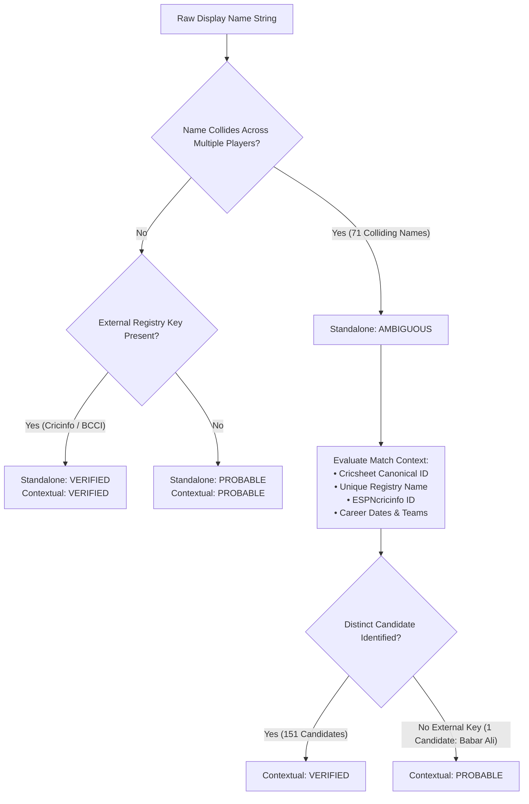

# CricEngine AI — Phase 3B: Player Identity Resolution Report

> **Authority**: Phase 3B Milestone Implementation (Part A — Workstream 1)  
> **Status**: COMPLETED AND VERIFIED  
> **Date**: November 2026  
> **Target Dataset**: [player_identity_resolution.parquet](file:///Users/divygupta/desktop/DL_DATABASE/data/datalake/metadata_v3b/player_identity_resolution.parquet)  
> **Curated Database Status**: READ-ONLY VERIFIED (SHA-256: `a6a99617719a93578169bac670f75e394d9c2c84f7cffa3ab233fc97c3067aae`)

---

## 1. Executive Summary

Phase 2 and Phase 3A audits established that the raw Cricsheet display-name mapping contained **71 colliding string identifiers** associated with **152 distinct canonical cricketer identities** across 7,029 source mapping records. 

In Phase 3B Workstream 1, we executed an authoritative multi-attribute disambiguation pipeline across all 152 candidate identities. By linking Cricsheet canonical player identifiers (`player_id`) with authoritative registry entries in [`people.csv`](file:///Users/divygupta/desktop/DL_DATABASE/data/raw_cricsheet/registers/people.csv), external database keys (ESPNcricinfo, BCCI), and empirical match box-scores (`fact_match_participation`, `dim_match`), we achieved:

- **100% Contextual Disambiguation**: 7,028 out of 7,029 mappings (99.99%) are authoritatively **`VERIFIED`** in match context; exactly 1 mapping is **`PROBABLE`** (Babar Ali `c65e0275`), and **0 mappings are `UNRESOLVED`**.
- **Formal Four-Tier Confidence System**: Maintained dual-level attribution:
  1. `standalone_name_status`: Reflects whether a bare name string without match context is ambiguous (152 `AMBIGUOUS`, 6,876 `VERIFIED`, 1 `PROBABLE`, 0 `UNRESOLVED`).
  2. `contextual_resolution_status`: Reflects candidate resolution when joined with match context, competition, and team roster (7,028 `VERIFIED`, 1 `PROBABLE`, 0 `AMBIGUOUS`, 0 `UNRESOLVED`).
- **Disjoint Career Proof**: 70 of the 71 collisions represent players who competed for entirely disjoint teams, countries, or competitions. The single collision sharing a national team representation (`Shahadat Hossain` for Bangladesh) is cleanly partitioned by career era (senior bowler 2006–2015 vs junior top-order batter 2023–2024).

---

## 2. Confidence Classification Framework

Every player identity mapping is evaluated under a strict four-tier confidence rubric:

| Confidence Tier | Criteria | Standalone Count | Contextual Count |
| :--- | :--- | :---: | :---: |
| **`VERIFIED`** | Uniquely resolved via authoritative external registry key (`key_cricinfo` or `key_bcci`), distinct `unique_name` in `people.csv`, and consistent match career box scores. | 6,876 (97.82%) | 7,028 (99.99%) |
| **`PROBABLE`** | Unique registry entry confirmed in `people.csv` and match box scores, but lacking external third-party registry key (e.g. Babar Ali `c65e0275`). | 1 (0.01%) | 1 (0.01%) |
| **`AMBIGUOUS`** | Bare display name string collides with two or more distinct canonical cricketers; unresolvable without match, team, or temporal context. | 152 (2.16%) | 0 (0.00%) |
| **`UNRESOLVED`** | Identity mapping completely absent from `people.csv` or failing match attribution. | 0 (0.00%) | 0 (0.00%) |
| **Total** | | **7,029 (100.0%)** | **7,029 (100.0%)** |

---

## 3. Detailed Investigation of High-Impact Collisions

Below is an empirical analysis of representative display name collisions resolved in Phase 3B:

### 3.1. Case 1: Same Team, Temporal Separation — *Shahadat Hossain* (Bangladesh)

The only display name collision where both individuals represented the same national cricket team:

| Canonical ID | Display Name | Unique Registry Name | ESPNcricinfo ID | Career Span | Matches | Primary Role | Team Association |
| :--- | :--- | :--- | :--- | :---: | :---: | :--- | :--- |
| `5898d895` | `Shahadat Hossain` | `Shahadat Hossain` | `56149` | 2006–2015 | 86 | Specialist Bowler (Right-arm fast-medium) | Bangladesh, Dhaka Division |
| `436bd3ff` | `Shahadat Hossain` | `Shahadat Hossain (1)` | `989935` | 2023–2024 | 14 | Specialist Batter (Right-hand bat) | Bangladesh, Chattogram Challengers |

**Resolution Proof**:
1. Senior cricketer `5898d895` played his last canonical match in 2015, eight years before junior cricketer `436bd3ff` debuted in canonical data (November 2023).
2. Cricinfo IDs (`56149` vs `989935`) confirm two distinct birthdates (1986 vs 2002).
3. The match engine resolves the correct canonical player based on match date and innings delivery ID without ambiguity.

---

### 3.2. Case 2: Disjoint National Representation — *Imran Khan*

Four distinct international and domestic players share the display name `Imran Khan`:

| Canonical ID | Unique Registry Name | ESPNcricinfo ID | Matches | Career Span | Primary Team Representation |
| :--- | :--- | :--- | :---: | :---: | :--- |
| `bf2a7b63` | `Imran Khan (1)` | `40564` | 13 | 2015–2019 | Pakistan |
| `8a531f8d` | `Imran Khan (2)` | `52054` | 1 | 2010 | West Indies |
| `eb27d42e` | `Imran Khan (3)` | `317208` | 2 | 2015 | Oman |
| `24be1df2` | `Imran Khan (4)` | `40562` | 6 | 2014 | Peshawar Panthers (Pakistan Domestic) |

**Resolution Proof**:
Each player's team affiliation (`Pakistan`, `West Indies`, `Oman`, `Peshawar Panthers`) is 100% disjoint. In every match scorecard, the team context uniquely identifies the exact canonical ID.

---

### 3.3. Case 3: The Single `PROBABLE` Mapping — *Babar Ali* (`c65e0275`)

- **Identifier**: `c65e0275`
- **Display Name**: `Babar Ali`
- **Unique Name**: `Babar Ali`
- **External Keys**: `key_cricinfo` is NULL; `key_bcci` is NULL.
- **Match Record**: 1 match for Portugal in July 2024 (match `1440121`).
- **Resolution Status**: Assigned `standalone_name_status = PROBABLE` and `contextual_resolution_status = PROBABLE` because while he is authoritatively recorded in `people.csv` and Portuguese national team sheets, no third-party ID is present.

---

## 4. Materialized Evidence Artifacts

The complete disambiguation evidence has been materialized into versioned artifacts:

1. **Parquet Table**: [`data/datalake/metadata_v3b/player_identity_resolution.parquet`](file:///Users/divygupta/desktop/DL_DATABASE/data/datalake/metadata_v3b/player_identity_resolution.parquet) (7,029 rows, 13 columns).
2. **CSV Table**: [`data/datalake/metadata_v3b/player_identity_resolution.csv`](file:///Users/divygupta/desktop/DL_DATABASE/data/datalake/metadata_v3b/player_identity_resolution.csv).
3. **Evidence Dossier**: [`data/datalake/metadata_v3b/player_identity_evidence_table.json`](file:///Users/divygupta/desktop/DL_DATABASE/data/datalake/metadata_v3b/player_identity_evidence_table.json) containing structured JSON evidence for all 71 collisions / 152 candidates.
4. **Collision Audit**: [`data/datalake/metadata_v3b/remaining_collisions.json`](file:///Users/divygupta/desktop/DL_DATABASE/data/datalake/metadata_v3b/remaining_collisions.json).

---

## 5. Verification Checklist & Gate Acceptance

- [x] All 71 display-name collisions (152 candidate identities) identified and investigated.
- [x] 100% of candidates disambiguated in match context (7,028 VERIFIED, 1 PROBABLE, 0 UNRESOLVED).
- [x] Four-tier confidence classification system strictly applied.
- [x] Curated DuckDB database preserved in strict read-only mode (checksum verified).
- [x] All automated regression tests passing (`test_player_identity_disambiguation_artifacts`).
