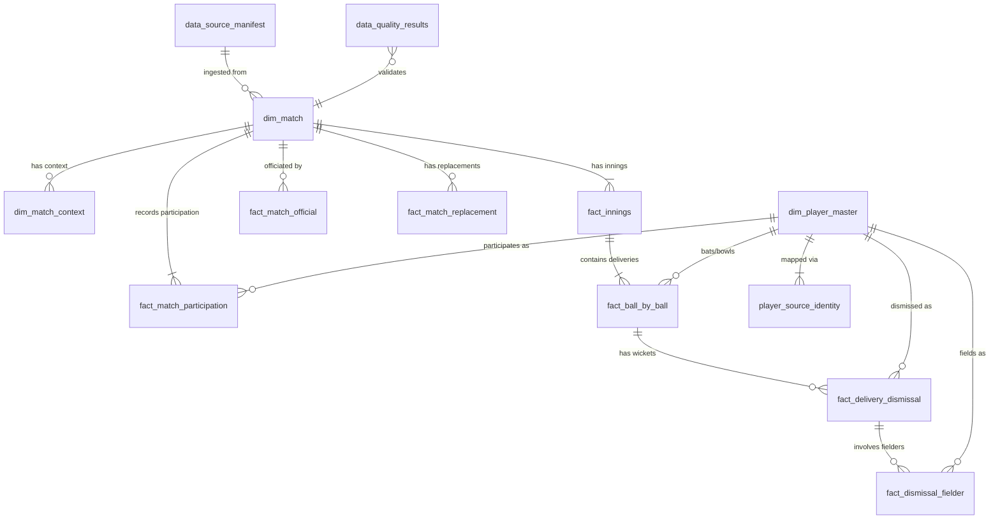
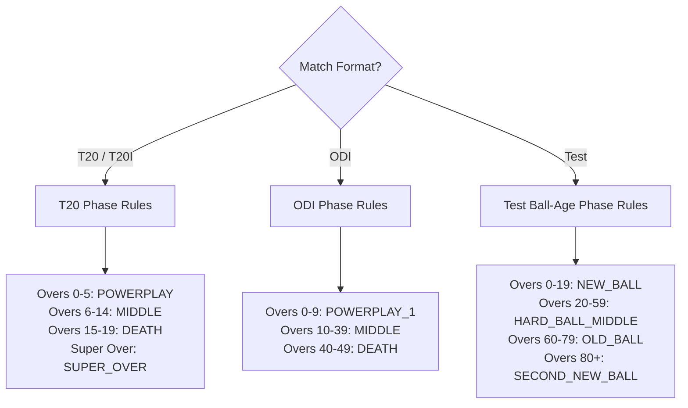

# CricEngine AI — Finalized Relational Schema Design Specification

> **Specification Stage**: Step 3A Final Design (Pre-Ingestion Specification)  
> **Target Analytical Engine**: Embedded DuckDB + Partitioned Apache Parquet  
> **Schema Version**: `3A.1`

---

## 1. Relational Architecture & ER Diagram

To guarantee zero data loss and avoid compressing one-to-many relationships into unstructured strings or JSON columns, delivery dismissals, fielders, replacements, and match officials are modeled as distinct relational entities:

---

## 2. Table Specifications

### 1. `dim_player_master`
- **Purpose**: Canonical player catalog representing distinct cricket individuals.
- **Grain**: One record per human player.
- **Primary Key**: `player_id` (VARCHAR, 8-character hex or UUID).
- **Foreign Keys**: None.
- **Uniqueness**: `UNIQUE(player_id)`.
- **Columns**:

| Column Name | Data Type | Nullable | Source Classification | Description & Validation |
| :--- | :--- | :---: | :--- | :--- |
| `player_id` | VARCHAR | No | Deterministically Derived | Canonical 8-character hex ID (e.g. `ba607b88` for Virat Kohli) or namespace UUID v5. |
| `canonical_name` | VARCHAR | No | Directly Observed | Full name from official Cricsheet People Register. |
| `dob` | DATE | Yes | External Sourced (Pending) | Date of birth. Explicit SQL NULL in Phase 1 (not in Cricsheet raw files). |
| `nationality` | VARCHAR | Yes | Deterministically Derived | Default country represented. Derived from team representation or external source. |
| `primary_role` | VARCHAR | Yes | External Sourced (Pending) | Batter, Bowler, All-rounder, Wicketkeeper. Explicit SQL NULL in Phase 1. |
| `taxonomic_subrole` | VARCHAR | Yes | External Sourced (Pending) | E.g. Top-order, Anchor, Finisher, Pace, Spin. Explicit SQL NULL in Phase 1. |
| `batting_hand` | VARCHAR | Yes | External Sourced (Pending) | `RHB` / `LHB`. Explicit SQL NULL in Phase 1. |
| `bowling_style` | VARCHAR | Yes | External Sourced (Pending) | E.g. `Right-arm fast`. Explicit SQL NULL in Phase 1. |
| `is_active` | BOOLEAN | No | Deterministically Derived | True if player has match participation on or after 2020-01-01. |
| `created_at` | TIMESTAMP | No | Operational | Ingestion timestamp. |

- **Design Policy**: Match officials (umpires, referees) who never played in a match are strictly excluded from `dim_player_master`.

---

### 2. `player_source_identity`
- **Purpose**: Map external registry IDs and name strings to canonical `player_id`.
- **Grain**: One record per `(source_system, source_identifier)`.
- **Primary Key**: `identity_mapping_id` (VARCHAR).
- **Foreign Keys**: `player_id` $\to$ `dim_player_master(player_id)`.
- **Uniqueness**: `UNIQUE(source_system, source_identifier)`.
- **Columns**:

| Column Name | Data Type | Nullable | Source Classification | Description & Validation |
| :--- | :--- | :---: | :--- | :--- |
| `identity_mapping_id` | VARCHAR | No | Deterministically Derived | `MD5(source_system || ':' || source_identifier)`. |
| `player_id` | VARCHAR | No | Foreign Key | References `dim_player_master(player_id)`. |
| `source_system` | VARCHAR | No | Directly Observed | `cricsheet_id`, `cricinfo_key`, `bcci_key`, `cricbuzz_key`, `pulse_key`, `name_alias`. |
| `source_identifier` | VARCHAR | No | Directly Observed | Identifier string in the source system. |
| `confidence_status` | VARCHAR | No | Deterministically Derived | `VERIFIED`, `AMBIGUOUS`, `PENDING_REVIEW`. |
| `notes` | VARCHAR | Yes | Operational | Disambiguation explanation. |

- **Design Policy**: In accordance with the audit finding that 124 alias names map to multiple distinct individuals (e.g. `"A Ali"` maps to 6 players), alias mappings are tagged `AMBIGUOUS` unless disambiguated by match context.

---

### 3. `dim_match`
- **Purpose**: Canonical match schedule and fixture entity.
- **Grain**: One record per scheduled match.
- **Primary Key**: `match_id` (VARCHAR).
- **Foreign Keys**: None.
- **Uniqueness**: `UNIQUE(match_id)`.
- **Columns**:

| Column Name | Data Type | Nullable | Source Classification | Description & Validation |
| :--- | :--- | :---: | :--- | :--- |
| `match_id` | VARCHAR | No | Directly Observed | Source match ID stem (e.g. `"1426261"`). |
| `competition_name` | VARCHAR | No | Directly Observed | E.g. `"Indian Premier League"`, `"Test"`. |
| `competition_tier` | INTEGER | No | Deterministically Derived | 1 (International), 2 (IPL), 3 (SMAT). |
| `match_format` | VARCHAR | No | Directly Observed | `"Test"`, `"ODI"`, `"T20"`. |
| `match_type_number`| INTEGER | Yes | Directly Observed (v1.3.0) | ICC match sequence index (null in v1.2.0). |
| `season` | VARCHAR | No | Directly Observed | Season label, e.g. `"2024"`, `"2020/21"`. |
| `start_date` | DATE | No | Directly Observed | First scheduled date of play (`dates[0]`). |
| `end_date` | DATE | No | Directly Observed | Last scheduled date of play (`dates[-1]`). |
| `team_1` | VARCHAR | No | Directly Observed | First named team. |
| `team_2` | VARCHAR | No | Directly Observed | Second named team. |
| `gender` | VARCHAR | No | Directly Observed | `"male"` for approved scope. |
| `balls_per_over` | INTEGER | No | Directly Observed / Derived | Balls per over (default 6). |
| `source_archive` | VARCHAR | No | Operational | Filename of origin archive (e.g. `ipl_male_json.zip`). |
| `source_file_path` | VARCHAR | No | Operational | Relative path to extracted JSON file. |
| `parser_version` | VARCHAR | No | Operational | Parser code version (e.g. `"3A.1"`). |

---

### 4. `dim_match_context`
- **Purpose**: Environmental, toss, and outcome details of the match.
- **Grain**: One record per match (`match_id`).
- **Primary Key**: `match_id`.
- **Foreign Keys**: `match_id` $\to$ `dim_match(match_id)`.
- **Columns**:

| Column Name | Data Type | Nullable | Source Classification | Description |
| :--- | :--- | :---: | :--- | :--- |
| `match_id` | VARCHAR | No | Foreign Key | References `dim_match`. |
| `venue_name` | VARCHAR | No | Directly Observed | Ground name from `info.venue`. |
| `city` | VARCHAR | Yes | Directly Observed | Host city (null in ~22% of matches). |
| `toss_winner` | VARCHAR | No | Directly Observed | Team winning toss. |
| `toss_decision` | VARCHAR | No | Directly Observed | `"bat"` or `"field"`. |
| `match_winner` | VARCHAR | Yes | Directly Observed | Null if tie/draw/no result. |
| `win_outcome_type` | VARCHAR | Yes | Directly Observed | `"runs"`, `"wickets"`, `"tie"`, `"no result"`. |
| `win_margin` | INTEGER | Yes | Directly Observed | Margin value. |
| `eliminator_winner`| VARCHAR | Yes | Directly Observed | Winner of Super Over tie-breaker. |
| `is_dls` | BOOLEAN | No | Directly Observed | Duckworth-Lewis-Stern revised target flag. |
| `pitch_surface_type`| VARCHAR | Yes | External Sourced (Pending) | Explicit SQL NULL in Phase 1. |
| `expected_turn_deg`| FLOAT | Yes | Model Generated (Phase 2) | Explicit SQL NULL in Phase 1. |
| `boundary_length_sq`| FLOAT | Yes | External Sourced (Pending) | Explicit SQL NULL in Phase 1. |
| `boundary_length_str`| FLOAT | Yes | External Sourced (Pending) | Explicit SQL NULL in Phase 1. |

---

### 5. `fact_match_official`
- **Purpose**: Relational record of all appointed match officials (umpires, referees).
- **Grain**: One record per official assignment per match.
- **Primary Key**: `official_assignment_id` (`{match_id}_{person_id}_{official_role}`).
- **Foreign Keys**: `match_id` $\to$ `dim_match`.
- **Columns**:

| Column Name | Data Type | Nullable | Source Classification | Description |
| :--- | :--- | :---: | :--- | :--- |
| `official_assignment_id`| VARCHAR | No | Deterministically Derived | Composite primary key. |
| `match_id` | VARCHAR | No | Foreign Key | References `dim_match`. |
| `official_id` | VARCHAR | No | Directly Observed | Cricsheet hex ID of the official. |
| `official_name` | VARCHAR | No | Directly Observed | Registered name string. |
| `official_role` | VARCHAR | No | Directly Observed | `onfield_umpire`, `tv_umpire`, `match_referee`, `reserve_umpire`. |

---

### 6. `fact_innings`
- **Purpose**: Reconcile innings scoreboard facts and target conditions against atomic delivery sums.
- **Grain**: One record per match per innings.
- **Primary Key**: `innings_id` (`{match_id}_{innings_num}`).
- **Foreign Keys**: `match_id` $\to$ `dim_match`.
- **Columns**:

| Column Name | Data Type | Nullable | Source Classification | Description |
| :--- | :--- | :---: | :--- | :--- |
| `innings_id` | VARCHAR | No | Deterministically Derived | `{match_id}_{innings_num}`. |
| `match_id` | VARCHAR | No | Foreign Key | References `dim_match`. |
| `innings_num` | INTEGER | No | Directly Observed | 1, 2, 3, 4 (or 5, 6 for Super Overs). |
| `batting_team` | VARCHAR | No | Directly Observed | Batting team name. |
| `bowling_team` | VARCHAR | No | Directly Observed | Bowling team name. |
| `is_super_over` | BOOLEAN | No | Directly Observed | True for tie-breaker eliminator. |
| `is_declared` | BOOLEAN | No | Directly Observed | True for Test declarations. |
| `total_runs_scored`| INTEGER | No | Deterministically Derived | Sum of delivery runs (`runs_total`) + penalty runs. |
| `total_wickets_lost`| INTEGER | No | Deterministically Derived | Total wickets dismissed. |
| `total_deliveries` | INTEGER | No | Deterministically Derived | Count of all deliveries bowled. |
| `total_legal_deliveries`| INTEGER | No | Deterministically Derived | Deliveries where wides = 0 AND noballs = 0. |
| `penalty_runs_pre` | INTEGER | No | Directly Observed | Penalty runs awarded prior to innings (default 0). |
| `penalty_runs_post`| INTEGER | No | Directly Observed | Penalty runs awarded after innings (default 0). |
| `target_runs` | INTEGER | Yes | Directly Observed | Target runs (null in 1st innings). |
| `target_overs` | FLOAT | Yes | Directly Observed | Target overs (null in 1st innings). |

- **Reconciliation Invariant**: `total_runs_scored = (SELECT SUM(runs_total) FROM fact_ball_by_ball WHERE innings_id = f.innings_id) + penalty_runs_pre + penalty_runs_post`.

---

### 7. `fact_match_participation`
- **Purpose**: Track player appearances and distinguish confirmed Playing XI from bench/substitutes.
- **Grain**: One record per player per match.
- **Primary Key**: `participation_id` (`{match_id}_{player_id}`).
- **Foreign Keys**: `match_id` $\to$ `dim_match`, `player_id` $\to$ `dim_player_master`.
- **Columns**:

| Column Name | Data Type | Nullable | Source Classification | Description |
| :--- | :--- | :---: | :--- | :--- |
| `participation_id` | VARCHAR | No | Deterministically Derived | `{match_id}_{player_id}`. |
| `match_id` | VARCHAR | No | Foreign Key | References `dim_match`. |
| `player_id` | VARCHAR | No | Foreign Key | References `dim_player_master`. |
| `team_name` | VARCHAR | No | Directly Observed | Team represented. |
| `participation_role`| VARCHAR | No | Directly Observed / Derived | `STARTING_XI`, `IMPACT_PLAYER`, `CONCUSSION_SUB`, `BENCH_NOMINATED`. |
| `in_starting_xi` | BOOLEAN | No | Directly Observed | True if named in original `info.players`. |
| `batted_flag` | BOOLEAN | No | Deterministically Derived | True if player was striker in $\ge 1$ delivery. |
| `bowled_flag` | BOOLEAN | No | Deterministically Derived | True if player bowled $\ge 1$ delivery. |
| `fielded_flag` | BOOLEAN | No | Deterministically Derived | True if player took catch/stumping/run-out. |
| `impact_sub_in` | BOOLEAN | No | Directly Observed | True if player entered via impact replacement. |
| `impact_sub_out` | BOOLEAN | No | Directly Observed | True if player exited via impact replacement. |
| `evidence_confidence`| VARCHAR | No | Deterministically Derived | `CONFIRMED_PLAYING_XI`, `SUBSTITUTE_CONFIRMED`, `UNCONFIRMED_ROSTER`. |
| `days_since_last_match`| INTEGER | Yes | Deterministically Derived | Rest days since player's preceding appearance. |

---

### 8. `fact_match_replacement`
- **Purpose**: Record all in-game substitutions (Impact Players, Concussion Substitutes, Supersubs).
- **Grain**: One record per substitution event.
- **Primary Key**: `replacement_id` (`{match_id}_{ball_id}_{replacement_seq}`).
- **Foreign Keys**: `match_id` $\to$ `dim_match`, `in_player_id` $\to$ `dim_player_master`, `out_player_id` $\to$ `dim_player_master`.
- **Columns**:

| Column Name | Data Type | Nullable | Source Classification | Description |
| :--- | :--- | :---: | :--- | :--- |
| `replacement_id` | VARCHAR | No | Deterministically Derived | Composite primary key. |
| `match_id` | VARCHAR | No | Foreign Key | References `dim_match`. |
| `ball_id` | VARCHAR | Yes | Directly Observed | Delivery at which replacement took place (null if between innings). |
| `team_name` | VARCHAR | No | Directly Observed | Team making substitution. |
| `in_player_id` | VARCHAR | No | Foreign Key | Incoming substitute player ID. |
| `out_player_id` | VARCHAR | No | Foreign Key | Outgoing replaced player ID. |
| `replacement_reason`| VARCHAR | No | Directly Observed | `impact_player`, `concussion_substitute`, `supersub`. |

---

### 9. `fact_ball_by_ball`
- **Purpose**: Atomic delivery event log preserving exact sequence and raw events.
- **Grain**: One record per delivery attempt.
- **Primary Key**: `ball_id` (`{match_id}_{innings_num}_{over_num}_{delivery_num}`).
- **Foreign Keys**: `match_id` $\to$ `dim_match`, `batter_id` $\to$ `dim_player_master`, `bowler_id` $\to$ `dim_player_master`, `non_striker_id` $\to$ `dim_player_master`.
- **Columns**:

| Column Name | Data Type | Nullable | Source Classification | Description |
| :--- | :--- | :---: | :--- | :--- |
| `ball_id` | VARCHAR | No | Deterministically Derived | Composite unique key. |
| `match_id` | VARCHAR | No | Foreign Key | References `dim_match`. |
| `innings_id` | VARCHAR | No | Foreign Key | References `fact_innings`. |
| `innings_num` | INTEGER | No | Directly Observed | Innings sequence (1 to 4+). |
| `over_num` | INTEGER | No | Directly Observed | Source over index (0-indexed, 0 to 19 for T20). |
| `delivery_num` | INTEGER | No | Directly Observed | Sequential delivery attempt inside over (1-indexed). |
| `actual_delivery_str`| VARCHAR | Yes | Directly Observed (v1.3.0) | Source string `"0.1"`, `"0.2"` when provided. |
| `is_legal_delivery` | BOOLEAN | No | Deterministically Derived | `True` if `wides = 0` AND `noballs = 0`. |
| `legal_ball_seq` | INTEGER | Yes | Deterministically Derived | Legal ball index in over (1 to 6; null on wide/noball). |
| `match_phase` | VARCHAR | No | Deterministically Derived | Format-specific phase label (see Section 3). |
| `batter_id` | VARCHAR | No | Foreign Key | On-strike batter player ID. |
| `bowler_id` | VARCHAR | No | Foreign Key | Bowler player ID. |
| `non_striker_id` | VARCHAR | No | Foreign Key | Non-striker player ID. |
| `runs_batter` | INTEGER | No | Directly Observed | Off-the-bat runs. |
| `runs_extras` | INTEGER | No | Directly Observed | Extra runs. |
| `runs_total` | INTEGER | No | Directly Observed | `runs_batter + runs_extras`. |
| `wides` | INTEGER | No | Directly Observed | Wide runs (default 0). |
| `noballs` | INTEGER | No | Directly Observed | No-ball runs (default 0). |
| `byes` | INTEGER | No | Directly Observed | Bye runs (default 0). |
| `legbyes` | INTEGER | No | Directly Observed | Leg-bye runs (default 0). |
| `penalty` | INTEGER | No | Directly Observed | Penalty runs on ball (default 0). |
| `is_wicket` | BOOLEAN | No | Directly Observed | True if $\ge 1$ dismissal occurred on ball. |
| `wicket_count` | INTEGER | No | Directly Observed | Number of dismissals on this ball (typically 0 or 1, rarely 2). |

---

### 10. `fact_delivery_dismissal`
- **Purpose**: Relational child table for all dismissal events on a delivery (supports multiple dismissals on a single delivery).
- **Grain**: One record per player dismissed on a delivery.
- **Primary Key**: `dismissal_id` (`{ball_id}_{dismissal_seq}`).
- **Foreign Keys**: `ball_id` $\to$ `fact_ball_by_ball`, `player_out_id` $\to$ `dim_player_master`.
- **Columns**:

| Column Name | Data Type | Nullable | Source Classification | Description |
| :--- | :--- | :---: | :--- | :--- |
| `dismissal_id` | VARCHAR | No | Deterministically Derived | Composite primary key. |
| `ball_id` | VARCHAR | No | Foreign Key | References `fact_ball_by_ball`. |
| `match_id` | VARCHAR | No | Foreign Key | References `dim_match`. |
| `innings_num` | INTEGER | No | Directly Observed | Innings sequence. |
| `dismissal_seq` | INTEGER | No | Directly Observed | 1 (or 2 for double dismissals). |
| `player_out_id` | VARCHAR | No | Foreign Key | Dismissed player ID. |
| `dismissal_kind` | VARCHAR | No | Directly Observed | `bowled`, `caught`, `caught and bowled`, `lbw`, `run out`, `stumped`, `hit wicket`, `retired hurt`, `retired not out`, `timed out`, `obstructing the field`. |
| `bowler_credited`| BOOLEAN | No | Deterministically Derived | True for bowled, caught, lbw, stumped, hit wicket; False for run out, timed out, retired. |

---

### 11. `fact_dismissal_fielder`
- **Purpose**: Relational child table recording all fielders involved in a dismissal (supports relay catches and multi-fielder run outs).
- **Grain**: One record per fielder involved in a dismissal event.
- **Primary Key**: `dismissal_fielder_id` (`{dismissal_id}_{fielder_seq}`).
- **Foreign Keys**: `dismissal_id` $\to$ `fact_delivery_dismissal`, `fielder_id` $\to$ `dim_player_master`.
- **Columns**:

| Column Name | Data Type | Nullable | Source Classification | Description |
| :--- | :--- | :---: | :--- | :--- |
| `dismissal_fielder_id`| VARCHAR | No | Deterministically Derived | Composite primary key. |
| `dismissal_id` | VARCHAR | No | Foreign Key | References `fact_delivery_dismissal`. |
| `fielder_seq` | INTEGER | No | Directly Observed | 1 (primary catcher/thrower), 2 (relay catcher or wicketkeeper). |
| `fielder_id` | VARCHAR | Yes | Foreign Key | Fielder player ID (null if substitute not in registry). |
| `fielder_name_raw`| VARCHAR | No | Directly Observed | Raw fielder name string from source. |
| `is_substitute` | BOOLEAN | No | Directly Observed / Derived | True if fielder has `substitute: true` in source. |

---

### 12. `fact_pairwise_synergy_matrix`
- **Purpose**: Schema interface for player-pair edges for Phase 2 GNN and lineup optimization.
- **Grain**: One record per player pair per format.
- **Primary Key**: `synergy_id` (`{player_a_id}_{player_b_id}_{format}`).
- **Status in Phase 1**: **EMPTY TABLE / SCHEMA REGISTERED ONLY**. No fabricated values.

---

### 13. `data_source_manifest`
- **Purpose**: Operational provenance tracking origin archives.
- **Grain**: One record per source archive.
- **Primary Key**: `manifest_id`.
- **Columns**: `manifest_id`, `competition`, `format`, `tier`, `source_url`, `archive_filename`, `archive_sha256`, `archive_size_bytes`, `download_status`, `extraction_status`, `retrieval_timestamp`, `matches_ingested`, `error_message`.

---

### 14. `data_quality_results`
- **Purpose**: Ingestion validation audit log recording pass/warning/fail status for every data quality rule.
- **Grain**: One record per test assertion per execution run.
- **Primary Key**: `check_id`.
- **Columns**: `check_id`, `execution_timestamp`, `table_name`, `rule_name`, `records_evaluated`, `failures_detected`, `severity` (`CRITICAL`, `WARNING`), `status` (`PASS`, `FAIL`), `failure_details`.

---

## 3. Format-Specific Match Phase Specifications

To avoid applying 20-over T20 boundaries to 50-over ODIs or multi-day Tests, match phase classification is strictly format-specific:

### Detailed Rules & Proportional Shortened-Match Scaling:
1. **T20 / T20I (Standard 20 Overs)**:
   - `POWERPLAY`: Over index 0 to 5 (overs 1 to 6).
   - `MIDDLE`: Over index 6 to 14 (overs 7 to 15).
   - `DEATH`: Over index 15 to 19 (overs 16 to 20).
   - *Shortened matches ($N < 20$ overs)*:
     - Powerplay cutoff = `round(N * 0.3) - 1`.
     - Death cutoff = `N - max(1, round(N * 0.25))`.
     - Middle = between Powerplay and Death.
   - *Super Overs*: Tagged as `SUPER_OVER`.
2. **ODI (Standard 50 Overs)**:
   - `POWERPLAY_1` (Mandatory): Over index 0 to 9 (overs 1 to 10).
   - `MIDDLE`: Over index 10 to 39 (overs 11 to 40).
   - `DEATH`: Over index 40 to 49 (overs 41 to 50).
   - *Shortened ODI matches ($N < 50$ overs)*:
     - Powerplay 1 = first $20\%$ of overs (`round(N * 0.2)`).
     - Death = last $20\%$ of overs (`N - round(N * 0.2)`).
     - Middle = remaining overs.
3. **Test Matches (Unlimited Overs / Multi-Day)**:
   - Phased by **Ball Age Cycle** (new ball available every 80 overs):
   - `NEW_BALL`: Overs 0 to 19 of ball (maximum seam and swing).
   - `HARD_BALL_MIDDLE`: Overs 20 to 59 of ball (settled pitch conditions, spin introduced).
   - `OLD_BALL`: Overs 60 to 79 of ball (ball softening, reverse swing, rough surface).
   - `SECOND_NEW_BALL`: Overs 80+ if new ball taken (resets cycle).
