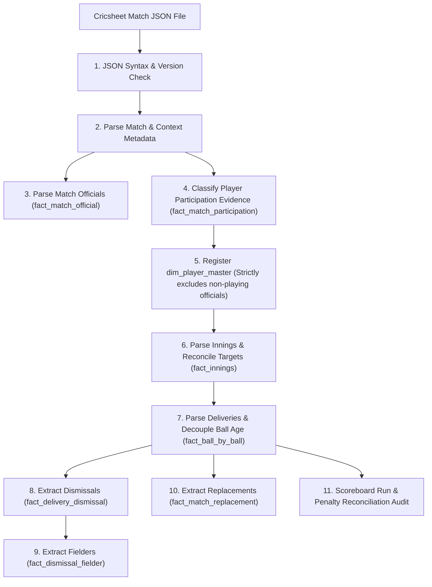

# CricEngine AI — Step 3A Parser Technical Specification (Revised)

> **Specification Version**: `1.1` (Corrective Audit Approved)  
> **Status**: Ready for Production Gate Review  
> **Scope**: Extraction, normalization, ordering, decoupling of ball age, participation evidence classification, and validation rules for Cricsheet JSON v1.2.0 and v1.3.0.

---

## 1. Parser Architecture & Execution Pipeline



---

## 2. Ingestion Flow & Provenance

### Idempotency & Batch Loading
- The parser processes match files in memory and loads them into DuckDB staging tables or writes directly to partitioned Parquet files.
- **Idempotency Rule**: Every table uses a composite primary key derived deterministically from source identifiers. Re-parsing a file produces identical primary keys, allowing idempotent `INSERT OR REPLACE` / merge operations.
- **Provenance Tracking**: Every table records:
  - `source_archive`: e.g. `"ipl_male_json.zip"`.
  - `source_file_path`: e.g. `"extracted/ipl_male/1426261.json"`.
  - `parser_version`: `"3A.1"`.
  - `ingested_at`: UTC timestamp.

---

## 3. Entity Extraction Rules

### A. Match Officials vs. Playing Personnel Separation
- **Officials**: Parsed exclusively from `info.officials`:
  - `umpires` $\to$ `official_role = 'onfield_umpire'`
  - `tv_umpires` $\to$ `official_role = 'tv_umpire'`
  - `match_referees` $\to$ `official_role = 'match_referee'`
  - `reserve_umpires` $\to$ `official_role = 'reserve_umpire'`
  - Stored in `fact_match_official`.
- **Players**: A person is registered in `dim_player_master` **strictly** if:
  1. They appear in `info.players[team_name]`, OR
  2. They appear in `replacements.match` (`in` or `out`), OR
  3. They participate in a delivery event (`batter`, `bowler`, `non_striker`, or credited fielder).
- **Invariance Rule**: Match officials who do not appear as active players or replacements are strictly excluded from `dim_player_master`.

### B. Player Participation Evidence & Confidence Classification
Modern cricket rules (such as IPL Impact Players, concussion substitutes, and extended 12-to-15 player match rosters) mean that `info.players` cannot be treated as synonymous with the starting XI. 

The parser applies evidence-based classification via `classify_player_participation()`:

| Participation Category | In Squad Sheet? | Active On-Field Events? | Replacement Trigger | Evidence Confidence Tier | Description |
| :--- | :---: | :---: | :---: | :--- | :--- |
| **`STARTING_XI`** | Yes | Yes (Batted, Bowled, or Fielded) | None | `CONFIRMED_PLAYING_XI` | Player was named in team lineup and took active part on-field. |
| **`IMPACT_PLAYER`** | Optional | Yes | `reason == 'impact_player'` | `IMPACT_PLAYER` | Tactical substitute entering the match via live replacement event. |
| **`CONCUSSION_SUB`** | Optional | Yes | `reason == 'concussion_substitute'` | `SUBSTITUTE_CONFIRMED` | Medical substitute entering the match via live replacement event. |
| **`SUBSTITUTE_FIELDER`** | No | Yes (Credited with dismissal/catch) | None | `SUBSTITUTE_CONFIRMED` | Fielder who took the field and made a dismissal but was not in starting XI. |
| **`BENCH_NOMINATED`** | Yes | No (0 balls faced, 0 bowled, 0 catches) | None | `UNCONFIRMED_ROSTER` | Listed on team match sheet but never took the field. |

---

## 4. Format-Specific Match Phase Logic (Decoupled Ball Age)

### Decoupling Over Number, Ball Changes, and Ball Age
In multi-day and Test cricket:
- `over_num` is preserved as the exact, immutable source sequence number (0-indexed or 1-indexed over in the innings).
- **Cricsheet Limitation**: Cricsheet match JSON does **not** record explicit `ball_change` or `new_ball_taken` events.
- **Architectural Decision**: The parser **must not auto-reset ball age every 80 overs** using `over_num % 80`. In real cricket, the fielding captain is *eligible* to take a second new ball after 80 overs, but often delays it (e.g. taking it at 85, 95 overs, or not taking it at all if spinners are effective).
- The parser classifies phase into:
  - `INITIAL_NEW_BALL`: Overs 0 to 19.
  - `WORN_BALL_MIDDLE`: Overs 20 to 79.
  - `OLD_BALL_UNCONFIRMED_NEW`: Overs 80+ (acknowledges new ball eligibility without fabricating an unrecorded ball change).
  - `SECOND_NEW_BALL`: Overs where an explicit `new_ball_taken_over` was supplied via external commentary enrichment.

```python
def calculate_match_phase(
    match_format: str,
    over_num: int,
    is_super_over: bool = False,
    scheduled_overs: int = 20,
    ball_age_overs: Optional[int] = None,
    new_ball_taken_over: Optional[int] = None,
) -> str:
    """Format-specific match phase calculation with decoupled ball age."""
    if is_super_over:
        return "SUPER_OVER"

    format_upper = match_format.upper()

    if "T20" in format_upper:
        if scheduled_overs >= 20:
            if over_num <= 5:
                return "POWERPLAY"
            elif over_num <= 14:
                return "MIDDLE"
            else:
                return "DEATH"
        else:
            pp_cutoff = max(0, round(scheduled_overs * 0.3) - 1)
            death_cutoff = scheduled_overs - max(1, round(scheduled_overs * 0.25))
            if over_num <= pp_cutoff:
                return "POWERPLAY"
            elif over_num < death_cutoff:
                return "MIDDLE"
            else:
                return "DEATH"

    elif "ODI" in format_upper or "ONE-DAY" in format_upper:
        if scheduled_overs >= 50:
            if over_num <= 9:
                return "POWERPLAY_1"
            elif over_num <= 39:
                return "MIDDLE"
            else:
                return "DEATH"
        else:
            pp_cutoff = max(0, round(scheduled_overs * 0.2) - 1)
            death_cutoff = scheduled_overs - max(2, round(scheduled_overs * 0.2))
            if over_num <= pp_cutoff:
                return "POWERPLAY_1"
            elif over_num < death_cutoff:
                return "MIDDLE"
            else:
                return "DEATH"

    elif "TEST" in format_upper or "MULTI-DAY" in format_upper:
        if new_ball_taken_over is not None and over_num >= new_ball_taken_over:
            effective_age = over_num - new_ball_taken_over
            if effective_age <= 19:
                return "SECOND_NEW_BALL"
            elif effective_age <= 59:
                return "SECOND_NEW_BALL_MIDDLE"
            else:
                return "OLD_BALL_80_PLUS"

        effective_ball_age = ball_age_overs if ball_age_overs is not None else over_num
        if effective_ball_age <= 19:
            return "INITIAL_NEW_BALL"
        elif effective_ball_age <= 79:
            return "WORN_BALL_MIDDLE"
        else:
            return "OLD_BALL_UNCONFIRMED_NEW"

    return "UNKNOWN"
```

---

## 5. Innings Scoreboard & Penalty Reconciliation

### Invariant & Balance Equation
$$\text{reconciled\_total\_runs} = \sum_{\text{deliveries}} \text{runs\_total} + \text{penalty\_pre} + \text{penalty\_post}$$

$$\sum_{\text{deliveries}} \text{runs\_total} \equiv \sum_{\text{deliveries}} \text{runs\_batter} + \sum_{\text{deliveries}} \text{runs\_extras}$$

### Quality Thresholding Policy:
1. **Mathematical Run Component Imbalance**: If $\sum \text{runs\_total} \ne \sum \text{runs\_batter} + \sum \text{runs\_extras}$, the file has internal corruption $\to$ **`CRITICAL` rejection**.
2. **Scorecard vs Delivery Discrepancy ($\Delta$)**:
   - $\Delta = 0$: Clean match $\to$ **`PASS`**.
   - $\Delta > 0$ with rain/DLS target adjustment recorded in `innings.target`: Legitimate revised calculation $\to$ **`WARNING`** (reason: `DLS_REVISED_TARGET_DIFFERENCE`).
   - $0 < \Delta \le 5$ runs without rain (historical early 2000s clerical scorecard differences): $\to$ **`WARNING`** (reason: `MINOR_HISTORICAL_SCORECARD_DISCREPANCY`). Match is admitted with quality audit flag.
   - $\Delta > 5$ runs without rain or explanation $\to$ **`CRITICAL` rejection** (reason: `SCORECARD_RUN_MISMATCH_EXCEEDS_TOLERANCE`).
