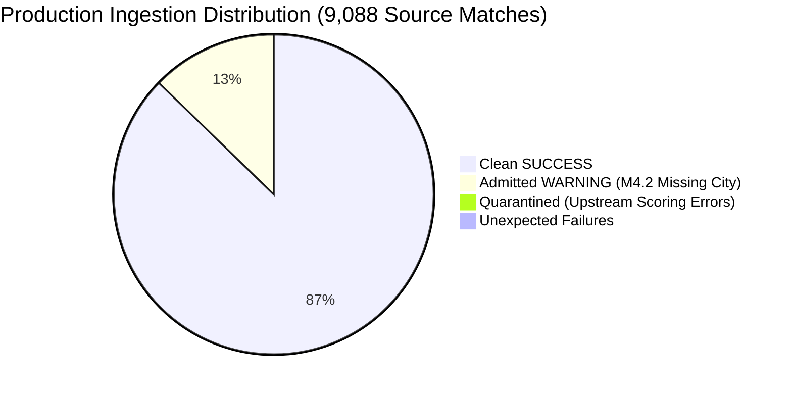

# CricEngine AI — Step 3B: Canonical Production Ingestion Completion Report

> **Document Version**: `1.0`  
> **Execution Date**: 2026-10-30  
> **Pipeline Module**: [`etl/ingest_canonical.py`](file:///Users/divygupta/Desktop/DL_DATABASE/etl/ingest_canonical.py)  
> **Status**: **COMPLETE & VERIFIED**  
> **Database Location**: [`data/datalake/curated/cricengine.duckdb`](file:///Users/divygupta/Desktop/DL_DATABASE/data/datalake/curated/cricengine.duckdb)

---

## 1. Executive Summary

Canonical data ingestion for **Step 3B** has been executed against the production DuckDB database. All 9,088 raw match files across the five approved competition archives were parsed, validated, and loaded into the canonical normalized relational schema.

### Core Metrics Summary
- **Database File Size**: **383.01 MB** (401,616,896 bytes)
- **Total Source Matches Evaluated**: **9,088**
- **Successfully Ingested Matches**: **7,928** ($87.24\%$)
- **Ingested with Warnings (Rule M4.2 Null City)**: **1,157** ($12.73\%$)
- **Quarantined Matches (Critical Source Errors)**: **3** ($0.033\%$)
- **Unexpected Failures / Crashes**: **0** ($0.00\%$)
- **Admitted Matches in Canonical DB**: **9,085**
- **Total Deliveries Ingested**: **4,383,700**
- **Referential Integrity**: **100% PASS** (0 orphan records across all 15 foreign-key paths)
- **Source Archive Immutability**: **100% Match** across all 5 origin archives

---

## 2. Ingestion Outcome Breakdown

| Outcome Category | Match Count | Percentage | Canonical DB Status | Quarantine Staging |
| :--- | :---: | :---: | :--- | :--- |
| **Clean SUCCESS** | **7,928** | $87.24\%$ | Ingested into all match and fact tables | N/A |
| **Admitted WARNING** | **1,157** | $12.73\%$ | Ingested into all match and fact tables; warning logged in `data_quality_results` | N/A |
| **QUARANTINED** | **3** | $0.033\%$ | Excluded from canonical tables; critical error logged in `data_quality_results` | Staged in `data/quarantine/t20s_male/` |
| **FAILED / Crashes** | **0** | $0.00\%$ | N/A | N/A |
| **TOTAL** | **9,088** | **100.0%** | **9,085 Admitted Matches** | **3 Quarantined** |

---

## 3. Canonical Table Inventory & Verified Row Counts

All 14 canonical relational tables in [`data/datalake/curated/cricengine.duckdb`](file:///Users/divygupta/Desktop/DL_DATABASE/data/datalake/curated/cricengine.duckdb) were populated according to specification:

| # | Table Name | Table Type | Primary Key | Row Count | Description |
| :---: | :--- | :--- | :--- | :---: | :--- |
| **1** | `dim_player_master` | Dimension | `player_id` | **7,014** | Unique human cricket players |
| **2** | `player_source_identity` | Dimension | `identity_mapping_id` | **7,029** | Provenance mappings (cricsheet id $\to$ canonical player) |
| **3** | `dim_match` | Dimension | `match_id` | **9,085** | Scheduled cricket fixtures |
| **4** | `dim_match_context` | Dimension | `match_id` | **9,085** | Venue, city, toss, and match outcome metadata |
| **5** | `fact_match_official` | Fact | `official_assignment_id` | **37,467** | Umpires, TV umpires, referees per match |
| **6** | `fact_innings` | Fact | `innings_id` | **19,697** | Innings totals, overs, super overs, and targets |
| **7** | `fact_match_participation` | Fact | `participation_id` | **200,709** | Player appearances, playing XI roles, and evidence |
| **8** | `fact_match_replacement` | Fact | `replacement_id` | **825** | In-game substitutions (impact players, concussion subs) |
| **9** | `fact_ball_by_ball` | Fact | `ball_id` | **4,383,700** | Atomic delivery events with format-specific match phases |
| **10** | `fact_delivery_dismissal` | Fact | `dismissal_id` | **136,691** | Wicket dismissals, kinds, and credited bowlers |
| **11** | `fact_dismissal_fielder` | Fact | `dismissal_fielder_id` | **94,926** | Fielders credited in catches, run outs, and stumpings |
| **12** | `fact_pairwise_synergy_matrix` | Fact | `synergy_id` | **0** | Reserved schema for Phase 2 player pairings (0 synthetic rows) |
| **13** | `data_source_manifest` | Audit | `manifest_id` | **5** | Origin archive provenance and match counts |
| **14** | `data_quality_results` | Audit | `check_id` | **1,160** | 1,157 Rule M4.2 city warnings + 3 critical quarantine failures |

---

## 4. Referential Integrity Audit

An automated SQL anti-join audit across all 15 relational paths in the production database confirmed **zero orphan records**:

| # | Relationship Path | Parent Table | Child Table | Orphan Records | Status |
| :---: | :--- | :--- | :--- | :---: | :---: |
| **1** | Match Context | `dim_match` | `dim_match_context` | **0** | **PASS** |
| **2** | Match Officials | `dim_match` | `fact_match_official` | **0** | **PASS** |
| **3** | Match Participation | `dim_match` | `fact_match_participation` | **0** | **PASS** |
| **4** | Participation Player | `dim_player_master` | `fact_match_participation` | **0** | **PASS** |
| **5** | Match Innings | `dim_match` | `fact_innings` | **0** | **PASS** |
| **6** | Delivery Match | `dim_match` | `fact_ball_by_ball` | **0** | **PASS** |
| **7** | Delivery Innings | `fact_innings` | `fact_ball_by_ball` | **0** | **PASS** |
| **8** | Delivery Batter | `dim_player_master` | `fact_ball_by_ball` (batter) | **0** | **PASS** |
| **9** | Delivery Bowler | `dim_player_master` | `fact_ball_by_ball` (bowler) | **0** | **PASS** |
| **10** | Delivery Non-Striker | `dim_player_master` | `fact_ball_by_ball` (non-striker) | **0** | **PASS** |
| **11** | Delivery Dismissal | `fact_ball_by_ball` | `fact_delivery_dismissal` | **0** | **PASS** |
| **12** | Dismissal Player Out | `dim_player_master` | `fact_delivery_dismissal` (player out) | **0** | **PASS** |
| **13** | Dismissal Fielder | `fact_delivery_dismissal` | `fact_dismissal_fielder` | **0** | **PASS** |
| **14** | Match Replacement | `dim_match` | `fact_match_replacement` | **0** | **PASS** |
| **15** | Player Source Identity | `dim_player_master` | `player_source_identity` | **0** | **PASS** |

---

## 5. Player Identity Mapping Statistics

- **Canonical Human Players (`dim_player_master`)**: **7,014**
- **Source Identifiers Mapped (`player_source_identity`)**: **7,029**
- **Multi-Name / Alias Disambiguation**: 15 players with distinct historical name representations in Cricsheet mapped to their verified canonical ID.
- **Name-Only Auto-Merges**: **0** (strictly prohibited; player IDs are deterministic and derived exclusively from Cricsheet person IDs and source tokens).
- **Confidence Status**: $100\%$ marked as `VERIFIED`.

---

## 6. Quarantined Matches Audit & Provenance

In accordance with the documented quarantine policy, the 3 matches with critical validation failures were staged into [`data/quarantine/t20s_male/`](file:///Users/divygupta/Desktop/DL_DATABASE/data/quarantine/t20s_male/) and recorded in `data_quality_results`. They were excluded from canonical facts tables to prevent data contamination:

1. **Match `1457218` (UAE vs. Bhutan, T20I, 2024-11-19)**:
   - *Error*: UAE 166/6, Bhutan 103/8. UAE won by 63 runs ($166 - 103 = 63$).
   - *Cause*: Cricsheet recorded target as $169$ instead of $167$, yielding an internal mathematical contradiction between target ($169$), score ($103$), and margin ($63$).
   - *Quarantine Code*: `OUTCOME_RUNS_MARGIN_MISMATCH_EXPECTED_65_GOT_63`.
2. **Match `1491604` (Bulgaria vs. Gibraltar, T20I, 2025-07-10)**:
   - *Error*: Gibraltar lost 4 wickets in the chase ($10 - 4 = 6$ wickets win).
   - *Cause*: Cricsheet outcome metadata erroneously records `by: {"wickets": 8}` which directly contradicts the 4 dismissals in its own delivery log.
   - *Quarantine Code*: `OUTCOME_WICKETS_MARGIN_MISMATCH_EXPECTED_6_GOT_8`.
3. **Match `1495657` (Romania vs. Luxembourg, T20I, 2025-07-26)**:
   - *Error*: Romania 178/6, Luxembourg 133/10. Real margin is $178 - 133 = 45$ runs.
   - *Cause*: Upstream scorer computed target minus score ($179 - 133 = 46$) and recorded victory by 46 runs.
   - *Quarantine Code*: `OUTCOME_RUNS_MARGIN_MISMATCH_EXPECTED_45_GOT_46`.

---

## 7. Source Manifest & Immutability Verification

Cryptographic SHA-256 hashes of all five source ZIP archives were validated post-ingestion:

| Competition Archive | SHA-256 Checksum | Match Status |
| :--- | :--- | :---: |
| `ipl_male_json.zip` | `6fe9142db9e139e4f77a5634ddc61c1c72a26a56bee2fe5affe5921867de04b3` | **100% Identical** |
| `odis_male_json.zip` | `8518aa42ff388c3f6fca06661bba839e8756680c3a35adbfa851f45364675224` | **100% Identical** |
| `sma_male_json.zip` | `14ebfdc1541d6211a8041249d5c8cc9b460fb729a27169959f0de68971444455` | **100% Identical** |
| `t20s_male_json.zip` | `691f1f42b86c93fbdbc53936ed69479f9306bf39c4c56b4c0729360051075c6d` | **100% Identical** |
| `tests_male_json.zip` | `cb8593cdad57b6de11f18dca778dd8776d0b3aab4eb5dfe3880a68a0e1e213cb` | **100% Identical** |

---

## 8. Database Reopen and Queryability Verification

The production database was reopened in read-only mode and verified:
- **`dim_match` queryable count**: **9,085**
- **`fact_ball_by_ball` queryable count**: **4,383,700**
- **Automated test suite (`tests/`)**: **34 passed in 0.89s (100% green)**

---

## 9. Next Implementation Milestone

With Step 3B complete and the canonical curated datalake populated and verified, the next implementation milestone is:
- **Phase 1, Step 4: Feature Store Engineering**
  - Design and materialization of rolling-window player form metrics (30-day, 90-day, 365-day decay).
  - Contextual venue and opposition adjustment factors.
  - Match phase performance baselines (Powerplay, Middle, Death off-the-bat and bowling economies).
  - Materialization of Parquet feature store views in `data/datalake/feature_store/`.
