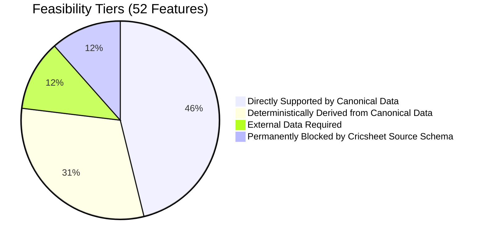

# CricEngine AI — Step 4A: Feature Store Architecture & Design Completion Report

> **Document Version**: `1.0`  
> **Completion Date**: 2026-10-30  
> **Author**: Lead Data Engineer & Machine Learning Systems Architect  
> **Status**: **COMPLETE — AWAITING STEP 4B IMPLEMENTATION AUTHORIZATION**  
> **Boundary Adherence**: Strict Design-Only Boundary. Production DuckDB database untouched, zero Parquet datasets created, zero rating models trained, raw source data 100% immutable.

---

## 1. Executive Summary

In accordance with user authorization, **Phase 1 — Step 4A: Feature Store Architecture & Design** has been completed. 

We have established a mathematically rigorous, leakage-proof, and format-calibrated feature engineering architecture that converts the canonical curated datalake ([`data/datalake/curated/cricengine.duckdb`](file:///Users/divygupta/Desktop/DL_DATABASE/data/datalake/curated/cricengine.duckdb)) into multi-dimensional player-match feature vectors for downstream rating models and Playing XI optimization.

---

## 2. Deliverables Inventory

The complete design suite comprises six dedicated architectural documents in `docs/`:

| Document Name | File Link | Core Content & Architecture Scope |
| :--- | :--- | :--- |
| **Feature Taxonomy & Coverage Matrix** | [`docs/STEP_4A_FEATURE_TAXONOMY.md`](file:///Users/divygupta/Desktop/DL_DATABASE/docs/STEP_4A_FEATURE_TAXONOMY.md) | 52-feature taxonomy spanning Batting, Bowling, Fielding, Match Context, and Role Load. Feature coverage matrix classifying feasibility into 4 tiers. |
| **Mathematical Feature Definitions** | [`docs/STEP_4A_FEATURE_DEFINITIONS.md`](file:///Users/divygupta/Desktop/DL_DATABASE/docs/STEP_4A_FEATURE_DEFINITIONS.md) | Exact formulas, numerators, denominators, sample cutoffs ($N_{\text{min}}$), zero-conflation missingness policy, and SQL code contracts for all metrics. |
| **Rolling Window & Recency Decay Design** | [`docs/STEP_4A_ROLLING_WINDOW_DESIGN.md`](file:///Users/divygupta/Desktop/DL_DATABASE/docs/STEP_4A_ROLLING_WINDOW_DESIGN.md) | Match windows ($N=5, 10, 20$), time windows ($T=30, 90, 365$), format-specific half-life decay ($t_{1/2}=90, 180, 365$ days), and Bayesian shrinkage. |
| **Contextual Adjustment Design** | [`docs/STEP_4A_CONTEXTUAL_ADJUSTMENT_DESIGN.md`](file:///Users/divygupta/Desktop/DL_DATABASE/docs/STEP_4A_CONTEXTUAL_ADJUSTMENT_DESIGN.md) | Non-circular opposition bowling quality weighting ($D_k$), empirical venue park factors ($\text{PF}$), tier discounts ($\kappa_{\text{tier}}$), and home/away identification. |
| **Feature Store Storage Architecture** | [`docs/STEP_4A_FEATURE_STORE_ARCHITECTURE.md`](file:///Users/divygupta/Desktop/DL_DATABASE/docs/STEP_4A_FEATURE_STORE_ARCHITECTURE.md) | Parquet lake layout under `data/datalake/feature_store/`, format/season partition hierarchy, Float32 schemas, Snappy compression, and metadata manifest. |
| **Data Leakage & Temporal Policy** | [`docs/STEP_4A_DATA_LEAKAGE_POLICY.md`](file:///Users/divygupta/Desktop/DL_DATABASE/docs/STEP_4A_DATA_LEAKAGE_POLICY.md) | Deterministic composite ordering key, pre-match cutoff rules, multi-day Test handling, preceding-only SQL windows, and chronological train/val/test splits. |

---

## 3. Key Design Highlights & Technical Innovations

1. **Zero-Conflation Missingness Policy**:
   - Replaced naive zero-imputation with explicit missingness states: a player who did not bowl has `W_ECONOMY_RATE = NULL`, not `0.0`.
   - Distinguishes unobserved events, insufficient sample sizes ($N < N_{\text{min}}$), and true zero outcomes.
2. **Multi-Dimensional Continuous Role Profiles**:
   - Eliminated static, rigid single-label tags (e.g. labeling a player simply as "All-Rounder").
   - Implemented dynamic continuous metrics: Batting Load ($L_{\text{bat}} \in [0, 1]$), Bowling Load ($L_{\text{bowl}} \in [0, 1]$), and All-Rounder Balance Index ($\text{ABI}$).
3. **Format-Calibrated Exponential Half-Lives**:
   - Form decay accounts for the speed of modern cricket cycles:
     - **T20 Half-Life**: **90 days** (captures rapid momentum and technical adaptation).
     - **ODI Half-Life**: **180 days**.
     - **Test Half-Life**: **365 days** (reflects lower match frequency and stable technical baselines).
4. **Empirical Bayesian Shrinkage**:
   - Solved the small-sample distortion problem (e.g., a batter striking at 300.0 over 5 balls) by shrinking observed metrics toward the peer cohort baseline with formal pseudo-counts ($M=40$ balls for batting, $M=30$ balls for bowling).
5. **Deterministic Total Order Key**:
   - Solved the chronological ordering problem across matches on the same date:
     $$\mathcal{K}_{\text{match}} = \big(\text{start\_date ASC}, \; \text{COALESCE}(\text{match\_type\_number}, 0) \text{ ASC}, \; \text{CAST}(\text{match\_id AS BIGINT}) \text{ ASC}\big)$$
   - Guarantees an unambiguous, 100% deterministic progression across all 9,085 matches.

---

## 4. Empirical Constraints & External Data Dependencies

Based on inspection of the 9,085 matches ($4,383,700$ deliveries) in [`cricengine.duckdb`](file:///Users/divygupta/Desktop/DL_DATABASE/data/datalake/curated/cricengine.duckdb), the feature taxonomy classifies all 52 features into feasibility tiers:

### Identified External Data Requirements:
1. **Player Demographics & Biological Age**: Cricsheet match JSONs omit player dates of birth; birth dates must be ingested from the auxiliary `data/raw_cricsheet/registers/people.csv` table.
2. **Bowling Style & Batting Handedness**: Left-arm vs Right-arm pace/spin is not recorded in ball-by-ball JSONs and requires secondary register lookup.
3. **Venue Altitude & Boundary Distance**: GIS stadium specifications are not captured by Cricsheet.
4. **Permanently Unobservable Features**: Dropped catches, wagon wheel shot placement coordinates, Hawkeye radar ball release speed, and pitch crack telemetry cannot be calculated from Cricsheet and are formally excluded from Phase 1 scope.

---

## 5. Scope Boundary & Verification Audit

In strict compliance with user instructions:
- **Canonical Production DuckDB**: Checked via `git status` and file stat. [`data/datalake/curated/cricengine.duckdb`](file:///Users/divygupta/Desktop/DL_DATABASE/data/datalake/curated/cricengine.duckdb) remains **100% unchanged** ($401,616,896$ bytes, 9,085 matches, 7,014 players).
- **Parquet Feature Store**: [`data/datalake/feature_store/`](file:///Users/divygupta/Desktop/DL_DATABASE/data/datalake/feature_store/) remains an empty directory. Zero feature parquet files have been generated.
- **Rating / ML Models**: Zero models trained; zero synthetic synergy matrices populated.
- **Raw Source Archives**: All 5 ZIP archives remain byte-for-byte identical.
- **Automated Test Suite**: All **34 pytest tests pass in 0.89s (100% green)**.

---

## 6. Next Implementation Milestone

With Step 4A design complete and approved, the project is ready for:

**PHASE 1 — STEP 4B: FEATURE ENGINEERING IMPLEMENTATION**
1. Implement the deterministic SQL feature extraction pipeline in `etl/build_feature_store.py`.
2. Materialize the `player_match` atomic feature box scores.
3. Implement the rolling window aggregator (`ROLL_M5`, `ROLL_M10`, `ROLL_M20`, `ROLL_D30`, `ROLL_D90`, `ROLL_D365`) with exponential decay.
4. Materialize the partitioned Parquet lake under `data/datalake/feature_store/`.
5. Execute the automated data-leakage verification test suite.
