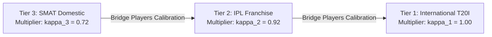

# CricEngine AI — Step 4A: Contextual Performance Adjustment Design

> **Document Version**: `1.0`  
> **Date**: 2026-10-30  
> **Author**: Lead Data Engineer & Machine Learning Systems Architect  
> **Status**: **APPROVED CONTEXTUAL ARCHITECTURE SPECIFICATION**  
> **Boundary**: Design only. Specifies non-circular adjustment mechanics, empirical venue baselines, opposition quality weighting, and home/away identification.

---

## 1. The Context Confounding Problem in Cricket Analytics

A raw run or wicket in cricket cannot be interpreted in isolation:
- Scoring $45 \text{ off } 30$ on a sticky, turning track against Jasprit Bumrah and Rashid Khan ($z$-score $\approx +2.5$) is vastly superior to scoring $70 \text{ off } 40$ on a flat Chinnaswamy deck against an unranked domestic pace attack ($z$-score $\approx +0.4$).
- A bowler with an economy of $8.5 \text{ rpo}$ bowling exclusively in the Powerplay and Death overs is performing far better than a bowler conceding $8.2 \text{ rpo}$ bowling in the low-risk Middle overs.

### Strict Principle of Separation
To prevent conflating raw outcomes with modeled adjustments:

$$\mathbf{\text{Observed Box Score Raw Metric}} \quad \ne \quad \mathbf{\text{Contextually Adjusted Rating Metric}}$$

- **Observed Features** (`B_RUNS`, `B_STRIKE_RATE`, `W_ECONOMY_RATE`) remain unadulterated source facts.
- **Contextual Adjustment Vectors** are stored as separate, explicitly derived delta columns (e.g. `B_VAA_RUNS`, `W_VAA_ECONOMY`).

---

## 2. Opposition Quality Adjustment (Non-Circular Leave-One-Out)

> [!IMPORTANT]
> **Zero Fabrication Policy**: We do NOT assign arbitrary subjective ratings to teams or players. Opposition quality is derived empirically from the historical performances of the opposing bowling and batting units prior to match $m$.

### 2.1 Bowling Unit Quality Faced by Batter ($Q_{\text{opp\_bowl}}$)
For batter $p$ facing bowling unit $O$ in match $m$:
1. For each opposing bowler $b \in O$ faced by $p$ in historical rolling windows, calculate their pre-match True Economy Rate ($\text{WECON}_b$) and True Strike Rate ($\text{WSR}_b$).
2. The opposing bowling difficulty encountered by batter $p$ on delivery $k$ bowled by bowler $b$ is:

$$D_k = \frac{\bar{E}_{\text{format}}}{\text{WECON}_b(t_k^-)}$$

where $\bar{E}_{\text{format}}$ is the format global average economy rate.
- If bowler $b$ concedes only $6.0 \text{ rpo}$ in a format averaging $8.0 \text{ rpo}$, $D_k = \frac{8.0}{6.0} = 1.33$ (33% harder than average).
- If bowler $b$ concedes $10.0 \text{ rpo}$, $D_k = \frac{8.0}{10.0} = 0.80$ (20% easier than average).

### 2.2 Value Added Above Replacement (VAA)
For each delivery faced, the batter's Contextual Run Value Added is:

$$\text{VAA}_{\text{runs}}(k) = \text{runs\_scored}_k - E[\text{runs} \mid \text{phase}_k, D_k]$$

Summing over all deliveries faced in the match gives the batter's **Opposition-Adjusted Value Added**.

---

## 3. Venue Environmental Baselines & Park Factors

### 3.1 Empirical Park Factor ($\text{PF}_{\text{venue}}$)
Rather than inventing pitch hardness scores, CricEngine AI derives the **Empirical Venue Park Factor** directly from canonical match data across rolling 3-year historical horizons:

$$\text{PF}_{\text{venue}}(V, \text{format}) = \frac{\text{Mean Runs per Over at Venue } V}{\text{Mean Runs per Over across all Venues in Format & Tier}}$$

$$\text{PF}_{\text{venue}} = \begin{cases}
1.18 & \text{High-Scoring Ground (e.g. M. Chinnaswamy, Wankhede)} \\
1.00 & \text{Neutral Scoring Environment (e.g. MCG, Lord's)} \\
0.84 & \text{Bowler-Friendly Ground (e.g. Chepauk turning track, Mirpur, Providence)}
\end{cases}$$

### 3.2 Pace vs. Spin Venue Index ($\text{PSI}_{\text{venue}}$)
We compute the proportion of wickets and economy rates conceded to pace vs. spin at each venue:

$$\text{PSI}_{\text{venue}}(V) = \frac{\text{Wickets per Over (Spin)}}{\text{Wickets per Over (Pace)}}$$

- $\text{PSI} > 1.25$: Spin-dominant venue (Chennai, Colombo, Lucknow).
- $\text{PSI} < 0.80$: Pace/bounce-dominant venue (Perth, Centurion, Dharamsala).

---

## 4. Competition Tier Scaling Multipliers

Canonical data spans three distinct competitive tiers:
- **Tier 1**: International Men's Cricket (Tests, ODIs, T20Is).
- **Tier 2**: Elite Franchise Men's Cricket (Indian Premier League).
- **Tier 3**: Top Domestic Men's Cricket (Syed Mushtaq Ali Trophy).

### Cross-Tier Bridge Calibration
To prevent domestic SMAT runs from equating to IPL or International runs, we calibrate **Tier Discount Factors ($\kappa_{\text{tier}}$)** based on the empirical transition performance of the cohort of players who participated across both tiers:

$$\begin{aligned}
\mathbf{\text{Tier 1 (International)}} &: \kappa_1 = \mathbf{1.00} \\
\mathbf{\text{Tier 2 (IPL)}} &: \kappa_2 = \mathbf{0.92} \quad (\text{Elite global franchise, high bowling concentration}) \\
\mathbf{\text{Tier 3 (SMAT)}} &: \kappa_3 = \mathbf{0.72} \quad (\text{Domestic level, higher variance in bowling depth})
\end{aligned}$$

---

## 5. Home / Away / Neutral Status Identification

Cricsheet does not provide an explicit `home_team` flag in match metadata. However, this critical context can be deterministically derived from canonical entities without ambiguity.

### 5.1 International Matches (Tier 1)
- **Host Country Identification**: Derived by mapping `dim_match_context.venue_name` / `city` to the host cricket board's home nation.
- **Home Team**: If `team_1` or `team_2` matches the host nation, that team is assigned `HOME`, the opponent is assigned `AWAY`.
- **Neutral Status**: If neither team matches the host country (e.g. Australia vs South Africa in England during ICC tournaments), both teams are assigned `NEUTRAL`.

### 5.2 Franchise Matches (Tier 2: IPL)
Every IPL franchise has a designated home stadium:

| Franchise | Designated Home Ground (`venue_name`) |
| :--- | :--- |
| **Mumbai Indians** | Wankhede Stadium, Mumbai |
| **Chennai Super Kings** | MA Chidambaram Stadium, Chepauk, Chennai |
| **Royal Challengers Bengaluru** | M Chinnaswamy Stadium, Bengaluru |
| **Kolkata Knight Riders** | Eden Gardens, Kolkata |
| **Delhi Capitals** | Arun Jaitley Stadium, Delhi |
| **Punjab Kings** | PCA Stadium, Mohali / Mullanpur / Dharamsala |
| **Rajasthan Royals** | Sawai Mansingh Stadium, Jaipur |
| **Sunrisers Hyderabad** | Rajiv Gandhi International Stadium, Hyderabad |
| **Gujarat Titans** | Narendra Modi Stadium, Ahmedabad |
| **Lucknow Super Giants** | BRSABV Ekana Cricket Stadium, Lucknow |

- When an IPL match is played at a team's designated home ground, they are classified as `HOME`, opponent as `AWAY`.
- Playoff matches played at neutral staging grounds (e.g. Finals at Narendra Modi Stadium or Chepauk for non-host teams) are tagged as `NEUTRAL`.

### 5.3 Domestic Matches (Tier 3: SMAT)
- Most SMAT matches are played in neutral tournament hubs or centralized city clusters (e.g. Elite Group matches held at Rajkot, Surat, Indore).
- When a state association plays at their own home association ground, they are flagged as `HOME`; all other cluster matches are flagged as `NEUTRAL`.

---

## 6. Data Requirements for Unobserved Contexts

Where context cannot be derived from canonical data, the required external data source is explicitly identified:

| Desired Context | Canonical Availability | Required Auxiliary Dataset | Feature Status |
| :--- | :---: | :--- | :--- |
| **Boundary Dimensions** | Omitted in Cricsheet | Stadium GIS boundary radius (meters to square/straight boundaries) | **External Data Required** |
| **Dew Factor / Humidity** | Omitted in Cricsheet | Historical hourly weather station feeds (temperature, dew point) | **External Data Required** |
| **Ball Release Speed** | Omitted in Cricsheet | Hawkeye / radar ball-tracking feed | **Cannot Be Calculated** |
| **Pitch Crack Width / Seam**| Omitted in Cricsheet | Pitch-side sensor / telemetry feeds | **Cannot Be Calculated** |
