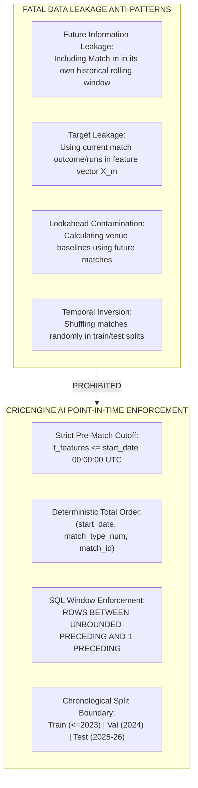
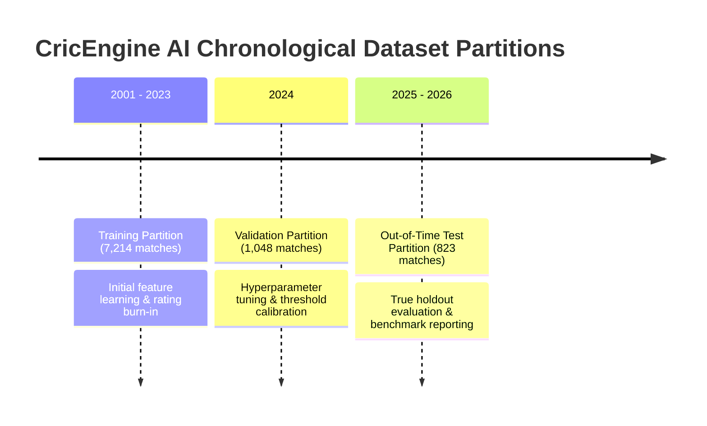

# CricEngine AI — Step 4A: Data Leakage Prevention & Temporal Ordering Policy

> **Document Version**: `1.0`  
> **Date**: 2026-10-30  
> **Author**: Lead Data Engineer & Machine Learning Systems Architect  
> **Status**: **APPROVED FORMAL AUDIT POLICY**  
> **Criticality**: **MANDATORY SYSTEM-WIDE INVARIANT**

---

## 1. The Threat of Data Leakage in Cricket Machine Learning

In sports analytics, data leakage is the single most common cause of artificially inflated offline model performance and disastrous real-world failure.



### The Golden Rule of Feature Engineering
For any feature vector $X_i(m)$ describing player $i$ entering match $m$:

$$\mathbf{X_i(m) = f\left(\mathcal{D}_{\text{historical}} \mid t < t_{\text{match\_start}}(m)\right)}$$

Under no circumstances may any delivery, wicket, run, toss result, or scoreboard outcome from match $m$ be present in $X_i(m)$.

---

## 2. Deterministic Chronological Total Order Key

To compute running historical windows across 9,085 matches without non-deterministic ties, a **Strict Total Order** is formally established.

### 2.1 The Total Order Key Formulation
Across all competitions, matches are ordered chronologically by the composite key:

$$\mathbf{\mathcal{K}_{\text{match}}} = \Big(\text{start\_date ASC}, \; \text{COALESCE}(\text{match\_type\_number}, 0) \text{ ASC}, \; \text{CAST}(\text{match\_id AS BIGINT}) \text{ ASC}\Big)$$

1. **`start_date ASC`**: Primary calendar progression.
2. **`COALESCE(match_type_number, 0) ASC`**: For international cricket (Tests, ODIs, T20Is), Cricsheet populates `match_type_number` ($100\%$ populated in canonical DB), which reflects the official ICC chronological match numbering.
3. **`CAST(match_id AS BIGINT) ASC`**: For domestic (SMAT) and franchise (IPL) fixtures where `match_type_number` is null, Cricsheet assigns integer match IDs in strictly monotonic chronological sequence.

> [!IMPORTANT]
> **Zero Tie Invariant**: Because `match_id` is globally unique and monotonic, the composite key $\mathcal{K}_{\text{match}}$ guarantees **zero ties** across the entire historical datalake. Every single match has a unique, deterministic integer position $j \in [1, 9085]$.

---

## 3. Handling Critical Edge Cases

### 3.1 Multi-Day Matches (Tests and Reserve Days)
- **The Problem**: A Test match spans 5 calendar days (`start_date` to `end_date`), or an ODI/T20 has a reserve day (e.g. IPL 2023 final spanned May 28 to May 29).
- **The Rule**: The evaluation cutoff timestamp for match $m$ is **strictly fixed at `start_date 00:00:00 UTC`** (prior to the toss on Day 1).
- Even if a player bats on Day 4 of a Test, their feature vector reflects their capability as of the start of Day 1. Events from Days 1–3 of that Test are part of match $m$ and are **never** leaked into $X_i(m)$.

### 3.2 Double-Headers on the Same Calendar Date
- **The Problem**: In associate T20 tournaments or domestic leagues, teams or players occasionally play two separate matches on the exact same calendar date (5 observed team instances in canonical data).
- **The Rule**: Match 1 and Match 2 are ordered by `match_number` or `CAST(match_id AS BIGINT)`.
  - When Match 1 is evaluated: It includes history up to Match 1 $- 1$.
  - When Match 2 is evaluated: It includes history up to Match 1. Match 1's completed box score is admissible into Match 2's rolling history only if Match 1 was fully concluded prior to Match 2's start.

---

## 4. SQL Windowing Enforcement Mechanics

All historical aggregates in the feature engine must use explicit **preceding-only window frames**.

### 4.1 Permitted Window Specification
```sql
-- CORRECT: Strictly excludes the current match
SUM(runs_scored) OVER (
    PARTITION BY player_id, match_format
    ORDER BY start_date ASC, COALESCE(match_type_number, 0) ASC, CAST(match_id AS BIGINT) ASC
    ROWS BETWEEN 10 PRECEDING AND 1 PRECEDING
) AS rolling_runs_last_10
```

### 4.2 Prohibited Window Specifications
```sql
-- FATAL ERROR: Default SQL window frame includes CURRENT ROW!
-- This causes severe data leakage!
SUM(runs_scored) OVER (
    PARTITION BY player_id
    ORDER BY start_date ASC
    -- Implicit: ROWS BETWEEN UNBOUNDED PRECEDING AND CURRENT ROW (LEAKAGE!)
)
```

> [!CAUTION]
> **Automated Leakage Audit Gate**: Any SQL extraction query containing `CURRENT ROW` or failing to specify `1 PRECEDING` will be rejected by the automated validation gate in Step 4B.

---

## 5. Non-Circular Contextual Baseline Calculation

When computing venue park factors or opposition bowling strength, circular leakage occurs if the current match $m$ is included in calculating the venue's average or the opposition's strength.

### Leave-One-Out Historical Formulation
To prevent circularity, all venue park factors and opposition unit ratings must be computed using **expanding historical windows strictly prior to match $m$**:

$$\text{PF}_{\text{venue}}(V, m) = \frac{\sum_{k < m, \text{venue}_k = V} \text{runs}_k / \text{overs}_k}{\sum_{k < m} \text{runs}_k / \text{overs}_k}$$

If a venue has fewer than 5 historical matches prior to match $m$, it falls back to the format global baseline ($1.00$).

---

## 6. Chronological Dataset Split Strategy

Machine learning models evaluating CricEngine AI features must never use random $k$-fold cross-validation, which shuffles future matches into training sets.

### Formal Temporal Split Boundaries
The canonical datalake (covering 2001 to 2026) is divided strictly chronologically:



1. **Training Set ($\mathcal{D}_{\text{train}}$)**: Matches with `start_date <= '2023-12-31'`.
   - Used for initial Glicko rating convergence, regression weights, and cohort shrinkage parameters.
2. **Validation Set ($\mathcal{D}_{\text{val}}$)**: Matches from `'2024-01-01'` to `'2024-12-31'`.
   - Used for tuning half-life parameters ($t_{1/2}$) and shrinkage strengths ($M$).
3. **Out-of-Time Test Set ($\mathcal{D}_{\text{test}}$)**: Matches from `'2025-01-01'` to `'2026-10-30'`.
   - Strictly untouched holdout set used exclusively for final rating model evaluation and Playing XI simulation accuracy.
