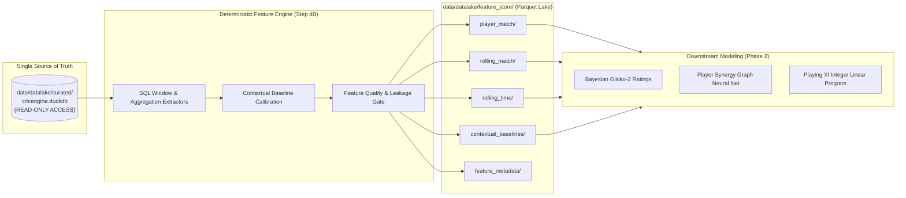

# CricEngine AI — Step 4A: Feature Store Architecture & Parquet Layout Specification

> **Document Version**: `1.0`  
> **Date**: 2026-10-30  
> **Author**: Lead Data Engineer & Machine Learning Systems Architect  
> **Status**: **APPROVED FEATURE STORE ARCHITECTURE**  
> **Boundary**: Design only. Specifies storage format, partition keys, directory structure, and lineage governance.

---

## 1. Storage Principles & System Boundary

The CricEngine AI Feature Store decouples analytical feature generation from relational ingestion:



### Core Architecture Rules:
1. **DuckDB Immutability**: The feature generation process opens `cricengine.duckdb` in **strict read-only mode** (`duckdb.connect(..., read_only=True)`). No table, view, or row in the curated database is ever modified.
2. **Columnar Parquet Storage**: All materialized feature sets are stored as Apache Parquet files using **Snappy compression** and **dictionary encoding** for high-throughput batch training.
3. **Point-in-Time Correctness**: Every feature record is timestamped as of the evaluated match's `start_date` before ball 1 is bowled, guaranteeing zero data leakage.

---

## 2. Directory Layout & Partitioning Strategy

All feature store artifacts reside under [`data/datalake/feature_store/`](file:///Users/divygupta/Desktop/DL_DATABASE/data/datalake/feature_store/):

```text
data/datalake/feature_store/
├── _manifest.json                                   # Feature store global versioning manifest
├── feature_metadata/                                # Data dictionary and lineage definitions
│   ├── feature_catalog_v1.json                      # Formal schema definitions and types
│   └── transformation_lineage.json                  # SQL queries and dependency graph
│
├── contextual_baselines/                            # Empirical ground, phase, and tier baselines
│   ├── format=T20/
│   │   ├── venue_park_factors.parquet
│   │   ├── phase_scoring_baselines.parquet
│   │   └── opposition_bowling_baselines.parquet
│   ├── format=ODI/
│   │   ├── venue_park_factors.parquet
│   │   └── phase_scoring_baselines.parquet
│   └── format=Test/
│       ├── venue_park_factors.parquet
│       └── ball_age_scoring_baselines.parquet
│
├── player_match/                                    # Tier 2: Atomic player box scores per match
│   ├── format=T20/
│   │   ├── season=2024/part-0.parquet
│   │   ├── season=2025/part-0.parquet
│   │   └── season=2026/part-0.parquet
│   ├── format=ODI/
│   │   └── season=2024/part-0.parquet
│   └── format=Test/
│       └── season=2024/part-0.parquet
│
├── rolling_match/                                   # Tier 3A: Match-based rolling features (N=5, 10, 20)
│   ├── format=T20/
│   │   ├── window=5/season=2024/part-0.parquet
│   │   ├── window=10/season=2024/part-0.parquet
│   │   └── window=20/season=2024/part-0.parquet
│   └── format=ODI/
│       └── ...
│
└── rolling_time/                                    # Tier 3B: Time-based rolling features (T=30, 90, 365)
    ├── format=T20/
    │   ├── window_days=30/season=2024/part-0.parquet
    │   ├── window_days=90/season=2024/part-0.parquet
    │   └── window_days=365/season=2024/part-0.parquet
    └── format=ODI/
        └── ...
```

### Partitioning Rationale:
- **`format={T20|ODI|Test}` (Primary Partition)**: Machine learning models are trained separately by format (e.g. T20 rating models never ingest Test rolling metrics directly). Format partitioning ensures zero redundant scans.
- **`season={YYYY}` (Secondary Partition)**: Enables parallelized chunk generation and efficient chronological time-slice extraction for train/validation/test splits.

---

## 3. Schema Specifications & Field Types

To optimize memory usage and GPU tensor loading, floating-point metrics are stored as `FLOAT32` (saving $50\%$ storage over `FLOAT64` without loss of sporting precision), and categorical columns use dictionary encoding.

### 3.1 `player_match` Schema Contract
| Column Name | Arrow Data Type | Nullable | Description |
| :--- | :--- | :---: | :--- |
| `player_id` | `string` | No | Canonical player identifier |
| `match_id` | `string` | No | Match fixture identifier |
| `competition_name` | `dictionary<int8, string>` | No | Competition label |
| `competition_tier` | `int8` | No | 1 (International), 2 (IPL), 3 (SMAT) |
| `match_format` | `dictionary<int8, string>` | No | `T20`, `ODI`, `Test` |
| `start_date` | `date32` | No | Fixture calendar date |
| `batting_innings_num`| `int8` | Yes | Innings sequence (1 or 2) |
| `batting_position` | `int8` | Yes | Crease entry rank (1 to 11) |
| `runs_scored` | `int16` | Yes | Runs scored by batter |
| `balls_faced` | `int16` | Yes | Legal deliveries faced |
| `boundary_fours` | `int8` | Yes | Fours hit |
| `boundary_sixes` | `int8` | Yes | Sixes hit |
| `is_dismissed` | `bool` | Yes | True if dismissed |
| `dismissal_kind` | `dictionary<int8, string>` | Yes | Kind of wicket |
| `overs_bowled` | `float32` | Yes | Completed overs |
| `legal_balls_bowled`| `int16` | Yes | Legal balls bowled |
| `runs_conceded` | `int16` | Yes | Bowler-credited runs |
| `wickets_taken` | `int8` | Yes | Bowler-credited wickets |
| `maiden_overs` | `int8` | Yes | Maiden overs bowled |
| `catches_taken` | `int8` | No | Outfield / keeper catches |
| `stumpings_taken` | `int8` | No | Stumpings executed |
| `runouts_involved` | `int8` | No | Run outs credited |
| `participation_role`| `dictionary<int8, string>` | No | `STARTING_XI`, `IMPACT_PLAYER`, etc. |
| `batting_load` | `float32` | No | Share of team balls faced |
| `bowling_load` | `float32` | No | Share of team overs bowled |
| `allrounder_index` | `float32` | No | Harmonic load index |

---

### 3.2 `rolling_match` Schema Contract
| Column Name | Arrow Data Type | Nullable | Description |
| :--- | :--- | :---: | :--- |
| `player_id` | `string` | No | Canonical player identifier |
| `match_id` | `string` | No | Evaluated match fixture |
| `window_size` | `int8` | No | 5, 10, or 20 matches |
| `evaluation_date` | `date32` | No | `start_date` of evaluated match |
| `matches_evaluated` | `int8` | No | Actual matches in window ($n \le N$) |
| `rolling_runs` | `int32` | Yes | Sum of runs in window |
| `rolling_balls_faced`| `int32` | Yes | Sum of balls faced in window |
| `rolling_batting_sr` | `float32` | Yes | Batting strike rate (Null if $< N_{\text{min}}$) |
| `rolling_batting_avg`| `float32` | Yes | Batting average (Null if $< D_{\text{min}}$) |
| `rolling_boundary_pct`| `float32` | Yes | Boundary ball percentage |
| `rolling_dot_pct_faced`| `float32`| Yes | Dot ball percentage faced |
| `rolling_overs_bowled`| `float32`| Yes | Overs bowled in window |
| `rolling_runs_conceded`| `int32` | Yes | Runs conceded in window |
| `rolling_wickets` | `int16` | Yes | Wickets taken in window |
| `rolling_economy_rate`| `float32`| Yes | Economy rate (Null if $< N_{\text{min}}$) |
| `rolling_bowling_sr` | `float32` | Yes | Bowling strike rate |
| `rolling_bowling_avg` | `float32` | Yes | Bowling average |
| `rolling_dot_pct_bowled`| `float32`| Yes| Dot ball percentage bowled |
| `shrunk_batting_sr` | `float32` | Yes | Bayesian-shrunk strike rate |
| `shrunk_economy_rate`| `float32` | Yes | Bayesian-shrunk economy rate |
| `decayed_batting_sr` | `float32` | Yes | Exponentially recency-decayed strike rate |
| `decayed_economy_rate`| `float32`| Yes | Exponentially recency-decayed economy rate |

---

## 4. Metadata Governance & Lineage Versioning

Every write to the feature store is recorded in [`data/datalake/feature_store/_manifest.json`](file:///Users/divygupta/Desktop/DL_DATABASE/data/datalake/feature_store/_manifest.json):

```json
{
  "feature_store_version": "1.0.0",
  "source_database_path": "data/datalake/curated/cricengine.duckdb",
  "source_database_sha256": "4ccb9f44e6ad9555...",
  "created_at": "2026-10-30T00:00:00Z",
  "compression": "SNAPPY",
  "format_support": ["T20", "ODI", "Test"],
  "partitions": {
    "player_match": ["format", "season"],
    "rolling_match": ["format", "window", "season"],
    "rolling_time": ["format", "window_days", "season"]
  },
  "lineage_hash": "e3b0c44298fc1c149afbf4c8996fb92427ae41e4649b934ca495991b7852b855"
}
```

This guarantees complete traceability from any model training dataset back to the exact DuckDB database state from which it was extracted.
