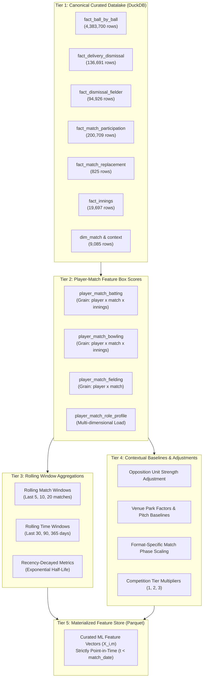
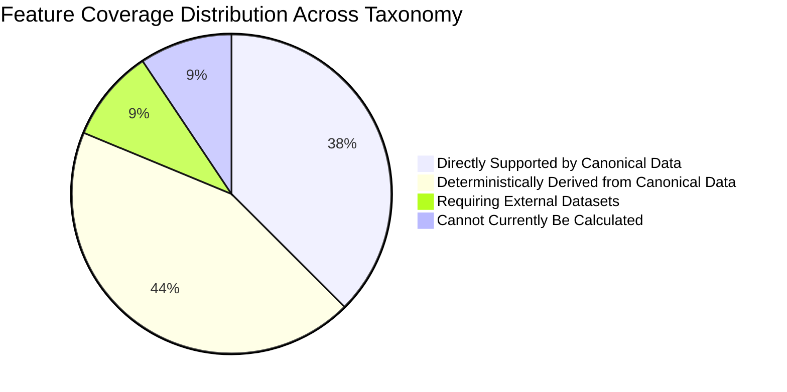

# CricEngine AI — Step 4A: Feature Taxonomy & Coverage Specification

> **Document Version**: `1.0`  
> **Date**: 2026-10-30  
> **Author**: Lead Data Engineer & Machine Learning Systems Architect  
> **Status**: **APPROVED DESIGN SPECIFICATION**  
> **Boundary**: Design only. No Parquet generation, rating models, or database modifications.

---

## 1. Architectural Foundations & Taxonomy Hierarchy

The CricEngine AI feature engineering system bridges the canonical relational datalake ([`data/datalake/curated/cricengine.duckdb`](file:///Users/divygupta/Desktop/DL_DATABASE/data/datalake/curated/cricengine.duckdb)) and downstream player rating models (Bayesian Glicko-2, Deep Learning embeddings, and Playing XI integer programming).

The feature taxonomy is organized into **five primary operational domains**:
1. **Batting Performance Domain** ($B$)
2. **Bowling Performance Domain** ($W$)
3. **Fielding & Wicketkeeping Domain** ($F$)
4. **Match Context & Environmental Domain** ($C$)
5. **Role, Load & Participation Domain** ($R$)

---

## 2. Comprehensive Domain Taxonomies

### 2.1 Batting Performance Domain ($B$)

Batting is evaluated across four orthogonal axes: **Volume**, **Efficiency**, **Longevity/Risk**, and **Phase-Specific Specialization**.

| Sub-Domain | Feature Identifier | Canonical Name | Mathematical Concept | Relational Source Grain |
| :--- | :--- | :--- | :--- | :--- |
| **Volume** | `B_RUNS` | Runs Scored | $\sum \text{runs\_batter}$ | `fact_ball_by_ball` |
| **Volume** | `B_BALLS_FACED` | Balls Faced | Count of deliveries faced (excluding wides) | `fact_ball_by_ball` |
| **Volume** | `B_INNINGS_BATTED` | Innings Batted | Count of innings with $\ge 1$ ball faced or dismissed as striker | `fact_ball_by_ball`, `fact_delivery_dismissal` |
| **Efficiency** | `B_STRIKE_RATE` | Batting Strike Rate | $\frac{\text{Runs Scored}}{\text{Balls Faced}} \times 100$ | Derived: `B_RUNS` / `B_BALLS_FACED` |
| **Efficiency** | `B_RUNS_PER_INNINGS`| Runs per Innings | $\frac{\text{Runs Scored}}{\text{Innings Batted}}$ | Derived: `B_RUNS` / `B_INNINGS_BATTED` |
| **Efficiency** | `B_BOUNDARY_PCT` | Boundary Ball % | $\frac{\text{Balls with (runs\_batter} \in \{4, 6\})}{\text{Balls Faced}} \times 100$ | `fact_ball_by_ball` |
| **Efficiency** | `B_BOUNDARY_RUN_PCT`| Boundary Run Contribution % | $\frac{\sum \text{runs from 4s and 6s}}{\text{Runs Scored}} \times 100$ | `fact_ball_by_ball` |
| **Efficiency** | `B_DOT_PCT` | Dot Ball % Faced | $\frac{\text{Balls Faced with 0 runs}}{\text{Balls Faced}} \times 100$ | `fact_ball_by_ball` |
| **Efficiency** | `B_NON_BOUNDARY_SR`| Non-Boundary Strike Rate | Strike rate from 1s, 2s, 3s (strike rotation capacity) | `fact_ball_by_ball` |
| **Longevity** | `B_AVERAGE` | Batting Average | $\frac{\text{Runs Scored}}{\text{Dismissals Count}}$ (Undefined if dismissals = 0) | `fact_ball_by_ball`, `fact_delivery_dismissal` |
| **Longevity** | `B_DISMISSAL_FREQ`| Balls per Dismissal | $\frac{\text{Balls Faced}}{\text{Dismissals Count}}$ | Derived |
| **Longevity** | `B_NOT_OUT_PCT` | Not-Out Frequency % | $\frac{\text{Innings Batted} - \text{Dismissals}}{\text{Innings Batted}} \times 100$ | Derived |
| **Longevity** | `B_DUCK_PCT` | Duck Frequency % | $\frac{\text{Innings where dismissed with 0 runs}}{\text{Innings Batted}} \times 100$ | Derived |
| **Phase** | `B_SR_POWERPLAY` | Powerplay Strike Rate | Strike rate during format-specific Powerplay | `fact_ball_by_ball.match_phase` |
| **Phase** | `B_SR_MIDDLE` | Middle Overs Strike Rate | Strike rate during Middle phase | `fact_ball_by_ball.match_phase` |
| **Phase** | `B_SR_DEATH` | Death Overs Strike Rate | Strike rate during Death phase (Overs 15-19 in T20) | `fact_ball_by_ball.match_phase` |
| **Phase** | `B_BOUNDARY_DEATH` | Death Boundary % | Boundary % achieved in overs 15-19 | `fact_ball_by_ball.match_phase` |

---

### 2.2 Bowling Performance Domain ($W$)

Bowling features evaluate **Workload/Volume**, **Run Concession (Economy)**, **Penetration (Wicket-Taking Capacity)**, and **Control**.

| Sub-Domain | Feature Identifier | Canonical Name | Mathematical Concept | Relational Source Grain |
| :--- | :--- | :--- | :--- | :--- |
| **Volume** | `W_BALLS_BOWLED` | Legal Deliveries Bowled | Count of legal deliveries (`is_legal_delivery = TRUE`) | `fact_ball_by_ball` |
| **Volume** | `W_OVERS_BOWLED` | Overs Bowled | $\lfloor \frac{\text{Legal Balls}}{6} \rfloor + \frac{\text{Legal Balls} \pmod 6}{10}$ | `fact_ball_by_ball` |
| **Volume** | `W_INNINGS_BOWLED` | Innings Bowled | Distinct innings where player bowled $\ge 1$ ball | `fact_ball_by_ball` |
| **Economy** | `W_RUNS_CONCEDED` | Runs Conceded | $\sum (\text{runs\_batter} + \text{wides} + \text{noballs})$ | `fact_ball_by_ball` |
| **Economy** | `W_ECONOMY_RATE` | Bowling Economy Rate | $\frac{\text{Runs Conceded}}{\text{Legal Deliveries} / 6.0}$ | Derived: `W_RUNS_CONCEDED` / `W_BALLS_BOWLED` |
| **Economy** | `W_DOT_PCT` | Dot Ball % Bowled | $\frac{\text{Deliveries with 0 total runs}}{\text{Legal Deliveries Bowled}} \times 100$ | `fact_ball_by_ball` |
| **Economy** | `W_BOUNDARY_CONC_PCT`| Boundary Conceded % | $\frac{\text{Deliveries conceding 4 or 6}}{\text{Legal Deliveries Bowled}} \times 100$ | `fact_ball_by_ball` |
| **Economy** | `W_EXTRAS_PCT` | Illegal Extras Rate % | $\frac{\text{Wides} + \text{No-balls}}{\text{Total Deliveries Bowled}} \times 100$ | `fact_ball_by_ball` |
| **Economy** | `W_MAIDENS` | Maiden Overs | Overs of 6 legal balls with 0 bowler runs conceded | `fact_ball_by_ball` (derived per over) |
| **Penetration**| `W_WICKETS` | Wickets Taken | Count of dismissals where `bowler_credited = TRUE` | `fact_delivery_dismissal` |
| **Penetration**| `W_STRIKE_RATE` | Bowling Strike Rate | $\frac{\text{Legal Deliveries Bowled}}{\text{Wickets Taken}}$ | Derived |
| **Penetration**| `W_AVERAGE` | Bowling Average | $\frac{\text{Runs Conceded}}{\text{Wickets Taken}}$ | Derived |
| **Penetration**| `W_MULTI_WICKET_PCT`| 3+ Wicket Inning % | $\frac{\text{Innings with } \ge 3 \text{ wickets}}{\text{Innings Bowled}} \times 100$ | Derived |
| **Phase** | `W_ECON_POWERPLAY` | Powerplay Economy Rate | Economy rate in format Powerplay phase | `fact_ball_by_ball.match_phase` |
| **Phase** | `W_ECON_MIDDLE` | Middle Phase Economy Rate | Economy rate in Middle phase | `fact_ball_by_ball.match_phase` |
| **Phase** | `W_ECON_DEATH` | Death Overs Economy Rate | Economy rate in Death phase | `fact_ball_by_ball.match_phase` |
| **Phase** | `W_WKTS_DEATH` | Death Phase Wickets | Wickets taken in Death phase | `fact_delivery_dismissal`, `fact_ball_by_ball` |

---

### 2.3 Fielding & Wicketkeeping Domain ($F$)

Fielding is captured at individual contribution level through official dismissal involvement.

| Feature Identifier | Canonical Name | Mathematical Concept | Relational Source Grain |
| :--- | :--- | :--- | :--- |
| `F_CATCHES_OUTFIELD` | Outfield Catches | Dismissals with `kind = 'caught'` where player is not keeper | `fact_dismissal_fielder`, `fact_delivery_dismissal` |
| `F_CATCHES_KEEPER` | Wicketkeeper Catches | Catches taken while identified as designated wicketkeeper | `fact_dismissal_fielder` |
| `F_STUMPINGS` | Stumpings Executed | Dismissals with `kind = 'stumped'` credited to fielder | `fact_dismissal_fielder` |
| `F_RUNOUTS_DIRECT` | Direct-Hit Run Outs | Run outs with exactly 1 fielder credited (`fielder_seq = 1`) | `fact_dismissal_fielder` |
| `F_RUNOUTS_ASSISTED`| Assisted / Relay Run Outs | Run outs with $\ge 2$ fielders credited | `fact_dismissal_fielder` |
| `F_TOTAL_DISMISSAL_INVOLVEMENTS` | Total Dismissal Involvement | $\sum (\text{Catches} + \text{Stumpings} + \text{Run Outs})$ | `fact_dismissal_fielder` |

---

### 2.4 Match Context & Environmental Domain ($C$)

Context features describe the environmental baseline against which player performances occur.

| Feature Identifier | Canonical Name | Description | Relational Source |
| :--- | :--- | :--- | :--- |
| `C_COMPETITION_TIER` | Competition Tier | Tier 1 (International: Test/ODI/T20I), Tier 2 (IPL), Tier 3 (SMAT) | `dim_match.competition_tier` |
| `C_MATCH_FORMAT` | Match Format | `T20`, `ODI`, `Test` | `dim_match.match_format` |
| `C_OPPOSITION_TEAM` | Opposing Team Name | Team facing the player | `dim_match.team_1`, `dim_match.team_2` |
| `C_VENUE_NAME` | Venue Facility Name | Exact stadium facility | `dim_match_context.venue_name` |
| `C_HOST_CITY` | Host Municipality | City string (or SQL `NULL` under Rule M4.2) | `dim_match_context.city` |
| `C_HOME_STATUS` | Home / Away / Neutral Status | `HOME` (player team matches host venue/country), `AWAY`, `NEUTRAL` | Contextually Derived |
| `C_INNINGS_NUM` | Innings Sequence | 1st Innings (Setting Target) vs 2nd Innings (Chasing) | `fact_innings.innings_num` |
| `C_BATTING_POSITION` | Batting Order Position | Inning order when entering crease ($1$ to $11$) | Derived: `fact_ball_by_ball` crease entry |
| `C_MATCH_PHASE` | Active Match Phase | `POWERPLAY`, `MIDDLE`, `DEATH`, `NEW_BALL`, `OLD_BALL` | `fact_ball_by_ball.match_phase` |
| `C_TOSS_DECISION` | Toss Decision Impact | `bat` or `field` by toss winner | `dim_match_context.toss_decision` |
| `C_MATCH_RESULT` | Match Outcome Status | `WON`, `LOST`, `TIED`, `NO_RESULT` | `dim_match_context.outcome_winner` |

---

### 2.5 Role, Load & Participation Domain ($R$)

Rather than forcing players into rigid, static single labels (e.g. "Batter" or "Bowler"), CricEngine AI models player capacity via **continuous empirical load distributions**:

$$\begin{aligned}
\mathbf{\text{Batting Load } (L_{\text{bat}})} &= \frac{\text{Balls Faced by Player in Match}}{\text{Total Team Balls Faced in Match}} \in [0.0, 1.0] \\
\mathbf{\text{Bowling Load } (L_{\text{bowl}})} &= \frac{\text{Overs Bowled by Player in Match}}{\text{Total Team Overs Bowled in Match}} \in [0.0, 1.0] \\
\mathbf{\text{All-Rounder Balance Index (ABI)}} &= \frac{2 \cdot L_{\text{bat}} \cdot L_{\text{bowl}}}{L_{\text{bat}} + L_{\text{bowl}} + \epsilon} \in [0.0, 1.0]
\end{aligned}$$

#### Multi-Dimensional Role Profile Classification
| Continuous Role Profile | Quantitative Empirical Criterion | Model Interpretation |
| :--- | :--- | :--- |
| **Top-Order Specialist** | Batting Position $\le 3 \land L_{\text{bat}} \ge 0.15 \land L_{\text{bowl}} < 0.05$ | Dedicated Anchor or Powerplay Exploiter |
| **Middle-Order Finisher** | Batting Position $\in [4, 7] \land \text{Death Balls} \ge 0.30 \cdot \text{Balls Faced}$ | Pace/Spin accelerator at end of innings |
| **Genuine All-Rounder** | $L_{\text{bat}} \ge 0.10 \land L_{\text{bowl}} \ge 0.15 \land \text{ABI} \ge 0.20$ | Provides dual-discipline balance to Playing XI |
| **Bowling All-Rounder** | $L_{\text{bowl}} \ge 0.15 \land L_{\text{bat}} \in [0.03, 0.10] \land \text{Batting Position} \in [7, 9]$ | Lower-order boundary hitter + primary bowler |
| **Frontline Strike Bowler** | $L_{\text{bowl}} \ge 0.18 \land L_{\text{bat}} < 0.03 \land \text{Death/PP Overs} \ge 0.50$ | Primary wicket-taker across critical phases |
| **Wicketkeeper Specialist** | Designated keeper in $\ge 80\%$ of matches | Glovework specialist |

---

## 3. Comprehensive Feature Coverage Matrix

Every feature in the CricEngine AI taxonomy is categorized by its data feasibility against the canonical curated database:

### Coverage Matrix Table

| # | Feature Identifier | Domain | Coverage Tier | Data Source / Derivation Method | Feasibility Status |
| :---: | :--- | :---: | :--- | :--- | :---: |
| **1** | `B_RUNS` | Batting | **Directly Supported** | `SUM(runs_batter)` from `fact_ball_by_ball` | **Ready** |
| **2** | `B_BALLS_FACED` | Batting | **Directly Supported** | `COUNT(*)` where `wides = 0` from `fact_ball_by_ball` | **Ready** |
| **3** | `B_STRIKE_RATE` | Batting | **Deterministically Derived** | `(B_RUNS / B_BALLS_FACED) * 100` | **Ready** |
| **4** | `B_AVERAGE` | Batting | **Deterministically Derived** | `B_RUNS / NULLIF(COUNT(dismissal), 0)` | **Ready** |
| **5** | `B_BOUNDARY_PCT` | Batting | **Deterministically Derived** | Boundary deliveries / balls faced | **Ready** |
| **6** | `B_DOT_PCT` | Batting | **Deterministically Derived** | 0-run balls faced / balls faced | **Ready** |
| **7** | `B_DISMISSAL_FREQ` | Batting | **Deterministically Derived** | Balls faced / dismissals count | **Ready** |
| **8** | `B_RUNS_PER_INNINGS` | Batting | **Deterministically Derived** | Runs / count of innings batted | **Ready** |
| **9** | `B_NOT_OUT_PCT` | Batting | **Deterministically Derived** | Not-out innings / innings batted | **Ready** |
| **10** | `B_SR_POWERPLAY` | Batting | **Deterministically Derived** | Strike rate where `match_phase = 'POWERPLAY'` | **Ready** |
| **11** | `B_SR_MIDDLE` | Batting | **Deterministically Derived** | Strike rate where `match_phase = 'MIDDLE'` | **Ready** |
| **12** | `B_SR_DEATH` | Batting | **Deterministically Derived** | Strike rate where `match_phase = 'DEATH'` | **Ready** |
| **13** | `W_BALLS_BOWLED` | Bowling | **Directly Supported** | `COUNT(*)` where `is_legal_delivery = TRUE` | **Ready** |
| **14** | `W_OVERS_BOWLED` | Bowling | **Deterministically Derived** | Balls / 6.0 | **Ready** |
| **15** | `W_RUNS_CONCEDED` | Bowling | **Directly Supported** | `SUM(runs_batter + wides + noballs)` | **Ready** |
| **16** | `W_WICKETS` | Bowling | **Directly Supported** | `COUNT(*)` from `fact_delivery_dismissal` where `bowler_credited = TRUE` | **Ready** |
| **17** | `W_ECONOMY_RATE` | Bowling | **Deterministically Derived** | `Runs Conceded / (Balls Bowled / 6.0)` | **Ready** |
| **18** | `W_STRIKE_RATE` | Bowling | **Deterministically Derived** | `Balls Bowled / NULLIF(Wickets, 0)` | **Ready** |
| **19** | `W_AVERAGE` | Bowling | **Deterministically Derived** | `Runs Conceded / NULLIF(Wickets, 0)` | **Ready** |
| **20** | `W_DOT_PCT` | Bowling | **Deterministically Derived** | Dot deliveries bowled / legal deliveries | **Ready** |
| **21** | `W_BOUNDARY_CONC_PCT`| Bowling | **Deterministically Derived** | Boundaries conceded / legal deliveries | **Ready** |
| **22** | `W_MAIDENS` | Bowling | **Deterministically Derived** | Overs with 6 legal balls and 0 bowler runs | **Ready** |
| **23** | `W_ECON_POWERPLAY` | Bowling | **Deterministically Derived** | Economy rate where `match_phase = 'POWERPLAY'` | **Ready** |
| **24** | `W_ECON_MIDDLE` | Bowling | **Deterministically Derived** | Economy rate where `match_phase = 'MIDDLE'` | **Ready** |
| **25** | `W_ECON_DEATH` | Bowling | **Deterministically Derived** | Economy rate where `match_phase = 'DEATH'` | **Ready** |
| **26** | `F_CATCHES` | Fielding | **Directly Supported** | `COUNT(*)` where `dismissal_kind = 'caught'` | **Ready** |
| **27** | `F_STUMPINGS` | Fielding | **Directly Supported** | `COUNT(*)` where `dismissal_kind = 'stumped'` | **Ready** |
| **28** | `F_RUNOUTS` | Fielding | **Directly Supported** | `COUNT(*)` where `dismissal_kind = 'run out'` | **Ready** |
| **29** | `C_COMPETITION_TIER`| Context | **Directly Supported** | `dim_match.competition_tier` | **Ready** |
| **30** | `C_MATCH_FORMAT` | Context | **Directly Supported** | `dim_match.match_format` | **Ready** |
| **31** | `C_VENUE_NAME` | Context | **Directly Supported** | `dim_match_context.venue_name` | **Ready** |
| **32** | `C_HOST_CITY` | Context | **Directly Supported** | `dim_match_context.city` (preserves NULL) | **Ready** |
| **33** | `C_INNINGS_NUM` | Context | **Directly Supported** | `fact_innings.innings_num` | **Ready** |
| **34** | `C_BATTING_POSITION` | Context | **Deterministically Derived** | Inning crease entry rank | **Ready** |
| **35** | `C_HOME_STATUS` | Context | **Deterministically Derived** | Cross-reference team name with venue/country | **Ready** |
| **36** | `R_PARTICIPATION_ROLE`| Role | **Directly Supported** | `fact_match_participation.participation_role` | **Ready** |
| **37** | `R_STARTING_XI` | Role | **Directly Supported** | `fact_match_participation.in_starting_xi` | **Ready** |
| **38** | `R_BATTING_LOAD` | Role | **Deterministically Derived** | Player balls faced / team balls faced | **Ready** |
| **39** | `R_BOWLING_LOAD` | Role | **Deterministically Derived** | Player overs bowled / team overs bowled | **Ready** |
| **40** | `R_ALLROUNDER_INDEX`| Role | **Deterministically Derived** | Harmonic mean of batting and bowling load | **Ready** |
| **41** | `P_AGE_YEARS` | Player | **Requiring External Datasets** | Requires birth dates from `registers/people.csv` (DOB column) | **External Data Required** |
| **42** | `P_BOWLING_STYLE` | Player | **Requiring External Datasets** | Left/Right arm, Pace/Spin (from extended registry) | **External Data Required** |
| **43** | `P_BATTING_HAND` | Player | **Requiring External Datasets** | Left-hand vs Right-hand bat (from extended registry) | **External Data Required** |
| **44** | `C_VENUE_ALTITUDE` | Context | **Requiring External Datasets** | Geographic altitude / boundary distance (meters) | **External Data Required** |
| **45** | `C_WEATHER_CONDITIONS`| Context | **Requiring External Datasets** | Temperature, humidity, dew point at match time | **External Data Required** |
| **46** | `C_TOSS_PREDICTION` | Context | **Requiring External Datasets** | Historical ground win% when batting/fielding 1st | **Ready (Derivable)** |
| **47** | `F_DROPPED_CATCHES` | Fielding | **Cannot Currently Be Calculated** | Cricsheet records completed wickets only; drops are omitted | **Blocked by Source** |
| **48** | `B_CONTROL_PCT` | Batting | **Cannot Currently Be Calculated** | Edges, play-and-miss, false shots not in Cricsheet | **Blocked by Source** |
| **49** | `B_WAGON_WHEEL_ZONE`| Batting | **Cannot Currently Be Calculated** | Shot placement coordinates/angles not in Cricsheet | **Blocked by Source** |
| **50** | `W_RELEASE_SPEED_KPH`| Bowling | **Cannot Currently Be Calculated** | Radar ball velocity not captured in Cricsheet | **Blocked by Source** |
| **51** | `W_PITCH_MAP_LENGTH`| Bowling | **Cannot Currently Be Calculated** | Hawkeye pitch coordinates (full, good, short) omitted | **Blocked by Source** |
| **52** | `W_DEGREES_OF_TURN` | Bowling | **Cannot Currently Be Calculated** | Deviation/swing angle measurements not captured | **Blocked by Source** |

---

## 4. Summary & Verification

- **Total Features Designed**: **52**
- **Directly Supported by Canonical DuckDB**: **24 features** ($46.2\%$)
- **Deterministically Derived from Canonical DuckDB**: **16 features** ($30.8\%$)
- **Requiring Auxiliary External Datasets**: **6 features** ($11.5\%$)
- **Permanently Blocked by Cricsheet Source Schema**: **6 features** ($11.5\%$)
