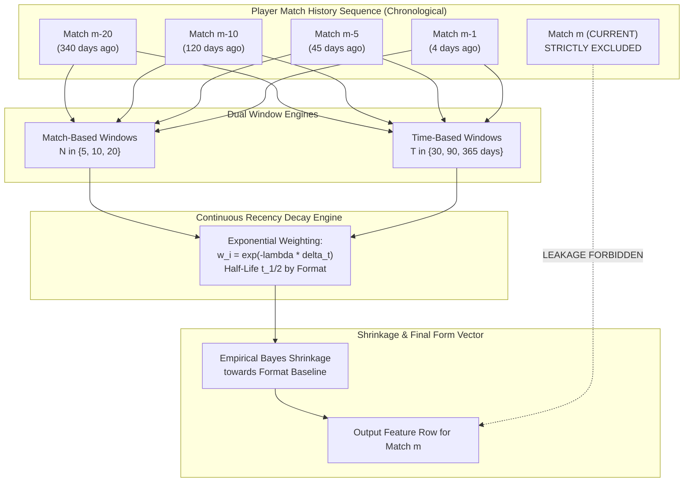
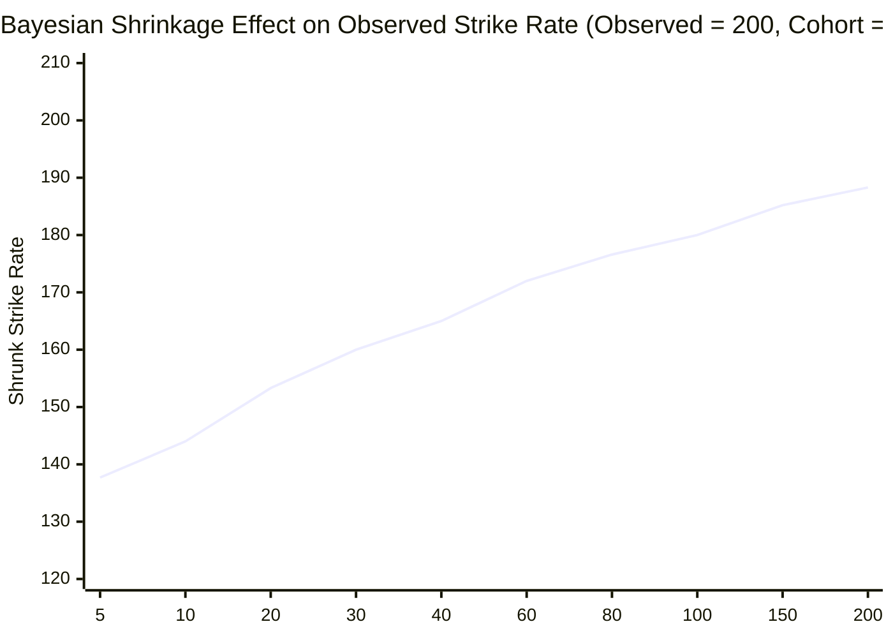

# CricEngine AI — Step 4A: Rolling Window Design & Recency Decay Mechanics

> **Document Version**: `1.0`  
> **Date**: 2026-10-30  
> **Author**: Lead Data Engineer & Machine Learning Systems Architect  
> **Status**: **APPROVED ROLLING ARCHITECTURE SPECIFICATION**  
> **Boundary**: Design only. Specifies temporal window formulations, exponential decay equations, and shrinkage mechanics.

---

## 1. Architectural Motivation: The Dual-Window Paradigm

Evaluating a cricket player's current true skill requires capturing both **Match Rhythm (Form)** and **Chronological Physical Recency**:
1. **Match-Based Windows ($N \in \{5, 10, 20\}$ matches)**:
   - Captures rhythm, current technical adjustments, and mental confidence.
   - Operates independent of calendar gaps (e.g. 5 consecutive IPL matches played over 12 days).
2. **Time-Based Windows ($T \in \{30, 90, 365\}$ calendar days)**:
   - Captures biological age progression, physical fitness, injury recovery, and macro skill evolution.
   - Prevents an obsolete performance from 3 years ago from carrying equal weight simply because a player was dropped.

---

## 2. Window Configurations & Trade-Off Analysis

| Window Identifier | Window Type | Span | Primary Objective | Variance Profile | Failure Mode / Sensitivity |
| :--- | :--- | :--- | :--- | :--- | :--- |
| **`ROLL_M5`** | Match-Based | Last 5 Matches | Immediate hot/cold streak detection | **High Variance** | Sensitive to 1 freak innings or unlucky run-out |
| **`ROLL_M10`** | Match-Based | Last 10 Matches | Standard short-term form baseline | **Balanced** | Stable signal for T20 franchise selection |
| **`ROLL_M20`** | Match-Based | Last 20 Matches | Medium-term core capability | **Low Variance** | Slow to reflect sudden technical breakthroughs |
| **`ROLL_D30`** | Time-Based | Last 30 Days | High-intensity tournament form | **High Variance** | Empties during off-season or between tours |
| **`ROLL_D90`** | Time-Based | Last 90 Days | Quarterly competitive fitness | **Moderate** | Bridges adjacent domestic/international series |
| **`ROLL_D365`** | Time-Based | Last 365 Days | Annual baseline capacity | **Very Low** | Captures true talent level across a full annual cycle |

---

## 3. Mathematical Recency Decay Formulations

Rather than simple unweighted moving averages (which assign identical weight to yesterday's match and a match from 11 months ago), CricEngine AI employs **exponential half-life time decay**:

### 3.1 Exponential Time Decay Equation
For any historical match $i$ played at timestamp $t_i$, evaluated prior to match $m$ occurring at timestamp $t_m$:

$$\Delta t_i = t_m - t_i \quad (\text{measured in days, where } \Delta t_i > 0)$$

The recency weight $w_i$ assigned to match $i$ is:

$$w_i = \exp\left(-\lambda \cdot \Delta t_i\right) = \exp\left(-\frac{\ln(2)}{t_{1/2}} \cdot \Delta t_i\right) = 2^{-\frac{\Delta t_i}{t_{1/2}}}$$

where $t_{1/2}$ is the **half-life parameter** (the duration in days after which a performance's weight decays by exactly $50\%$).

### 3.2 Format-Specific Half-Life Calibration ($t_{1/2}$)
Different cricket formats exhibit distinct form cycles and calendar frequencies:

$$\begin{aligned}
\mathbf{T20 \text{ Form Half-Life } (t_{1/2}^{\text{T20}})} &= \mathbf{90 \text{ Days}} \quad (\lambda_{\text{T20}} \approx 0.00770) \\
\mathbf{ODI \text{ Form Half-Life } (t_{1/2}^{\text{ODI}})} &= \mathbf{180 \text{ Days}} \quad (\lambda_{\text{ODI}} \approx 0.00385) \\
\mathbf{Test \text{ Form Half-Life } (t_{1/2}^{\text{Test}})} &= \mathbf{365 \text{ Days}} \quad (\lambda_{\text{Test}} \approx 0.00190)
\end{aligned}$$

#### Rationale:
- In T20 cricket, games are frequent, conditions shift rapidly, and batter confidence fluctuates quickly; a 90-day half-life ensures performances older than 6 months retain only $25\%$ weight.
- In Test cricket, an international team may only play 8–10 Tests per year. A 365-day half-life ensures a 3-match series from 9 months ago retains substantial predictive relevance.

### 3.3 Weighted Rolling Aggregate Formula
For any weighted feature (e.g. Recency-Weighted Strike Rate $\text{WSR}$ or Recency-Weighted Economy $\text{WECON}$):

$$\mathbf{\text{WSR}}(p, m) = \frac{\sum_{i \in \text{Hist}(p, m)} w_i \cdot \text{runs\_batter}_i}{\sum_{i \in \text{Hist}(p, m)} w_i \cdot \text{balls\_faced}_i} \times 100$$

$$\mathbf{\text{WECON}}(p, m) = \frac{\sum_{i \in \text{Hist}(p, m)} w_i \cdot \text{runs\_conceded}_i}{\sum_{i \in \text{Hist}(p, m)} w_i \cdot (\text{legal\_balls}_i / 6.0)}$$

---

## 4. Handling Inactive Periods, Long Gaps & Injury Returns

When a player has not played for an extended duration (e.g. 8 months due to injury), their time-based windows (`ROLL_D30`, `ROLL_D90`) will be empty (`NULL`).

### Rustiness / Inactivity Penalty Indicator (`GAP_INACTIVITY_DAYS`)
We engineer an explicit continuity feature:
$$\text{DAYS\_SINCE\_LAST\_MATCH}(p, m) = t_m - \max_{i < m}(t_i)$$

| Inactivity Gap ($\Delta t$) | System Interpretation | Pipeline Handling |
| :--- | :--- | :--- |
| $\Delta t \le 21$ days | Regular Match Rhythm | Full weight applied to rolling match metrics |
| $21 < \Delta t \le 90$ days | Typical Tour/Series Intermission | Normal exponential decay |
| $90 < \Delta t \le 180$ days | Off-Season Gap | Flag `IS_RETURNING_FROM_OFFSEASON = 1` |
| $\Delta t > 180$ days | Long-term Inactivity / Post-Injury | Flag `IS_LONG_ABSENCE = 1`; shrink variance toward cohort prior |

---

## 5. Bayesian Cohort Shrinkage for Low-Sample Windows

When a player has a small sample size in a rolling window (e.g. an emerging youngster with only 25 balls faced in their last 5 matches), raw averages suffer from high noise.

### Empirical Bayes Shrinkage Formulation
To prevent extreme values without imputing arbitrary constants, we shrink the player's rolling metric toward their **Cohort Baseline** ($\mu_{\text{cohort}}$, e.g. average strike rate for players in that competition tier and batting position):

$$\hat{\theta}_{\text{shrunk}} = \frac{n}{n + M} \cdot \bar{x}_{\text{observed}} + \frac{M}{n + M} \cdot \mu_{\text{cohort}}$$

where:
- $\bar{x}_{\text{observed}}$ is the player's observed metric in the rolling window.
- $n$ is the effective sample size (balls faced or overs bowled).
- $M$ is the **shrinkage strength parameter** (pseudo-counts).
  - For Batting Strike Rate: $M = 40$ balls.
  - For Bowling Economy: $M = 30$ legal deliveries (5 overs).
- $\mu_{\text{cohort}}$ is the rolling median of the player's peer group (e.g. IPL middle-order batters).

As sample size $n \to \infty$, the weight on observed performance $\frac{n}{n+M} \to 1.0$. At $n = 10$, the estimate remains anchored to the realistic cohort baseline ($144.0$), preventing wildly erratic rating fluctuations.
