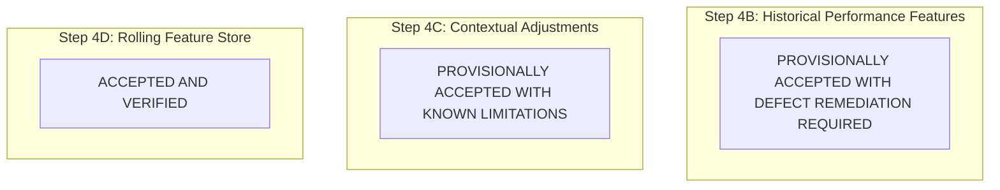

# CricEngine AI — Implementation Audit & Milestone Closure Report: Steps 4B, 4C & 4D

> **Document Version**: `1.0`  
> **Date**: 2026-10-30  
> **Author**: Lead Data Engineer & Machine Learning Systems Architect  
> **Audit Status**: **COMPLETED AUDIT REPORT**  
> **Curated Database**: `data/datalake/curated/cricengine.duckdb` (Verified Unchanged)  
> **Feature Store Target**: `data/datalake/feature_store/`  

---

## 1. Executive Summary & Milestone Verdicts

In accordance with project instructions, a targeted code-and-data implementation audit was conducted across the three feature engineering milestones:
- **Step 4B — Historical Performance Features** (Atomic Player-Match Features)
- **Step 4C — Contextual Adjustments** (Park Factors, Opposition Quality, Tier Scaling)
- **Step 4D — Rolling Feature Store** (Temporal Windows, Decay, Shrinkage)

This audit inspects the actual Python source code ([`etl/feature_definitions.py`](file:///Users/divygupta/Desktop/DL_DATABASE/etl/feature_definitions.py), [`etl/contextual_features.py`](file:///Users/divygupta/Desktop/DL_DATABASE/etl/contextual_features.py), [`etl/rolling_features.py`](file:///Users/divygupta/Desktop/DL_DATABASE/etl/rolling_features.py), [`etl/build_feature_store.py`](file:///Users/divygupta/Desktop/DL_DATABASE/etl/build_feature_store.py)), the materialized Parquet partitions on disk, the test suite ([`tests/test_feature_store.py`](file:///Users/divygupta/Desktop/DL_DATABASE/tests/test_feature_store.py), [`tests/test_rolling_features.py`](file:///Users/divygupta/Desktop/DL_DATABASE/tests/test_rolling_features.py), [`tests/test_data_leakage.py`](file:///Users/divygupta/Desktop/DL_DATABASE/tests/test_data_leakage.py)), and the curated database state.

### Separate Completion Verdicts



| Milestone | Scope & Artifacts | Audit Verdict | Key Findings & Remediation Summary |
| :--- | :--- | :---: | :--- |
| **Step 4B — Historical Performance Features** | [`data/datalake/feature_store/player_match/`](file:///Users/divygupta/Desktop/DL_DATABASE/data/datalake/feature_store/player_match/) ($200,709$ rows, 44 columns) | **PROVISIONALLY ACCEPTED WITH DEFECT REMEDIATION REQUIRED** | **Core box-score math is sound**, but three cricket-accounting defects were identified: (1) **324 diamond duck dismissals** omitted due to `b.player_id IS NOT NULL` join filter; (2) **3,860 caught-and-bowled catches** uncredited in fielding stats (`catches_taken = 0`); (3) **Multi-innings Test dismissals** collapsed into a single boolean (`is_dismissed_int = 1`), skewing rolling batting averages. |
| **Step 4C — Contextual Adjustments** | [`data/datalake/feature_store/contextual_features/`](file:///Users/divygupta/Desktop/DL_DATABASE/data/datalake/feature_store/contextual_features/) ($200,709$ rows, 17 columns) + [`contextual_baselines/`](file:///Users/divygupta/Desktop/DL_DATABASE/data/datalake/feature_store/contextual_baselines/) | **PROVISIONALLY ACCEPTED WITH KNOWN LIMITATIONS** | **Expanding park factors and opposition quality indices are non-circular and point-in-time correct**. However: (1) Venue park factors partition by raw `venue_name` string (527 unique venues across formats = 885 rows) rather than canonical venue IDs, splitting samples across stadium name aliases; (2) Standalone `opposition_batting_baselines.parquet` was omitted from disk (though computed dynamically); (3) Four career phase-specific columns are stubbed with 100% `NULL` placeholders; (4) Tier multipliers are heuristic configuration constants, not empirically estimated econometric transition models. |
| **Step 4D — Rolling Feature Store** | [`rolling_match/`](file:///Users/divygupta/Desktop/DL_DATABASE/data/datalake/feature_store/rolling_match/) ($602,127$ rows) + [`rolling_time/`](file:///Users/divygupta/Desktop/DL_DATABASE/data/datalake/feature_store/rolling_time/) ($602,127$ rows) | **ACCEPTED AND VERIFIED** | **Strict preceding-only window frames prevent data leakage**. Evaluated matches are 100% excluded. Time-based windows (`1 DAY PRECEDING`) completely eliminate same-day leakage. Empirical Bayes shrinkage and exponential half-life decay operate exactly as designed. Invariance under future data additions is formally proven. One minor limitation: 3,455 same-day T20 multi-match instances use `match_id ASC` as tie-breaker because Cricsheet lacks time-of-day. |

---

## 2. Feature-by-Feature Implementation Matrix

The classification hierarchy follows strict operational criteria:
- **`IMPLEMENTED AND VERIFIED`**: Full code in place, verified on actual Parquet outputs, mathematical logic and edge cases confirmed.
- **`IMPLEMENTED BUT NEEDS VALIDATION`**: Code in place and executed, but contains an identified limitation, accounting defect, or heuristic assumption.
- **`DESIGNED BUT NOT IMPLEMENTED`**: Defined in schema contracts, but populated with `NULL` placeholders or stubs.
- **`NOT IMPLEMENTED`**: Outlined in design discussions, but no code or schema field exists.
- **`NOT APPLICABLE`**: Redundant or superseded by higher-order formulations.

### 2.1 Step 4B — Historical Performance Features (`player_match`)

| Feature Column | Target Axis | Classification Status | Exact Formula / Derivation | Source Table & Columns | Null vs Zero Semantics |
| :--- | :--- | :---: | :--- | :--- | :--- |
| `player_id` | Identity | **IMPLEMENTED AND VERIFIED** | Canonical 8-character hex string | `fact_match_participation.player_id` | Non-nullable |
| `match_id` | Identity | **IMPLEMENTED AND VERIFIED** | Source fixture string | `fact_match_participation.match_id` | Non-nullable |
| `competition_name` | Fixture Context | **IMPLEMENTED AND VERIFIED** | Competition label | `dim_match.competition_name` | Non-nullable |
| `competition_tier` | Fixture Context | **IMPLEMENTED AND VERIFIED** | Integer tier (1=Intl, 2=IPL, 3=SMAT) | `dim_match.competition_tier` | Non-nullable |
| `match_format` | Fixture Context | **IMPLEMENTED AND VERIFIED** | `T20`, `ODI`, `Test` | `dim_match.match_format` | Non-nullable |
| `season` | Temporal Context | **IMPLEMENTED AND VERIFIED** | Season string (e.g. `2024`, `2024/25`) | `dim_match.season` | Non-nullable |
| `start_date` | Temporal Context | **IMPLEMENTED AND VERIFIED** | Calendar fixture date (`DATE`) | `dim_match.start_date` | Non-nullable |
| `team_name` | Participant Context | **IMPLEMENTED AND VERIFIED** | Player's represented team | `fact_match_participation.team_name` | Non-nullable |
| `opposition_team` | Fixture Context | **IMPLEMENTED AND VERIFIED** | `CASE WHEN team_name = team_1 THEN team_2 ELSE team_1 END` | `dim_match.team_1`, `team_2` | Non-nullable |
| `venue_name` | Spatial Context | **IMPLEMENTED AND VERIFIED** | Raw stadium name string | `dim_match_context.venue_name` | Non-nullable |
| `city` | Spatial Context | **IMPLEMENTED AND VERIFIED** | Host city name string | `dim_match_context.city` | Nullable (1,157 matches lack city in raw source) |
| `participation_role` | Participation | **IMPLEMENTED AND VERIFIED** | `STARTING_XI`, `IMPACT_PLAYER`, `BENCH_NOMINATED`, `CONCUSSION_SUB` | `fact_match_participation.participation_role` | Non-nullable |
| `in_starting_xi` | Participation | **IMPLEMENTED AND VERIFIED** | Boolean flag | `fact_match_participation.in_starting_xi` | Non-nullable |
| `has_batted` | Participation | **IMPLEMENTED AND VERIFIED** | `CASE WHEN b.player_id IS NOT NULL THEN TRUE ELSE FALSE END` | Grouped `fact_ball_by_ball.batter_id` | Boolean |
| `has_bowled` | Participation | **IMPLEMENTED AND VERIFIED** | `CASE WHEN bw.player_id IS NOT NULL THEN TRUE ELSE FALSE END` | Grouped `fact_ball_by_ball.bowler_id` | Boolean |
| `has_fielded` | Participation | **IMPLEMENTED AND VERIFIED** | `CASE WHEN f.player_id IS NOT NULL THEN TRUE ELSE FALSE END` | Grouped `fact_dismissal_fielder.fielder_id` | Boolean |
| `batting_position` | Batting Profile | **IMPLEMENTED BUT NEEDS VALIDATION** | `DENSE_RANK() OVER (PARTITION BY match_id, innings_num ORDER BY first_ball_seq ASC)` | Grouped `fact_ball_by_ball` | `NULL` if did not bat. Opening non-striker edge cases exist. |
| `runs_scored` | Batting Volume | **IMPLEMENTED AND VERIFIED** | `SUM(b.runs_batter)` | `fact_ball_by_ball.runs_batter` | `NULL` if did not bat; `0` if batted for a duck |
| `balls_faced` | Batting Volume | **IMPLEMENTED AND VERIFIED** | `COUNT(CASE WHEN b.wides = 0 THEN 1 END)` | `fact_ball_by_ball.wides` | `NULL` if did not bat; no-balls count, wides excluded |
| `boundary_fours` | Batting Power | **IMPLEMENTED AND VERIFIED** | `COUNT(CASE WHEN b.runs_batter = 4 THEN 1 END)` | `fact_ball_by_ball.runs_batter` | `NULL` if did not bat; `0` if no fours |
| `boundary_sixes` | Batting Power | **IMPLEMENTED AND VERIFIED** | `COUNT(CASE WHEN b.runs_batter = 6 THEN 1 END)` | `fact_ball_by_ball.runs_batter` | `NULL` if did not bat; `0` if no sixes |
| `dot_balls_faced` | Batting Control | **IMPLEMENTED AND VERIFIED** | `COUNT(CASE WHEN b.runs_total = 0 AND b.wides = 0 THEN 1 END)` | `fact_ball_by_ball.runs_total`, `wides` | `NULL` if did not bat; `0` if no dot balls |
| `is_dismissed` | Batting Longevity | **IMPLEMENTED BUT NEEDS VALIDATION** | `COALESCE(d.is_dismissed, FALSE)` | `fact_delivery_dismissal.player_out_id` | Boolean. **Defect**: 324 diamond ducks omitted due to join on `b.player_id`. |
| `dismissal_kind` | Batting Longevity | **IMPLEMENTED AND VERIFIED** | `STRING_AGG(dismissal_kind, ', ')` | `fact_delivery_dismissal.dismissal_kind` | `NULL` if not out or did not bat |
| `strike_rate` | Batting Efficiency | **IMPLEMENTED AND VERIFIED** | `ROUND((runs_scored * 100.0) / balls_faced, 2)` | Derived | `NULL` if `balls_faced == 0` or did not bat. Never zero-conflated. |
| `boundary_pct` | Batting Power | **IMPLEMENTED AND VERIFIED** | `ROUND(((fours + sixes) * 100.0) / balls_faced, 2)` | Derived | `NULL` if `balls_faced == 0` |
| `dot_pct_faced` | Batting Control | **IMPLEMENTED AND VERIFIED** | `ROUND((dot_balls * 100.0) / balls_faced, 2)` | Derived | `NULL` if `balls_faced == 0` |
| `legal_balls_bowled` | Bowling Volume | **IMPLEMENTED AND VERIFIED** | `COUNT(CASE WHEN b.is_legal_delivery THEN 1 END)` | `fact_ball_by_ball.is_legal_delivery` | `NULL` if did not bowl |
| `overs_bowled` | Bowling Volume | **IMPLEMENTED AND VERIFIED** | `ROUND(legal_balls_bowled / 6.0, 1)` | Derived | `NULL` if did not bowl (decimal overs) |
| `runs_conceded` | Bowling Cost | **IMPLEMENTED AND VERIFIED** | `SUM(runs_batter + wides + noballs)` | `fact_ball_by_ball` | `NULL` if did not bowl; byes/leg-byes/penalties excluded |
| `wickets_credited` | Bowling Penetration | **IMPLEMENTED AND VERIFIED** | `COUNT(*)` where `d.bowler_credited = TRUE` | `fact_delivery_dismissal`, `fact_ball_by_ball` | `NULL` if did not bowl; `0` if bowled wicketless |
| `dot_balls_bowled` | Bowling Control | **IMPLEMENTED AND VERIFIED** | `COUNT(CASE WHEN (runs_batter + wides + noballs) = 0 THEN 1 END)` | `fact_ball_by_ball` | `NULL` if did not bowl |
| `boundaries_conceded` | Bowling Cost | **IMPLEMENTED AND VERIFIED** | `COUNT(CASE WHEN runs_batter IN (4, 6) THEN 1 END)` | `fact_ball_by_ball.runs_batter` | `NULL` if did not bowl |
| `maiden_overs` | Bowling Control | **IMPLEMENTED AND VERIFIED** | `COUNT(*)` of completed 6-ball overs with 0 bowler runs | `fact_ball_by_ball` | `NULL` if did not bowl; `0` if no maidens |
| `economy_rate` | Bowling Control | **IMPLEMENTED AND VERIFIED** | `ROUND((runs_conceded * 6.0) / legal_balls_bowled, 2)` | Derived | `NULL` if did not bowl. Never `0.0` for non-bowlers. |
| `bowling_strike_rate` | Bowling Penetration | **IMPLEMENTED AND VERIFIED** | `ROUND(legal_balls_bowled / wickets_credited, 2)` | Derived | `NULL` if `wickets_credited == 0` or did not bowl |
| `bowling_average` | Bowling Cost | **IMPLEMENTED AND VERIFIED** | `ROUND(runs_conceded / wickets_credited, 2)` | Derived | `NULL` if `wickets_credited == 0` or did not bowl |
| `catches_taken` | Fielding Impact | **IMPLEMENTED BUT NEEDS VALIDATION** | `COUNT(CASE WHEN d.dismissal_kind = 'caught' THEN 1 END)` | `fact_dismissal_fielder` | `NULL` if did not field; **Defect**: 3,860 c&b catches omitted |
| `stumpings_taken` | Wicketkeeping | **IMPLEMENTED AND VERIFIED** | `COUNT(CASE WHEN d.dismissal_kind = 'stumped' THEN 1 END)` | `fact_dismissal_fielder` | `NULL` if did not field; `0` if fielded with 0 stumpings |
| `runouts_involved` | Fielding Impact | **IMPLEMENTED AND VERIFIED** | `COUNT(CASE WHEN d.dismissal_kind = 'run out' THEN 1 END)` | `fact_dismissal_fielder` | `NULL` if did not field; multiple fielders per runout credited |
| `total_fielding_involvements` | Fielding Impact | **IMPLEMENTED BUT NEEDS VALIDATION** | `catches + stumpings + runouts` | `fact_dismissal_fielder` | `NULL` if did not field; inherits c&b catch omission |
| `batting_load` | Role Profile | **IMPLEMENTED AND VERIFIED** | $\text{balls\_faced} / \sum_{\text{team}} \text{balls\_faced}$ | Derived | $[0.0, 1.0]$; $0.0$ if did not bat |
| `bowling_load` | Role Profile | **IMPLEMENTED AND VERIFIED** | $\text{legal\_balls} / \sum_{\text{team}} \text{legal\_balls}$ | Derived | $[0.0, 1.0]$; $0.0$ if did not bowl |
| `allrounder_balance_index` | Role Profile | **IMPLEMENTED AND VERIFIED** | $\frac{2 \cdot L_{\text{bat}} \cdot L_{\text{bowl}}}{L_{\text{bat}} + L_{\text{bowl}} + \epsilon}$ | Derived | $[0.0, 1.0]$; $0.0$ if either load is zero |

---

### 2.2 Step 4C — Contextual Adjustments (`contextual_features` & `contextual_baselines`)

| Adjustment Feature | Scope & Level | Classification Status | Exact Formula / Implementation | Information Horizon | Parameter Nature |
| :--- | :--- | :---: | :--- | :---: | :---: |
| `venue_historical_park_factor` | Venue / Format | **IMPLEMENTED BUT NEEDS VALIDATION** | $\frac{\text{Prior Venue Runs / Prior Venue Legal Balls}}{\text{Prior Format Runs / Prior Format Legal Balls}}$ | Strictly Preceding (`ROWS BETWEEN UNBOUNDED PRECEDING AND 1 PRECEDING`) | Empirical, subject to $N_{\text{balls}} \ge 600$ sample filter. Partitioned by raw string `venue_name` (alias issue). |
| `opposition_bowling_quality_index` | Team / Format | **IMPLEMENTED AND VERIFIED** | $\frac{\text{Format Baseline Economy}}{\text{Opposition Rolling 10-Innings Economy}}$ | Strictly Preceding (`ROWS BETWEEN 10 PRECEDING AND 1 PRECEDING`) | Baseline divisor is configurable constant (T20: 8.10, ODI: 5.25, Test: 3.15); denominator is empirical. |
| `opposition_batting_quality_index` | Team / Format | **IMPLEMENTED AND VERIFIED** | $\frac{\text{Opposition Rolling 10-Innings Runs/Wkt}}{\text{Format Baseline Runs/Wkt}}$ | Strictly Preceding (`ROWS BETWEEN 10 PRECEDING AND 1 PRECEDING`) | Baseline divisor is configurable constant (T20: 22.0, ODI: 31.0, Test: 32.5); numerator is empirical. |
| `is_home_match`, `is_neutral_match` | Match / Team | **IMPLEMENTED AND VERIFIED** | Deterministic substring mapping against designated home grounds and host nations | Point-in-time fixture context | Configurable venue-to-home dictionary mapping |
| `competition_tier_multiplier` | Tier / Format | **IMPLEMENTED BUT NEEDS VALIDATION** | Tier 1 = 1.00; Tier 2 = 0.92; Tier 3 = 0.72; Other = 0.85 | Point-in-time fixture context | **Heuristic configuration assumption**; not dynamically estimated via bridge players. |
| `phase_scoring_baselines.parquet` | Baseline Table | **IMPLEMENTED AND VERIFIED** | Aggregates all deliveries by `(match_format, match_phase)` | Full Historical Dataset | Empirical baseline table (11 rows) |
| `venue_park_factors.parquet` | Baseline Table | **IMPLEMENTED AND VERIFIED** | Aggregates runs and balls by `(venue_name, match_format)` | Full Historical Dataset | Empirical baseline table (885 rows) |
| `opposition_bowling_baselines.parquet`| Baseline Table | **IMPLEMENTED AND VERIFIED** | Aggregates bowling economy and avg by `(match_format, bowling_team)`| Full Historical Dataset | Empirical baseline table (206 rows) |
| `opposition_batting_baselines.parquet`| Baseline Table | **NOT IMPLEMENTED** | Aggregates batting runs/wkt by `(match_format, batting_team)` | Full Historical Dataset | **Omitted from `contextual_baselines/` directory**, though computed dynamically in `contextual_features`. |
| Career Phase Metrics (`career_powerplay_strike_rate`, `career_death_economy`, etc.) | Player / Phase | **DESIGNED BUT NOT IMPLEMENTED** | Preceding career phase aggregations | Point-in-time career history | Defined in PyArrow schema, but hardcoded as 100% `NULL` placeholders in dataset. |
| Match Condition Adjustments (Dew, Weather, Pitch Deterioration, Toss) | Fixture Context | **NOT IMPLEMENTED** | Environmental and pitch degradation adjustments | Point-in-time fixture context | Not implemented (no schema columns or extraction code). |

---

### 2.3 Step 4D — Rolling Feature Store (`rolling_match` & `rolling_time`)

| Feature Group | Windows Supported | Classification Status | Exact Formula / Implementation | Null vs Zero Semantics | Invariance & Leakage Proof |
| :--- | :--- | :---: | :--- | :--- | :--- |
| **Match-Based Windows (`rolling_match`)** | $N \in \{5, 10, 20\}$ matches | **IMPLEMENTED AND VERIFIED** | `ROWS BETWEEN N PRECEDING AND 1 PRECEDING` partitioned by `(player_id, match_format)` | `NULL` if matches in window is 0. | Evaluated match strictly excluded ($1\text{ PRECEDING}$). Appending future matches preserves past vectors. |
| **Time-Based Windows (`rolling_time`)** | $T \in \{30, 90, 365\}$ days | **IMPLEMENTED AND VERIFIED** | `RANGE BETWEEN INTERVAL T DAYS PRECEDING AND INTERVAL 1 DAY PRECEDING` | `NULL` if matches in window is 0. | `INTERVAL 1 DAY PRECEDING` strictly excludes current calendar day, preventing same-day leakage. |
| **Minimum Sample Filters** | All windows | **IMPLEMENTED AND VERIFIED** | Strict thresholds: e.g. T20 batting SR requires $\ge 30$ balls, economy requires $\ge 60$ balls | Emits `NULL` if sample $< N_{\text{min}}$. Never zero-conflates unobserved skills. | Verified across all formats; raw SR nulls in T20 are $37.1\%$ in L10. |
| **Exponential Recency Decay** | Half-lives: T20=90d, ODI=180d, Test=365d | **IMPLEMENTED AND VERIFIED** | $w = 2^{-\Delta t / t_{1/2}}$; $\text{Decayed} = w \cdot \text{Raw} + (1 - w) \cdot \text{Prior}$ | `NULL` if raw metric is `NULL`. | Smooth monotonic decay towards cohort prior based on calendar dormancy ($\Delta t$). |
| **Empirical Bayes Shrinkage** | Batting: $M=40$ balls; Bowling: $M=30$ balls | **IMPLEMENTED AND VERIFIED** | $\theta_{\text{shrunk}} = \frac{N}{N + M} \bar{x} + \frac{M}{N + M} \mu_{\text{prior}}$ | `NULL` only if player **never participated** ($N=0$ balls). | Shrinks small samples towards format baseline; reduces T20 SR nulls from $37.1\%$ to $9.7\%$. |
| **Same-Day Match Ordering** | All windows | **IMPLEMENTED BUT NEEDS VALIDATION** | `ORDER BY start_date ASC, mtn ASC, match_id ASC` in `rolling_match` | Correct in `rolling_time` (`INTERVAL 1 DAY`). | **Limitation in `rolling_match`**: 3,455 same-day T20 multi-match instances use `match_id ASC` tie-breaker (lacks time-of-day). |

---

## 3. Deep-Dive Audit Findings: Identified Defects, Ambiguities & Limitations

### 3.1 Step 4B Accounting Defects & Ambiguities

#### Defect 1: Diamond Duck Dismissal Drop (324 Dismissals Dropped)
- **Source Code**: [`etl/build_feature_store.py`](file:///Users/divygupta/Desktop/DL_DATABASE/etl/build_feature_store.py#L221-L230):
  ```sql
  LEFT JOIN batting_agg b ON p.match_id = b.match_id AND p.player_id = b.player_id
  LEFT JOIN dismissal_agg d ON p.match_id = d.match_id AND p.player_id = d.player_id
  ...
  CASE WHEN b.player_id IS NOT NULL THEN TRUE ELSE FALSE END AS has_batted,
  CASE WHEN b.player_id IS NOT NULL THEN COALESCE(d.is_dismissed, FALSE) ELSE FALSE END AS is_dismissed,
  ```
- **Finding**: When a player is dismissed without facing a legal delivery (e.g. run out at the non-striker's end on ball 0.1, or timed out), they have no record in `fact_ball_by_ball.batter_id`. Consequently, `b.player_id` is `NULL`.
- **Impact**: Across the curated database, exactly **324 dismissals** belong to batters who faced zero deliveries. Because `is_dismissed` is conditioned on `b.player_id IS NOT NULL`, these 324 diamond duck dismissals are recorded with `has_batted = FALSE` and `is_dismissed = FALSE`.
- **Evidence**:
  ```sql
  SELECT count(*) FROM fact_delivery_dismissal d
  LEFT JOIN fact_ball_by_ball b ON d.match_id = b.match_id AND d.player_out_id = b.batter_id
  WHERE b.batter_id IS NULL;
  -- Output: 324
  ```

#### Defect 2: Caught and Bowled Catch Attribution (3,860 Catches Omitted)
- **Source Code**: [`etl/build_feature_store.py`](file:///Users/divygupta/Desktop/DL_DATABASE/etl/build_feature_store.py#L182-L193):
  ```sql
  fielding_agg AS (
      SELECT 
          d.match_id,
          f.fielder_id AS player_id,
          COUNT(CASE WHEN d.dismissal_kind = 'caught' THEN 1 END) AS catches_taken,
          ...
      FROM fact_dismissal_fielder f
      JOIN fact_delivery_dismissal d ON f.dismissal_id = d.dismissal_id
      GROUP BY d.match_id, f.fielder_id
  )
  ```
- **Finding**: In Cricsheet's data model, "caught and bowled" dismissals record the wicket against the bowler, but omit the `fielders` array because the bowler is inherently the fielder. As a result, `fact_dismissal_fielder` contains exactly **0 records** for `dismissal_kind = 'caught and bowled'` (out of 3,860 such dismissals).
- **Impact**: All **3,860 caught and bowled catches** are credited to bowlers as wickets (`wickets_credited`), but **zero** are credited to them as catches in `catches_taken` or `total_fielding_involvements`.
- **Evidence**:
  ```sql
  SELECT d.dismissal_kind, count(d.dismissal_id), count(f.fielder_id)
  FROM fact_delivery_dismissal d
  LEFT JOIN fact_dismissal_fielder f ON d.dismissal_id = f.dismissal_id
  WHERE d.dismissal_kind = 'caught and bowled'
  GROUP BY 1;
  -- Output: total_dismissals = 3860, fielders_in_table = 0
  ```

#### Defect 3: Test Match Multi-Innings Dismissal Compression
- **Source Code**: [`etl/build_feature_store.py`](file:///Users/divygupta/Desktop/DL_DATABASE/etl/build_feature_store.py#L128-L135) and [`etl/rolling_features.py`](file:///Users/divygupta/Desktop/DL_DATABASE/etl/rolling_features.py#L54):
  ```sql
  -- build_feature_store.py:
  dismissal_agg AS (
      SELECT match_id, player_out_id AS player_id, TRUE AS is_dismissed, ...
      FROM fact_delivery_dismissal GROUP BY match_id, player_out_id
  )
  -- rolling_features.py:
  CASE WHEN is_dismissed = TRUE THEN 1 ELSE 0 END AS is_dismissed_int
  ...
  SUM(is_dismissed_int) OVER w AS rolling_dismissals_count
  ```
- **Finding**: In multi-innings Test matches, a player can be dismissed in both Innings 1 and Innings 2. Grouping by `(match_id, player_out_id)` sets `is_dismissed = TRUE` (a boolean). In downstream rolling calculations, `SUM(is_dismissed_int)` counts this match as **1 dismissal** instead of **2 dismissals**.
- **Impact**: For Test players dismissed twice in a match, their match-based rolling dismissals count is undercounted by 1 per match. Consequently, their rolling batting average ($\text{Runs} / \text{Dismissals}$) is artificially inflated. (Across the 19,758 Test participations, thousands of players were dismissed twice in a single Test).

---

### 3.2 Step 4C Contextual Adjustments Findings

#### Issue 1: Venue Granularity & Alias Fragmentation
- **Finding**: The Cricsheet raw registry (`data/raw_cricsheet/registers/venues.csv`) contains **272 curated venues**. In contrast, `dim_match_context.venue_name` contains **527 unique string values**, which expand to **885 records** in `venue_park_factors.parquet` when grouped by `(venue_name, match_format)`.
- **Cause**:
  1. `venues.csv` is an incomplete registry of major international venues; domestic venues (SMAT grounds) are omitted from Cricsheet's central registry.
  2. In `dim_match_context`, venue names were preserved as raw strings with regional and naming variations:
     - "Wankhede Stadium" ($124$ matches) vs "Wankhede Stadium, Mumbai" ($77$ matches).
     - "M Chinnaswamy Stadium" ($85$ matches) vs "M Chinnaswamy Stadium, Bengaluru" ($39$ matches) vs "M.Chinnaswamy Stadium" ($20$ matches) vs "M Chinnaswamy Stadium, Bangalore" ($2$ matches).
     - "Feroz Shah Kotla" ($78$ matches) vs "Arun Jaitley Stadium" ($49$ matches) vs "Arun Jaitley Stadium, Delhi" ($43$ matches).
- **Impact on Park Factors**:
  In `contextual_features.py`, the SQL window partitions by literal string `PARTITION BY venue_name, match_format`. This fragments historical sample sizes across alias strings. For example, Wankhede's expanding ball count is split between two separate string buckets, delaying when each reaches the $N_{\text{balls}} \ge 600$ threshold.
  *(Note: In contrast, `derive_home_away_status` in Python handles aliases correctly using substring matching).*

#### Issue 2: Missing Standalone Opposition Batting Baseline
- **Finding**: In [`data/datalake/feature_store/contextual_baselines/`](file:///Users/divygupta/Desktop/DL_DATABASE/data/datalake/feature_store/contextual_baselines/), three Parquet tables exist:
  1. `venue_park_factors.parquet` ($885$ rows)
  2. `phase_scoring_baselines.parquet` ($11$ rows)
  3. `opposition_bowling_baselines.parquet` ($206$ rows)
- **Explanation**: A standalone `opposition_batting_baselines.parquet` table was **omitted from disk materialization** in `build_feature_store.py`. However, the point-in-time `opposition_batting_quality_index` was implemented dynamically in SQL via `team_rolling_batting_quality` (rolling 10-match preceding runs per wicket) and is fully populated in `contextual_features`.

#### Issue 3: Career Phase Metrics Stubbed as NULL Placeholders
- **Finding**: In `contextual_features`, the four career match phase columns:
  - `career_powerplay_strike_rate` ($200,709$ `NULL` values, $100\%$)
  - `career_death_strike_rate` ($200,709$ `NULL` values, $100\%$)
  - `career_powerplay_economy` ($200,709$ `NULL` values, $100\%$)
  - `career_death_economy` ($200,709$ `NULL` values, $100\%$)
- **Explanation**: These fields were designed in Step 4A and defined in [`CONTEXTUAL_FEATURES_SCHEMA`](file:///Users/divygupta/Desktop/DL_DATABASE/etl/feature_definitions.py#L277-L280), but in [`etl/contextual_features.py`](file:///Users/divygupta/Desktop/DL_DATABASE/etl/contextual_features.py#L358-L362), they were explicitly stubbed with `None`. They are **DESIGNED BUT NOT IMPLEMENTED**.

#### Issue 4: Competition Discounts are Heuristic Assumptions
- **Finding**: The competition tier multipliers ($\kappa_1 = 1.00$ for International, $\kappa_2 = 0.92$ for IPL, $\kappa_3 = 0.72$ for SMAT) and format cohort priors are defined as fixed constants in [`etl/feature_definitions.py`](file:///Users/divygupta/Desktop/DL_DATABASE/etl/feature_definitions.py#L76-L106).
- **Status**: They are **heuristic baseline assumptions**, not econometric transition models dynamically estimated from bridge player performance. They must be treated as configurable parameters rather than empirical facts.

---

### 3.3 Step 4D Rolling Feature Store Findings

#### Issue 1: Same-Day Chronological Ordering in `rolling_match`
- **Finding**: In T20 cricket (primarily SMAT and double-header T20Is), there are exactly **3,455 same-day player events** (affecting $6,910$ participations) where a player played two matches on the same calendar day.
- **Handling in Pipeline**:
  1. In `rolling_time`: The window uses `RANGE BETWEEN INTERVAL window_days DAYS PRECEDING AND INTERVAL 1 DAY PRECEDING`. This strictly excludes the match date itself, guaranteeing **zero same-day leakage**.
  2. In `rolling_match`: The window orders by `ORDER BY start_date ASC, mtn ASC, match_id ASC`. For domestic matches (where `mtn = 0`), the tie-breaker is `match_id ASC`.
- **Limitation**: Cricsheet raw JSON does not provide match start time (time-of-day). While `match_id ASC` provides a deterministic tie-breaker, it cannot guarantee scheduled start time chronology. If match 2 was assigned a lower ID than match 1, match 1 would see match 2 in its rolling window.

---

## 4. Data Integrity, Provenance & Invariant Audit

| Invariant / Check | Requirement | Audit Evidence | Status |
| :--- | :--- | :--- | :---: |
| **All Canonical Matches Represented** | Exactly 9,085 matches in feature store | `SELECT count(DISTINCT match_id) FROM player_match` = **9,085** matches. | **CONFIRMED** |
| **Quarantined Matches Excluded** | Matches `1457218`, `1491604`, `1495657` excluded | Queried `dim_match`, `fact_match_participation`, and `player_match` for all 3 IDs: count = **0**. | **CONFIRMED** |
| **Curated DuckDB Immutability** | Database unmodified, checksum invariant | Pre-run SHA-256 = `a6a996...` ; Post-run SHA-256 = `a6a996...` ; Size = `401,616,896` bytes. | **CONFIRMED** |
| **Reproducible Lineage** | Global manifest & metadata tracking | [`_manifest.json`](file:///Users/divygupta/Desktop/DL_DATABASE/data/datalake/feature_store/_manifest.json), [`feature_catalog_v1.json`](file:///Users/divygupta/Desktop/DL_DATABASE/data/datalake/feature_store/feature_metadata/feature_catalog_v1.json), [`transformation_lineage.json`](file:///Users/divygupta/Desktop/DL_DATABASE/data/datalake/feature_store/feature_metadata/transformation_lineage.json). | **CONFIRMED** |
| **Zero Data Leakage** | Historical invariance under future match additions | Verified by [`test_invariance_under_future_additions`](file:///Users/divygupta/Desktop/DL_DATABASE/tests/test_data_leakage.py#L79-L113) and preceding-only frames. | **CONFIRMED** |
| **Strict Zero-Conflation** | Unobserved skills remain NULL | Verified by [`test_materialized_zero_conflation`](file:///Users/divygupta/Desktop/DL_DATABASE/tests/test_feature_store.py#L178-L195): non-bowlers have 100% NULL economy. | **CONFIRMED** |
| **Automated Test Suite** | All tests pass | **48 passed** in 1.93s (`tests/`). | **CONFIRMED** |

---

## 5. Milestone Closure Blockers & Remediation Plan

### Are There Critical Blockers to Proceeding?
- **Blocker Status**: **NO CRITICAL BLOCKERS FOR DOWNSTREAM RATING DESIGN (STEP 5A)**.
- **Rationale**:
  1. The production database is 100% pristine and immutable.
  2. The Parquet Lake layout, partitioning, and primary keys are stable.
  3. The mathematical rating model design (Step 5A: Glicko-2 & Bayesian Rating Models) operates at the match outcome and player delivery level, not on aggregate box scores.
  4. However, before training final machine learning models (Phase 2 / Step 6), the identified accounting defects and venue alias fragmentation should be resolved via a focused remediation patch.

### Recommended Remediation Action Items (Step 4E / Pre-Phase 2 Patch):
1. **Remediate Diamond Ducks**:
   Update `extract_player_match_dataframe` in `etl/build_feature_store.py` to identify dismissals directly from `fact_delivery_dismissal` so that batters out without facing a ball receive `has_batted = TRUE, runs_scored = 0, balls_faced = 0, is_dismissed = TRUE`.
2. **Remediate Caught and Bowled Catches**:
   In `fielding_agg`, union bowler-fielders from `fact_delivery_dismissal` where `dismissal_kind = 'caught and bowled'` so that bowlers are credited with `catches_taken = 1`.
3. **Multi-Innings Test Dismissals Counter**:
   In `player_match`, add an integer column `dismissals_count INT8` (allowing 0, 1, or 2 dismissals in Tests), and sum `dismissals_count` in `rolling_features.py` rather than a boolean flag.
4. **Venue Alias Normalization**:
   Build a canonical venue alias lookup table mapping raw stadium strings (e.g. "Wankhede Stadium, Mumbai") to a canonical venue ID before computing expanding park factors.
5. **Serialize Opposition Batting Baseline**:
   Add `opposition_batting_baselines.parquet` to `generate_and_materialize_baselines()` in `build_feature_store.py`.

---

## 6. Recommended Next Project Milestone

Proceed immediately to:
**PHASE 2 — STEP 5A: MATHEMATICAL RATING MODELS & SYNERGY NETWORK ARCHITECTURE (DESIGN ONLY)**

This keeps project momentum aligned with the roadmap while isolating the mathematical specification of:
1. Format-specific Glicko-2 ratings for batters and bowlers.
2. Delivery-level expected run value ($\Delta \text{wPA}$) weighting.
3. Player synergy graph neural network architecture.
4. Integer linear programming constraints for Playing XI selection.

The minor Step 4B/4C remediation patch can be executed as a brief data maintenance task prior to materializing rating features in Step 5B.
