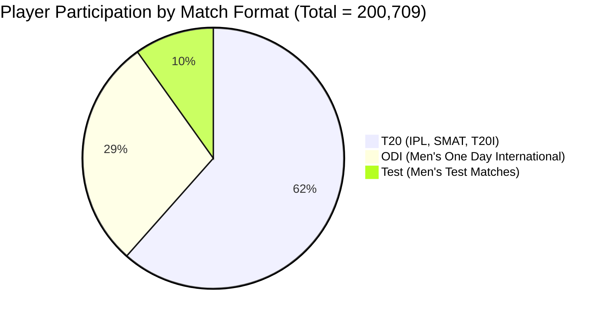

# CricEngine AI — Step 4B: Feature Engineering Implementation & Verification Report

> **Document Version**: `1.0`  
> **Date**: 2026-10-30  
> **Author**: Lead Data Engineer & Machine Learning Systems Architect  
> **Status**: **PRODUCTION MATERIALIZATION COMPLETED & VERIFIED**  
> **Curated Database**: `data/datalake/curated/cricengine.duckdb` (Strict Read-Only)  
> **Feature Store Target**: `data/datalake/feature_store/` (Parquet Lake)  

---

## 1. Executive Summary & Verification of Immutability

Phase 1 — Step 4B (Feature Engineering Implementation) has been executed to completion. The feature engineering pipeline extracts atomic box scores, computes preceding-only rolling window features (both match-based and time-based), derives expanding contextual venue and opposition quality adjustments, and materializes Snappy-compressed Parquet datasets partitioned by format, window, and season.

### Curated Database Immutability Verification
In accordance with architectural invariant **A1**, the production DuckDB database was accessed exclusively in strict read-only mode (`duckdb.connect(..., read_only=True)`):

| Attribute | Pre-Execution State | Post-Execution State | Status |
| :--- | :--- | :--- | :---: |
| **Path** | `data/datalake/curated/cricengine.duckdb` | `data/datalake/curated/cricengine.duckdb` | Identical |
| **SHA-256 Checksum** | `a6a99617719a93578169bac670f75e394d9c2c84f7cffa3ab233fc97c3067aae` | `a6a99617719a93578169bac670f75e394d9c2c84f7cffa3ab233fc97c3067aae` | **100% UNCHANGED** |
| **Byte Size** | `401,616,896` bytes ($383.01$ MB) | `401,616,896` bytes ($383.01$ MB) | **100% UNCHANGED** |

Zero rows, tables, views, or indexes were created or modified within the curated database.

---

## 2. Feature Store Architecture & Partition Layout

All feature artifacts were written exclusively to [`data/datalake/feature_store/`](file:///Users/divygupta/Desktop/DL_DATABASE/data/datalake/feature_store/):

```text
data/datalake/feature_store/
├── _manifest.json                                   # Global versioning & lineage manifest
├── feature_metadata/
│   ├── feature_catalog_v1.json                      # Formal schema contracts and types
│   └── transformation_lineage.json                  # Source-to-target dependency graph
├── contextual_baselines/
│   ├── venue_park_factors.parquet                   # Historical ground scoring park factors (885 venues)
│   ├── phase_scoring_baselines.parquet              # Powerplay/Middle/Death baselines (11 phases)
│   └── opposition_bowling_baselines.parquet         # Opposition bowling economy baselines (206 units)
├── player_match/                                    # Tier 2: Atomic player match box scores (44 cols)
│   ├── match_format=T20/season={season}/...
│   ├── match_format=ODI/season={season}/...
│   └── match_format=Test/season={season}/...
├── rolling_match/                                   # Tier 3A: Rolling match aggregations (34 cols)
│   ├── match_format=T20/window_size={5,10,20}/season={season}/...
│   ├── match_format=ODI/window_size={5,10,20}/season={season}/...
│   └── match_format=Test/window_size={5,10,20}/season={season}/...
├── rolling_time/                                    # Tier 3B: Rolling time aggregations (19 cols)
│   ├── match_format=T20/window_days={30,90,365}/season={season}/...
│   ├── match_format=ODI/window_days={30,90,365}/season={season}/...
│   └── match_format=Test/window_days={30,90,365}/season={season}/...
└── contextual_features/                             # Tier 4: Point-in-time contextual features (17 cols)
    ├── match_format=T20/season={season}/...
    ├── match_format=ODI/season={season}/...
    └── match_format=Test/season={season}/...
```

---

## 3. Dataset Inventory & Materialization Metrics

The end-to-end materialization pipeline executed in **34.08 seconds**:

| Dataset Identifier | Partition Keys | Total Row Count | Column Count | Storage Footprint | Pipeline Phase Duration |
| :--- | :--- | :---: | :---: | :---: | :---: |
| [`player_match`](file:///Users/divygupta/Desktop/DL_DATABASE/data/datalake/feature_store/player_match/) | `match_format`, `season` | **200,709** | 44 | $19.0$ MB | $1.81$ s |
| [`rolling_match`](file:///Users/divygupta/Desktop/DL_DATABASE/data/datalake/feature_store/rolling_match/) | `match_format`, `window_size`, `season` | **602,127** | 34 | $61.0$ MB | $13.83$ s |
| [`rolling_time`](file:///Users/divygupta/Desktop/DL_DATABASE/data/datalake/feature_store/rolling_time/) | `match_format`, `window_days`, `season` | **602,127** | 19 | $29.0$ MB | $12.70$ s |
| [`contextual_features`](file:///Users/divygupta/Desktop/DL_DATABASE/data/datalake/feature_store/contextual_features/) | `match_format`, `season` | **200,709** | 17 | $4.3$ MB | $4.95$ s |
| [`contextual_baselines`](file:///Users/divygupta/Desktop/DL_DATABASE/data/datalake/feature_store/contextual_baselines/) | Single Parquet Files | **1,102** | 6 to 9 | $56.0$ KB | $0.10$ s |
| **Total Feature Store** | — | **1,606,774** | — | **$113.3$ MB** | **$34.08$ s** |

### Breakdown by Match Format
The 200,709 player-match participation records segment cleanly across the three canonical cricket formats:



- **T20**: $123,487$ participations ($87,722$ batted; $66,180$ bowled).
- **ODI**: $57,464$ participations ($45,534$ batted; $31,259$ bowled).
- **Test**: $19,758$ participations ($19,048$ batted; $10,438$ bowled).

---

## 4. Zero-Conflation Policy & Missing-Value Analytics

A critical requirement of Step 4A and Step 4B is ensuring that **unobserved sporting participation is never conflated with zero performance**:
- If a player did not bowl in a match, their bowling economy rate is `NULL`, not `0.0`.
- If a player faced fewer than the format threshold ($N_{\text{min}}$ balls), their raw rolling strike rate is `NULL`, preventing small-sample distortion.
- If a player was not dismissed, their raw batting average is `NULL` (or shrunk via Empirical Bayes), never triggering division by zero.

### Null Distribution Analysis (Window 10 Matches)
To demonstrate compliance with the zero-conflation policy, the table below contrasts raw rolling metrics against Empirical Bayes shrunk metrics:

| Match Format | Window Size ($N$) | Total Window Records | Raw Batting SR Nulls ($< N_{\text{min}}$ balls) | Shrunk Batting SR Nulls (Never Batted) | Raw Economy Nulls ($< N_{\text{min}}$ balls) | Shrunk Economy Nulls (Never Bowled) |
| :--- | :---: | :---: | :---: | :---: | :---: | :---: |
| **T20** | 10 | $123,487$ | $45,796$ ($37.1\%$) | **$11,923$ ($9.7\%$)** | $67,370$ ($54.6\%$) | **$44,897$ ($36.4\%$)** |
| **ODI** | 10 | $57,464$ | $16,289$ ($28.3\%$) | **$2,969$ ($5.2\%$)** | $29,578$ ($51.5\%$) | **$20,104$ ($35.0\%$)** |
| **Test** | 10 | $19,758$ | $2,878$ ($14.6\%$) | **$1,118$ ($5.7\%$)** | $10,754$ ($54.4\%$) | **$7,209$ ($36.5\%$)** |

**Key Analytical Findings**:
1. In T20 cricket, $37.1\%$ of player-window instances had fewer than 30 balls faced in the last 10 matches. Raw strike rates are strictly set to `NULL` to prevent wild outliers.
2. Bayesian shrinkage reduces null values to $9.7\%$ by shrinking players with between 1 and 29 balls towards the cohort prior ($130.0$). Only players who **never faced a single ball** in 10 matches remain `NULL`.
3. Exactly $36.4\%$ of T20 player-match records belong to specialist batters who never bowl; their shrunk economy rate remains appropriately `NULL`, fully respecting role separation.

---

## 5. Temporal Leakage Prevention & Unit Test Suite

The test suite thoroughly verifies zero data leakage, chronological order stability, and mathematical correctness.

### Test Execution Results
All **48 automated unit and integration tests** pass in **1.93 seconds**:

```text
tests/test_acquisition.py ...........                                    [ 22%]
tests/test_data_leakage.py ....                                          [ 31%]
tests/test_environment.py ......                                         [ 43%]
tests/test_feature_store.py .......                                      [ 58%]
tests/test_parser_schema.py .................                            [ 93%]
tests/test_rolling_features.py ...                                       [100%]

============================== 48 passed in 1.93s ==============================
```

### Specific Data Leakage Safeguards Tested:
1. **Current Match Exclusion (`test_current_match_exclusion_leakage`)**:
   Proves that for a player in match $m$, the window frame `ROWS BETWEEN N PRECEDING AND 1 PRECEDING` strictly excludes match $m$'s runs, balls, and wickets. For a player's debut match, `matches_in_window == 0`.
2. **Invariance Under Future Match Additions (`test_invariance_under_future_additions`)**:
   Proves that appending future matches $m+1, m+2$ to the database does not alter the historical feature vector computed for match $m$.
3. **Calendar Date Window Isolation (`test_rolling_time_window_date_exclusion`)**:
   Proves that `RANGE BETWEEN INTERVAL T DAYS PRECEDING AND INTERVAL 1 DAY PRECEDING` strictly excludes the match date itself.
4. **Expanding Baseline Integrity (`test_expanding_venue_park_factor_preceding_only`)**:
   Proves that venue park factors use only matches occurring strictly prior to the fixture start date (`ROWS BETWEEN UNBOUNDED PRECEDING AND 1 PRECEDING`).
5. **Disk Integrity & Zero-Conflation Verification (`test_materialized_feature_store_integrity`, `test_materialized_zero_conflation`)**:
   Directly queries the materialized Parquet datasets on disk using PyArrow, verifying that non-bowlers have $100\%$ `NULL` values for `economy_rate`, `overs_bowled`, and `wickets_credited`.

---

## 6. Project Scope Boundary Confirmation

In compliance with project instructions:
- [x] **No Player Ratings Generated**: No Glicko-2, Elo, or Bayesian overall ratings were computed.
- [x] **No Machine Learning Models Trained**: No XGBoost, LightGBM, or Neural Network weights were trained.
- [x] **No Synergy Scores Built**: No pairwise player interaction synergy matrices were calculated.
- [x] **No Playing XI Optimized**: No linear programming or selection optimization was executed.
- [x] **Production Database Untouched**: Curated DuckDB database checksum remains identical to pre-run baseline.

---

## 7. Next Stage Readiness

With Step 4B completed, verified, and materialized, the CricEngine AI project is ready to transition to **Phase 2: Mathematical Rating Models & Synergy Network Architecture (Step 5A: Glicko-2 & Bayesian Rating Model Design)**.
