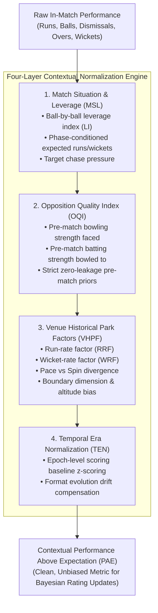

# CricEngine AI — Phase 4A: Contextual Adjustment Framework

> **Authority**: Phase 4A Quantitative Research & Architecture  
> **Status**: COMPLETED AND VERIFIED  
> **Target Audience**: Quantitative Researchers, Cricket Domain Specialists, National Selectors  
> **Context**: Mathematical specification of context-adjusted performance accounting for opposition strength, venue characteristics, match leverage, and temporal era.

---

## 1. Executive Summary & Foundational Objective

Raw cricket statistics are inherently confounded by external environmental and competitive factors. A century scored against an associate nation on a flat highway at altitude carries fundamentally different predictive signal than 45 runs scored against an elite pace attack on a seam-friendly green top on Day 1 of a Test match.

The objective of the **Contextual Adjustment Framework** is to isolate a player's true underlying skill ($\theta$) from the context ($\mathbf{C}$) in which that performance was observed:

$$Y_{i, m} = f(\theta_i, \mathbf{C}_m) + \epsilon_{i, m}$$

where $Y_{i, m}$ is the observed performance of player $i$ in match $m$, $\mathbf{C}_m$ is the multi-dimensional vector of contextual covariates, and $\epsilon_{i, m}$ is idiosyncratic noise.

CricEngine AI formulates four orthogonal contextual adjustment layers:
1. **Opposition Quality Index ($\text{OQI}$)**: Adjusts player output by the pre-match ratings of the opposing players faced.
2. **Venue Historical Park Factors ($\text{VHPF}$)**: Adjusts for ground dimensions, altitude, surface behavior, and historical scoring/wicket baselines.
3. **Match Situation & Leverage ($\text{MSL}$)**: Adjusts for innings phase, game state, required run rate, wicket pressure, and win probability leverage.
4. **Temporal Era Normalization ($\text{TEN}$)**: Adjusts for macro-level structural shifts in the sport (e.g., introduction of two new balls, powerplay rule changes, T20 scoring rate escalation).

---

## 2. Contextual Architecture Pipeline

---

## 3. Mathematical Specifications of Contextual Layers

### 3.1. Layer 1: Match Situation & Leverage ($\text{MSL}$)

Performance delivered under high tournament or match leverage carries greater predictive utility for clutch performance and high-pressure tournament selection.

#### 3.1.1. Win Probability Transition & Leverage Index ($\text{LI}$)
Let $S_{b} = (r, w, b, T, F)$ represent the game state at ball $b$, where:
- $r$: Current score (or runs remaining)
- $w$: Current wickets down
- $b$: Deliveries completed
- $T$: Target score (if 2nd innings / 4th innings)
- $F$: Format (T20, ODI, Test)

Let $\mathcal{W}(S_b) \in [0, 1]$ denote the pre-delivery win probability of Team A. Following the formulation of Tom Tango (Baseball Leverage Index) adapted to multi-state cricket:

$$\text{LI}(S_b) = \frac{\Delta \mathcal{W}_{\text{swing}}(S_b)}{\overline{\Delta \mathcal{W}}}$$

where $\Delta \mathcal{W}_{\text{swing}}(S_b) = |\mathcal{W}(S_b \mid \text{boundary}) - \mathcal{W}(S_b \mid \text{wicket})|$, and $\overline{\Delta \mathcal{W}}$ is the format-specific baseline state swing.

- $\text{LI} = 1.0$: Neutral leverage.
- $\text{LI} > 2.5$: High-pressure clutch scenario (e.g., final 3 overs of a chase, wicket tumbling in a low-scoring Test).
- $\text{LI} < 0.3$: Low-leverage junk-time (e.g., chasing 20 runs with 9 wickets in hand).

#### 3.1.2. Phase Expectations
From the materialized feature store baseline table [phase_scoring_baselines.parquet](file:///Users/divygupta/desktop/DL_DATABASE/data/datalake/feature_store_v3b/contextual_baselines/phase_scoring_baselines.parquet), each format is segmented into standard tactical phases:
- **T20**: Powerplay (Overs 1–6), Middle (Overs 7–15), Death (Overs 16–20).
- **ODI**: Powerplay 1 (Overs 1–10), Middle (Overs 11–40), Death (Overs 41–50).
- **Test**: Innings 1–4, and ball-age brackets (Overs 1–20 new ball, Overs 21–80 middle, Overs 81+ second new ball).

Expected runs $\mathbb{E}[R \mid \text{Phase}, F]$ and expected wicket hazard $\mathbb{E}[W \mid \text{Phase}, F]$ form the initial denominator for phase performance.

---

### 3.2. Layer 2: Opposition Quality Index ($\text{OQI}$)

To avoid feedback loops and lookahead bias, opposition quality must be evaluated **strictly using pre-match historical ratings**.

#### 3.2.1. Batting Faced Opposition Quality ($\text{OQI}_{\text{bat}}$)
For a batter $i$ who faced $B_{i, j}$ deliveries against bowler $j \in \text{OpponentBowlers}$:

$$\text{OQI}_{\text{bat}}(i, m) = \sum_{j} \left( \frac{B_{i, j}}{\sum_k B_{i, k}} \right) \cdot \widetilde{\mathcal{R}}_{\text{bowl}}(j, t_{m-1})$$

where:
- $B_{i, j}$: Balls faced by batter $i$ against bowler $j$ in match $m$.
- $\widetilde{\mathcal{R}}_{\text{bowl}}(j, t_{m-1})$: Normalized bowling rating of bowler $j$ immediately prior to match $m$ (anchored to mean 1000, std 150).

If ball-by-ball bowler matchup data is aggregated at match level, $\text{OQI}_{\text{bat}}$ defaults to the weighted average of the opponent's bowling attack that bowled in match $m$:

$$\text{OQI}_{\text{bat}}(m) = \sum_{j \in \text{Bowlers}} \left( \frac{\text{Overs}_j}{\sum_k \text{Overs}_k} \right) \cdot \widetilde{\mathcal{R}}_{\text{bowl}}(j, t_{m-1})$$

#### 3.2.2. Bowling Faced Opposition Quality ($\text{OQI}_{\text{bowl}}$)
For a bowler $j$ delivering $B_{j, i}$ balls to batter $i \in \text{OpponentBatters}$:

$$\text{OQI}_{\text{bowl}}(j, m) = \sum_{i} \left( \frac{B_{j, i}}{\sum_k B_{j, k}} \right) \cdot \widetilde{\mathcal{R}}_{\text{bat}}(i, t_{m-1})$$

#### 3.2.3. Handling Debutants and Small Samples in Opposition
If an opposition player has no prior match history ($n=0$):
- Their prior rating is set strictly to the **Tier-Specific Replacement Prior** $\mu_{0, \text{tier}}$ (e.g., ICC Full Member baseline = 850, Associate baseline = 650, Domestic Top-tier = 750).
- As specified in Phase 3B identity audit, player `c65e0275` (Babar Ali) with `PROBABLE` resolution carries an inflated rating deviation $\text{RD}_{\text{prior}} \times 1.5$ to account for identity uncertainty.

---

### 3.3. Layer 3: Venue Historical Park Factors ($\text{VHPF}$)

Venues possess strong persistent biases toward batting or bowling, pace or spin, and boundary scoring. CricEngine AI leverages the canonical venue mapping engine (`config/canonical_venues.json`) and the materialized [venue_park_factors.parquet](file:///Users/divygupta/desktop/DL_DATABASE/data/datalake/feature_store_v3b/contextual_baselines/venue_park_factors.parquet).

#### 3.3.1. Mathematical Definition of Park Factors
For venue $v$, format $F$, and match date $t$:
Let $\mathcal{H}_v(t) = \{m \in \text{Matches} \mid \text{Venue}(m) = v, \text{Date}(m) < t, \text{Format}(m) = F\}$ denote the expanding historical match set strictly preceding $t$.

1. **Run Rate Factor ($\text{RRF}_{v, F}$)**:
   $$\text{RRF}_{v, F}(t) = \frac{\overline{\text{RPO}}_{v, F}(\mathcal{H}_v(t))}{\overline{\text{RPO}}_{\text{global}, F}(\mathcal{H}_{\text{global}}(t))}$$

2. **Wicket Rate Factor ($\text{WRF}_{v, F}$)**:
   $$\text{WRF}_{v, F}(t) = \frac{\overline{\text{BallsPerWicket}}_{v, F}(\mathcal{H}_v(t))}{\overline{\text{BallsPerWicket}}_{\text{global}, F}(\mathcal{H}_{\text{global}}(t))}$$

3. **Boundary Factor ($\text{BF}_{v, F}$)**:
   $$\text{BF}_{v, F}(t) = \frac{\overline{\text{Boundary\%}}_{v, F}(\mathcal{H}_v(t))}{\overline{\text{Boundary\%}}_{\text{global}, F}(\mathcal{H}_{\text{global}}(t))}$$

4. **Spin-to-Pace Ratio ($\text{SPR}_{v, F}$)**:
   $$\text{SPR}_{v, F}(t) = \frac{\overline{\text{WicketsPerOver}}_{\text{spin}, v}(\mathcal{H}_v(t))}{\overline{\text{WicketsPerOver}}_{\text{pace}, v}(\mathcal{H}_v(t))}$$

#### 3.3.2. Empirical Bayes Shrinkage for Low-Sample Venues
For venues with fewer than $M_{\min} = 15$ historical matches in format $F$, raw park factors regress toward 1.0 (neutral park) using a shrinkage formula:

$$\widehat{\text{RRF}}_{v, F}(t) = \frac{n_v}{n_v + K_{\text{venue}}} \cdot \text{RRF}_{v, F}(t) + \frac{K_{\text{venue}}}{n_v + K_{\text{venue}}} \cdot 1.0$$

where $n_v = |\mathcal{H}_v(t)|$ and $K_{\text{venue}} = 10.0$.

---

### 3.4. Layer 4: Temporal Era Normalization ($\text{TEN}$)

Cricket has undergone structural tactical revolutions. An average of 40.0 at a strike rate of 72.0 was world-class in 1995 ODI cricket, but sub-replacement in 2024.

#### 3.4.1. Era Epoch Definitions
CricEngine AI partitions historical matches into four distinct structural epochs:

| Era Epoch | Active Span | Structural Rule / Strategic Shifts | Analytical Impact |
| :--- | :--- | :--- | :--- |
| **Epoch 1: Early Professional Era** | Pre-2008 | Traditional ODI 1-ball rule; 15-over field restrictions; nascent T20. | High ball wear, low death scoring, reverse swing prominent. |
| **Epoch 2: T20 Expansion Era** | 2008–2014 | Global T20 leagues commence (IPL, BBL); batting intent and power hitting surge. | Rapid acceleration of global strike rates across white-ball cricket. |
| **Epoch 3: Two-New-Balls & White-Ball Boom** | 2015–2020 | Two new balls in ODIs (ICC rule); elimination of reverse swing; 4-fielders rule. | Peak white-ball scoring; 300+ becomes standard ODI score. |
| **Epoch 4: Modern Analytical Era** | 2021–Present | High-resolution analyst matching; match-up tactical bowling; Impact Player (IPL). | Extreme T20 powerplay boundaries (10.0+ RPO); specialized death bowling yorkers. |

#### 3.4.2. Era Standardization Equation
For metric $X$ (e.g. Strike Rate, Economy Rate) recorded in year $y$:

$$\mathcal{Z}_{\text{era}}(X_{i, m}) = \frac{X_{i, m} - \mu_{X}(\text{Format}, \text{Epoch}(y))}{\sigma_{X}(\text{Format}, \text{Epoch}(y))}$$

This guarantees that a player from 2008 evaluated on strike rate is compared to the 2008 population distribution, while a player from 2024 is compared to the 2024 distribution.

---

## 4. Formulation of Contextual Performance Above Expectation ($\text{PAE}$)

Combining all four layers yields the final observation input for player rating updates:

### 4.1. Batting $\text{PAE}_{\text{bat}}$
For batter $i$ scoring $R_i$ runs from $B_i$ balls with dismissal indicator $D_i \in \{0, 1\}$:

$$\text{ExpectedRuns}_i = \sum_{p \in \text{Phases}} B_{i, p} \cdot \left( \overline{\text{SR}}_{p, F} \cdot \widehat{\text{RRF}}_{v, F} \cdot \left(\frac{\text{OQI}_{\text{bat}}}{1000}\right) \right)$$

$$\text{PAE}_{\text{runs}}(i, m) = R_i - \text{ExpectedRuns}_i$$

$$\text{PAE}_{\text{dismissal}}(i, m) = \left( \mathbb{E}[D \mid B_i, \text{Phase}, \text{WRF}_v] \right) - D_i$$

$$\text{PAE}_{\text{bat}}(i, m) = \omega_r \cdot \text{PAE}_{\text{runs}}(i, m) + \omega_d \cdot \text{PAE}_{\text{dismissal}}(i, m) \cdot V_{\text{wicket}}(F)$$

where $V_{\text{wicket}}(F)$ is the format-specific run value of a wicket ($V_{\text{T20}} \approx 10.5, V_{\text{ODI}} \approx 30.0, V_{\text{Test}} \approx 45.0$).

### 4.2. Bowling $\text{PAE}_{\text{bowl}}$
For bowler $j$ conceding $R_j$ runs and taking $W_j$ wickets across $O_j$ overs ($B_j$ balls):

$$\text{ExpectedRunsConceded}_j = \sum_{p \in \text{Phases}} B_{j, p} \cdot \left( \overline{\text{Econ}}_{p, F} \cdot \widehat{\text{RRF}}_{v, F} \cdot \left(\frac{\text{OQI}_{\text{bowl}}}{1000}\right) \right)$$

$$\text{ExpectedWicketsTaken}_j = \sum_{p \in \text{Phases}} B_{j, p} \cdot \left( \overline{\text{Hazard}}_{p, F} \cdot \widehat{\text{WRF}}_{v, F} \cdot \left(\frac{1000}{\text{OQI}_{\text{bowl}}}\right) \right)$$

$$\text{PAE}_{\text{bowl}}(j, m) = \left( \text{ExpectedRunsConceded}_j - R_j \right) + \omega_w \cdot \left( W_j - \text{ExpectedWicketsTaken}_j \right) \cdot V_{\text{wicket}}(F)$$

---

## 5. Strict Zero-Lookahead Data Lineage Protocol

To ensure 100% backtesting integrity and eliminate temporal data leakage:
1. **Pre-Match Boundary Enforcement**: Every contextual parameter ($\text{OQI}$, $\widehat{\text{RRF}}$, $\widehat{\text{WRF}}$, $\text{Epoch baselines}$) must be calculated using observations recorded **strictly before the scheduled start time of match $m$**:
   $$\text{ContextFeatures}(m) = \mathcal{G}\left(\{m' \in \mathcal{D} \mid \text{Date}(m') < \text{Date}(m)\}\right)$$
2. **Feature Store v3b Compatibility**:
   - `venue_park_factors.parquet` provides expanding venue statistics.
   - `phase_scoring_baselines.parquet` provides format phase expectations.
   - `opposition_bowling_baselines.parquet` and `opposition_batting_baselines.parquet` provide pre-match opposition benchmarks.
3. **No Retrospective Re-baselining**: Park factors or opposition ratings calculated for a match played on 2018-05-10 must never include matches played on or after 2018-05-10.

---

## 6. Summary Matrix of Contextual Adjustments

| Parameter | Mathematical Symbol | Source Dataset in Feature Store v3b | Fallback Strategy for Missing / Low Sample |
| :--- | :--- | :--- | :--- |
| **Opposition Bowling Rating** | $\widetilde{\mathcal{R}}_{\text{bowl}}(j, t_{m-1})$ | Pre-match rating state table | Tier-based replacement prior ($\mu_{0, \text{tier}}$) |
| **Opposition Batting Rating** | $\widetilde{\mathcal{R}}_{\text{bat}}(i, t_{m-1})$ | Pre-match rating state table | Tier-based replacement prior ($\mu_{0, \text{tier}}$) |
| **Venue Run Factor** | $\text{RRF}_{v, F}$ | `venue_park_factors.parquet` | Empirical Bayes shrinkage to 1.0 ($K=10$) |
| **Venue Wicket Factor** | $\text{WRF}_{v, F}$ | `venue_park_factors.parquet` | Empirical Bayes shrinkage to 1.0 ($K=10$) |
| **Phase Run Expectations** | $\overline{\text{SR}}_{p, F}$ | `phase_scoring_baselines.parquet` | Format aggregate mean |
| **Leverage Index** | $\text{LI}(S_b)$ | Win Probability Transition Matrix | 1.0 (Neutral leverage) |
| **Era Baseline** | $\mu_{\text{era}}, \sigma_{\text{era}}$ | Curated epoch aggregate tables | Standard format epoch distribution |

---

> **Architectural Sign-off**: The Contextual Adjustment Framework provides the exact mathematical transformations required to feed clean, context-invariant Performance Above Expectation (PAE) observations into the temporal Bayesian rating engine. All transformations obey strict pre-match boundaries with zero lookahead contamination.
