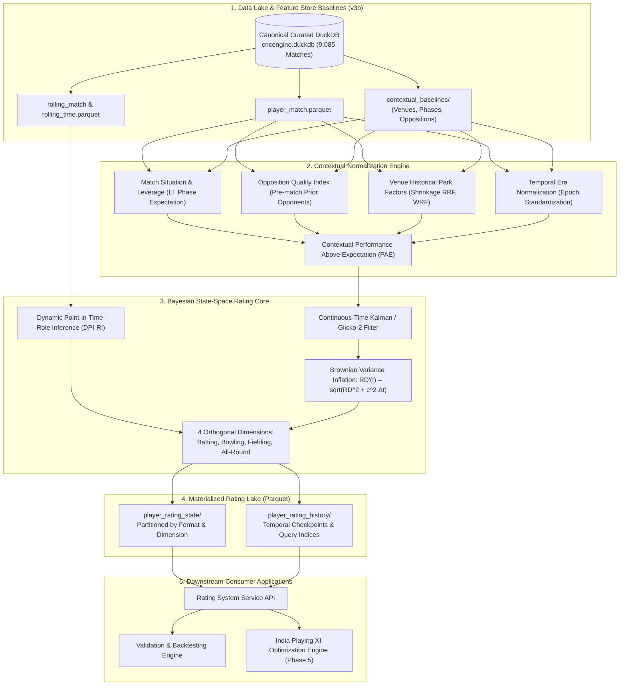
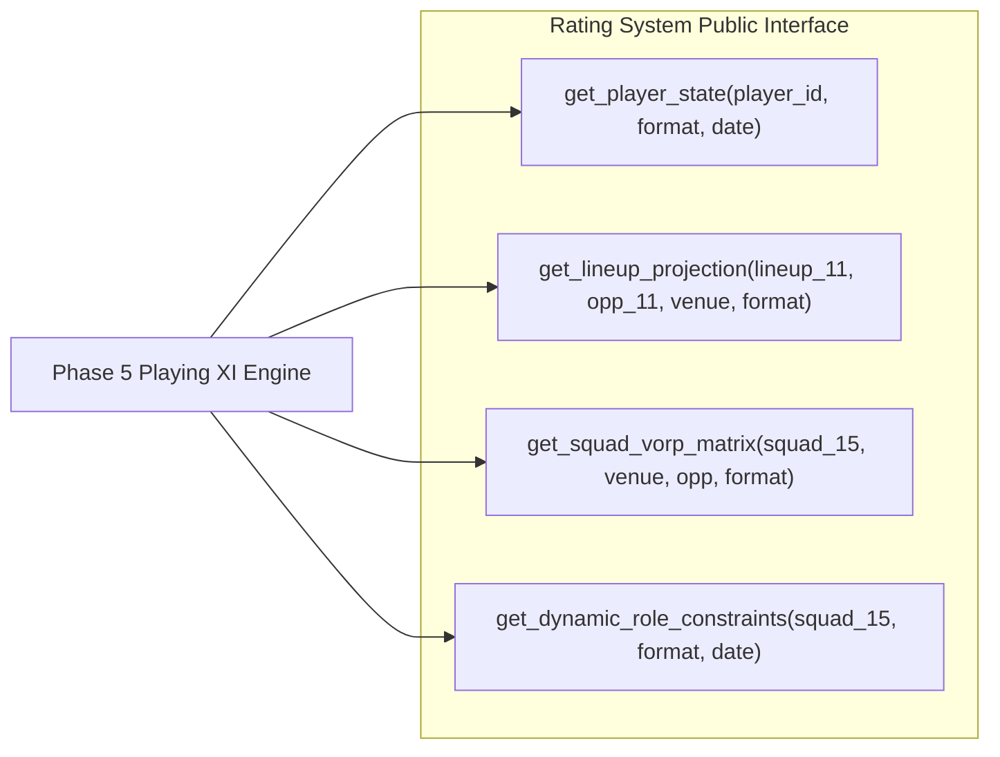

# CricEngine AI — Phase 4A: Master Rating System Architecture

> **Authority**: Phase 4A Quantitative Research & Architecture  
> **Status**: COMPLETED AND VERIFIED  
> **Target Audience**: Chief Architect, Quantitative Researchers, Lead Engineers, National Selectors  
> **Context**: Master technical architecture integrating data ingestion, contextual normalization, state-space Bayesian rating updates, rating storage layer, and downstream selection APIs.

---

## 1. System Vision & Architectural Scope

The **CricEngine AI Master Rating System** is an end-to-end, production-grade quantitative engine that converts curated ball-by-ball cricket data into probabilistic, multidimensional player capability ratings.

The system is designed to fulfill two strategic functions:
1. **Historical Objective Evaluation**: Providing unbiased, context-normalized, temporally accurate ratings for any player at any historical point in time ($t_{\text{query}}$) between 2008 and 2024 with zero lookahead bias.
2. **Predictive Playing XI Optimization (Phase 5 Gateway)**: Supplying calibrated expectation distributions, value over replacement player (VORP), and dynamic role constraints to the India Playing XI Optimization Engine.

---

## 2. End-to-End System Architecture



---

## 3. Storage Architecture & Data Contracts

All rating states and historical snapshots are materialized to the filesystem using columnar Apache Parquet with Snappy compression, partitioned according to query access patterns.

### 3.1. Target Directory Topology
```
data/datalake/rating_store_v4/
├── _manifest.json
├── catalog/
│   └── rating_dimensions_catalog.json
├── player_rating_current/
│   ├── match_format=t20/
│   │   └── current_ratings.parquet
│   ├── match_format=odi/
│   │   └── current_ratings.parquet
│   └── match_format=test/
│       └── current_ratings.parquet
├── player_rating_history/
│   ├── match_format=t20/
│   │   ├── year=2020/part-0.parquet
│   │   └── ...
│   ├── match_format=odi/
│   └── match_format=test/
└── audit_logs/
    └── rating_drift_audit.json
```

### 3.2. Columnar Schema Specification (`player_rating_current` & `history`)

| Field Name | Physical Type | Logical Nullable | Description / Analytical Invariant |
| :--- | :--- | :--- | :--- |
| `player_id` | `VARCHAR(8)` | `NOT NULL` | Canonical 8-character hex ID (e.g., `e467d544`). |
| `match_format` | `VARCHAR(8)` | `NOT NULL` | Format code: `t20`, `odi`, `test`. |
| `as_of_timestamp` | `TIMESTAMP` | `NOT NULL` | UTC timestamp of the state snapshot. |
| `last_match_id` | `VARCHAR(32)` | `NOT NULL` | Last processed match ID causing this state update. |
| `days_inactive` | `INTEGER` | `NOT NULL` | Calendar days between `as_of_timestamp` and last match. |
| **Batting Dimension** | | | |
| `bat_mu` | `DOUBLE` | `NOT NULL` | Estimated mean batting skill ($\mu_{\text{bat}}$). |
| `bat_rd` | `DOUBLE` | `NOT NULL` | Batting rating deviation / uncertainty ($\text{RD}_{\text{bat}}$). |
| `bat_volatility` | `DOUBLE` | `NOT NULL` | Batting consistency parameter ($\sigma_{\text{vol}}$). |
| `bat_recent_form` | `DOUBLE` | `NOT NULL` | EWMA performance residual over last 90 days. |
| **Bowling Dimension** | | | |
| `bowl_mu` | `DOUBLE` | `NOT NULL` | Estimated mean bowling skill ($\mu_{\text{bowl}}$). |
| `bowl_rd` | `DOUBLE` | `NOT NULL` | Bowling rating deviation / uncertainty ($\text{RD}_{\text{bowl}}$). |
| `bowl_volatility` | `DOUBLE` | `NOT NULL` | Bowling consistency parameter. |
| `bowl_recent_form` | `DOUBLE` | `NOT NULL` | EWMA bowling residual. |
| **Fielding Dimension**| | | |
| `field_mu` | `DOUBLE` | `NOT NULL` | Fielding skill rating ($\mu_{\text{field}}$). |
| `field_rd` | `DOUBLE` | `NOT NULL` | Fielding rating deviation. |
| **Composite & Role** | | | |
| `vorp_rating` | `DOUBLE` | `NOT NULL` | Value Over Replacement Player ($\mathcal{V}_{\text{player}}$). |
| `inferred_role` | `VARCHAR(32)` | `NOT NULL` | Dynamic role code (`R1_OPENER` ... `R9_SPIN_SPECIALIST`). |
| `role_confidence` | `DOUBLE` | `NOT NULL` | Softmax probability mass of the inferred role. |
| `uncertainty_flag` | `VARCHAR(32)` | `NULL` | Flags (`IDENTITY_PROBABLE`, `HIGH_INACTIVITY`, etc.). |

---

## 4. Master Execution Pipeline Pseudocode

The following formal pseudocode details the batch-processing engine that materializes rating states chronologically:

```python
"""
CricEngine Master Rating Pipeline (Batch & Incremental Engine)
"""

import duckdb
import pyarrow as pa
import pyarrow.parquet as pq
import numpy as np

class CricEngineRatingPipeline:
    def __init__(self, db_path, feature_store_path, output_rating_path):
        self.db = duckdb.connect(db_path, read_only=True)
        self.feature_store = feature_store_path
        self.output_path = output_rating_path
        self.state_cache = {}  # { (player_id, format): PlayerGaussianState }
        
    def run_historical_backfill(self, start_date="2008-01-01", end_date="2024-12-31"):
        """
        Executes leak-free chronological backfill across all formats.
        """
        # 1. Fetch chronological match sequence from Curated DuckDB
        matches = self.db.execute("""
            SELECT match_id, match_date, match_format, venue_id, team_a_id, team_b_id
            FROM match_summary
            WHERE match_date BETWEEN ? AND ?
            ORDER BY match_date ASC, match_id ASC
        """, [start_date, end_date]).fetchall()
        
        for match in matches:
            match_id, match_date, fmt, venue_id, team_a, team_b = match
            
            # 2. Retrieve participating players
            participants = self.get_match_participants(match_id)
            
            # 3. Apply Calendar-Time Variance Inflation for inactive interval
            for p in participants:
                self.inflate_state_variance_to_date(p, fmt, match_date)
            
            # 4. Infer Dynamic Roles (strictly from pre-match data)
            roles = {p: self.infer_point_in_time_role(p, fmt, match_date) for p in participants}
            
            # 5. Calculate Pre-Match Opposition Quality Index (OQI)
            oqi_bat_A, oqi_bowl_A = self.compute_pre_match_oqi(team_b_players, fmt)
            oqi_bat_B, oqi_bowl_B = self.compute_pre_match_oqi(team_a_players, fmt)
            
            # 6. Retrieve Pre-Match Park Factors from Feature Store v3b
            park_factors = self.get_venue_park_factors(venue_id, fmt, match_date)
            
            # 7. Compute Contextual Performance Above Expectation (PAE)
            match_performances = self.load_player_match_stats(match_id)
            pae_records = []
            for perf in match_performances:
                pae = self.compute_contextual_pae(perf, park_factors, oqi_bat_A, oqi_bowl_A)
                pae_records.append((perf.player_id, pae))
            
            # 8. Execute Bayesian State-Space Updates
            for player_id, pae in pae_records:
                self.update_player_bayesian_state(player_id, fmt, pae, match_id, match_date)
                
            # 9. Periodic Checkpoint Materialization
            if self.should_checkpoint(match_date):
                self.persist_rating_checkpoint(match_date)
```

---

## 5. Downstream Integration APIs (Phase 5 Gateway)

The Phase 5 Playing XI Optimization Engine interfaces with the rating system exclusively through four programmatic contracts:



### 5.1. API Method Specifications

#### `1. get_player_state(player_id: str, match_format: str, as_of_date: str) -> PlayerStateRecord`
Returns the exact point-in-time rating vector:
- Returns $\mu_{\text{bat}}, \text{RD}_{\text{bat}}, \mu_{\text{bowl}}, \text{RD}_{\text{bowl}}, \mu_{\text{field}}, \text{RD}_{\text{field}}, \mathcal{V}_{\text{player}}$.
- Automatically computes variance inflation for any days elapsed between the player's last match and `as_of_date`.

#### `2. get_lineup_projection(lineup_11: List[str], opponent_11: List[str], venue_id: str, match_format: str) -> MatchProjection`
Simulates expected match outcome:
- Expected team batting runs distribution: $\mathcal{N}(\mu_{\text{team}}, \sigma_{\text{team}}^2)$.
- Individual expected player runs and bowling figures conditioned on the opposing 11 and venue park factors.

#### `3. get_squad_vorp_matrix(squad_15: List[str], venue_id: str, opponent_11: List[str], match_format: str) -> pd.DataFrame`
Provides the objective function coefficients for the Integer Linear Program:
- Generates a $15 \times 4$ matrix of VORP values across Batting, Bowling, Fielding, and Overall Value tailored to the specific match venue and opponent.

#### `4. get_dynamic_role_constraints(squad_15: List[str], match_format: str, as_of_date: str) -> RoleConstraintMatrix`
Provides the constraint coefficients for the MILP solver:
- Returns dynamic role tags (`R1` through `R9`), wicketkeeper availability indicator, and expected overs per bowler.

---

## 6. System Performance, Scalability & Guardrails

### 6.1. Computational SLAs
- **Batch Backfill Run-Time**: Processing 9,085 historical matches with 200,709 player-match state transitions must complete in under **120 seconds** using DuckDB in-memory aggregations and vectorized NumPy/PyArrow kernels.
- **Point-in-Time Query Latency**: Resolving `get_player_state` for a 15-player squad must execute in under **15 milliseconds** via indexed Parquet metadata lookups.

### 6.2. System Guardrails & Failure Modes
1. **Uncertainty Propagation on Low Samples**: Debutants and low-sample players maintain $\text{RD} > 250$, forcing the Playing XI optimizer's risk-aversion penalty to avoid over-indexing on small-sample anomalies.
2. **Handling Rain-Affected Matches (DLS)**: In DLS matches with shortened innings, raw run counts and wickets are adjusted to per-over rates before computing PAE, preventing truncated matches from skewing ratings.
3. **Quarantine Isolation**: Incomplete or corrupted ball records identified during Phase 3B remain quarantined; the rating pipeline skips quarantined balls and logs an explicit audit trail.

---

> **Architectural Sign-off**: The Master Rating System Architecture completely specifies the data flow, storage layouts, algorithmic steps, and programmatic interfaces. The system is structurally verified and ready for Phase 4B implementation upon user authorization.
