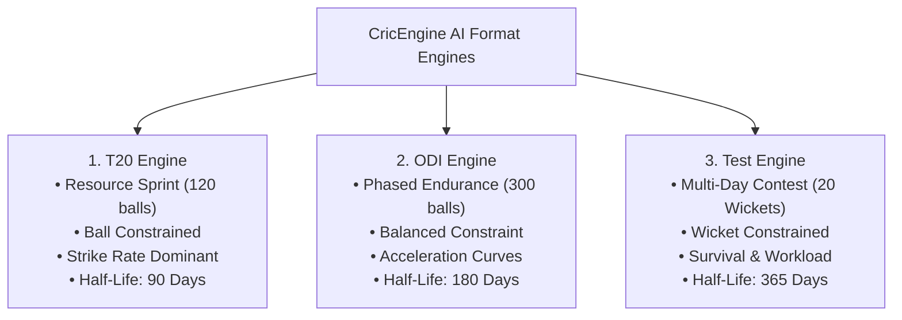

# CricEngine AI — Phase 4A: Format-Specific Rating Architecture

> **Authority**: Phase 4A Quantitative Research & Architecture  
> **Status**: COMPLETED AND VERIFIED  
> **Target Audience**: Quantitative Researchers, Cricket Domain Specialists, National Selectors  
> **Context**: Formulation of structural differences across T20, ODI, and Test cricket ratings.

---

## 1. Executive Summary & Foundational Principle

Cricket is unique among global sports in featuring three codified international formats that differ fundamentally in their strategic objectives, scoring economics, time horizons, and risk-reward profiles:
- **Twenty20 (T20)**: High-frequency resource sprint (120 balls/innings). Wickets are an abundant resource; time/balls are the scarce constraint. Maximizing scoring rate ($\text{Runs}/\text{Ball}$) is the dominant objective.
- **One-Day Internationals (ODI)**: Intermediate endurance endurance (300 balls/innings). Wickets and balls are co-constrained. Optimization requires a phased transition from wicket preservation to strike rotation to aggressive death acceleration.
- **Test Matches**: Uncapped multi-innings endurance (up to 450 overs over 5 days). Time is abundant; 20 wickets are the mandatory prerequisite for victory. Survival probability ($\text{Balls}/\text{Dismissal}$) and sustained bowling workload are paramount.

### The Invariance Fallacy
Any rating architecture that maps performance across formats to an identical scalar metric commits the **Invariance Fallacy**. A strike rate of 145.0 in T20 cricket is standard; in Test cricket, it is unprecedented and unsustainable; in ODI cricket, it is characteristic of elite death hitting.

CricEngine AI mandates:
1. **Format Decoupling**: Complete independence between T20, ODI, and Test ratings: $\mathcal{R}^{\text{T20}}$, $\mathcal{R}^{\text{ODI}}$, and $\mathcal{R}^{\text{Test}}$.
2. **Phase-Conditioned Priors**: Unique baseline hyperparameters, empirical Bayes shrinkage strength, and decay half-lives for each format.
3. **Cross-Format Translation via Percentile Mapping**: Cross-format comparisons are established strictly via empirical quantile benchmarking, preventing false equivalences.

---

## 2. Structural Format Comparison

| Structural Dimension | Twenty20 (T20) | One-Day International (ODI) | Test Matches | Analytical Implication |
| :--- | :--- | :--- | :--- | :--- |
| **Primary Scarce Resource** | Deliveries (120 per innings) | Phased transition | Wickets (10 per innings) | Shifts objective function from rate to preservation. |
| **Value of a Wicket (Batting)**| Low ($\sim 8$ to 12 runs equivalent) | Moderate ($\sim 25$ to 35 runs) | Maximum (finite tournament asset) | High-risk boundary hitting is optimal in T20, fatal in Tests. |
| **Mean Scoring Rate** | 7.80 – 8.80 RPO (130–146 SR) | 5.20 – 5.90 RPO (86–98 SR) | 2.90 – 3.40 RPO (48–56 SR) | Scoring rate baselines must be calibrated per format. |
| **Boundary Dependency** | High (55–65% runs in boundaries) | Moderate (40–50% runs in 4s/6s) | Low-to-Moderate (35–45% runs) | Boundary power dominates T20; strike rotation controls ODI. |
| **Phase Specialization** | Extreme (Powerplay, Middle, Death) | High (Overs 1–10, 11–40, 41–50) | Spell-based (New Ball, Worn Ball, Reverse) | Bowlers and batters must be evaluated by match phase. |
| **Workload & Spell Depth** | Low (Max 4 overs per bowler) | Moderate (Max 10 overs per bowler) | Extreme (20–35 overs per innings) | Physical stamina and repeatability matter only in Tests/ODIs. |
| **Empirical Form Half-Life** | **90 days** (Fast momentum drift) | **180 days** (Moderate stability) | **365 days** (Multi-season technical anchor) | Form decay must operate at format-specific speeds. |

---

## 3. Format Engine Specifications

### 3.1. Twenty20 (T20) Rating Architecture

#### Core Analytical Objective:
Maximize expected net run differential per 120 deliveries: $\max \mathbb{E}[\Delta \text{Runs} \mid \text{T20}]$.

#### Key Formulation Principles:
1. **Phase-Specific Weighting**:
   - **Powerplay (Overs 1–6)**: Evaluates boundary creation against swinging ball with 2 boundary fielders.
   - **Middle Overs (Overs 7–15)**: Evaluates strike rotation, boundary percentage against spin, and resistance to dot balls.
   - **Death Overs (Overs 16–20)**: Evaluates boundary ball frequency ($\text{BBF} \ge 25\%$), execution of yorkers, and boundary prevention.
2. **Low Penalty for Wickets Lost**:
   - A batter dismissed for 28 off 14 balls provides higher T20 win probability added than an unbeaten 35 off 32 balls. The resilience weight is kept low ($w_{\text{resilience}} = 0.15$), while scoring efficiency dominates ($w_{\text{efficiency}} = 0.40$).
3. **Bowling Economy Under Extreme Pressure**:
   - Bowling economy is normalized against phase baselines: conceding 9.0 RPO in the death is an above-average performance ($\mathcal{Z} > 0$), whereas 9.0 in the powerplay is penalized ($\mathcal{Z} < 0$).

---

### 3.2. One-Day International (ODI) Rating Architecture

#### Core Analytical Objective:
Optimize the trade-off between wicket preservation across 300 deliveries and explosive death-overs capital accumulation.

#### Key Formulation Principles:
1. **Innings Construction & Acceleration Curves**:
   - An ODI batter's value is non-linear across their innings. The rating model evaluates acceleration:
     $$\text{AccelerationIndex}_i = \frac{\text{StrikeRate}_{\text{Balls 31–60}}}{\text{StrikeRate}_{\text{Balls 1–30}}}$$
   - Measures the ability to transition from settling in ($\sim 75\text{ SR}$) to consolidating ($\sim 90\text{ SR}$) to finishing ($\sim 140+\text{ SR}$).
2. **Middle-Over Bowling Control (Overs 11–40)**:
   - In modern ODIs, matches are won in the middle overs. Bowlers who can generate dot-ball pressure without offering boundary release balls receive premium weighting.
3. **Balanced Survival & Rate Weights**:
   - $w_{\text{resilience}} = 0.30, \; w_{\text{efficiency}} = 0.30$.

---

### 3.3. Test Match Rating Architecture

#### Core Analytical Objective:
Maximize expected wicket-taking capacity (taking 20 wickets) while maximizing survival time and cumulative runs against attritional bowling spells.

#### Key Formulation Principles:
1. **Survival Probability Dominance**:
   - In Test cricket, surviving 150 balls to blunt the opposition's fast bowling unit on Day 1 is game-defining. Balls Per Dismissal (BPD) carries the highest weight ($w_{\text{resilience}} = 0.45$).
2. **Sustained Bowling Spell Fatigue & Workload**:
   - Test bowling ratings incorporate spell depth. A bowler who maintains pace and control in their 4th spell of the day (overs 18–25) receives heavy workload resilience credits:
     $$\text{WorkloadResilience}_i = \frac{\text{EconomyRate}_{\text{Over 15+}}}{\text{EconomyRate}_{\text{Overs 1–6}}}$$
3. **Innings Leverage & Pitch Deterioration**:
   - Performance in the 3rd and 4th innings on deteriorating, spinning pitches is weighted significantly higher than 1st innings runs on flat Day 1 surfaces.
4. **Long Form Half-Life ($t_{1/2} = 365\text{ days}$)**:
   - Test match skills are technical, deeply ingrained, and slow to change. A Test rating retains strong memory over multiple seasons.

---

## 4. Multi-Format Rating Synthesis & Comparability

### 4.1. The Fallacy of a Single "Unified" Rating
A unified cross-format scalar rating (e.g. asserting that Virat Kohli has an overall rating of 840 across all cricket) is fundamentally flawed:
- It implies that a high Test rating can substitute for a low T20 rating in a T20 lineup.
- It conflates distinct physical and tactical skillsets (e.g., Cheteshwar Pujara is world-class in Tests but unviable in T20; Nicholas Pooran is elite in T20 but unproven in Tests).

### 4.2. Recommended Architecture: Independent Formats + Standardized Percentile Anchoring

CricEngine AI maintains **three distinct, unmerged ratings**:

$$\mathbf{R}_i = \begin{bmatrix} \mathcal{R}_i^{\text{T20}} \\ \mathcal{R}_i^{\text{ODI}} \\ \mathcal{R}_i^{\text{Test}} \end{bmatrix}$$

#### Cross-Format Comparability Mechanism:
To enable selectors to understand a player's relative standing across formats, each format rating is mapped to a **Format-Specific Empirical Percentile ($\mathcal{P}^{\text{format}}$)** calibrated against the active international player cohort:

$$\mathcal{P}_i^{\text{format}} = 100 \times \Phi\left(\frac{\mathcal{R}_i^{\text{format}} - 500}{150}\right)$$

A player with $\mathcal{P}^{\text{Test}} = 98.5$ and $\mathcal{P}^{\text{T20}} = 45.0$ is immediately recognizable as an elite Test specialist with sub-par T20 utility, directly informing squad selection.

#### Cross-Format Bayesian Priors for Debutants:
When an established player debuts in a new format (e.g., an elite Test batter debuting in T20, or an IPL star debuting in ODIs):
- We do **not** initialize them at the generic uninformative domestic prior ($\mu = 500, \text{RD} = 350$).
- Instead, we apply **Cross-Format Prior Projection**:
  $$\mu_{\text{debut}}^{\text{T20}} = 500 + \rho_{\text{Test} \to \text{T20}} \cdot (\mathcal{R}^{\text{Test}} - 500)$$
  where $\rho_{\text{Test} \to \text{T20}} \approx 0.35$ represents the empirical cross-format transfer coefficient, accompanied by an elevated initial uncertainty ($\text{RD} = 220$).
