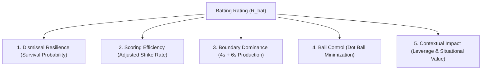
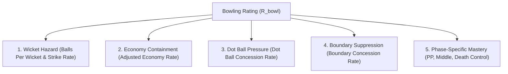

# CricEngine AI — Phase 4A: Player Rating Dimensions & Formulation

> **Authority**: Phase 4A Quantitative Research & Architecture  
> **Status**: COMPLETED AND VERIFIED  
> **Target Audience**: Quantitative Researchers, Statistical Modellers, Playing XI Optimization Architects  
> **Context**: Mathematical specification of independent player evaluation dimensions for CricEngine AI.

---

## 1. Architectural Philosophy: The Anti-Reductionist Principle

A fundamental defect in legacy sports rating systems is collapsing multi-faceted athletic contribution into a single scalar number. In cricket, this reductionist fallacy produces catastrophic distortions:
- An elite specialist bowler with a batting average of 4.2 (e.g. Jasprit Bumrah) would have their rating dragged down to mediocrity if evaluated via an unweighted composite average.
- An explosive finisher who scores 24 off 10 balls in death overs provides immense match-winning equity, but would be penalized by an unadjusted batting metric that prioritizes classical innings longevity.

CricEngine AI strictly enforces the **Orthogonal Dimension Principle**:
1. Every player maintains **independent, decoupled ratings** across four primary functional dimensions:
   - **$\mathcal{R}_{\text{bat}}$**: Batting Rating
   - **$\mathcal{R}_{\text{bowl}}$**: Bowling Rating
   - **$\mathcal{R}_{\text{field}}$**: Fielding Rating
   - **$\mathcal{R}_{\text{ar}}$**: All-Round Rating
2. An **Overall Player Value Metric ($\mathcal{V}_{\text{player}}$)** is computed not as a naive linear average, but as a **Role-Conditioned Value-Over-Replacement (VORP)** representation, tailored specifically to team construction and Playing XI optimization.

---

## 2. Batting Rating Formulation ($\mathcal{R}_{\text{bat}}$)

### 2.1. Decomposition of Batting Skill
Batting ability is multidimensional and cannot be captured by either average or strike rate in isolation. CricEngine AI decomposes batting into five distinct sub-dimensions:

$$\mathcal{R}_{\text{bat}} = f\left(\text{Resilience}, \; \text{Efficiency}, \; \text{Boundary Power}, \; \text{Ball Control}, \; \text{Clutch Impact}\right)$$

### 2.2. Mathematical Specification of Sub-Dimensions

#### 1. Dismissal Resilience ($S_{\text{resilience}}$)
Measures the player's intrinsic ability to preserve their wicket and prevent dismissal, regularized by Empirical Bayes Beta-Binomial shrinkage against the format-tier prior:

$$\hat{p}_{\text{dismissal}, i} = \frac{D_i + \alpha_{\text{dism}}}{B_i + \alpha_{\text{dism}} + \beta_{\text{dism}}}$$

$$S_{\text{resilience}, i} = \frac{1}{\hat{p}_{\text{dismissal}, i}} = \text{Shrunk Balls Per Dismissal (BPD)}_i$$

In Test cricket, $S_{\text{resilience}}$ carries heavy weight (0.45); in T20, it carries lower weight (0.15) to prevent penalizing aggressive risk-taking.

#### 2. Scoring Efficiency ($S_{\text{efficiency}}$)
Measures the player's run production speed normalized by venue park factors and opposition bowling quality. Rather than raw strike rate, we compute the **Park-and-Opposition Adjusted Strike Rate (ASR)**:

$$\text{ASR}_{i,m} = \frac{\text{RunsScored}_{i,m}}{\text{BallsFaced}_{i,m}} \times \frac{1}{\text{ParkFactor}_{\text{venue}}} \times \text{OppBowlingQualityIndex}_{\text{opp}}$$

Using Gamma-Poisson shrinkage towards the tier prior $\lambda_{\text{prior}}$:

$$S_{\text{efficiency}, i} = \frac{\sum_m \text{AdjustedRuns}_{i,m} + \alpha_{\text{sr}}}{\sum_m \text{BallsFaced}_{i,m} + \beta_{\text{sr}}}$$

#### 3. Boundary Dominance ($S_{\text{boundary}}$)
Measures boundary run contribution percentage ($\text{BRC} = \frac{4 \times 4s + 6 \times 6s}{\text{Total Runs}}$) and boundary ball frequency ($\text{BBF} = \frac{4s + 6s}{\text{Balls Faced}}$).

$$S_{\text{boundary}, i} = w_1 \cdot \text{ShrunkBBF}_i + w_2 \cdot \text{ShrunkBRC}_i$$

#### 4. Ball Control & Rotation ($S_{\text{control}}$)
Quantifies dot-ball avoidance and strike rotation:

$$S_{\text{control}, i} = 1.0 - \text{ShrunkDotPctFaced}_i$$

Minimizing dot balls is vital in T20 and ODI cricket to prevent scoreboard stagnation and relieve pressure on batting partners.

#### 5. Contextual Impact ($S_{\text{impact}}$)
Evaluates run scoring under high-leverage match conditions:
- Performance when required run rate $\text{RRR} > 10.0$ in chases.
- Performance when top-order collapse occurs (wickets down $< 3$ for $< 30$ runs).
- Performance in death overs (overs 16–20 in T20, 41–50 in ODI).

### 2.3. Format-Weighted Synthesis
The composite batting rating scales to $[0, 1000]$, centered at 500 for a baseline replacement international player:

$$\mathcal{R}_{\text{bat}} = 1000 \times \left[ \sum_{k=1}^5 w_k^{\text{format}} \cdot \Phi\left(\frac{S_k - \mu_k^{\text{format}}}{\sigma_k^{\text{format}}}\right) \right]$$

where $\Phi(\cdot)$ is the standard normal cumulative distribution function (mapping z-scores to $[0, 1]$), and weights $w_k^{\text{format}}$ vary by format:

| Sub-Dimension | T20 Weight | ODI Weight | Test Weight | Analytical Rationale |
| :--- | :---: | :---: | :---: | :--- |
| **Resilience (BPD)** | 0.15 | 0.30 | **0.45** | Wicket preservation is critical in Test; secondary to rate in T20. |
| **Efficiency (ASR)** | **0.40** | 0.30 | 0.15 | Scoring speed is primary driver of T20 win probability. |
| **Boundary Dominance** | **0.25** | 0.15 | 0.10 | Boundary hitting breaks defensive fielding setups in white ball. |
| **Ball Control (1-Dot%)**| 0.10 | **0.15** | 0.15 | Strike rotation controls middle overs in ODIs. |
| **Contextual Impact** | 0.10 | 0.10 | 0.15 | Critical in Test 4th innings chases and white-ball death finishes. |

---

## 3. Bowling Rating Formulation ($\mathcal{R}_{\text{bowl}}$)

### 3.1. Decomposition of Bowling Skill
A bowler's contribution is governed by two complementary yet distinct disciplines: **Run Containment** (suppressing scoring rate) and **Wicket Hazard** (terminating batting innings).

$$\mathcal{R}_{\text{bowl}} = f\left(\text{Wicket Hazard}, \; \text{Economy Containment}, \; \text{Dot Ball Pressure}, \; \text{Phase Flexibility}, \; \text{Workload Resilience}\right)$$

### 3.2. Mathematical Specification of Sub-Dimensions

#### 1. Wicket Hazard ($B_{\text{wicket}}$)
Measures the bowler's intrinsic hazard rate $\lambda_w$ (probability of taking a bowler-credited wicket per legal delivery), regularized via Gamma-Poisson shrinkage:

$$\hat{\lambda}_{w, i} = \frac{W_i + \alpha_{\text{wkt}}}{L_i + \beta_{\text{wkt}}}$$

$$B_{\text{wicket}, i} = \frac{1}{\hat{\lambda}_{w, i}} = \text{Shrunk Bowling Strike Rate (BSR)}_i$$

Where $W_i$ is bowler-credited wickets (excluding run-outs) and $L_i$ is legal deliveries bowled.

#### 2. Economy Containment ($B_{\text{economy}}$)
Measures runs conceded per over, adjusted for canonical venue park factor and opposition batting strength:

$$\text{AER}_{i,m} = \left(\frac{\text{RunsConceded}_{i,m} \times 6}{\text{LegalBalls}_{i,m}}\right) \times \frac{1}{\text{ParkFactor}_{\text{venue}}} \times \text{OppBattingQualityIndex}_{\text{opp}}$$

Using Gaussian shrinkage towards the tier-format prior:

$$B_{\text{economy}, i} = \text{Shrunk Adjusted Economy Rate (AER)}_i$$

#### 3. Dot Ball Pressure ($B_{\text{pressure}}$)
Measures the percentage of legal balls delivered that yield zero runs:

$$B_{\text{pressure}, i} = \text{Shrunk Dot Balls Bowled Percentage}$$

Dot ball pressure forces batters into low-percentage strokes, directly inducing wickets at the other end.

#### 4. Boundary Concession Resistance ($B_{\text{boundary\_resist}}$)
Measures resistance to conceding 4s and 6s per ball:

$$B_{\text{boundary\_resist}, i} = 1.0 - \text{Shrunk Boundaries Conceded Per Legal Ball}$$

#### 5. Phase-Specific Mastery ($B_{\text{phase}}$)
Bowlers are specialized by match phase:
- **Powerplay**: High fielding restrictions; swinging new ball.
- **Middle Overs**: Spin dominance; boundary containment; building pressure.
- **Death Overs**: Reverse swing; yorkers; defensive boundary suppression.

The phase rating measures performance relative to the format phase baseline (e.g., an economy of 8.5 in death overs is exceptional, whereas 8.5 in the powerplay is poor).

### 3.3. Format-Weighted Synthesis
Scaled to $[0, 1000]$, centered at 500 for replacement baseline:

$$\mathcal{R}_{\text{bowl}} = 1000 \times \left[ \sum_{k=1}^5 v_k^{\text{format}} \cdot \Phi\left(\frac{\mu_k^{\text{format}} - B_k}{\sigma_k^{\text{format}}}\right) \right]$$

*(Note: Inversion applied where lower values represent superior performance, e.g., economy rate and strike rate).*

| Sub-Dimension | T20 Weight | ODI Weight | Test Weight | Analytical Rationale |
| :--- | :---: | :---: | :---: | :--- |
| **Wicket Hazard (BSR)** | 0.25 | 0.35 | **0.50** | Taking 20 wickets is the only path to winning Test matches. |
| **Economy Containment**| **0.35** | 0.25 | 0.15 | Run containment directly dictates T20 win probability. |
| **Dot Ball Pressure** | 0.15 | 0.15 | 0.15 | Dot balls create systemic pressure across all formats. |
| **Boundary Resistance**| **0.15** | 0.15 | 0.05 | Boundary prevention is paramount in T20 death overs. |
| **Phase Mastery** | 0.10 | 0.10 | 0.15 | New-ball and reverse-swing phase effectiveness in multi-day cricket. |

---

## 4. Fielding Rating Formulation ($\mathcal{R}_{\text{field}}$)

### 4.1. The Data Observability Challenge
In public cricket data (including Cricsheet and official match scorecards), **fielding opportunities are partially observable**:
- **Observed Events**: Catches taken, stumpings executed, and run-outs directly credited to a fielder.
- **Unobserved Events**: Catches dropped, ground fielding runs saved, misfields, overthrows, and missed run-out opportunities are **not recorded** in raw scorecards.

### 4.2. Principled Formulation Under Partial Observability
To prevent misleading ratings, the fielding framework must:
1. Distinguish wicketkeepers (who receive a massive volume of catch and stumping chances) from outfielders.
2. Apply strong Empirical Bayes shrinkage to avoid rating an outfielder who played 2 matches and took 4 catches as the "world's best fielder".
3. Measure **Fielding Involvements Per Match (FPM)** adjusted for team bowling style (spin-heavy teams generate more slip catches and stumpings; pace-heavy teams generate more outfield catches).

#### Formula:
For non-wicketkeepers:

$$\text{FPM}_i = \frac{\text{Catches}_i + 1.25 \times \text{RunOutsInvolved}_i}{\text{MatchesFielded}_i + M_{\text{field}}}$$

For wicketkeepers:

$$\text{WKM}_i = \frac{\text{CatchesWk}_i + 1.50 \times \text{Stumpings}_i}{\text{MatchesKept}_i + M_{\text{keeper}}}$$

where $M_{\text{field}} = 15.0$ matches and $M_{\text{keeper}} = 20.0$ matches represent shrinkage pseudo-counts.

Scaled to $[0, 1000]$, centered at 500:
- Baseline replacement outfielder: ~500 ($\sim 0.35$ catches/match).
- Elite outfielder (e.g. Ravindra Jadeja, Glenn Maxwell): 800–920 ($\sim 0.75+$ involvements/match + high direct run-out involvement).

---

## 5. All-Round Rating Formulation ($\mathcal{R}_{\text{ar}}$)

### 5.1. The Dilution Fallacy and Sample Minimums
A naive linear average of batting and bowling:

$$\mathcal{R}_{\text{naive}} = 0.5 \times \mathcal{R}_{\text{bat}} + 0.5 \times \mathcal{R}_{\text{bowl}}$$

fails fundamentally:
- A pure batter ($\mathcal{R}_{\text{bat}} = 900, \mathcal{R}_{\text{bowl}} = 100$) receives 500 (average).
- A pure bowler ($\mathcal{R}_{\text{bat}} = 100, \mathcal{R}_{\text{bowl}} = 900$) receives 500 (average).
- A true all-rounder with solid dual skills ($\mathcal{R}_{\text{bat}} = 650, \mathcal{R}_{\text{bowl}} = 650$) receives 650, but their team value is vastly superior to the sum of parts because they create an extra squad slot.

### 5.2. Harmonic Load & Dual-Threshold Formulation
CricEngine AI formulates the All-Round Rating using a **Harmonic Balance Formulation** combined with **Workload Burden**:

$$\mathcal{R}_{\text{ar}} = \text{BalanceMultiplier}(\mathcal{R}_{\text{bat}}, \mathcal{R}_{\text{bowl}}) \times \left( w_b \mathcal{R}_{\text{bat}} + w_w \mathcal{R}_{\text{bowl}} \right) \times \text{WorkloadFactor}$$

#### 1. Balance Multiplier:
The harmonic mean penalizes extreme imbalance:

$$\text{HM}(\mathcal{R}_{\text{bat}}, \mathcal{R}_{\text{bowl}}) = \frac{2 \cdot \mathcal{R}_{\text{bat}} \cdot \mathcal{R}_{\text{bowl}}}{\mathcal{R}_{\text{bat}} + \mathcal{R}_{\text{bowl}} + \epsilon}$$

$$\text{BalanceMultiplier} = \frac{\text{HM}(\mathcal{R}_{\text{bat}}, \mathcal{R}_{\text{bowl}})}{\max(\mathcal{R}_{\text{bat}}, \mathcal{R}_{\text{bowl}})}$$

- For a pure specialist ($\mathcal{R}_{\text{bat}} = 900, \mathcal{R}_{\text{bowl}} = 100$): Balance Multiplier $\approx \frac{180}{900} = 0.20$.
- For a balanced all-rounder ($\mathcal{R}_{\text{bat}} = 700, \mathcal{R}_{\text{bowl}} = 700$): Balance Multiplier $= 1.00$.

#### 2. Workload Factor (ABI Integration):
To receive an elite all-rounder rating, the player must consistently carry meaningful team load in both facets. We integrate the point-in-time **All-Rounder Balance Index (ABI)** from `feature_store_v3b`:

$$\text{ABI}_i = \frac{2 \cdot \text{Load}_{\text{bat}, i} \cdot \text{Load}_{\text{bowl}, i}}{\text{Load}_{\text{bat}, i} + \text{Load}_{\text{bowl}, i} + 10^{-6}}$$

$$\text{WorkloadFactor} = \frac{\text{ABI}_i}{\text{ABI}_i + M_{\text{abi}}}$$

where $M_{\text{abi}} = 0.15$. A player who bowls 1 over every 5 matches cannot achieve a high all-round rating, regardless of taking a lucky wicket.

---

## 6. Overall Player Value Formulation ($\mathcal{V}_{\text{player}}$)

### 6.1. Role-Conditioned Value-Over-Replacement (VORP)
To evaluate a player's total match-winning equity for squad selection and Playing XI optimization without obscuring individual skills, CricEngine AI designs an **Overall Value Metric ($\mathcal{V}_{\text{player}}$)** rooted in Value Over Replacement Player (VORP).

Let $\mathcal{R}_{\text{rep}} = 400$ represent the baseline ability of a readily available replacement domestic cricketer.

$$\text{MarginalBatValue} = \max\left(0, \; \mathcal{R}_{\text{bat}} - \mathcal{R}_{\text{rep}}\right) \times \text{BattingLoadBurdens}$$

$$\text{MarginalBowlValue} = \max\left(0, \; \mathcal{R}_{\text{bowl}} - \mathcal{R}_{\text{rep}}\right) \times \text{BowlingLoadBurdens}$$

$$\text{MarginalFieldValue} = \left(\mathcal{R}_{\text{field}} - \mathcal{R}_{\text{rep}}\right) \times 0.20$$

$$\mathcal{V}_{\text{player}} = \text{MarginalBatValue} + \text{MarginalBowlValue} + \text{MarginalFieldValue} + \text{RosterFlexibilityBonus}(\mathcal{R}_{\text{ar}})$$

### 6.2. Key Advantages of the VORP Approach
1. **Preserves Specialist Excellence**: Jasprit Bumrah produces massive $\text{MarginalBowlValue}$ (~550) with 0 batting value, yielding an overall elite rating of ~550 VORP.
2. **Rewards Dual-Utility Assets**: An elite all-rounder (e.g. Ravindra Jadeja) produces 300 Bat Value + 320 Bowl Value + 100 Field Value + 80 Roster Bonus = ~800 VORP, capturing their game-changing team balance utility.
3. **Seamless Input to Playing XI Optimizer**: Because $\mathcal{V}$ is additive in expected run-margin space, the downstream integer linear programming (ILP) or genetic algorithm can directly optimize $\sum_{i=1}^{11} \mathcal{V}_i$ subject to structural team constraints (e.g., minimum 5 bowling options, exactly 1 wicketkeeper).
