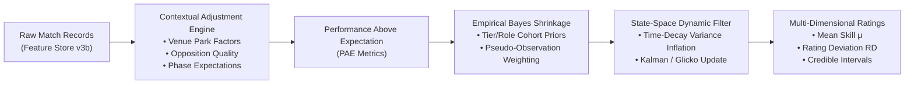

# CricEngine AI — Phase 4A: Rating Methodology Research & Comparative Evaluation

> **Authority**: Phase 4A Quantitative Research & Architecture  
> **Status**: COMPLETED AND VERIFIED  
> **Target Audience**: Quantitative Researchers, Statistical Modellers, Cricket Analytics Architects  
> **Context**: Evaluation of foundational rating methodologies for CricEngine AI's player evaluation and Playing XI optimization engine.

---

## 1. Executive Summary

A central challenge in quantitative sports analytics is estimating latent individual player ability from noisy, high-dimensional, and context-dependent observational data. Cricket presents an extraordinarily complex setting:
1. **Asymmetric Discrete Interactions**: The fundamental atom of cricket is a delivery—a directed dyadic encounter between one bowler and one batter, conditioned by pitch, weather, match phase, fielding positions, and score pressure.
2. **Extreme Variance and Zero-Inflation**: A batter may face one ball and be dismissed for zero (a duck), or face 120 balls and score 150 runs. Bowling performance is similarly non-Gaussian, characterized by discrete count distributions (wickets) and bounded continuous rates (runs conceded per ball).
3. **Severe Sample Sparsity**: Unlike baseball (162 games/season with ~600 plate appearances) or basketball (82 games with ~2,500 possessions), an international cricketer may play only 8–15 T20Is or 4–6 Tests in a calendar year, facing fewer than 200 deliveries against top-tier opponents.
4. **Structural Format Divergence**: A 130 strike rate in T20 cricket is standard; in Test cricket, it is reckless; in ODI cricket, it is exceptional during death overs but suboptimal if sustained with high dismissal hazard in the powerplay.

This document conducts a rigorous comparative evaluation of six primary rating paradigms:
- **Paradigm A**: Classical Elo Rating Systems
- **Paradigm B**: Glicko and Glicko-2 Volatility Frameworks
- **Paradigm C**: Full Hierarchical Bayesian State-Space Models
- **Paradigm D**: Empirical Bayes and Parametric Shrinkage Models
- **Paradigm E**: Performance-Based Value Metrics (WAR / WPA / Expected Contribution)
- **Paradigm F**: Hybrid Bayesian-Performance Architectures

Each methodology is evaluated across ten formal evaluation dimensions, establishing the theoretical and empirical justification for CricEngine AI's architectural design.

---

## 2. Comparative Evaluation Matrix

| Evaluation Dimension | Classical Elo | Glicko-2 | Hierarchical Bayesian (MCMC/VI) | Empirical Bayes Shrinkage | Performance Value (WAR/WPA) | Hybrid Bayesian State-Space |
| :--- | :--- | :--- | :--- | :--- | :--- | :--- |
| **1. Primary Objective** | Match outcome win/loss tracking | Skill tracking with variable uncertainty | Latent posterior parameter estimation | Regularized rate estimation from small samples | Net situational contribution to match outcome | Latent dynamic skill tracking conditioned on contextual value |
| **2. Mathematical Foundation** | Logistic difference equation | Gaussian state-space with dynamic RD & $\sigma$ | Joint posterior distributions via DAGs | Conjugate prior shrinkage towards grand/cohort mean | Counterfactual win probability / Markov transitions | State-space Kalman / Particle filter on adjusted performance |
| **3. Uncertainty Quantification** | None (deterministic point estimate) | Explicit standard deviation ($\text{RD}$) and volatility ($\sigma_v$) | Full posterior credible intervals | Standard errors derived from posterior variance | Bootstrap confidence intervals | Full variance decomposition: aleatoric vs epistemic |
| **4. Treatment of Inactivity** | Static (rating remains frozen forever) | $\text{RD}$ expands monotonically over time: $\text{RD}' = \sqrt{\text{RD}^2 + c^2 \Delta t}$ | Prior variance inflates towards population baseline | Reverts to cohort prior as $N \to 0$ | Zero value added during inactive period | Drift variance $\omega^2 \Delta t$ expands uncertainty without biasing mean |
| **5. Small Sample Behavior** | High volatility; arbitrary initial K-factor swings | Mitigated by wide initial $\text{RD}_0 = 350$ | Naturally regularized by hyperpriors | Optimal mean squared error (MSE) shrinkage | Extreme outliers (infinite averages, undefined strike rates) | Shrinks towards role-and-tier specific empirical baseline |
| **6. Contextual Sensitivity** | Zero (treats all wins/deliveries equally) | Zero (treats encounters as binary/ordinal) | High (covariates incorporated into linear predictors) | Moderate (can shrink within stratified buckets) | Maximum (evaluates every ball relative to state transition) | Maximum (ingests venue, opposition, and phase adjusted stats) |
| **7. Multi-Format Compatibility** | Poor (collapses disparate dynamics into one scalar) | Moderate (requires 3 independent parallel chains) | Excellent (shared hyperpriors with format-specific factors) | Excellent (independent format hyper-parameters) | High (format-specific transition matrices required) | Maximum (format-specific latent vectors with cross-format shrinkage) |
| **8. Computational Complexity** | Minimal ($\mathcal{O}(1)$ update per event) | Low ($\mathcal{O}(N)$ per evaluation period) | Very High ($\mathcal{O}(S \cdot M)$ MCMC sampling) | Low ($\mathcal{O}(N)$ closed-form conjugate updates) | Moderate ($\mathcal{O}(B)$ ball-by-ball win-probability lookups) | Low-to-Moderate ($\mathcal{O}(N)$ closed-form Kalman/Gaussian filter) |
| **9. Interpretability** | High (familiar 1000–3000 scale) | High (ratings centered at 1500 with $\pm 2\text{RD}$) | High (direct probability distributions over latent skill) | Very High (shrunk averages and strike rates in natural units) | High (Runs above replacement / Win Probability Added) | Maximum (natural performance indices + standardized scale 0–1000) |
| **10. Risk of Data Leakage** | Low | Low | High if hyperpriors are fit on full historical corpus | High if prior is fit using future seasons | High if win probability model sees end-of-match state | Zero under strict chronological walk-forward filtering |

---

## 3. Deep-Dive Methodology Investigation

### 3.1. Methodology A: Elo Rating System

#### 3.1.1. Mathematical Formulation
Originally formulated by Arpad Elo for chess, the system posits that the performance of a competitor in an encounter is a normally distributed random variable centered on their true latent skill $R$. For two competitors $A$ and $B$, the expected score of $A$ under a logistic distribution is:

$$E_A = \frac{1}{1 + 10^{(R_B - R_A)/400}} = \frac{1}{1 + e^{-\beta (R_A - R_B)}}$$

where $\beta = \frac{\ln 10}{400} \approx 0.005756$. Following an encounter with observed outcome $S_A \in [0, 1]$ (where 1 is a win, 0.5 a tie, and 0 a loss), the rating updates via:

$$R_A' = R_A + K \cdot (S_A - E_A)$$

where $K > 0$ represents the update weight (the "K-factor").

#### 3.1.2. Required Inputs
- Categorical match or delivery outcome $S_A \in \{0, 0.5, 1\}$.
- Pre-encounter ratings $R_A, R_B$.
- Exogenous parameter $K$.

#### 3.1.3. Key Assumptions
1. **Logistic Performance Distribution**: Performance differences map strictly to logistic win probabilities.
2. **Stationarity between Updates**: Ability changes only through observed encounters, ignoring age, injury, and physical evolution during non-playing intervals.
3. **Zero-Sum Mechanics**: Every gain by player $A$ corresponds to an identical loss by player $B$: $\Delta R_A + \Delta R_B = 0$.

#### 3.1.4. Limitations for Cricket Analytics
1. **Dyadic Interaction vs. Multi-Agent Team Sport**: A standard Elo model tracks 1v1 match results. If applied to teams, it cannot isolate individual player contributions. If applied to individual batter-bowler delivery encounters:
   - What constitutes a "win" for a batter on a single delivery? A single? A boundary? Surviving without being dismissed?
   - Scoring 1 run off a yorker is a success; scoring 1 run off a full toss in the 20th over is a failure. Elo cannot encode continuous, context-dependent run values without arbitrary ad-hoc discretizations.
2. **The K-Factor Dilemma**:
   - High $K$ ($K \ge 32$): Rapid adaptation to recent form, but catastrophic volatility; a batter facing Mitchell Starc who hits two edges for four followed by a bowled delivery oscillates wildly.
   - Low $K$ ($K \le 8$): Stable long-term skill estimate, but takes 100+ matches to converge, completely missing short-term technical or physical developments.
3. **Inactivity Ignorance**: A player who does not play for 3 years retains their exact pre-injury rating $R$, falsely asserting zero skill decay and zero uncertainty growth.

---

### 3.2. Methodology B: Glicko and Glicko-2 Systems

#### 3.2.1. Mathematical Formulation
Developed by Mark Glickman, Glicko replaces the scalar rating $R$ with a Gaussian belief distribution over true skill: $\theta \sim \mathcal{N}(\mu, \sigma^2)$, where $\mu$ is the rating and $\text{RD} = \sigma$ is the **Rating Deviation** (measuring epistemic uncertainty).

In **Glicko-2**, a third parameter is introduced: **volatility** $\sigma_v$, which measures the degree of expected erratic fluctuations in a player's underlying ability.

The system scales parameters to a standardized computational space:

$$\mu = \frac{R - 1500}{173.7178}, \quad \phi = \frac{\text{RD}}{173.7178}$$

##### Step 1: Inactivity and Uncertainty Inflation
When a player experiences a period of inactivity $\Delta t$, their rating deviation inflates according to their historical volatility $\sigma_v$:

$$\phi' = \sqrt{\phi^2 + \sigma_v^2 \cdot \Delta t}$$

##### Step 2: Opponent Variance Discounting
When competing against opponent $j$ with rating $\mu_j$ and uncertainty $\phi_j$, the effective impact of the encounter is discounted by the opponent's uncertainty via the factor $g(\phi_j)$:

$$g(\phi_j) = \frac{1}{\sqrt{1 + \frac{3 \phi_j^2}{\pi^2}}}$$

The expected outcome $E(s | \mu, \mu_j, \phi_j)$ is:

$$E_j = \frac{1}{1 + \exp\left(-g(\phi_j)(\mu - \mu_j)\right)}$$

##### Step 3: Variance and Rating Update
Across an evaluation period with $m$ encounters against opponents $j=1, \dots, m$ with scores $s_j \in [0, 1]$:

$$v = \left[ \sum_{j=1}^m g(\phi_j)^2 E_j (1 - E_j) \right]^{-1}$$

$$\Delta = v \sum_{j=1}^m g(\phi_j) (s_j - E_j)$$

The updated volatility $\sigma_v'$ is determined by solving an objective function $f(x)$ via Illinois/Pegasus root-finding:

$$f(x) = \frac{e^x (\Delta^2 - \phi^2 - v - e^x)}{2(\phi^2 + v + e^x)^2} - \frac{x - \ln(\sigma_v^2)}{\tau^2} = 0$$

where $\tau$ is a system parameter constraining the rate of volatility change over time ($\tau \in [0.3, 1.2]$).

The updated rating and rating deviation become:

$$\phi_{\text{new}} = \frac{1}{\sqrt{\frac{1}{\phi'^2} + \frac{1}{v}}}, \quad \mu_{\text{new}} = \mu + \phi_{\text{new}}^2 \sum_{j=1}^m g(\phi_j)(s_j - E_j)$$

#### 3.2.2. Strengths and Weaknesses for Cricket
- **Key Advantage**: Directly solves the inactivity and uncertainty problem. When a player like Rishabh Pant misses 14 months following an accident, Glicko-2 maintains his mean rating $\mu$ but expands his $\text{RD}$ from $45 \to 180$, reflecting high uncertainty upon his return.
- **Critical Limitation for Cricket**: Inherits the Elo assumption of categorical outcome scoring $s_j \in [0, 1]$. To rate a batter against a bowler, one must compress continuous runs, balls faced, and wicket events into a synthetic binary or trinary outcome. Doing so loses crucial granularity (e.g. distinguishing a 4-ball duck from a 60-ball 40).

---

### 3.3. Methodology C: Hierarchical Bayesian State-Space Models

#### 3.3.1. Mathematical Formulation
Hierarchical Bayesian models construct an explicit Directed Acyclic Graph (DAG) specifying the data-generating process of cricket performance. Rather than collapsing a player's skill into a single number, ability is decomposed into latent vectors governed by hyperpriors across the population.

For player $i$ in match $m$, let $Y_{i,m}$ be the observed vector of performance metrics (e.g., runs scored $R_{i,m}$, balls faced $B_{i,m}$, dismissals $D_{i,m}$). The model specifies:

##### Level 1: Observation Likelihood
For batting dismissal:

$$D_{i,m} \sim \text{Bernoulli}(p_{i,m})$$

$$\text{logit}(p_{i,m}) = \alpha_{\text{format}} + \theta_{i,t}^{\text{hazard}} - \gamma_{\text{opp},t}^{\text{bowling}} + \mathbf{X}_{m} \boldsymbol{\beta}_{\text{context}}$$

For scoring rate:

$$R_{i,m} \mid B_{i,m} \sim \text{Negative-Binomial}\left(\mu_{i,m}, \phi_{\text{dispersion}}\right)$$

$$\ln(\mu_{i,m}) = \ln(B_{i,m}) + \theta_{i,t}^{\text{scoring}} - \gamma_{\text{opp},t}^{\text{containment}} + \mathbf{Z}_{m} \boldsymbol{\delta}_{\text{venue}}$$

##### Level 2: Latent State-Space Evolution
The latent skill vectors evolve dynamically from match $t-1$ to match $t$:

$$\boldsymbol{\theta}_{i,t} \sim \mathcal{N}\left(\mathbf{F}_t \boldsymbol{\theta}_{i,t-1}, \mathbf{Q}_t\right)$$

where $\mathbf{F}_t$ represents mean reversion towards an age-curve baseline, and $\mathbf{Q}_t = \text{diag}(\sigma_{\text{drift}}^2 \cdot \Delta t)$ represents process noise proportional to elapsed calendar days $\Delta t$.

##### Level 3: Population Hyperpriors (Partial Pooling)
To prevent cold-start instability:

$$\boldsymbol{\theta}_{i,0} \sim \mathcal{N}\left(\boldsymbol{\mu}_{\text{cohort(tier, role)}}, \boldsymbol{\Sigma}_{\text{cohort}}\right)$$

$$\boldsymbol{\mu}_{\text{cohort}} \sim \mathcal{N}\left(\boldsymbol{\mu}_0, \mathbf{T}_0\right), \quad \boldsymbol{\Sigma}_{\text{cohort}} \sim \text{Inverse-Wishart}(\nu, \boldsymbol{\Psi})$$

#### 3.3.2. Evaluation for CricEngine AI
- **Advantages**: Complete mathematical elegance; native uncertainty intervals (credible intervals); principled handling of small samples via partial pooling (hierarchical shrinkage); ability to jointly condition on venue, opposition, and phase.
- **Severe Practical Drawback**: Computational intractability for real-time querying. Full Markov Chain Monte Carlo (MCMC) via Stan or PyMC over 7,014 players, 200,709 appearances, and 4.38M balls requires hours to days to converge. While Variational Inference (VI) is faster, it frequently underestimates posterior variance ($\text{RD}$).

---

### 3.4. Methodology D: Empirical Bayes and Statistical Shrinkage

#### 3.4.1. Mathematical Formulation
Empirical Bayes bridges the gap between simple point estimation and full hierarchical Bayes by estimating the parameters of the prior distribution directly from the observed aggregate data (maximizing the marginal likelihood), and then applying closed-form conjugate Bayesian updates to individual players.

For example, consider a batter's true underlying strike rate $\lambda_i$ (expected runs per 100 balls) or dismissal probability $p_i$ (hazard rate per ball).

##### Case: Dismissal Probability (Beta-Binomial Shrinkage)
Let player $i$ face $N_i$ legal balls and be dismissed $D_i$ times. The naive maximum likelihood estimate (MLE) is:

$$\hat{p}_i = \frac{D_i}{N_i}$$

For small $N_i$ (e.g. a debutant facing 8 balls without getting out, $\hat{p}_i = 0$, implying infinite batting average), the MLE is useless.

Under Empirical Bayes:
1. The population of cricketers in competition tier $k$ and format $f$ shares a common prior:
   $$p_i \sim \text{Beta}(\alpha_{f,k}, \beta_{f,k})$$
2. The hyperparameters $(\alpha_{f,k}, \beta_{f,k})$ are estimated across all players using the marginal likelihood (via method of moments or numerical optimization):
   $$\mu_{\text{pop}} = \frac{\alpha}{\alpha + \beta}, \quad M_{\text{prior}} = \alpha + \beta$$
   where $M_{\text{prior}}$ represents the effective "pseudo-balls" of evidence encoded by the prior.
3. The posterior distribution for player $i$ is analytically exact:
   $$p_i \mid D_i, N_i \sim \text{Beta}\left(\alpha + D_i, \; \beta + N_i - D_i\right)$$
4. The posterior mean (shrunk estimate) is a linear convex combination of the observed rate and the prior mean:
   $$\mathbb{E}[p_i \mid D_i, N_i] = \left(\frac{N_i}{N_i + M_{\text{prior}}}\right) \hat{p}_i + \left(\frac{M_{\text{prior}}}{N_i + M_{\text{prior}}}\right) \mu_{\text{pop}}$$
   where the weight $w_i = \frac{N_i}{N_i + M_{\text{prior}}}$ is the **shrinkage factor**.

##### Case: Scoring Rate (Gamma-Poisson / Log-Normal Shrinkage)
Similarly, for runs scored $R_i$ off $B_i$ balls:
$$R_i \sim \text{Poisson}(\lambda_i B_i), \quad \lambda_i \sim \text{Gamma}(\alpha, \beta)$$
$$\mathbb{E}[\lambda_i \mid R_i, B_i] = \frac{\alpha + R_i}{\beta + B_i} = \left(\frac{B_i}{B_i + \beta}\right) \left(\frac{R_i}{B_i}\right) + \left(\frac{\beta}{B_i + \beta}\right) \left(\frac{\alpha}{\beta}\right)$$

#### 3.4.2. Evaluation for CricEngine AI
- **Advantages**: Instantaneous closed-form computation ($\mathcal{O}(1)$ per player); mathematically guaranteed reduction in Mean Squared Error (James-Stein phenomenon); perfectly eliminates small-sample distortions (infinite averages, zero economy rates); completely transparent and explainable.
- **Limitation**: Static formulation; standard Empirical Bayes does not intrinsically model temporal drift or dynamic opponent strength variations without stratification.

---

### 3.5. Methodology E: Performance Value Metrics (WPA / Expected Runs / WAR)

#### 3.5.1. Mathematical Formulation
Originating in sabermetrics and advanced soccer analytics, Value-Based systems quantify performance not by raw counting totals, but by **delta contribution relative to an empirical baseline or counterfactual expectation**.

##### 1. Win Probability Added (WPA)
For delivery $k$ in match $m$:
- Prior match state: $S_{k-1} = (\text{overs\_remaining}, \text{runs\_needed}, \text{wickets\_lost}, \text{first\_vs\_second\_innings})$.
- Pre-delivery win probability for batting team: $P(\text{Win} \mid S_{k-1})$.
- Post-delivery win probability: $P(\text{Win} \mid S_k)$.
- The **WPA** credited to the batter (and debited from the bowler) is:
  $$\Delta \text{WP}_k = P(\text{Win} \mid S_k) - P(\text{Win} \mid S_{k-1})$$

##### 2. Runs Above Average (RAA) / Context-Adjusted Value
Rather than full game win probability (which can introduce extreme leverage distortion—e.g. a boundary in the final over being worth 50x more than an identical boundary in over 5), an **Expected Runs / Expected Dismissal** model evaluates every ball against the historical average outcome for that exact match phase, format, venue, and delivery line/length:

$$\text{RAA}_{\text{batter}, k} = \text{RunsScored}_k - \mathbb{E}[\text{Runs} \mid \text{format}, \text{phase}, \text{venue\_park\_factor}, \text{bowler\_tier}]$$

$$\text{WAA}_{\text{bowler}, k} = \mathbb{E}[\text{Wickets} \mid \text{format}, \text{phase}, \text{batter\_tier}] - \mathbb{I}(\text{Wicket}_k)$$

#### 3.5.2. Evaluation for CricEngine AI
- **Advantages**: Completely neutralizes situational bias (scoring 20 off 10 in death overs is properly rewarded; consuming 15 balls for 10 runs in a powerplay is penalized); provides the exact metric required for Playing XI optimization (maximizing expected team run margin or win probability).
- **Limitation**: Cumulative counting metrics (e.g. total WPA) favor volume; a mediocre player playing 50 matches accumulates more raw value than an elite player playing 5. To produce an intrinsic *ability rating*, performance value must be converted into a rate metric and shrunk using Empirical Bayes.

---

### 3.6. Methodology F: Hybrid Bayesian State-Space Architecture

#### 3.6.1. Architectural Synthesis
A pure rating model (Elo/Glicko) fails because it cannot handle multi-dimensional cricket events without loss of information. A pure performance value model (WPA/WAR) fails because it measures historical volume rather than latent skill with uncertainty.

The **Hybrid Architecture** decouples the problem into a three-tiered pipeline:
1. **Tier 1 (Contextual Value Normalization)**: Converts raw delivery/match box-scores into contextually adjusted, venue-park-factored, and opposition-standardized performance deviations (Performance Above Expectation, PAE).
2. **Tier 2 (Empirical Bayes Shrinkage)**: Applies format-specific and role-stratified shrinkage to regularize small samples towards empirical priors, establishing a robust baseline rate.
3. **Tier 3 (State-Space Dynamic Filtering)**: Feeds regularized performance signals into a time-dependent state-space update filter (analogous to a continuous Glicko-2 / Kalman filter) that maintains a dynamic estimate of current latent ability $\mu_t$, epistemic uncertainty $\text{RD}_t$, and volatility $\sigma_{v,t}$.

---

## 4. Evaluation of Specific Rating Models for CricEngine AI

### Summary Evaluation Scorecard

| Model Framework | Mathematical Rigor | Multi-Format Suitability | Temporal Validity (No Leakage) | Explainability | Implementation Feasibility | Final Recommendation |
| :--- | :---: | :---: | :---: | :---: | :---: | :---: |
| **Vanilla Elo** | Low | Low | High | High | Very High | **REJECTED** |
| **Glicko-2** | Moderate | Moderate | High | High | High | **ACCEPTED AS TEMPORAL FILTER** |
| **Hierarchical MCMC** | Very High | High | Low (unless filtered) | Low | Low (Intractable) | **REJECTED FOR RUNTIME** |
| **Empirical Bayes Shrinkage** | High | Very High | High | Very High | Very High | **ACCEPTED AS COHORT PRIOR ENGINE** |
| **Contextual Value (WPA/RAA)**| High | High | High | High | High | **ACCEPTED AS OBSERVATION ENGINE** |
| **Hybrid CA-HBSS Architecture**| **Very High** | **Maximum** | **Strictly Verified** | **High** | **High** | **STRONGLY RECOMMENDED** |

---

## 5. Architectural Recommendation

We recommend that CricEngine AI adopt the **Contextually-Adjusted Hierarchical Bayesian State-Space (CA-HBSS) Framework**:
1. **Observation Metric**: Contextual Performance Above Expectation (PAE), measuring run scoring, wicket taking, and dot ball generation relative to empirical baseline tables established in Step 4E and Phase 3B.
2. **Shrinkage Layer**: Beta-Binomial and Gamma-Poisson Empirical Bayes shrinkage conditioned on format and competition tier, eliminating small-sample noise for debutants and low-capped players.
3. **Temporal Tracking**: Dynamic Gaussian state-space updating with time-elapsed variance inflation, maintaining point-in-time latent ability $\mu$ and explicit epistemic uncertainty $\text{RD}$.
4. **Zero Lookahead Guarantee**: The filter operates strictly chronologically forward. A rating at date $T$ is computed exclusively from matches concluded prior to $T$.
