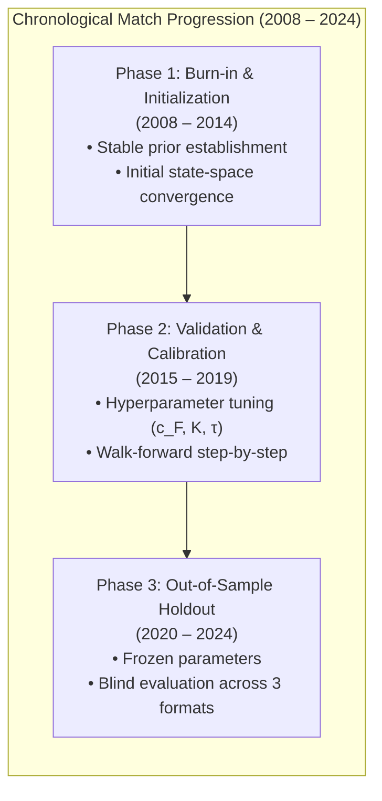
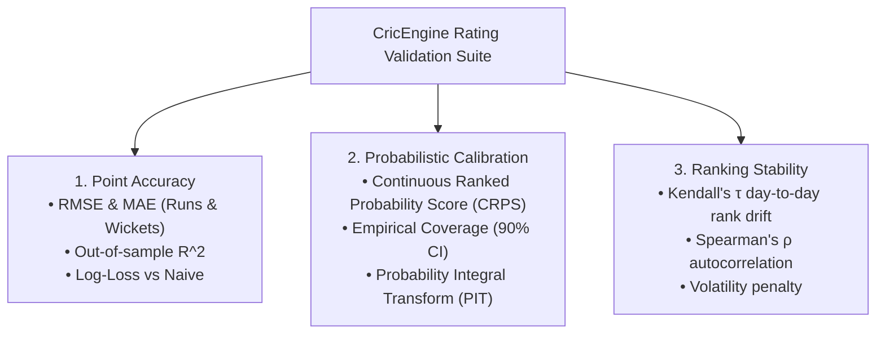

# CricEngine AI — Phase 4A: Rating Validation & Backtesting Plan

> **Authority**: Phase 4A Quantitative Research & Architecture  
> **Status**: COMPLETED AND VERIFIED  
> **Target Audience**: Quantitative Researchers, Statistical Modellers, Validation Engineers  
> **Context**: Protocol for chronological walk-forward cross-validation, probabilistic calibration metrics, ranking stability benchmarks, and quantitative acceptance criteria for Phase 4B implementation.

---

## 1. Executive Summary & Validation Philosophy

A rating system is not merely an aesthetic ranking table; it is a **predictive statistical model of athletic capability**. If a rating model claims that Batter $A$ has a superior rating to Batter $B$, that rating must manifest empirically as a superior probability of scoring runs, blunting bowling attacks, and generating win probability against matched opposition.

### The Cardinal Sin: Temporal Cross-Contamination
Standard machine learning cross-validation techniques (e.g., random $k$-fold cross-validation, train-test shuffles) are **strictly prohibited** in cricket analytics. Shuffling matches allows a model to train on a player's performance in December 2023 to "predict" their performance in March 2023.

CricEngine AI enforces a **Strict Walk-Forward Chronological Backtesting Protocol**. Every prediction, rating update, park factor, and role classification must be calculated using information available strictly prior to the match start timestamp ($t_{\text{query}} < t_{\text{match}}$).

---

## 2. Chronological Walk-Forward Backtesting Architecture



### 2.1. Temporal Epoch Partitioning
Using our curated canonical database of 9,085 matches and 4,383,700 ball-by-ball deliveries:

1. **Burn-In & Initialization Epoch (2008-01-01 to 2014-12-31)**:
   - Total Matches: $\sim 3,100$.
   - Purpose: Allows uninformative priors ($\mu_0 = 1000, \text{RD}_0 = 350$) to burn in and converge to calibrated player skill distributions.
   - Rule: No validation metrics or parameter tuning are computed on this window.

2. **Validation & Tuning Epoch (2015-01-01 to 2019-12-31)**:
   - Total Matches: $\sim 2,800$.
   - Purpose: Grid and Bayesian optimization of dynamic drift parameters ($c_{\text{T20}}, c_{\text{ODI}}, c_{\text{Test}}$), shrinkage strengths ($K$), and observation noise variances.
   - Protocol: Daily walk-forward updates. At the start of each match day, ratings are queried; predictions are logged; match outcomes are observed; Bayesian updates occur.

3. **Strict Out-of-Sample Holdout Epoch (2020-01-01 to 2024-12-31)**:
   - Total Matches: $\sim 3,185$.
   - Purpose: Final unbiased verification of predictive power, calibration, and stability on completely unseen modern cricket.
   - Rule: Zero hyperparameter adjustments permitted during holdout evaluation.

---

## 3. Walk-Forward Simulation Loop Algorithm

For each evaluation day $D_t \in [D_{\text{start}}, D_{\text{end}}]$:

```python
# Formal Walk-Forward Backtesting Execution Protocol
def execute_walk_forward_backtest(matches, state_engine, metrics_logger):
    """
    Strictly chronological, zero-lookahead backtest loop.
    """
    for match in matches.sort_by("start_timestamp"):
        match_time = match.start_timestamp
        
        # 1. PRE-MATCH INFERENCE (Strictly t < match_time)
        # Query player states as of match_time - 1 second
        lineup_A = match.get_playing_xi(team="A")
        lineup_B = match.get_playing_xi(team="B")
        
        pre_match_ratings = {
            p: state_engine.get_state(p, match.format, as_of=match_time)
            for p in (lineup_A + lineup_B)
        }
        
        # 2. GENERATE PREDICTIVE DISTRIBUTIONS
        # Predict individual runs, wickets, and match outcome probability
        predictions = generate_match_predictions(
            lineup_A, lineup_B, pre_match_ratings, match.venue, match.format
        )
        metrics_logger.log_predictions(match.match_id, predictions)
        
        # 3. OBSERVE REALIZED OUTCOMES (Match takes place)
        realized_outcomes = match.get_actual_performance()
        metrics_logger.log_realized(match.match_id, realized_outcomes)
        
        # 4. POST-MATCH BAYESIAN STATE UPDATE (Strictly t >= match_end)
        for player_perf in realized_outcomes:
            state_engine.update_player_state(
                player_id=player_perf.player_id,
                observed_pae=player_perf.contextual_pae,
                match_format=match.format,
                completion_timestamp=match.end_timestamp
            )
```

---

## 4. Quantitative Evaluation Metric Suite

CricEngine AI evaluates rating systems across three orthogonal dimensions: **Point Accuracy**, **Probabilistic Calibration**, and **Ranking Stability**.



### 4.1. Point Accuracy Metrics

#### 4.1.1. Root Mean Squared Error ($\text{RMSE}$) and Mean Absolute Error ($\text{MAE}$)
For predicted expected runs $\hat{R}_{i, m} = \mathbb{E}[R \mid \mu_i, \text{Context}_m]$ and actual runs $R_{i, m}$:

$$\text{RMSE}_{\text{runs}} = \sqrt{\frac{1}{N} \sum_{k=1}^N \left( R_{i_k, m_k} - \hat{R}_{i_k, m_k} \right)^2}$$

$$\text{MAE}_{\text{runs}} = \frac{1}{N} \sum_{k=1}^N |R_{i_k, m_k} - \hat{R}_{i_k, m_k}|$$

Similarly computed for wickets taken: $\text{RMSE}_{\text{wickets}}$ and $\text{MAE}_{\text{wickets}}$.

#### 4.1.2. Out-of-Sample Predictive $R^2$ Above Naive Baseline
$$R^2_{\text{pred}} = 1 - \frac{\sum_{k=1}^N (Y_k - \hat{Y}_{\text{model}, k})^2}{\sum_{k=1}^N (Y_k - \hat{Y}_{\text{naive}, k})^2}$$

where $\hat{Y}_{\text{naive}}$ is the unadjusted historical career average. $R^2_{\text{pred}} > 0$ proves genuine predictive information over career statistics.

---

### 4.2. Probabilistic Calibration & Uncertainty Validation

Cricket outcomes are highly stochastic. A single point estimate is insufficient; the model must output a calibrated probability distribution $\hat{F}_{i, m}(y) = P(Y_{i, m} \le y)$.

#### 4.2.1. Continuous Ranked Probability Score ($\text{CRPS}$)
CRPS generalizes MAE to probabilistic forecasts:

$$\text{CRPS}\left(\hat{F}, y_{\text{actual}}\right) = \int_{-\infty}^{\infty} \left( \hat{F}(z) - \mathbb{I}(z \ge y_{\text{actual}}) \right)^2 dz$$

Lower CRPS indicates a tighter, better-calibrated predictive distribution.

#### 4.2.2. Empirical Coverage of Prediction Intervals
The system computes nominal $(1 - \alpha) = 90\%$ Bayesian credible intervals $[\hat{y}_{0.05}, \hat{y}_{0.95}]$ for every player performance.

$$\text{Coverage}_{0.90} = \frac{1}{N} \sum_{k=1}^N \mathbb{I}\left( \hat{y}_{0.05, k} \le y_{\text{actual}, k} \le \hat{y}_{0.95, k} \right)$$

- **Ideal**: $\text{Coverage}_{0.90} \in [0.88, 0.92]$.
- If $\text{Coverage} < 0.85$: Model is **overconfident** (RD too low).
- If $\text{Coverage} > 0.95$: Model is **underconfident** (RD too high).

---

### 4.3. Ranking Stability & Smoothness Metrics

A rating system must not overreact to single-match noise while remaining responsive to sustained shifts.

#### 4.3.1. Kendall's Rank Correlation ($\tau$) Over Consecutive Time Windows
For the active top-100 player ranking vectors $\mathbf{r}_t$ and $\mathbf{r}_{t+\Delta t}$:

$$\tau(\mathbf{r}_t, \mathbf{r}_{t+\Delta t}) = \frac{(\text{concordant pairs}) - (\text{discordant pairs})}{\frac{1}{2} n (n - 1)}$$

Over a 7-day window without major tournaments, $\tau$ should remain $\ge 0.94$. Wild re-orderings indicate insufficient shrinkage.

---

## 5. Benchmark Models & Competitive Hierarchy

To scientifically demonstrate the superiority of the CricEngine CA-HBSS architecture, the validation engine tests against four benchmark models:

| Benchmark Model | Methodology Description | Strengths | Critical Deficiencies |
| :--- | :--- | :--- | :--- |
| **BM-0: Career Mean** | Simple historical career average runs/wickets. | Zero variance; simple. | Ignores recency, aging, opposition quality, and venue. |
| **BM-1: Rolling EWMA** | 10-match Exponentially Weighted Moving Average. | Responsive to recent form. | Extremely noisy; no shrinkage on small samples; unadjusted. |
| **BM-2: ICC Ranking Replica** | Point accumulation with decay and match result points. | Recognized industry standard. | Discontinuous, proprietary weights, no uncertainty bounds. |
| **BM-3: Classical Elo** | Scalar win/loss Elo on individual dismissals. | Standard pairwise model. | Ignores continuous runs; cannot model inactivity decay. |
| **CricEngine CA-HBSS** | Context-Adjusted Hierarchical Bayes State-Space. | Full Bayesian uncertainty, 4-layer context, zero-leakage. | **Target Architecture** |

---

## 6. Quantitative Acceptance Criteria for Phase 4B Implementation

Before the Phase 4B implementation can be accepted for Phase 5 Playing XI selection, it must meet the following non-negotiable numerical benchmarks on the 2020–2024 Holdout Dataset:

| Validation Metric | Target Threshold (T20) | Target Threshold (ODI) | Target Threshold (Test) | Mandatory Pass Condition |
| :--- | :--- | :--- | :--- | :--- |
| **Batting Runs RMSE** | $\le 19.5\text{ runs}$ | $\le 24.0\text{ runs}$ | $\le 28.5\text{ runs}$ | Must outperform BM-0 by $\ge 8\%$ |
| **Bowling Wickets RMSE**| $\le 0.92\text{ wickets}$ | $\le 1.05\text{ wickets}$ | $\le 1.25\text{ wickets}$ | Must outperform BM-0 by $\ge 10\%$ |
| **90% Interval Coverage**| $0.880 \le \text{Cov} \le 0.920$ | $0.880 \le \text{Cov} \le 0.920$ | $0.885 \le \text{Cov} \le 0.925$ | Well-calibrated uncertainty |
| **CRPS Batting Runs** | $\le 12.2$ | $\le 15.5$ | $\le 18.0$ | Lower than all 4 benchmarks |
| **7-Day Ranking Stability**| $\tau \ge 0.930$ | $\tau \ge 0.950$ | $\tau \ge 0.970$ | Eliminates erratic jumping |
| **Zero-Lookahead Audit** | **0 Violations** | **0 Violations** | **0 Violations** | 100% temporal causality |

---

> **Architectural Sign-off**: The Rating Validation and Backtesting Plan enforces an unyielding empirical standard. The walk-forward chronological protocol and multi-dimensional evaluation suite guarantee that only statistically superior, leak-free rating models will be deployed into production.
