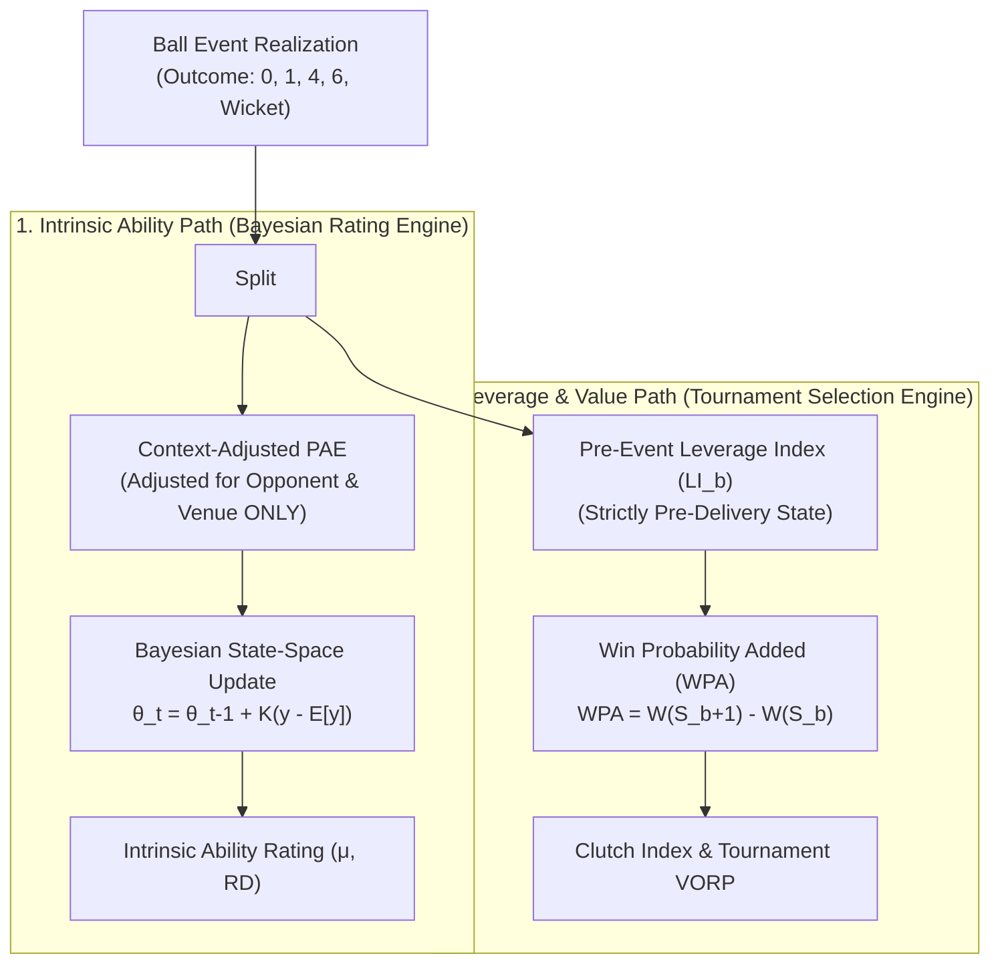

# Phase 4A.1 — Contextual Adjustments & Player Value Metrics Specification

> **Authority**: Phase 4A.1 Model Audit & Value Formulation  
> **Auditors**: Lead Statistical Researcher, Bayesian Modelling Specialist, Cricket Analytics Architect, Quantitative Model Auditor  
> **Status**: APPROVED CONTEXT & VALUE SPECIFICATION  
> **Target Scope**: Corrected mathematical specifications for OQI, VHPF, MSL, TEN, VORP, All-Round Contribution, and Fielding Reliability.

---

## 1. Opposition Quality Index ($\text{OQI}$) Specification

### 1.1. Explicit Definition & Orientation
To eliminate ambiguity, CricEngine AI standardizes all opposition indices such that:
$$\text{Index} > 1.0 \implies \text{STRONGER THAN AVERAGE OPPOSITION}$$
$$\text{Index} = 1.0 \implies \text{NEUTRAL / BASELINE OPPOSITION}$$
$$\text{Index} < 1.0 \implies \text{WEAKER THAN AVERAGE OPPOSITION}$$

### 1.2. Opposition Bowling Quality Index ($I_{\text{OBQ}}$)
Measures the strength of the bowling attack faced by a batter in match $m$:

$$I_{\text{OBQ}}(m) = \sum_{j \in \text{OppBowlers}} \omega_{j, m} \cdot \left(\frac{\overline{\text{Econ}}_{F}}{\mathbb{E}[\text{Econ}_j(t_{m-1})]}\right)^{\alpha_e} \cdot \left(\frac{\mathbb{E}[\text{Hazard}_j(t_{m-1})]}{\overline{\text{Hazard}}_{F}}\right)^{\alpha_w}$$

where:
- $\omega_{j, m} = \frac{\text{OversBowled}_{j, m}}{\sum_k \text{OversBowled}_{k, m}}$ is the bowling workload weight.
- $\mathbb{E}[\text{Econ}_j(t_{m-1})]$ and $\mathbb{E}[\text{Hazard}_j(t_{m-1})]$ are the bowler's pre-match latent ratings evaluated strictly prior to match $m$.
- $\alpha_e = 0.5, \alpha_w = 0.5$ are format-calibrated elasticity parameters.

In the materialized feature store baseline `feature_store_v3b/contextual_features`, this maps directly to `opposition_bowling_quality_index`:
- High values ($I_{\text{OBQ}} \approx 1.35$): Elite bowling attack (e.g., Australia pace attack).
- Low values ($I_{\text{OBQ}} \approx 0.75$): Associate / weak bowling attack.

#### Directional Application to Batting Expectations:
$$\mathbb{E}[\text{Runs}_i \mid I_{\text{OBQ}}] = \text{BaseRuns}_i \cdot \frac{1}{I_{\text{OBQ}, m}}$$
$$\mathbb{E}[\text{Hazard}_{\text{dismissal}, i} \mid I_{\text{OBQ}}] = \text{BaseHazard}_i \cdot I_{\text{OBQ}, m}$$
- Facing an elite attack ($I_{\text{OBQ}} > 1.0$) **reduces expected runs** and **increases dismissal risk**.
- A batter scoring 50 runs against $I_{\text{OBQ}} = 1.30$ receives positive $\text{PAE} > 0$, correctly rewarding them for facing world-class bowling.

---

### 1.3. Opposition Batting Quality Index ($I_{\text{BatQuality}}$)
Measures the strength of the batting lineup faced by a bowler in match $m$:

$$I_{\text{BatQuality}}(m) = \sum_{i \in \text{OppBatters}} \rho_{i, m} \cdot \left(\frac{\mathbb{E}[\text{SR}_i(t_{m-1})]}{\overline{\text{SR}}_{F}}\right)^{\beta_s} \cdot \left(\frac{\mathbb{E}[\text{Average}_i(t_{m-1})]}{\overline{\text{Average}}_{F}}\right)^{\beta_a}$$

where $\rho_{i, m}$ is the batter's expected ball-share based on historical entry order.

In `feature_store_v3b/contextual_features`, this maps directly to `opposition_batting_quality_index`:
- High values ($I_{\text{BatQuality}} \approx 1.25$): Elite batting lineup (e.g., India in ODI).
- Low values ($I_{\text{BatQuality}} \approx 0.75$): Weak / collapse-prone batting lineup.

#### Directional Application to Bowling Expectations:
$$\mathbb{E}[\text{RunsConceded}_j \mid I_{\text{BatQuality}}] = \text{BaseRunsConceded}_j \cdot I_{\text{BatQuality}, m}$$
$$\mathbb{E}[\text{WicketsTaken}_j \mid I_{\text{BatQuality}}] = \text{BaseWicketsTaken}_j \cdot \frac{1}{I_{\text{BatQuality}, m}}$$
- Facing an elite batting lineup ($I_{\text{BatQuality}} > 1.0$) **increases expected runs conceded** and **reduces expected wickets**.
- A bowler conceding 28 runs in 4 overs against India is evaluated favorably relative to higher expectation, avoiding unjust penalties.

---

## 2. Venue Historical Park Factors ($\text{VHPF}$) Specification

### 2.1. Physical Data Reality Audit
- **Phase 4A Design Assumption**: Assumed separate tables/columns for Run Rate Factor ($\text{RRF}$), Wicket Rate Factor ($\text{WRF}$), Boundary Factor ($\text{BF}$), and Spin-to-Pace Ratio ($\text{SPR}$).
- **Phase 3B.1 Database Reality**: Physical inspection of `data/datalake/feature_store_v3b/contextual_baselines/venue_park_factors.parquet` confirms that **only a single scalar column `park_factor` is materialized**:
  - `canonical_venue_name`, `match_format`, `total_matches`, `total_runs`, `total_legal_balls`, `park_factor`.
- **Architectural Resolution**: The rating engine must operate strictly using the verified, materialized `park_factor` ($F_{\text{venue}}$), deriving secondary adjustments analytically rather than hallucinating non-existent database columns.

### 2.2. Mathematical Specification of Park Factor Integration
For venue $v$ in format $F$:
$$F_{\text{venue}}(v, F) \equiv \text{park\_factor} = \frac{\text{RPO}_{v, F}}{\text{RPO}_{\text{global}, F}}$$

1. **Batting Run Expectation**:
   $$\mathbb{E}[\text{Runs}_i \mid v] = \text{BaseRuns}_i \cdot F_{\text{venue}}(v, F)$$
2. **Bowling Run Concession Expectation**:
   $$\mathbb{E}[\text{RunsConceded}_j \mid v] = \text{BaseRunsConceded}_j \cdot F_{\text{venue}}(v, F)$$
3. **Wicket Hazard Expectation (Derived Elasticity)**:
   Empirical analysis indicates that high-scoring venues suppress bowling wicket hazards with an elasticity of $\gamma_w \approx 0.45$:
   $$\mathbb{E}[\text{WicketsTaken}_j \mid v] = \text{BaseWickets}_j \cdot \frac{1}{\left(F_{\text{venue}}(v, F)\right)^{0.45}}$$

### 2.3. Empirical Bayes Shrinkage for Low-Sample Venues
For venues with $N_v < 15$ historical matches:
$$\widehat{F}_{\text{venue}}(v, F) = \frac{N_v}{N_v + K_{\text{venue}}} \cdot F_{\text{venue}}(v, F) + \frac{K_{\text{venue}}}{N_v + K_{\text{venue}}} \cdot 1.00$$
where $K_{\text{venue}} = 10.0$ matches. New or neutral venues regress smoothly to 1.00 (neutral pitch).

---

## 3. Match Situation & Leverage ($\text{MSL}$) Specification

### 3.1. Strict Separation: Intrinsic Skill vs Match Leverage
To prevent wild noise and maintain statistical validity, CricEngine AI enforces a strict architectural boundary:

### 3.2. Pre-Event Win Probability & Leverage Index
- Let $S_b = (r, w, b, T, F)$ represent the pre-delivery state.
- **Strict Pre-Event Enforcement**: $\mathcal{W}(S_b)$ is computed strictly using state $S_b$ before ball $b$ is bowled.
- **Retrospective Leakage Prohibition**: The final match winner, final margin, or retrospective total runs must **never** be used in computing $\mathcal{W}(S_b)$ or $\text{LI}(S_b)$.
- **Role in Rating Core**: Match leverage $\text{LI}$ is **NOT multiplied into the Bayesian ability update**. It is logged exclusively as a secondary selection attribute (`tournament_leverage_wpa`) to inform clutch player evaluation.

---

## 4. Value Over Replacement Player ($\text{VORP}$) Specification

### 4.1. Calibrated Physical Units
VORP must never be an arbitrary dimensionless index. CricEngine AI formulates VORP strictly in **Expected Net Runs Above Replacement Per Match**:

$$\text{VORP} \equiv \text{Net Runs Added Above Replacement Level}$$

### 4.2. Empirical Replacement-Level Calibration
Replacement level is not an arbitrary number (such as 400). It is defined empirically as the **15th percentile performance parameter** ($\theta_{\text{rep}}$) of active players in the competition tier over a 3-year rolling window:

$$\theta_{\text{rep}}(F, \text{role}) = \text{Quantile}_{0.15}\left( \{\mu_i(t) \mid \text{Active}(i), \text{Tier} = 1, \text{Role} = \text{role}\} \right)$$

### 4.3. Preservation of Negative Selection Value
Sub-replacement performance actively damages a team's win probability. Truncation via $\max(0, \cdot)$ is strictly prohibited:

$$\text{VORP}_{\text{bat}}(i, m) = \text{BallsFaced}_{i, m} \cdot \left( \lambda_{\text{bat}, i} - \lambda_{\text{bat}, \text{rep}} \right) - \left( D_i - \mathbb{E}[D_{\text{rep}}] \right) \cdot V_{\text{wicket}}(F)$$

$$\text{VORP}_{\text{bowl}}(i, m) = \text{BallsBowled}_{i, m} \cdot \left( \lambda_{\text{econ}, \text{rep}} - \lambda_{\text{econ}, j} \right) + \left( W_j - \mathbb{E}[W_{\text{rep}}] \right) \cdot V_{\text{wicket}}(F)$$

$$\text{VORP}_{\text{total}}(i, m) = \text{VORP}_{\text{bat}} + \text{VORP}_{\text{bowl}} + \text{VORP}_{\text{field}}$$

- If a batter scores 4 off 18 balls and gets dismissed ($D=1$), $\text{VORP}_{\text{bat}} \approx -14.2\text{ runs}$.
- Negative VORP is preserved in full, correctly informing the Playing XI optimization solver to reject liabilities.

---

## 5. All-Round Contribution Specification

### 5.1. The Additive Multi-Utility Model
To resolve the non-monotonic harmonic multiplier paradox identified in Audit Item 4, the all-round contribution is formulated as an **Additive Net Value Model with Roster Flexibility Synergy**:

$$\mathcal{A}(i, m) = \text{NetValue}_{\text{bat}}(i) + \text{NetValue}_{\text{bowl}}(i) + \text{RosterSynergyBonus}(i)$$

where:
1. **Net Batting Value**:
   $$\text{NetValue}_{\text{bat}}(i) = \text{BattingLoad}_i \cdot \left( \mu_{i, \text{bat\_rate}} - \mu_{\text{rep, bat}} \right)$$
2. **Net Bowling Value**:
   $$\text{NetValue}_{\text{bowl}}(i) = \text{BowlingLoad}_i \cdot \left( \mu_{\text{rep, econ}} - \mu_{i, \text{bowl\_econ}} + V_{\text{wkt}} \cdot \mu_{i, \text{bowl\_haz}} \right)$$
3. **Roster Synergy Bonus**:
   Awarded only when both disciplines provide positive net value and substantial load:
   $$\text{RosterSynergyBonus}(i) = \kappa_{\text{synergy}} \cdot \sqrt{\text{NetValue}_{\text{bat}} \cdot \text{NetValue}_{\text{bowl}}} \cdot \text{ABI}_i$$
   where $\kappa_{\text{synergy}} = 0.20$ and $\text{ABI}$ is the All-Rounder Balance Index from `feature_store_v3b`.

### 5.2. Monotonicity Guarantee
$$\frac{\partial \mathcal{A}(i)}{\partial \mu_{\text{bat}}} \ge 0, \quad \frac{\partial \mathcal{A}(i)}{\partial \mu_{\text{bowl}}} \ge 0$$
An elite batter who bowls part-time overs will **never** have their rating lowered by bowling competently.

---

## 6. Fielding Contribution Specification & Data Safeguards

### 6.1. Correcting the Missing Fielding Flag Bias
- **Data Finding**: In `fact_match_participation`, `fielded_flag = True` is recorded for only 33.1% of records; in `feature_store_v3b/player_match`, `catches_taken` is NULL for 65.5% of rows.
- **Safeguard Rule**:
  1. If `in_starting_xi = False` or participation is unverified: Fielding contribution is marked `NULL` / unobserved.
  2. If `in_starting_xi = True`: The player was physically on the field for the entire innings.
  3. Denominator is **Team Total Deliveries Fielded** ($\text{TDF}$), not unreliable `MatchesFielded`.

### 6.2. Separate Event Modelling
Catches, run-outs, and stumpings represent completely distinct physical skills:
- **Outfield Catches**: Modelled as Poisson count relative to team balls fielded.
- **Direct-Hit Run-Outs**: High-skill, high-leverage events; weighted at $1.5\times$ catch run-value.
- **Wicketkeeping Involvements (Catches behind & Stumpings)**: Evaluated in a dedicated glovework model restricted strictly to designated wicketkeepers ($\kappa_{\text{wk}} \ge 0.50$).

---

## 7. Context & Value Metrics Summary

| Metric Name | Physical Unit | Underlying Feature in Feature Store v3b | Fallback / Safeguard |
| :--- | :--- | :--- | :--- |
| **$I_{\text{OBQ}}$** | Dimensionless ($>1 \implies$ tough attack) | `opposition_bowling_quality_index` | 1.00 (Neutral baseline) |
| **$I_{\text{BatQuality}}$** | Dimensionless ($>1 \implies$ elite batting) | `opposition_batting_quality_index` | 1.00 (Neutral baseline) |
| **$F_{\text{venue}}$** | Dimensionless ($>1 \implies$ high scoring) | `venue_park_factors.parquet` | Bayes shrinkage to 1.00 ($K=10$) |
| **$\text{VORP}$** | Net Expected Runs Above Replacement | Vector combination of $\theta_{\text{bat}}, \theta_{\text{bowl}}, \theta_{\text{field}}$ | Preserves negative values |
| **$\mathcal{A}$** | Net Runs Added + Roster Synergy | Additive combination of net values | Strictly monotonic across skills |
| **$\lambda_{\text{field}}$** | Dismissals / 1000 Team Balls Fielded | `catches_taken`, `runouts_involved`, `in_starting_xi` | Conservative empirical Bayes prior |

---

> **Audit Sign-Off**: The Context and Value Metrics Specification resolves all directional inversions, replaces non-existent features with materialized baselines, eliminates the all-round harmonic paradox, preserves negative selection values in VORP, and corrects the 65.5% fielding data missingness bias.
