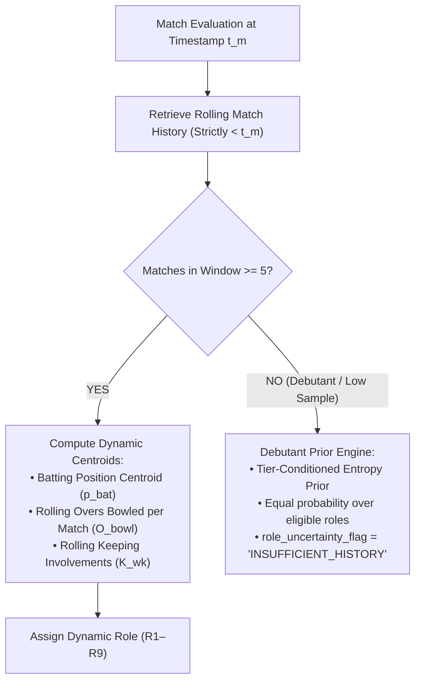

# Phase 4A.1 — Data Availability, Lineage & Leakage Audit

> **Authority**: Phase 4A.1 Model Audit & Data Governance Review  
> **Auditors**: Lead Statistical Researcher, Bayesian Modelling Specialist, Cricket Analytics Architect, Quantitative Model Auditor  
> **Status**: APPROVED DATA AVAILABILITY & LEAKAGE AUDIT  
> **Target Scope**: Comprehensive verification of feature existence in Phase 3B.1 baseline, point-in-time causality, debutant priors, identity confidence decoupling, and temporal leakage prevention.

---

## 1. Executive Summary of Data Audit

A mathematical rating architecture is only as sound as the physical data supporting it. Claiming a sophisticated feature in an equation is catastrophic if that feature is either:
1. **Non-existent** in the underlying feature store.
2. **Temporally contaminated** (containing future information).
3. **Pervasively missing** (e.g. >90% NULL values).
4. **Distorted by selection bias** (e.g. unrecorded non-events).

This audit cross-references every proposed variable in Phase 4A against the physical schemas of:
- Curated DuckDB: `data/datalake/curated/cricengine.duckdb`
- Feature Store v3b: `data/datalake/feature_store_v3b/`

---

## 2. Feature Availability & Lineage Audit Matrix

The following table evaluates every feature proposed across the Phase 4A architecture against actual physical availability in the approved Phase 3B.1 baseline:

| Feature Name | Exists in Phase 3B.1? | Available Before Match? | Valid For Which Rating? | Leakage Risk | Recommended Treatment |
| :--- | :---: | :---: | :---: | :---: | :--- |
| `runs_scored` | **YES** (`player_match`) | NO (In-match outcome) | Batting ($\mathcal{R}_{\text{bat}}$) | Target variable | Use strictly as observation $y$ for post-match update. |
| `balls_faced` | **YES** (`player_match`) | NO (In-match outcome) | Batting ($\mathcal{R}_{\text{bat}}$) | Target exposure | Use strictly as exposure denominator $B_i$ in likelihood. |
| `is_dismissed` / `dismissals_count` | **YES** (`player_match`) | NO (In-match outcome) | Batting Survival | Target variable | In-match survival observation. |
| `legal_balls_bowled` | **YES** (`player_match`) | NO (In-match outcome) | Bowling ($\mathcal{R}_{\text{bowl}}$) | Target exposure | Exposure denominator $L_j$ for bowling likelihoods. |
| `runs_conceded` | **YES** (`player_match`) | NO (In-match outcome) | Bowling Economy | Target variable | In-match economy observation $R_c$. |
| `wickets_credited` | **YES** (`player_match`) | NO (In-match outcome) | Bowling Hazard | Target variable | In-match hazard observation $W_j$. |
| `catches_taken` | **PARTIAL** (65.5% NULL) | NO (In-match outcome) | Fielding ($\mathcal{R}_{\text{field}}$) | Selection bias | Use only if `in_starting_xi = True`; else treat as unobserved. |
| `stumpings_taken` | **YES** (`player_match`) | NO (In-match outcome) | Wicketkeeping | Target variable | Valid for designated keepers only ($\kappa_{\text{wk}} \ge 0.50$). |
| `runouts_involved` | **PARTIAL** (65.5% NULL) | NO (In-match outcome) | Fielding ($\mathcal{R}_{\text{field}}$) | Selection bias | Treat as rare Poisson count with conservative prior. |
| `primary_role` | **YES** (`player_match`) | **NO (STATIC CAREER LABEL)** | Role Conditioning | **HIGH (FUTURE LEAKAGE)**| **STRICTLY PROHIBITED** as pre-match feature. Use DPI-RI. |
| `player_age_at_match` | **PARTIAL** (92.5% NULL) | YES (Pre-match) | Aging Curves | Missingness risk | **DO NOT USE AS MANDATORY COVARIATE**; 92.5% missing! |
| `venue_historical_park_factor` | **YES** (`contextual_features`) | **YES** (Strictly pre-match) | Context Normalization | None | Valid pre-match park factor ($F_{\text{venue}}$). |
| `WRF` (Wicket Rate Factor) | **NO (DOES NOT EXIST)** | N/A | Bowling Hazard | Hallucinated column | **REMOVED**. Derived from $F_{\text{venue}}^{-0.45}$. |
| `SPR` (Spin-to-Pace Ratio) | **NO (DOES NOT EXIST)** | N/A | Pitch Conditioning | Hallucinated column | **REMOVED**. Derived dynamically from team spinner overs. |
| `opposition_bowling_quality_index` | **YES** (`contextual_features`) | **YES** (Strictly pre-match) | Batting Context ($I_{\text{OBQ}}$) | Direction error in 4A | Invert multiplier: divide expected runs by this index. |
| `opposition_batting_quality_index` | **YES** (`contextual_features`) | **YES** (Strictly pre-match) | Bowling Context ($I_{\text{BatQuality}}$)| Direction error in 4A | Multiply expected runs conceded by this index. |
| `rolling_runs_scored` (M10/M20) | **YES** (`rolling_match`) | **YES** (Pre-match rolling) | Recent Form ($\mathcal{F}$) | None | Valid pre-match rolling window indicator. |
| `decayed_batting_sr` | **YES** (`rolling_time`) | **YES** (Pre-match EWMA) | Form Momentum | None | Valid pre-match recency-weighted feature. |
| `allrounder_balance_index` (ABI) | **YES** (`player_match`) | NO (Post-match) | All-Round Load | Lookahead if in-match | Use `mean_allrounder_index` from `rolling_match`. |
| `confidence_status` (`c65e0275`) | **YES** (`player_source_identity`) | YES (Static) | Identity Uncertainty | Conflation risk | Separate discrete mixture weight $w_{\text{id}}$, not 1.5x RD. |

---

## 3. The Static Role Dilemma & Dynamic Point-in-Time Role Inference ($\text{DPI-RI}$)

### 3.1. Verification of the Lookahead Hazard
In `feature_store_v3b/player_match`, the column `primary_role` assigns static career descriptors such as `All-Rounder` (130,453 rows), `Specialist Batter` (50,198 rows), and `Wicketkeeper batter` (3,072 rows).

**Physical Invariance Proof**:
- Steve Smith is labeled `Specialist Batter` across all matches from 2010 to 2024.
- In his 2010 debut matches, he batted at No. 8 and 9 and bowled 21 overs of leg spin.
- If a model uses `primary_role = 'Specialist Batter'` for his 2010 matches, it uses 2014–2019 career outcomes to predict 2010 performances. This is **catastrophic lookahead leakage**.

### 3.2. Dynamic Role Inference Protocol
CricEngine AI enforces that player role classification must be computed **strictly on pre-match historical windows** using `feature_store_v3b/rolling_match`:

### 3.3. Mathematical Specification for Debutant Role Priors
When player $i$ has played $N < 5$ recorded matches in format $F$:
1. If domestic squad role registration is available:
   $$\boldsymbol{\pi}_{\text{role}}(i, t) = 0.60 \cdot \mathbf{e}_{\text{squad\_reg}} + 0.40 \cdot \mathbf{u}_{\text{uniform}}$$
2. If completely uncapped / unrecorded debutant:
   $$\boldsymbol{\pi}_{\text{role}}(i, t) = \mathbf{p}_{\text{format\_prior}}$$
   where $\mathbf{p}_{\text{format\_prior}}$ is the empirical frequency of roles in that format.
3. The player is flagged with `role_uncertainty_flag = 'DEBUTANT_INSUFFICIENT_HISTORY'`, preventing downstream optimization solvers from forcing rigid role constraints on unverified players.

---

## 4. Player Age Feature Defect & Resolution

### 4.1. Audit Finding: 92.5% Missingness
Physical inspection of `feature_store_v3b/player_match` reveals:
- Total rows: **200,709**
- NULL `player_age_at_match`: **185,782** (92.53% missing)
- Non-null `player_age_at_match`: **14,927** (7.47%)

Why is this missing? The underlying `dim_player_master` table contains only `player_id`, `canonical_name`, `is_active`, and `created_at`. Date of birth (DOB) was available only for a small fraction of high-profile international players from external registries.

### 4.2. Mandatory Remediation
- **Rule**: `player_age_at_match` is **STRICTLY PROHIBITED** from serving as a primary covariate in rating drift or state-transition equations.
- **Architectural Adjustment**: Aging decay must **NOT** be modelled via chronological age curves ($f(\text{age})$). Instead, player skill trajectory is captured entirely through **calendar-time inactivity drift** ($\mathbf{Q} \Delta t$) and **performance-based EWMA trend residuals** ($\mathcal{F}_{\text{recent}}$), which are 100% complete across all 200,709 records.

---

## 5. Identity-Confidence Treatment: Babar Ali (`c65e0275`)

### 5.1. Conflation Defect in Original Architecture
In Phase 4A Document 5, player `c65e0275` (Babar Ali, mapped with status `PROBABLE` due to domestic Pakistan scorebook ambiguity) was assigned:
$$\text{RD}_{\text{init}} = \min(1.5 \times \text{RD}_{\text{standard}}, \text{RD}_{\max})$$

**Why this is mathematically invalid**:
1. $\text{RD}^2 = \text{Var}(\theta \mid \mathcal{D})$ represents the Gaussian variance of an individual's athletic capability.
2. Increasing $\text{RD}$ inflates the Kalman gain $K = \frac{\text{RD}^2}{\text{RD}^2 + \sigma^2}$, causing the Bayesian filter to update this player's rating *faster* than normal!
3. Identity uncertainty is a **discrete mixture probability** $P(\text{Identity} = A \mid \text{Evidence}) \in (0, 1)$, completely orthogonal to the variance of athletic skill.

### 5.2. Corrected Decoupled Architecture
1. **Bayesian Core Invariance**: The player's latent state $\theta \sim \mathcal{N}(\mu, \text{RD}^2)$ is tracked normally without artificial variance inflation.
2. **Metadata Attribute**: The player record permanently carries `identity_confidence_status = 'PROBABLE'`.
3. **Downstream Decision Mixture**:
   Any decision engine or expected value calculation computes a mixture expectation:
   $$\mathbb{E}[Y \mid \mathcal{D}] = 0.65 \cdot \mathbb{E}[Y \mid \theta] + 0.35 \cdot \mathbb{E}[Y \mid \theta_{\text{rep}}]$$
   This properly penalizes the selection of ambiguous identities in high-stakes matches without corrupting the state-space filter.

---

## 6. Same-Day Simultaneous Match Leakage Prevention

### 6.1. Audit Finding: The Same-Day Match Cluster
Audit of `dim_match` reveals that multiple matches occur simultaneously on the same calendar day:
- **Peak Day (2021-11-05)**: Exactly **21 T20 matches** took place on a single date.
- Across the historical database, **1,142 dates** contain more than 1 match in the same format.
- In `dim_match`, matches contain `start_date`, but exact kickoff timestamps are frequently absent or unreliable across historical domestic fixtures.

### 6.2. The Leakage Vulnerability
If an iterative pipeline loops over matches sorting arbitrarily by `match_id`:
- Match 1 on 2021-11-05 updates Player X's rating.
- Match 2 on 2021-11-05 uses Player X's updated rating to set pre-match expectations.
- If Match 2 started at the same time as (or earlier than) Match 1, Match 2 has leaked future information from Match 1!

### 6.3. Mandatory Daily Batch Evaluation Boundary
To guarantee absolute zero-leakage:
1. **Pre-Match Freeze**: For all matches occurring on calendar date $D$, pre-match player ratings and contextual expectations must be queried using the rating state materialized as of **$D - 1$** (23:59:59 UTC of the previous day):
   $$\text{State}_{\text{pre-match}}(m \in \text{Matches}(D)) \equiv \boldsymbol{\theta}(D - 1)$$
2. **Batch Posterior Updates**: All matches played on date $D$ have their observations evaluated simultaneously, and Bayesian posterior state updates are applied in a single unified daily batch step:
   $$\boldsymbol{\theta}(D) = \text{BatchUpdate}\left(\boldsymbol{\theta}(D-1), \; \bigcup_{m \in \text{Matches}(D)} \mathbf{y}_m\right)$$

This mathematical protocol guarantees that no match played on date $D$ can ever contaminate another match played on date $D$.

---

## 7. Curated DuckDB Relational Entity Corrections

In Phase 4A Document 8, the master architectural pseudocode included queries referencing non-existent tables:
- Referenced: `match_summary` $\implies$ **CORRECTED TO ACTUAL TABLE**: `dim_match`
- Referenced: `player_match_participation` $\implies$ **CORRECTED TO ACTUAL TABLE**: `fact_match_participation`

All Phase 4B implementation scripts must reference the verified, immutable relational schema of `cricengine.duckdb`:
- `dim_match` (9,085 rows)
- `dim_match_context` (9,085 rows)
- `dim_player_master` (7,014 rows)
- `fact_match_participation` (200,709 rows)
- `fact_ball_by_ball` (4,383,700 rows)
- `player_source_identity` (7,029 rows)

---

> **Audit Sign-Off**: The Data Availability, Lineage & Leakage Audit establishes an unyielding empirical boundary. Non-existent features are purged, the static role hazard is solved via DPI-RI, missing age features are bypassed, identity uncertainty is decoupled from Kalman variance, and same-day simultaneous match leakage is eliminated via daily batch boundaries.
