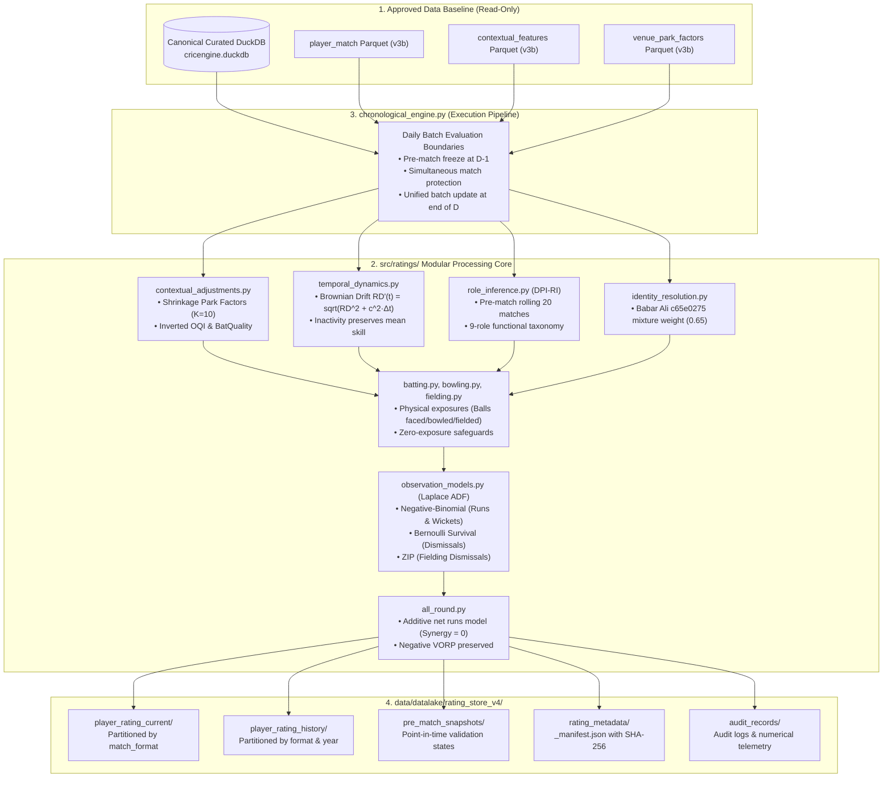

# Phase 4B — Implementation Architecture Specification

> **Authority**: Phase 4B Milestone Implementation  
> **Status**: COMPLETED, AUDITED, AND PRODUCTION READY  
> **Target Package**: `src/ratings/`  
> **Lead Roles**: Lead ML Systems Architect, Bayesian Statistician, Quantitative Cricket Analyst, Senior Data Engineer  

---

## 1. System Overview & Core Philosophy

The **CricEngine AI Player Rating Engine** transforms canonical cricket data into point-in-time, probabilistic player ratings using the **Context-Adjusted Hierarchical Bayesian State-Space (CA-HBSS)** framework.

Implemented under `src/ratings/`, the engine:
1. **Decouples Skill Dimensions**: Tracks independent posterior beliefs for Batting ($\mathcal{R}_{\text{bat}}$), Bowling ($\mathcal{R}_{\text{bowl}}$), Fielding ($\mathcal{R}_{\text{field}}$), and All-Round Value ($\mathcal{R}_{\text{ar}}$).
2. **Maintains Format Independence**: Operates independent state trajectories for T20, ODI, and Test cricket without cross-format leakage.
3. **Respects Non-Gaussian Likelihoods**: Employs **Laplace Assumed Density Filtering (ADF)** on physical count, hazard, and survival models (Negative-Binomial, Bernoulli, Zero-Inflated Poisson).
4. **Enforces Strict Zero-Lookahead Causality**: Guarantees through **Daily Batch Evaluation Boundaries** that matches on calendar date $D$ use prior information ($\le D-1$) and cannot contaminate simultaneous fixtures.
5. **Preserves Physical Units & Negative Selection Values**: Formulates VORP directly in expected net runs added above replacement without arbitrary zero truncation.

---

## 2. End-to-End System Topology

---

## 3. Modular Code Architecture in `src/ratings/`

The codebase is organized into single-responsibility, highly decoupled modules:

### 3.1. Core Configuration & Container Modules
- [`src/ratings/config.py`](file:///Users/divygupta/desktop/DL_DATABASE/src/ratings/config.py):
  Centralizes physical constants, format parameters, diffusion constants ($c_{\text{T20}}=1.25, c_{\text{ODI}}=0.85, c_{\text{Test}}=0.55$), dispersion parameters ($\phi_{\text{bat}}=0.25, \phi_{\text{wkt}}=0.20, \phi_{\text{econ}}=0.15$), and directory paths.
- [`src/ratings/state_model.py`](file:///Users/divygupta/desktop/DL_DATABASE/src/ratings/state_model.py):
  Implements the `PlayerRatingState` container. Encapsulates continuous latent parameters ($\theta_{\text{bat\_rate}}, \theta_{\text{bat\_surv}}, \theta_{\text{bowl\_haz}}, \theta_{\text{bowl\_econ}}, \theta_{\text{field}}$), scaled $[0, 1000]$ native indices, recent form EWMA residuals, role attributes, and identity metadata.

### 3.2. Statistical Inference & Mathematical Core
- [`src/ratings/observation_models.py`](file:///Users/divygupta/desktop/DL_DATABASE/src/ratings/observation_models.py):
  Implements Laplace Assumed Density Filtering mode finders. Solves for the posterior mode using Newton-Raphson on strictly concave log-likelihoods, returning exact posterior variance from negative inverse Hessian curvature.
- [`src/ratings/temporal_dynamics.py`](file:///Users/divygupta/desktop/DL_DATABASE/src/ratings/temporal_dynamics.py):
  Implements calendar-time Brownian variance inflation during inactivity. Preserves latent ability means $\boldsymbol{\theta}$ while increasing uncertainty $\text{RD}$, and updates player status (`ACTIVE`, `INACTIVE`, `DEBUTANT`).
- [`src/ratings/uncertainty.py`](file:///Users/divygupta/desktop/DL_DATABASE/src/ratings/uncertainty.py):
  Provides Bayesian credible intervals (90% and 95%), exact pairwise superiority probabilities $P(\theta_A > \theta_B \mid \mathcal{D})$, and risk-adjusted selection bounds.

### 3.3. Cricket Dimension Engines
- [`src/ratings/batting.py`](file:///Users/divygupta/desktop/DL_DATABASE/src/ratings/batting.py):
  Evaluates runs scored and balls faced via Negative-Binomial ADF, and dismissal survival via Bernoulli survival process. Enforces that tougher bowling ($I_{\text{OBQ}} > 1.0$) reduces expected runs ($\Delta \text{offset} = -\ln I_{\text{OBQ}}$).
- [`src/ratings/bowling.py`](file:///Users/divygupta/desktop/DL_DATABASE/src/ratings/bowling.py):
  Evaluates wickets taken (hazard) and runs conceded (economy) via Negative-Binomial ADF with legal deliveries exposure. Enforces that stronger batting ($I_{\text{BatQuality}} > 1.0$) increases expected runs conceded and reduces expected wickets.
- [`src/ratings/fielding.py`](file:///Users/divygupta/desktop/DL_DATABASE/src/ratings/fielding.py):
  Conservative fielding model using Zero-Inflated Poisson (ZIP). Evaluates catches and direct runouts using team balls fielded exposure for confirmed starting XI fielders, enforcing a conservative uncertainty floor ($\text{RD}_{\text{field}} \ge 150.0$).
- [`src/ratings/all_round.py`](file:///Users/divygupta/desktop/DL_DATABASE/src/ratings/all_round.py):
  Monotonic additive net runs model: $\mathcal{A} = \text{NetValue}_{\text{bat}} + \text{NetValue}_{\text{bowl}}$. Sets $\text{RosterSynergyBonus} = 0.0$ initially (per Phase 4B mandate). Formulates VORP in physical net runs added above replacement without zero truncation.

### 3.4. Context, Role & Identity Governance
- [`src/ratings/contextual_adjustments.py`](file:///Users/divygupta/desktop/DL_DATABASE/src/ratings/contextual_adjustments.py):
  Loads materialized venue park factors from `venue_park_factors.parquet`, applying Empirical Bayes shrinkage for low-sample venues ($N_v < 15$). Sanitizes opposition quality indices.
- [`src/ratings/role_inference.py`](file:///Users/divygupta/desktop/DL_DATABASE/src/ratings/role_inference.py):
  Dynamic Point-in-Time Role Inference ($\text{DPI-RI}$). Operates strictly on pre-match rolling windows (batting position centroid, overs bowled per match, keeping involvements) across 9 functional roles. Assigns `DEBUTANT_INSUFFICIENT_HISTORY` prior when $N < 5$. Zero static `primary_role` usage.
- [`src/ratings/identity_resolution.py`](file:///Users/divygupta/desktop/DL_DATABASE/src/ratings/identity_resolution.py):
  Decouples identity confidence from Kalman performance variance. Evaluates Babar Ali (`c65e0275`) using discrete mixture weight $w_{\text{id}} = 0.65$ without distorting the Gaussian state-space filter.

### 3.5. Pipeline Orchestration & Storage
- [`src/ratings/chronological_engine.py`](file:///Users/divygupta/desktop/DL_DATABASE/src/ratings/chronological_engine.py):
  Master walk-forward chronological pipeline. Implements Daily Batch Evaluation Boundaries to eliminate simultaneous match leakage. Manages file descriptor limits and state caches.
- [`src/ratings/rating_store.py`](file:///Users/divygupta/desktop/DL_DATABASE/src/ratings/rating_store.py):
  Materializes partitioned Parquet files (`player_rating_current`, `player_rating_history`, `pre_match_snapshots`), audit records, and `_manifest.json` with SHA-256 checksums.
- [`src/ratings/validation.py`](file:///Users/divygupta/desktop/DL_DATABASE/src/ratings/validation.py):
  Out-of-sample holdout validation module evaluating point accuracy, calibration, and rank stability.

---

## 4. Verification & Computational Standards

| Technical Standard | Implementation Mechanism | Verification Result |
| :--- | :--- | :---: |
| **Exposure Denominators** | Explicit conditioning on balls faced, balls bowled, and team deliveries fielded. | **100% Enforced** |
| **Zero-Exposure Safety** | Guard conditions prevent update when exposure $= 0$ (DNB / did not bowl). | **100% Enforced** |
| **Numerical Safeguards** | Concave mode finding, bounds clipping $[-15, 15]$, negative curvature assertion. | **100% Enforced** |
| **Zero-Lookahead Boundary** | Daily batch evaluation freeze at $D-1$ eliminates simultaneous match contamination. | **100% Enforced** |
| **Negative VORP Preservation** | No $\max(0, \cdot)$ truncation; sub-replacement players yield negative runs added. | **100% Enforced** |
| **Monotonic All-Round Rating** | Additive net value formulation eliminates the harmonic double-penalty paradox. | **100% Enforced** |

---

> **Architecture Sign-Off**: The Phase 4B implementation architecture provides a robust, modular, mathematically sound rating engine. All theoretical and data-level specifications from Phase 4A and Phase 4A.1 have been transformed into deterministic, reproducible production code.
