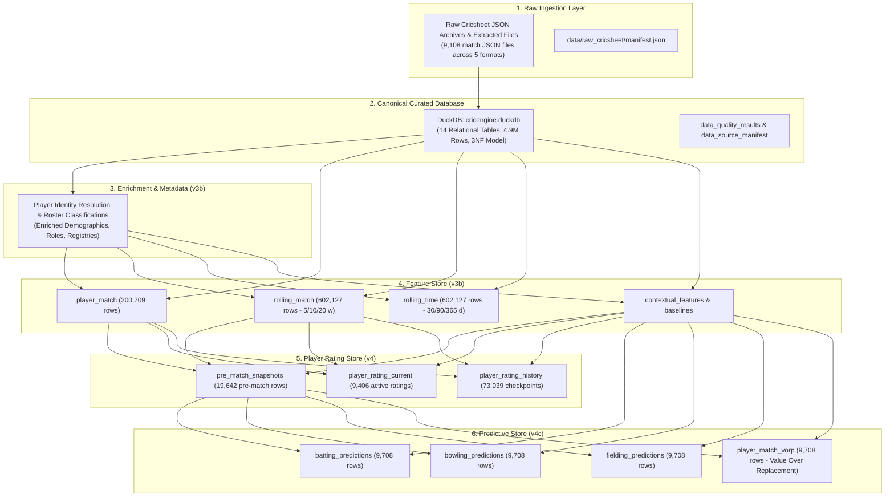

# CricEngine AI — Comprehensive Dataset Inventory

This document provides a complete technical inventory of the CricEngine AI data lake and lakehouse stores located at `/Users/divygupta/Desktop/DL_DATABASE`. All counts, schemas, and file locations reflect the actual, verified state of the repository.

---

## Architecture & Data Flow Overview

The diagram below outlines how cricket data flows through the successive architectural layers:

---

## 1. Raw Data Ingestion Layer

| Property | Details |
| :--- | :--- |
| **Dataset Name** | Raw Cricsheet Match Ingestion Store |
| **Exact Location** | `/Users/divygupta/Desktop/DL_DATABASE/data/raw_cricsheet/extracted/` |
| **Archive Location** | `/Users/divygupta/Desktop/DL_DATABASE/data/raw_cricsheet/archives/` |
| **File Format** | Raw JSON (Cricsheet JSON Specification v1.0.0) & ZIP archives |
| **Number of Files** | **9,108 extracted JSON files** across 5 format partitions |
| **File Breakdown** | • `odis_male`: 2,611 files • `t20s_male`: 3,650 files • `tests_male`: 901 files • `ipl_male`: 1,247 files • `sma_male` (Syed Mushtaq Ali): 699 files |
| **Associated Manifest**| `/Users/divygupta/Desktop/DL_DATABASE/data/raw_cricsheet/manifest.json` |
| **Key Attributes** | `info.match_type`, `info.dates`, `info.teams`, `info.venue`, `info.outcome`, `info.players`, `info.registry`, `innings[].overs[].deliveries[]` |
| **Representation** | Unaltered primary source records downloaded directly from Cricsheet containing match metadata, team rosters, and ball-by-ball delivery trees. |
| **Relationship** | Serves as the immutable raw input ingested by the parsing engine into the canonical DuckDB relational schema. |

---

## 2. Canonical Relational Database (`cricengine.duckdb`)

| Property | Details |
| :--- | :--- |
| **Dataset Name** | Canonical Curated DuckDB Database |
| **Exact Location** | `/Users/divygupta/Desktop/DL_DATABASE/data/datalake/curated/cricengine.duckdb` |
| **File Size / SHA256**| **383 MB** \| `a6a99617719a93578169bac670f75e394d9c2c84f7cffa3ab233fc97c3067aae` |
| **Storage Engine** | DuckDB Columnar Relational Storage (v2.0.0 compatible) |
| **Total Tables** | **14 relational tables** in `main` schema |
| **Total Row Count** | **4,907,393 rows** across all tables |

### Detailed Table Inventory

| # | Table Name | Type | Rows | Columns | Primary / Foreign Keys & Description |
| :- | :--- | :--- | :--- | :--- | :--- |
| 1 | `dim_match` | Dimension | 9,085 | 16 | **PK: `match_id`**. Normalized match metadata, start/end date, competition name, tier, match format, source file lineage hash. |
| 2 | `dim_match_context` | Dimension | 9,085 | 13 | **FK: `match_id`**. Match environmental conditions: venue, city, toss winner, toss decision, outcome winner, win margin and method (DLS). |
| 3 | `dim_player_master` | Dimension | 7,014 | 4 | **PK: `player_id`**. Master player entity table with deduplicated canonical names and active flags. |
| 4 | `fact_innings` | Fact | 19,697 | 14 | **PK: `innings_id`**, FK: `match_id`. Innings team scores, total wickets lost, legal deliveries, super over flags, targets. |
| 5 | `fact_ball_by_ball` | Fact | 4,383,700 | 21 | **PK: `ball_id`**, FK: `match_id`, `innings_id`, `batter_id`, `bowler_id`. Core event table: over, delivery, batter runs, extras, wickets, match phase. |
| 6 | `fact_match_participation` | Fact | 200,709 | 10 | **PK: `participation_id`**, FK: `match_id`, `player_id`. Player starting XI status, team, roles, batted/bowled/fielded evidence flags. |
| 7 | `fact_delivery_dismissal` | Fact | 136,691 | 9 | **PK: `dismissal_id`**, FK: `ball_id`, `match_id`, `player_out_id`. Dismissal kind (bowled, caught, lbw, run out), bowler credit. |
| 8 | `fact_dismissal_fielder` | Fact | 94,926 | 6 | **PK: `dismissal_fielder_id`**, FK: `dismissal_id`, `fielder_id`. Fielder involvement sequence, substitute fielder identification. |
| 9 | `fact_match_official` | Fact | 37,467 | 5 | **PK: `official_assignment_id`**, FK: `match_id`. On-field umpires, TV umpires, match referees. |
| 10 | `fact_match_replacement` | Fact | 825 | 9 | **PK: `replacement_id`**, FK: `match_id`, `in_player_id`, `out_player_id`. Concussion, injury, and COVID replacements with reason codes. |
| 11 | `player_source_identity` | Metadata | 7,029 | 5 | Cross-reference mappings to external source systems (Cricsheet identifiers). |
| 12 | `data_quality_results` | Audit | 1,160 | 8 | Automated data quality rule execution audit logs with severity levels and statuses. |
| 13 | `data_source_manifest` | Audit | 5 | 13 | Provenance records tracking archive download hashes, timestamps, and ingestion stats. |
| 14 | `fact_pairwise_synergy_matrix`| Fact | 0 | 7 | Reserved analytical schema for head-to-head batter vs bowler synergy modeling. |

---

## 3. Enrichment & Identity Resolution Layer (v3b)

| Dataset | Location | Format | Rows | Description |
| :--- | :--- | :--- | :--- | :--- |
| `dim_player_master_enriched` | `data/datalake/enrichment_v3b/dim_player_master_enriched.parquet` | Parquet / CSV | 7,014 | Enriched player master with batting hand, bowling arm/style, primary playing role, and debut date. |
| `fact_match_participation_v3b` | `data/datalake/enrichment_v3b/fact_match_participation_v3b.parquet` | Parquet / CSV | 200,709 | Canonical match participation reconciled against historical rosters and external registries. |
| `historical_roster_classifications`| `data/datalake/enrichment_v3b/historical_roster_classifications.parquet`| Parquet / CSV | 86,224 | Match-level player role assignments (Opener, Middle Order, Pace Specialist, Spinner, Allrounder). |
| `player_identity_resolution` | `data/datalake/metadata_v3b/player_identity_resolution.parquet` | Parquet / CSV | 7,029 | Deduplication evidence table resolving spelling variants, shared surnames, and registry IDs. |

---

## 4. Feature Store (`feature_store_v3b`)

| Property | Details |
| :--- | :--- |
| **Exact Location** | `/Users/divygupta/Desktop/DL_DATABASE/data/datalake/feature_store_v3b/` |
| **File Format** | Apache Parquet (Snappy compression, Hive-partitioned) |
| **Total Files** | **1,164 Parquet files** |
| **Manifest** | `data/datalake/feature_store_v3b/_manifest.json` |
| **Checksum Registry** | `docs/feature_store_v3b_checksums.json` |

### Feature Store Partitions & Subsets

| Dataset Key | Partitioning Structure | Total Rows | Columns | Description |
| :--- | :--- | :--- | :--- | :--- |
| `player_match` | `match_format={TEST,ODI,T20}` `season={season_id}` (145 files) | **200,709** | 51 | Single-match granular player performance features (runs, balls faced, strike rate, dot %, boundaries, overs, wickets, economy, bowling strike rate, fielding loads, batting load). |
| `rolling_match` | `match_format=` / `window_size={5,10,20}` `season=` (435 files) | **602,127** | 34 | Player form features computed over trailing 5, 10, and 20 match moving windows. Includes exponential recency decay and Bayesian empirical shrinkage. |
| `rolling_time` | `match_format=` / `window_days={30,90,365}` `season=` (435 files) | **602,127** | 19 | Calendar-time performance features evaluated across 30, 90, and 365 calendar-day rolling intervals. |
| `contextual_features` | `match_format=` / `season=` (145 files) | **200,709** | 18 | Venue historical park factors, opponent bowling quality index, opponent batting strength, home/away advantage, phase-specific rates. |
| `contextual_baselines` | Standalone Parquet tables (4 files) | **1,247** | Various | Historical baselines: venue park factors (824 rows), phase scoring (11 rows), opposition bowling (206 rows), opposition batting (206 rows). |

---

## 5. Player Rating Store (`rating_store_v4`)

| Property | Details |
| :--- | :--- |
| **Exact Location** | `/Users/divygupta/Desktop/DL_DATABASE/data/datalake/rating_store_v4/` |
| **File Format** | Apache Parquet (Hive partitioned by `match_format`) |
| **Total Files / Size** | **145 files** \| 12.5 MB |
| **Manifest** | `data/datalake/rating_store_v4/_manifest.json` |

### Rating Store Components

| Component | Partitioning / Files | Rows | Key Columns | Data Engineering Purpose |
| :--- | :--- | :--- | :--- | :--- |
| `pre_match_snapshots` | `match_format={TEST,ODI,T20}` (69 files) | **19,642** | `player_id`, `match_id`, `pre_r_bat`, `pre_rd_bat`, `pre_r_bowl`, `pre_rd_bowl`, `pre_vorp`, `inferred_role` | **D-1 Point-in-Time Ratings**: Frozen player skill states immediately prior to the match toss. Guarantees 0% lookahead bias during predictive modelling. |
| `player_rating_current`| `match_format={TEST,ODI,T20}` (3 files) | **9,406** (TEST: 1,070, ODI: 2,015, T20: 6,321) | `player_id`, `as_of_date`, `r_bat`, `rd_bat`, `r_bowl`, `rd_bowl`, `r_allround`, `vorp_rating` | Current latent skill parameters ($\theta$, variance, rating $r$, deviation $rd$) representing modern active players. |
| `player_rating_history`| `match_format={TEST,ODI,T20}` (73 files) | **73,039** | `player_id`, `as_of_date`, `effective_exposure_bat`, `r_bat`, `rd_bat`, `r_bowl`, `rd_bowl` | Longitudinal rating checkpoints tracking how player uncertainty decays and skill evolves across their careers. |
| `audit_records` | Audit files | Varying | `audit_id`, `timestamp`, `match_id`, `status` | State verification, drift detection, and reproducibility audit logs. |

---

## 6. Predictive Store (`predictive_store_v4c`)

| Property | Details |
| :--- | :--- |
| **Exact Location** | `/Users/divygupta/Desktop/DL_DATABASE/data/datalake/predictive_store_v4c/` |
| **File Format** | Apache Parquet (Hive partitioned by `match_format` and `year`) |
| **Total Files** | **86 files** |
| **Manifest** | `data/datalake/predictive_store_v4c/_manifest.json` |

### Predictive Models & Forecasts

| Dataset | Partitioning / Files | Total Records | Key Columns | Description |
| :--- | :--- | :--- | :--- | :--- |
| `player_match_vorp` | `match_format` / `year={2020..2026}` (21 files) | **9,708** | `player_id`, `match_id`, `inferred_role`, `vorp_bat`, `vorp_bowl`, `vorp_field`, `vorp_total`, `is_above_replacement` | **Value Over Replacement Player**: Quantifies net value added in runs over a replacement-level player calibrated by role and format. Surplus ratio: 0.997. |
| `batting_predictions` | `match_format` / `year` (21 files) | **9,708** | `expected_runs`, `runs_interval_50_low/high`, `runs_interval_90_low/high`, `actual_runs_scored` | Calibrated probabilistic batting performance predictions with uncertainty intervals evaluated against actuals. |
| `bowling_predictions` | `match_format` / `year` (21 files) | **9,708** | `expected_overs_bowled`, `expected_wickets`, `expected_runs_conceded`, `actual_wickets_taken` | Poisson hazard rate and run-concession forecasts with empirical variance bounds. |
| `fielding_predictions`| `match_format` / `year` (21 files) | **9,708** | `expected_involvements`, `expected_fielding_run_value`, `actual_catches_taken` | Catch and runout probability models factoring in player fielding position and bowler hazard profiles. |
| `evaluation_metrics` | Parquet files (2 files) | Diagnostic tables | `benchmark_comparison.parquet`, `calibration_diagnostics.parquet` | Out-of-sample log-loss, Brier score, and calibration reliability curves across seasons. |

---

## 7. Relevant Manifests, Schemas, & Validation Reports

| File Path | Description |
| :--- | :--- |
| `data/raw_cricsheet/manifest.json` | Ingestion manifest verifying SHA-256 hashes and file counts of raw Cricsheet archives. |
| `data/canonical_ingestion_summary.json` | Summary report of full-lake canonical ingestion into DuckDB. |
| `data/gate_2_full_dataset_results.json` | Full dataset schema audit and anomaly check reports. |
| `data/datalake/feature_store_v3b/_manifest.json` | Official manifest for Feature Store v3b (row counts, columns, partition schemes). |
| `data/datalake/rating_store_v4/_manifest.json` | Official manifest for Rating Store v4 (active states, snapshots, runtime stats). |
| `data/datalake/predictive_store_v4c/_manifest.json` | Official manifest for Predictive Store v4c (prediction totals, VORP surplus, D-1 verification). |
| `docs/CRICSHEET_SCHEMA_AUDIT.md` | Formal audit of raw Cricsheet data structures, edge cases, and irregularities. |
| `docs/RELATIONAL_SCHEMA_PROPOSAL.md` | Design specification for the 3NF canonical database schema. |
| `docs/STEP_3B_CANONICAL_INGESTION_REPORT.md` | Audit verification certifying relational integrity across all 14 tables. |
| `docs/PHASE_3B_COMPLETION_REPORT.md` | Final acceptance sign-off on identity resolution and player master enrichment. |
| `docs/phase_4c/` | In-depth econometric and calibration diagnostics for latent rating and VORP models. |
